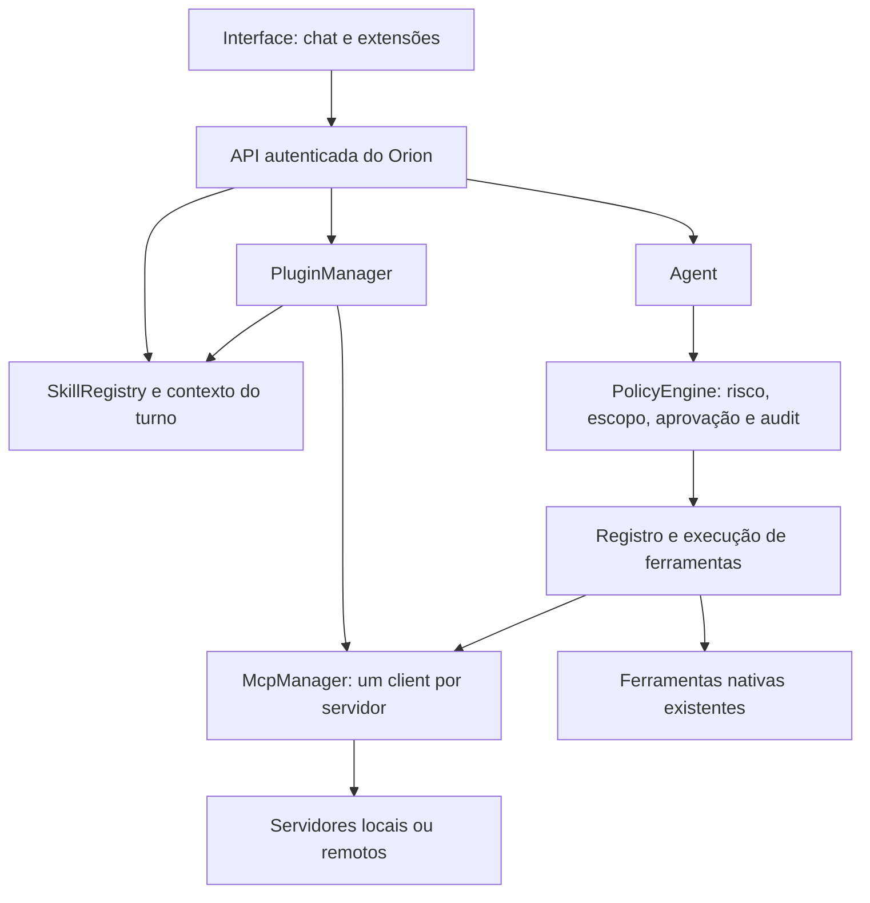

# ORION — Legado: documentação consolidada

> Reúne, sem reescrever, os 24 documentos antigos de `Memorias Do Projeto/` e o README anterior, como estavam antes da consolidação de 14/10/2026. É a referência do que o **Python** faz hoje: operação, variáveis, ferramentas, rodadas e decisões antigas.
>
> Estado atual: [ORION.md](ORION.md). Regras: [REGRAS.md](REGRAS.md). Arquitetura: [ARQUITETURA.md](ARQUITETURA.md). Como rodar: [README.md](../README.md).
>
> Este arquivo não é atualizado por rotina. Os números de seção originais foram mantidos onde código ou testes os citam (ex.: §16 da operação, lida por `tests/test_operacao_doc.py`). Os títulos internos foram rebaixados um nível para caber num arquivo só.

## Mapa: regra antiga → princípio

As regras antigas eram numeradas. Em REGRAS.md os princípios não têm número; o nome curto abaixo é o que os comentários do código passam a citar.

| N | Princípio (nome curto) |
|---|---|
| 1 | classe de risco fixa por ferramenta |
| 2 | confirmação fora de banda (canal autenticado) |
| 3 | código, persona e política imutáveis para as ferramentas |
| 4 | conteúdo externo é dado, não instrução |
| 5 | segredos nunca em log, audit ou processo filho |
| 6 | shell só roda sem confirmação o que é leitura provada |
| 7 | URL do modelo só para host público |
| 8 | falha de auditoria nega a ação |
| 9 | bind só em 127.0.0.1 |
| 10 | WebSocket confere Origin |
| 11 | upload com limite de tamanho e nome sanitizado |
| 12 | chat só renderiza imagem gerada pelo Orion |
| 13 | toda rota da API exige login |
| 14 | SQL parametrizado e exceções específicas |
| 15 | CI verde em Linux, Windows e macOS para mergear |
| 16 | persona sem fato que envelhece |
| 17 | acesso de fora só com login |
| 18 | agendamento avisa; não executa ferramenta sozinho |
| 19 | fato consolidado só vem de fala do Antônio |
| 20 | pendência velha não vira rajada de aviso |
| 21 | Telegram com default-deny e aprovação só por botão |
| 22 | ler segredo ou chave pede confirmação |
| 23 | só se aprova o que se vê inteiro |
| 24 | MCP: a classe de risco é do mcp.json, não do servidor |
| 25 | login com senha e sessão revogável |
| 26 | o que o modelo escreve nunca vira comando para o computador |
| 27 | voz e foto não ganham poder novo |
| 28 | tela e imagem só saem do computador com aval |
| 29 | título de janela nunca vira comando |
| 30 | captura rápida e briefing não passam pelo modelo |
| 31 | painel só lê e nunca mostra segredo |
| 32 | destino de rede escolhido pelo modelo confirma após conteúdo externo |
| 33 | imagem gerada com nome do código, tipo conferido e só com login |
| 34 | /mcp do legado não atende página de navegador |
| 35 | voz por clique é canal do agente; aprovar nunca é por voz |
| 36 | voz ao vivo só conversa, sem ferramentas nem memória |
| 37 | agenda do briefing é leitura fixa, sem modelo |
| 38 | palavra de ativação só abre o microfone; detecção local |
| 39 | pesquisa noturna só lê, sem aprovação |
| 40 | skill é texto, não código |
| 41 | n8n: o destino é seu, não do modelo |
| 42 | ciclo de sono revisa, não decide |
| 43 | transcrever mídia é comando seu |
| 44 | memória da tela: só texto, local e com opt-in |
| 45 | plugin é pacote sem poder próprio |
| 46 | custo zero (sem API paga) |
| 47 | toda saída de dado fica registrada, sem conteúdo |
| 48 | pânico é corte; não perturbe só segura |
| 49 | modelo local é reserva sem ferramentas |
| 50 | ponte de desktop só abre e cola o que você aprovou |
| 51 | palmas só abrem; nunca aprovam nem executam |
| 52 | o que é de um projeto fica no projeto |
| 53 | resumo da conversa nunca substitui o registro |
| 54 | o Orion não decide sozinho qual fato vale |
| 55 | recurso e prompt de MCP são dado, não comando |
| 56 | o Orion como servidor MCP só lê |
| 57 | catálogo de plugins: baixar não instala, nada atualiza sozinho |
| 58 | automação sua vale pelo arquivo concedido |
| 59 | tarefa em segundo plano só lê e propõe |
| 60 | históricos locais: opt-in, só texto, só neste computador |
| 61–71 | planejadas (E10–E13 do plano da rodada 2); ainda sem código. Se aparecerem no código, avise em vez de trocar. |

## Índice

| Documento antigo | O que é | Linhas |
|---|---|---|
| `README.md` | README anterior (raiz): Como rodar a base, arquitetura antiga (Qdrant, SurrealDB, cascata), segurança e layout. | 336 |
| `ORION_NUCLEO.md` | Plano antigo: Ring 0 de 01/10, inventário do legado, fases 0–7 e o registro de decisões desde 25/06/2026. | 270 |
| `ORION_REGRAS.md` | Regras antigas (numeradas): Tabela com 60 regras, onde o código as impõe e o teste que as prova. Fonte do mapa de princípios. | 100 |
| `ORION_OPERACAO.md` | Operação do Python: Como ligar: login, Tailscale, variáveis, MCP, Telegram, checklists e a tabela de opt-ins (§16, lida por testes). | 1117 |
| `ORION_TECNICO.md` | Referência técnica do legado: Stack, regras críticas, backend, memória/RAG, agentes, voz, front, avaliações e versão 2.0. | 527 |
| `ORION_FRONT.md` | Front-end (design e engenharia): Diagnóstico, direção, sistema de design e entregas do front 'Observatório noturno'. | 290 |
| `ORION_FERRAMENTAS.md` | Triagem das 55 ferramentas do legado: Tabela de situação por ferramenta (portada, substituída, a portar, descartar); lida por teste. | 96 |
| `ORION_CORTE.md` | Plano de corte (venda do PC): Bloco A (dados), bloco B (Orion mínimo), corte, rollback e decisões pendentes. | 84 |
| `ORION_MELHORIAS.md` | Rodadas de auditoria e melhorias: Achados, rodadas 1 a 15, o que foi construído, decisões tomadas por você e o que não foi verificado. | 471 |
| `ORION_PLANO_RODADA2.md` | Plano de execução E0–E13: Checklists por etapa, com provas e pendências suas. Substituído pelo backlog em ORION.md. | 837 |
| `ORION_PLANO_PROXIMOS.md` | Plano de próximos passos (08/10): Blocos A a F e a sequência sugerida daquela data. | 96 |
| `ORION_MIGRACAO_RUST.md` | Plano de migração para Rust (primeira versão): Princípios, plataforma, arquitetura, fases, métricas e riscos. Substituído pelo ORION.md e pelo ARQUITETURA.md. | 176 |
| `ORION_EXTENSOES.md` | Referências de produto e plano de extensões: Referências pesquisadas, plugins, skills e MCP, etapas e critérios de aceite. | 1880 |
| `ORION_CAPACIDADES.md` | Contrato de recursos do backend: Sessões, histórico, exportação, busca e adaptação do front aos dois backends. | 194 |
| `ORION_MCP.md` | MCP no Orion (ciclos C07–C14 e E7): Base verificada, ciclo de vida, HTTP, classificação, falhas, descoberta, resources e prompts. | 147 |
| `ORION_MCP_EXPORT.md` | Orion como servidor MCP de leitura: Compatibilidade e uso do servidor MCP do próprio Orion. | 50 |
| `ORION_PLUGINS.md` | Plugins (ciclos C19–C50): Manifesto, pasta local, distribuição ZIP, estado operacional e catálogo. | 115 |
| `ORION_SKILLS.md` | Agent Skills (C15–C18): Formato, contexto progressivo, chat e paleta, confiança e scripts. | 76 |
| `ORION_AGENDA.md` | Agenda e conector Google Calendar: Configuração, limites, evidências e propostas de criação. | 62 |
| `ORION_CONTAS.md` | Contas e conexões MCP: Quais contas estão conectadas e como. | 25 |
| `ORION_DOCUMENTOS.md` | Documentos e fontes: Índice curto de documentos e fontes. | 16 |
| `ORION_RESULTADOS.md` | Resultados persistentes: Pedidos editados, caminhos e prévia HTML. | 60 |
| `ORION_PESQUISA.md` | Orion Pesquisa (C28–C30): Pacote de pesquisa e validação local. | 88 |
| `ORION_PROJETOS.md` | Projetos e escopo de dados: Como os dados se separam por projeto. | 37 |
| `ORION_VALIDACAO_AMBIENTES.md` | Validação por ambiente (C46): Bateria do front e fechamento da rodada. | 36 |

---

## Documento: `README.md`

> Origem: `README.md` (HEAD antes da consolidação de 14/10/2026).

### Orion

Assistente pessoal com identidade masculina: técnico, direto, não-servil. Não é
um chatbot. É uma extensão do dia a dia do Antônio: lembra do que importa, age no
computador dele e responde de qualquer lugar.

*"Não é uma IA. É uma extensão do sistema nervoso."*

> **Licença:** proprietário, todos os direitos reservados — ver [LICENSE](LICENSE).
> Público como portfólio, não como software livre.

#### Status

O Orion está sendo construído sobre uma **base que já funciona**: o código deste
repositório (backend FastAPI, memória híbrida, 55 ferramentas, voz e bot do
Telegram) roda hoje num PC Windows com GPU dedicada (Ryzen 7 3700X · RTX 2060
Super 8GB · 64GB RAM). A arquitetura nova é mais leve, multiplataforma e de custo
zero. Ela entra no lugar da base fase a fase, e cada fase apaga o que substituiu.

**Próximo passo:** fase 0 — exportar os dados pessoais da base antes de o PC ser
vendido e provar o export com `uv run orion verify-export` (plano completo, com os critérios para a
venda: [ORION_CORTE.md](Memorias%20Do%20Projeto/ORION_CORTE.md)).

**Reescrita em andamento (`orion/`):** fundação (fase 1), memória em SQLite com importador completo,
agendador, backup e consolidação (fase 3), política de ferramentas com audit em banco, gateway, agente e `/chat`
(fase 2), `orion-desktop` (com visão, mídia e janelas), cliente MCP e painel único (fase 4), login com senha, canal Telegram com voz, foto, `/capturar` (nota no vault), briefing matinal e `/painel` e
`orion autostart` (fase 5), voz por clique, voz ao vivo e palavra de ativação "Orion" (escuta local, `orion wake-test`) no front (fase 6) e a agenda do Google no briefing já existem e têm testes; falta ligar o que só você pode: chaves dos provedores de modelo (`orion chave <id>`),
chave de embeddings, servidores MCP de e-mail/agenda/navegador, Tailscale e o bot. O que foi feito, o que não
foi verificado e os próximos passos: [ORION_MELHORIAS.md](Memorias%20Do%20Projeto/ORION_MELHORIAS.md); como ligar:
[ORION_OPERACAO.md](Memorias%20Do%20Projeto/ORION_OPERACAO.md).

| Documento | Conteúdo |
|---|---|
| `README.md` (este) | Visão geral, para onde o projeto vai, como rodar a base, segurança, licença |
| [ORION_NUCLEO.md](Memorias%20Do%20Projeto/ORION_NUCLEO.md) | Plano: princípios, arquitetura-alvo, inventário da base, fases, decisões |
| [ORION_REGRAS.md](Memorias%20Do%20Projeto/ORION_REGRAS.md) | Regras do Ring 0: onde o código impõe cada uma e o teste que a prova |
| [ORION_MELHORIAS.md](Memorias%20Do%20Projeto/ORION_MELHORIAS.md) | Auditoria de 02/10/2026: achados, o que foi feito, o que não foi verificado |
| [ORION_TECNICO.md](Memorias%20Do%20Projeto/ORION_TECNICO.md) | Referência técnica da base: regras críticas, API, memória/RAG, gotchas |
| [ORION_CORTE.md](Memorias%20Do%20Projeto/ORION_CORTE.md) | Plano de corte: o que provar antes de vender o PC, orion mínimo, rollback, decisões suas |
| [ORION_FERRAMENTAS.md](Memorias%20Do%20Projeto/ORION_FERRAMENTAS.md) | Triagem das 55 ferramentas do legado: portada, substituída, a portar ou descartar |
| [ORION_OPERACAO.md](Memorias%20Do%20Projeto/ORION_OPERACAO.md) | Como ligar o Orion novo: login, Tailscale, servidores MCP, ferramentas, Telegram com voz |
| [ORION_FRONT.md](Memorias%20Do%20Projeto/ORION_FRONT.md) | Front-end: brief de design e engenharia, orçamentos, o que foi verificado |
| [ORION_EXTENSOES.md](Memorias%20Do%20Projeto/ORION_EXTENSOES.md) | Referências de produto, lacunas e plano para plugins, skills e MCP |
| [ORION_CAPACIDADES.md](Memorias%20Do%20Projeto/ORION_CAPACIDADES.md) | Contrato de recursos e adaptação do front para os backends novo e legado |

---

#### Para onde vai

```
Celular ── Telegram ─────────────┤
Notebook ── web / casca desktop ─┤
                                 ▼
                     Orion (Python, FastAPI, 1 processo)
                     ├─ Agente: persona fixa + ferramentas + memória
                     ├─ Modelos ──► provedores direto (free tiers por chave de API)
                     ├─ Tarefa pesada ──► CLIs oficiais: claude -p · codex exec · gemini -p
                     ├─ Ferramentas ──► servidores MCP (prontos + orion-desktop próprio)
                     │                   └─ política: leitura livre · escrita com log ·
                     │                      destrutiva só com confirmação
                     ├─ Memória ──► SQLite (FTS5 + vetores em numpy), um arquivo
                     │               └─ embeddings por API gratuita
                     └─ Jobs ──► lembretes · consolidação da memória · backup
```

- **Custo zero:** free tiers com fallback automático por cota. As assinaturas
  (Claude, Gemini, Codex) entram só para tarefa pesada, pelas CLIs oficiais.
- **Leve e multiplataforma:** um processo, memória num único arquivo, sem GPU,
  Docker ou servidores pesados. Roda num notebook Windows de 8GB agora e num
  MacBook M2 depois.
- **Desktop primeiro:** a interface é só para desktop (decisão de 07/10/2026: sem
  versão para celular). No celular o canal é o Telegram, sem expor portas.
- **Ações sob controle:** ação destrutiva só roda com confirmação explícita,
  inclusive pelo celular.

| Fase | Entrega |
|---|---|
| 0 | Exportar os dados pessoais da base |
| 1 | Fundação: pacote `orion/` (uv, ruff, pyright, pytest), app com `/health`, CI em Windows e macOS |
| 2 | Cérebro: gateway de modelos, agente com persona, chat em streaming, delegação às CLIs |
| 3 | Memória: SQLite + busca híbrida, importação dos dados, vault do Obsidian, backup |
| 4 | Ferramentas: servidores MCP + `orion-desktop`, política de confirmação, audit |
| 5 | Canais: Telegram, login, Tailscale, autostart |
| 6 | Interface, voz e identidade visual |
| 7 | Limpeza: a base sai do repositório |

Critérios de pronto e decisões em aberto: [ORION_NUCLEO.md](Memorias%20Do%20Projeto/ORION_NUCLEO.md) §6–§7.

---

#### A base atual

O que roda hoje no PC Windows. Referência completa em
[ORION_TECNICO.md](Memorias%20Do%20Projeto/ORION_TECNICO.md).

##### Arquitetura

```
 ┌─────────────────────────────────────────────────────────────┐
 │  Frontend: v1 pywebview + Three.js                          │
 └──────────────────────────────┬──────────────────────────────┘
                                │ HTTP/SSE/WS :8000 (v1 via hub WS :8765)
 ┌──────────────────────────────▼──────────────────────────────┐
 │  cerebro_maestro.py  (FastAPI :8000)                         │
 │   • Cascata: Groq → Gemini → Claude(CLI)                     │
 │   • RAG híbrido: BM25 + Qdrant denso + RRF + reranker        │
 │   • Grafo de memória (SurrealDB RELATE), agentes, telemetria │
 └───┬──────────────┬───────────────┬───────────────┬──────────┘
 ┌───▼───┐   ┌──────▼─────┐   ┌─────▼─────┐   ┌─────▼──────┐
 │Qdrant │   │ SurrealDB  │   │  embed    │   │ APIs cloud │
 │ :6333 │   │  :8090     │   │  :8001    │   │ Groq/Gemini│
 │vetores│   │ episódico  │   │  BGE-M3   │   │  /Claude   │
 └───────┘   └────────────┘   └───────────┘   └────────────┘
```

| Serviço | Porta | Papel |
|---|---|---|
| `cerebro_maestro.py` (FastAPI) | 8000 | Orquestrador: cascata, RAG, endpoints, MCP (`/mcp`), dashboard |
| `embed_service.py` (FastAPI) | 8001 | BGE-M3 1024d + reranker bge-reranker-v2-m3 (GPU). O cérebro depende dele |
| hub WS (`orion_app.py`) | 8765 | Ponte entre o frontend v1 e o cérebro |
| Qdrant | 6333 | Vetores (~3,09M, BGE-M3 1024d) |
| SurrealDB | 8090 | Memória episódica + grafo |

- **Cascata:** o chat tenta Groq, Gemini e Claude, nessa ordem. Não há modelo
  local: sem chave de API ou sem internet, o chat não responde.
- **Windows:** chamadas internas usam sempre `127.0.0.1`, nunca `localhost`
  (o resolver IPv6 adiciona ~2s por chamada).

##### Requisitos

- Windows 10/11, Python 3.12 (Python global, sem venv)
- GPU NVIDIA com CUDA 12.4 (BGE-M3 + reranker)
- CLI `claude` no PATH (andar Claude da cascata)
- Qdrant **v1.17.1** (fixado — ver regra em ORION_TECNICO §2) e SurrealDB 3.0.5

##### Configuração

```
python -m pip install -r requirements.txt   # inclui torch 2.6+cu124 (bge-m3)
```

`Orion_Ollama/.env` (copiar de `.env.example`):

| Variável | Uso |
|---|---|
| `GROQ_API_KEY`, `GEMINI_API_KEY` | Obrigatórias para a cascata de chat |
| `TELEGRAM_BOT_TOKEN`, `TELEGRAM_ALLOWED_USERS` | Opcionais, bot do Telegram (sem allowlist o bot recusa iniciar) |
| `SURREAL_USER`, `SURREAL_PASS` | Credencial do SurrealDB (default `root/root`, só para bind local) |
| `SURREAL_NS`, `QDRANT_COLLECTION` | Namespace e coleção dos dados (default `orion_core` / `orion_memory`) |
| `ATORES_LEGADOS` | Nomes de ator antigos que a leitura trata como fala do Orion |

##### Como subir

```bat
bin\startup\start_qdrant.bat
bin\startup\start_surreal.bat
bin\startup\start_embed.bat     :: embed_service :8001
bin\startup\start_cerebro.bat   :: espera 6333/8090/8001 e sobe o FastAPI
```

Cada `.bat` só sobe se a porta estiver livre e rotaciona o próprio log (>5MB → `.old`).
No boot do Windows, `bin/startup/orion_boot.vbs` (atalho em Startup) sobe
qdrant + surreal + embed + cérebro.

**Reiniciar o cérebro:** `lsof`/`kill` do Git Bash não enxergam processos
Windows. Use PowerShell:

```powershell
Get-CimInstance Win32_Process -Filter "Name = 'python.exe'" |
  Where-Object { $_.CommandLine -like '*cerebro_maestro*' } | Stop-Process -Force
```

##### Frontend

`python Orion_Core/Front_end_Orion/orion_app.py` abre a interface desktop
(pywebview + Three.js, funciona offline): a constelação de Órion em 3D reagindo
ao estado (em espera, ouvindo, processando, respondendo), chat com sessões,
grafo de memória 3D, voz ao vivo e anexos. A interface definitiva do Orion é
decidida na fase 6.

##### Integrações opcionais (passos manuais)

1. **Telegram** — `@BotFather` → `/newbot` → token em `TELEGRAM_BOT_TOKEN`;
   seu ID numérico (via `@userinfobot`) em `TELEGRAM_ALLOWED_USERS`. Subir:
   `bin\startup\start_telegram.bat`. Depois de validado, adicionar
   `Shell "...\bin\startup\start_telegram.bat"` ao `orion_boot.vbs`.
2. **Google Workspace (Gmail + Calendar)** — Google Cloud Console → ativar Gmail
   API e Calendar API → credencial OAuth "Aplicativo para computador" → salvar
   em `Orion_Core/google_auth/credentials.json` → rodar uma vez
   `python Orion_Ollama/orion_google_workspace.py` (gera `token.json`).
3. **Atualizar SurrealDB** (base parada, PowerShell admin) —
   `winget upgrade SurrealDB.SurrealDB --accept-source-agreements --accept-package-agreements`.
4. **MCP no Claude Code** — em `~/.claude/settings.json`:
   `{"mcpServers": {"orion": {"url": "http://127.0.0.1:8000/mcp"}}}`.

`navegar_web` (Playwright Chromium) já está instalado e funcional.

##### Testes

Reescrita e legado (lógica pura, sem serviços no ar):

```
uv sync
uv run pytest -q                      # política, memória, gateway, agente, app, legado
uv run ruff check . && uv run pyright
node --test "tests/front/*.test.js"   # markdown/XSS e lógica pura do front

# testes de navegador do front (Playwright + axe-core; backend de mentira incluso)
uv sync --group e2e && (cd tests/front_e2e && npm ci)
uv run playwright install chromium    # ou ORION_E2E_CHROME=/caminho/do/chrome
uv run pytest tests/front_e2e -q

# ver o front sem subir o cérebro de verdade:
uv run python -m tests.front_e2e.mock_backend      # abra http://127.0.0.1:8000/ui/
```

O CI (`.github/workflows/ci.yml`) roda isso em Linux, Windows e macOS.

Smoke test do legado, com os serviços no ar:

```
python Orion_Ollama/test_smoke.py            # todos os endpoints
python Orion_Ollama/test_smoke.py --rapido   # sem o teste de chat
```

Dashboard ao vivo: **http://127.0.0.1:8000/dashboard** (serviços, CPU/RAM/GPU/VRAM,
vetores, telemetria da cascata).

##### A reescrita (`orion/`)

```
uv sync
ORION_ADMIN_TOKEN=<16+ caracteres> ORION_GATEWAY_URL=http://127.0.0.1:20128/v1 \
ORION_GATEWAY_MODEL=<modelo> uv run orion         # sobe em 127.0.0.1:8000
uv run orion set-password                          # define/troca a senha do login (encerra as sessões abertas)
# Windows sem instalar nada: Actions > "Orion.exe (Windows)" gera o orion.exe (usuário admin; ver ORION_OPERACAO.md §1.1)
uv run orion mcp-check                             # sobe os servidores do mcp.json e lista as ferramentas e suas classes
uv run orion backup                                # backup diário da memória (mantém 7)
uv run orion autostart [--install]                 # arquivo de início automático do seu SO (mostra; --install grava)
uv run orion restore <backup.db> [--force]         # restaura um backup (confere antes; --force substitui)
uv run orion verify-export <pasta-do-backup> --assistente <nome-antigo> \
    [--env .env --google-auth <pasta> --vault <pasta>]   # fase 0: prova o export (não toca no banco real)
uv run orion import-surreal <pasta-do-backup> --assistente <nome-antigo>   # importa o export do legado
python -m orion.memory.eval <casos.json> --db <orion.db> [--embeddings]    # mede a busca com suas perguntas
```

| Variável | Uso |
|---|---|
| `uv run orion set-password` | Login: toda rota da API exige sessão (cookie) ou o token abaixo. Sem senha e sem token a API fica desligada (503) |
| `ORION_ADMIN_TOKEN` | Credencial de **máquina** (16+ caracteres): `Authorization: Bearer` para scripts e o app desktop. O navegador usa a senha |
| `ORION_SESSION_TTL_H`, `ORION_COOKIE_SECURE`, `ORION_AUTH_USER` | Validade da sessão (padrão 168 h), cookie `Secure` (automático em HTTPS) e o nome do usuário (padrão `admin`) |
| `ORION_PROVEDORES` + `uv run orion chave <id>` | Provedores de modelo ligados direto (Gemini, Groq, Cerebras, OpenRouter, Mistral, GitHub Models, NVIDIA, Z.ai ou outro com `url`), em ordem de prioridade; guia em [ORION_OPERACAO.md §4.2](Memorias%20Do%20Projeto/ORION_OPERACAO.md) |
| `ORION_GATEWAY_URL`, `ORION_GATEWAY_MODEL`, `ORION_GATEWAY_API_KEY` | Endpoint avulso compatível com a API da OpenAI (opcional). Sem provedor nem endpoint, `/chat` responde 503 |
| `ORION_DATA_DIR` | Onde fica o `orion.db` (padrão: pasta de dados do usuário no SO) |
| `ORION_EXTRA_SAFE_ROOTS` | Lista JSON de pastas extras onde as ferramentas escrevem sem confirmação (ex.: Documents no OneDrive) |
| `ORION_HOST`, `ORION_PORT`, `ORION_ALLOWED_HOSTS` | Só `127.0.0.1` por padrão; bind público é recusado. Host de fora (ex.: nome do Tailscale, lista JSON) só sobe **com login** (senha ou token); guia em [ORION_OPERACAO.md](Memorias%20Do%20Projeto/ORION_OPERACAO.md). A porta padrão (8000) é a do legado: não suba os dois juntos |
| `ORION_EMBED_API_KEY` (ou no cofre do SO), `ORION_EMBED_MODEL`, `ORION_EMBED_DIM` | Embeddings pela API gratuita do Gemini (padrão `gemini-embedding-001`, 768). Sem chave a busca é só por palavra-chave. Trocar modelo ou dimensão: o banco sobe sem vetores (veja o log) até `reset_vectors()` |
| `ORION_TELEGRAM_TOKEN` (ou no cofre do SO), `ORION_TELEGRAM_ALLOWED_USERS` | Canal Telegram novo: sobe com token + IDs permitidos (`123,456` ou `[123]`) + gateway; sem lista não sobe (default-deny). **Pare o bot do legado antes** (dois clientes no mesmo token dão erro 409; o do legado também não fala com o `/chat` novo). Aprovações chegam com botões ✅/❌. Voz: `ORION_TRANSCRIBE_API_KEY` (Whisper no Groq; também liga `transcrever_audio`); foto vai ao modelo como imagem só no turno |
| `ORION_DESKTOP_TOOLS` | `true` liga o `orion-desktop`: comando, arquivos, documentos, área de transferência, notificação, abrir app, Git somente-leitura, saúde, processos em segundo plano e vigilância de pastas (padrão desligado). Só leitura provada roda direto; o resto e a leitura de segredos pedem aprovação |
| `ORION_WEB_TOOLS`, `ORION_SEARCH_API_KEY`, `ORION_WEATHER_CITY` | `true` liga `buscar_url`, `consultar_clima` e `pesquisar_com_ia` (padrão desligado: página lida pode mandar o modelo buscar outra URL com dados na query) |
| `ORION_MCP_CONFIG`, `ORION_MCP_ENABLED` | `mcp.json` com os servidores MCP (padrão `<dados>/mcp.json`; exemplo em `mcp.example.json`). A classe de risco de cada ferramenta vem do arquivo, nunca do servidor |
| `ORION_BACKUP_DIR`, `ORION_BACKUP_KEEP` | Backup diário da memória (padrão `<dados>/backups`, mantém 7); aponte para o iCloud/OneDrive |
| `ORION_VAULT_DIR` | Vault do Obsidian reindexado de hora em hora na memória (vazio: não indexa) |
| `ORION_JOBS_ENABLED`, `ORION_JOBS_TICK_S`, `ORION_CONSOLIDATE` | Jobs em segundo plano (lembretes, agendamentos, embeddings, vault, backup, consolidação em fatos; padrão ligados, rodada a cada 30 s). Os avisos saem em `GET /notifications` (confirmar em `POST /notifications/{id}/ack`) |

##### Layout

```
Orion_Ollama/                  # backend
  cerebro_maestro.py            # entrypoint FastAPI :8000 — estado compartilhado + wiring dos routers
  routers/ · models/            # endpoints por domínio, schemas Pydantic
  config.py                     # portas, URLs, model IDs
  llm_cascade.py                # cascata Groq → Gemini → Claude(CLI)
  rag_engine.py                 # RAG híbrido + grafo + persistência de eventos
  session_manager.py            # histórico, sessões, briefing
  proactive_loop.py             # loop proativo (lembretes, self-healing, shadow thoughts, reconciliação)
  surreal_client.py · logger.py
  tools/                        # 55 ferramentas por domínio (orion_tools.py = shim)
  embed_service.py              # BGE-M3 + reranker :8001
  orion_agentes.py              # enxame paralelo de sub-agentes
  orion_shadow_thoughts.py      # ciclo de sono NREM/REM/DEEP
  orion_seguranca.py            # rate limit, câmara de eco, audit, self-healing
  orion_browser.py · orion_google_workspace.py · orion_telegram.py · orion_voice_live.py
  bm25_index.py · reconciliar_episodios.py · test_smoke.py
orion/                         # REESCRITA: policy/ (risco, aprovações, audit), memory/ (SQLite, importador, ops, embeddings, consolidação), channels/ (Telegram: texto, voz, foto), tools/ (memória, operação, orion-desktop, web), auth, mcp_client, netguard, transcribe, gateway, agent, delegate, jobs, agenda (briefing), wake (palavra de ativação), voice, migration, autostart, app
tests/                         # pytest (orion + legado) e Node (front); ver "Testes"
.github/workflows/ci.yml       # ruff, pyright, pytest, node em Linux/Windows/macOS
pyproject.toml · uv.lock       # a reescrita usa uv; requirements.txt é só do legado
Orion_Core/                    # front-end v1, voz, sentidos
  Front_end_Orion/              # pywebview + Three.js + hub WS :8765 (ver ORION_FRONT.md); também servido em /ui/ pelo orion.app
  audio_manager.py (TTS) · mic_engine.py (STT) · commands.py
bin/startup/                   # .bat de cada serviço + orion_boot.vbs
Memorias Do Projeto/           # ORION_NUCLEO (plano), _CORTE, _FERRAMENTAS, _REGRAS, _MELHORIAS, _OPERACAO, _FRONT, _TECNICO (base)
```

**Fora do git (runtime):** `Orion_Core/Sons/cache/`, `Orion_Ollama/telemetria*`,
`.env`, credenciais OAuth, `qdrant_data/`, `db_cortex/`, `bm25s_index*/`,
`.claude/settings.local.json`.

---

#### Segurança

Base atual:

- Todos os serviços escutam só em `127.0.0.1`; não foram preparados para exposição em rede.
- **Sem login (só o legado):** nenhuma rota do legado exige autenticação; a reescrita (`orion/`) exige
  login em toda rota (regras 13, 17 e 25).
- **Câmara de Eco:** `executar_comando` e `iniciar_processo_bg` só rodam sem confirmação se o
  comando for provadamente leitura (lista positiva); escrever dentro do código do Orion, em
  diretório de sistema ou arquivo sensível também pede confirmação. Regras em
  [ORION_REGRAS.md](Memorias%20Do%20Projeto/ORION_REGRAS.md). A confirmação ainda é por frase no chat.
- `buscar_url` e a URL inicial do `navegar_web` só aceitam host público (bloqueia loopback, LAN e
  Tailscale). O agente do navegador navega livre depois da primeira página.
- O hub `:8765` e `/ws/voice` recusam `Origin` de site externo; `/upload` tem limite de 25 MB.
- O chat só renderiza imagem gerada pelo próprio Orion (exfiltração por prompt injection).
- **CORS** aceita a origem `"null"` (necessária pro pywebview do v1). Página com
  iframe sandboxed também manda `Origin: null`, então um site aberto no navegador
  consegue falar com `/chat`.
- **`/mcp`** expõe os endpoints REST como ferramentas MCP, sem autenticação.
- `.env`, chaves de API e credenciais OAuth nunca são versionados.

Na arquitetura nova (já em `orion/`): login com senha em toda rota (sessão por cookie, bloqueio por
tentativas erradas), o acesso de fora passa só pela rede privada do Tailscale, o bot do Telegram responde
apenas ao ID do Antônio e aprovação de ação é só por botão.

**Reportar vulnerabilidade:** não abra Issue pública — e-mail
antonio.assuino.salomao@gmail.com com passos para reproduzir, impacto e
commit afetado. Sem SLA formal.

#### Licença e contribuição

Proprietário — todos os direitos reservados ([LICENSE](LICENSE)). Uso, cópia ou
redistribuição exigem autorização prévia por escrito. Projeto pessoal: não
aceita pull requests. Issues podem ser abertas, sem garantia de resposta — o
roadmap é interno. Autorização de uso: antonio.assuino.salomao@gmail.com


## Documento: `ORION_NUCLEO.md`

> Origem: `Memorias Do Projeto/ORION_NUCLEO.md` (HEAD antes da consolidação de 14/10/2026).

### ORION — Plano do Projeto

> Visão, princípios, arquitetura-alvo, inventário do legado, fases e
> decisões. Atualizado em 06/10/2026. A reescrita começou (`orion/`, ver
> status na §6); este documento continua sendo o planejamento. Como o código **atual** funciona:
> [ORION_TECNICO.md](ORION_TECNICO.md) · Operação do legado: [README.md](../README.md) ·
> Histórico completo do legado: histórico do git deste repositório. Plano de corte (venda do PC):
> [ORION_CORTE.md](ORION_CORTE.md) · Triagem das ferramentas: [ORION_FERRAMENTAS.md](ORION_FERRAMENTAS.md) ·
> Como ligar login, Tailscale, MCP e ferramentas: [ORION_OPERACAO.md](ORION_OPERACAO.md).

---

#### 1. Quem e o quê

**Arquiteto:** Antônio — estudante de ADS na UNIMAR (Marília-SP), arquiteto único.
Prefere explicações diretas, sem enrolação.

**Orion:** assistente pessoal com identidade masculina, técnico, direto, não-servil.
Não é um chatbot: é uma extensão do dia a dia do Antônio — lembra do que importa,
age no computador dele e responde de qualquer lugar.

*"Não é uma IA. É uma extensão do sistema nervoso."*

#### 2. Ring 0 — princípios invioláveis (revisados em 01/10/2026)

1. **Antônio é o Administrador Supremo.** O Protocolo de Sobrescrita anula
   qualquer raciocínio da máquina.
2. **Núcleo imutável.** Persona e Ring 0 ficam num arquivo que o próprio Orion não
   pode editar (o antigo `core.py`).
3. **Nuvem por padrão, custo zero.** Free tiers + as assinaturas que o Antônio já
   paga (Claude, Gemini, ChatGPT/Codex), estas só pelos programas oficiais. Modelo
   local pequeno só como último recurso. Memória pessoal pode ir para a nuvem como
   contexto. Captura contínua (tela, áudio ambiente, biometria) exige aprovação.
4. **Portabilidade.** Nada no Orion depende de um hardware específico: máquina, sistema, modelos e
   provedores vêm de configuração, e o Orion roda igual no notebook, no MacBook e no PC. *(Substitui o
   "Hardware-Bound Logic Gates" da Lyra, que amarrava a lógica à máquina; aprovado pelo Antônio em
   07/10/2026.)*
5. **Auto-modificação de código exige aprovação explícita.**
6. **Ação de alto risco exige confirmação explícita**, inclusive pelo celular.

**Regras de trabalho:** nada de download grande sem confirmação; código legível
sem contexto prévio (POO onde fizer sentido); cada fase termina apagando o que
substituiu.

> **Regras operacionais (02/10/2026):** o que o código impõe de cada princípio — e o teste que o
> prova — está em [ORION_REGRAS.md](ORION_REGRAS.md). O #4 virou "Portabilidade" em 07/10/2026.

#### 3. Restrições

| Restrição | Consequência no desenho |
|---|---|
| **Notebook Lenovo IdeaPad Slim 3, i5, 8GB DDR5, Windows** — depois MacBook M2 16GB | Nada de servidores pesados rodando o tempo todo (Qdrant, SurrealDB, embedding local); sem Docker; tudo nativo |
| **Windows agora, macOS depois** | Código e ferramentas multiplataforma desde o primeiro commit; CI testando os dois |
| **Orçamento R$0** | Free tiers com fallback automático por cota; assinaturas só para tarefa pesada |
| **Acesso pelo celular** | Canal móvel (Telegram) + web acessível de fora de casa sem expor portas |
| **Um desenvolvedor** | Menos peças, mais coisa pronta: gateway, servidores MCP, banco embutido |
| **Notebook pode estar desligado** | Backend portátil, para migrar a uma máquina sempre ligada se precisar |

#### 4. Arquitetura-alvo

##### 4.1 Visão geral

```
Celular ── Telegram ─────────────────────────┐
Notebook ── web (Tailscale) / casca desktop ─┤
                                             ▼
                     Orion (Python, FastAPI, 1 processo)
                     ├─ Agente: persona fixa + ferramentas + memória
                     ├─ Modelos ──► provedores direto (free tiers por chave de API)
                     ├─ Tarefa pesada ──► CLIs oficiais: claude -p · codex exec · gemini -p
                     ├─ Ferramentas ──► servidores MCP (prontos + orion-desktop próprio)
                     │                   └─ política: leitura livre · escrita com log ·
                     │                      destrutiva só com confirmação
                     ├─ Memória ──► SQLite (FTS5 + vetores em tabela, numpy), um arquivo
                     │               └─ embeddings por API gratuita
                     └─ Jobs ──► lembretes · consolidação da memória · backup
```

##### 4.2 Peças

| Peça | Escolha | Por quê |
|---|---|---|
| Linguagem/servidor | Python + FastAPI, pacote `orion/` com `pyproject` + uv | Ecossistema de IA; uv resolve Python e dependências igual no Windows e no Mac |
| Qualidade | ruff, pyright, pytest; CI no GitHub Actions em Windows e macOS | Garantia de que roda nas duas máquinas |
| Configuração/segredos | pydantic-settings + `.env`; chaves no cofre do SO (`keyring`) | Funciona no Credential Manager e no Keychain |
| Modelos (conversa) | Provedores ligados **direto** (`orion/provedores.py`), API compatível com a da OpenAI | Sem processo extra: fallback, quarentena por modelo, pausa por falhas e orçamento diário no próprio `gateway.py` (OmniRoute descartado em 09/10/2026) |
| Modelos (tarefa pesada) | Claude Code, Codex e Gemini CLI em modo sem interface | Usa as assinaturas pelo caminho oficial, sem token extraído |
| Último recurso | Nenhum por enquanto (sem modelo local) | Ollama saiu em 01/10/2026; reavaliar se faltar internet ou cota |
| Agente | PydanticAI | Ferramentas tipadas, MCP nativo, streaming, testável com modelo falso |
| Memória | SQLite + FTS5 (palavra-chave) + vetores em tabela comum com busca em numpy + fusão RRF | Arquivo único, zero servidor, multiplataforma, backup = copiar o arquivo |
| Embeddings | API gratuita (Gemini), com fila e retry | Sem GPU; se cair, a busca segue só por palavra-chave |
| Ferramentas | MCP: servidores prontos + `orion-desktop` próprio | Menos código; o mesmo servidor serve o Orion e o Claude Code |
| Celular | Bot do Telegram + web via Tailscale | Telegram funciona de qualquer lugar; Tailscale dá acesso à web sem expor portas |
| Jobs | Agendador dentro do processo | Lembretes, consolidação noturna, backup |

##### 4.3 Caminho de uma mensagem

1. Chega por um canal (Telegram ou web) e passa pela autenticação.
2. O Orion monta o contexto: persona fixa + fatos sobre o Antônio + memória
   relevante (busca híbrida) + histórico da sessão.
3. O agente chama o modelo direto no provedor (na ordem configurada) com as ferramentas disponíveis.
4. Pedido de ferramenta passa pela política: leitura roda direto, escrita roda e
   fica no log, destrutiva pede confirmação no próprio canal (botão no Telegram).
5. Tarefa pesada vira a ferramenta `delegar(agente, tarefa, pasta)`, que roda a
   CLI oficial com tempo-limite, pasta de trabalho definida e contador de uso
   diário; se a cota de uma acabar, tenta a próxima.
6. A resposta volta em streaming; a conversa é gravada; a consolidação
   (fatos, resumos, deduplicação) roda depois, num job.

##### 4.4 Memória (modelo de dados)

| Tabela | Conteúdo |
|---|---|
| `sessions`, `messages` | Conversas (episódico) |
| `facts` | Fatos e preferências do Antônio, com fonte e data; atualizados pela consolidação |
| `documents`, `chunks` (+ índice FTS5 e vetor) | Vault do Obsidian e arquivos enviados |
| `edges` | Relações (mensagem→tópico, fato→fonte) — substitui o grafo do SurrealDB |
| `reminders`, `prompts`, `users`, `audit`, `approvals` | Operação |

Sem datasets genéricos. Backup diário copiando o arquivo para a nuvem (iCloud ou
OneDrive). Herdado do legado: Goal Drift (objetivos em aberto no briefing) e
Response Provenance (de onde veio cada resposta).

##### 4.5 Segurança

- Nada escuta fora de `127.0.0.1`; acesso de fora só pela rede privada do Tailscale.
- Login obrigatório em toda rota: senha em PBKDF2 e **sessão opaca** em cookie httpOnly
  (revogável; não é JWT, que não se revoga) — `orion/auth.py`; token de admin só para
  máquinas; bot do Telegram só responde ao ID do Antônio.
- Só provedores por chave de API oficial (nada de token de assinatura); chaves no cofre do SO.
- Política de ferramentas com rate limit, Câmara de Eco e audit log (portados do legado).

#### 5. Inventário do legado

O que existe hoje e o destino de cada peça. "Fase" = quando é substituído e apagado.

| Legado | Destino | Fase |
|---|---|---|
| `cerebro_maestro.py`, `routers/`, `models/` | Reescrever como app FastAPI com lifespan e injeção de dependências; portar chat, sessões, prompts, logs, sistema | 1–2 |
| `config.py`, `logger.py`, `test_smoke.py`, `requirements.txt` | pydantic-settings + keyring, logging padrão, pytest, `pyproject` | 1 |
| `llm_cascade.py` (3 formatos de API) | Apagar — `orion/gateway.py` + `orion/provedores.py` | 2 |
| Andar Claude CLI / `consultar_especialista` | Generalizar para Claude Code, Codex e Gemini CLI | 2 |
| Roteamento MoE por regex | Apagar | 2 |
| `orion_agentes.py` (enxame) | Apagar — o agente vira o núcleo; tarefa grande vai para as CLIs | 2 |
| `rag_engine.py`, `bm25_index.py`, `surreal_client.py`, `reconciliar_episodios.py`, `embed_service.py`, Qdrant, SurrealDB | Apagar — memória nova em SQLite | 3 |
| `session_manager.py` | Portar a lógica | 3 |
| `orion_shadow_thoughts.py` | Reescrever como consolidação da memória (job) | 3 — feito em `orion/memory/consolidate.py` (fatos a partir das falas do Antônio) |
| `proactive_loop.py` | Reescrever como agendador (lembretes, consolidação, backup); self-healing de bancos deixa de existir | 3–4 — feito em `orion/jobs.py` (lembretes, agendamentos, embeddings, vault, backup, consolidação); falta a vigilância de pastas |
| `tools/` (55 ferramentas) | Triagem: o que um servidor MCP pronto já faz sai; o resto vai para `orion-desktop` multiplataforma | 4 — feito: 32 portadas, 2 substituídas, 8 a descartar, 13 a portar (dependem de servidor MCP seu, modelo multimodal, API de imagem ou Windows). Ver [ORION_FERRAMENTAS.md](ORION_FERRAMENTAS.md) |
| `orion_seguranca.py` (rate limit, Câmara de Eco, audit) | Portar como política de ferramentas | 4 — feito em `orion/policy/` (audit também em banco, tabela `audit`) |
| `orion_browser.py`, `orion_google_workspace.py` | Servidores MCP (navegador, Google) | 4 — o cliente MCP existe (`orion/mcp_client.py`, `mcp.example.json`); falta **você** escolher e configurar os servidores |
| `orion_telegram.py` | Reescrever como canal principal do celular | 5 — feito em `orion/channels/telegram.py` (texto, **voz**, **foto**, botões de aprovar, avisos). O bot do legado **não** fala com o `/chat` novo (não envia o token) |
| Login (PBKDF2 + JWT, `utils/auth.py` no histórico do git) | Portar | 5 — feito em `orion/auth.py`: PBKDF2 + sessão opaca revogável (não JWT), tela de entrada no front |
| `bin/startup/*.bat`, `orion_boot.vbs` | Apagar — um comando só e autostart por SO | 5 — `orion autostart` gera o arquivo de cada SO (falta ligar no notebook); apagar na fase 7 |
| `orion_voice_live.py`, `audio_manager.py`, `mic_engine.py`, `commands.py` | Voz nova (masculina, palavra de ativação "Orion") | 6 |
| Frontend v1 (pywebview + Three.js), `dashboard.html` | Decidir na fase de interface | 6 |

**Já apagado (30/09–01/10):** IDE Theia, app desktop antigo, front-ends v2 (React) e
v3 (SvelteKit + Tauri), scripts de ingestão e
vetorização dos datasets, `ingest_webdocs.py`, `build_bm25_index.py`,
`validador_cortical.py`, `calibrar_pesos_rag.py`, `Modelfile`, `Modelfile_mini`,
`webcam.py`, launcher antigo, PDF e gerador do Gênesis, screenshots, mockups.
Em 01/10, o que estava sem cliente: rotas e routers `auth`, `gateway`, `tools`,
`logs`, `models_hub` e `prompts`, `utils/`, `orion_agent.py` (ReAct),
`tools/_registry.py`, `start_screenpipe.bat`, dependências sem import, e o que
nunca funcionava: keyring (pacote não instalado), auto-extensão
(`criar_ferramenta`, cujas ferramentas nunca eram executadas) e foto no Telegram
(chamava uma rota inexistente). Também em 01/10, tudo que dependia do Ollama:
andar local da cascata, draft do spec-decoding, watcher de VRAM, fallbacks
locais de tradução/visão/clipboard, especialista local e `start_ollama.bat`.
Tudo continua no histórico do git.

#### 6. Fases

| Fase | Entrega | Pronto quando |
|---|---|---|
| **0 — Antes de vender o PC** *(urgente)* | Exportar do SurrealDB as tabelas pessoais (`evento`, `sessao`, `prompt`, `lembrete`, `agendamento`, `tarefa`, `numero`) para JSON; copiar `.env` e `Orion_Core/google_auth/`; conferir o vault do Obsidian no iCloud | `orion verify-export` termina em PRONTO (contagens, importação de ensaio, backup e restauração); detalhes em [ORION_CORTE.md](ORION_CORTE.md) |
| **1 — Fundação** | Pacote `orion/` (uv, ruff, pyright, pytest), configuração, app FastAPI com `/health`, CI em Windows e macOS | CI verde nos dois SOs; `uv run orion` sobe |
| **2 — Cérebro** | Provedores configurados; agente com persona; `/chat` em streaming; `delegar` nas 3 CLIs | Conversa segue funcionando com um provedor derrubado de propósito; delegação testada nas 3 CLIs |
| **3 — Memória** | SQLite + FTS5 + vetores (numpy); importação do export; indexação do vault; fatos e consolidação; backup | Perguntas reais sobre o Antônio (conjunto fixo, em pytest) recuperam a memória certa |
| **4 — Ferramentas** | Cliente MCP; servidores prontos + `orion-desktop`; política, confirmação, audit | Teste prova que nenhuma ação destrutiva roda sem confirmação |
| **5 — Canais** | Telegram (texto, voz, foto, botões), login, Tailscale, autostart | Usar o Orion pelo celular fora de casa |
| **6 — Interface, voz, identidade** | Frontend escolhido, voz masculina, palavra de ativação, visual do Orion | A definir na própria fase |
| **7 — Limpeza** | Apagar `Orion_Ollama/`, `Orion_Core/`, `bin/` | Nenhum arquivo do legado no repositório |

**Status em 06/10/2026** (detalhe e o que não foi verificado: [ORION_MELHORIAS.md](ORION_MELHORIAS.md)):
a fase 0 continua pendente (é sua), mas há `orion verify-export` e o [plano de corte](ORION_CORTE.md); a fase 1 está
pronta (CI verde em Linux, Windows e macOS); a fase 3 está pronta no código (memória SQLite com esquema v3, importador
completo, embeddings pela API gratuita, consolidação, agendador, backup diário; falta a chave de embeddings e as suas
perguntas reais); a fase 2 existe com gateway e CLIs falsos (faltam chaves reais dos provedores e CLIs reais); a fase 4 está pronta no
código: política com audit em banco, ferramentas de memória, operação, `delegar`, `orion-desktop` completo (comando,
arquivos, documentos, área de transferência, notificação, abrir app, Git somente-leitura, saúde, processos em segundo
plano, vigilância de pastas), web (opt-in) e cliente MCP; faltam os servidores MCP que **você** escolher (e-mail, agenda,
navegador) e o que depende de modelo multimodal (tela, imagem); a fase 5 está pronta no código: login com senha e
tela de entrada, Telegram com texto, voz e foto, `orion autostart`, guia do Tailscale ([ORION_OPERACAO.md](ORION_OPERACAO.md));
falta instalar o Tailscale, ligar o bot e ativar o autostart no notebook; a fase 6 tem o front redesenhado (só desktop), voz por clique e voz ao vivo no código (falta a palavra de ativação);
a fase 7 não começou.

#### 7. Decisões em aberto

| # | Decisão | Recomendação | Alternativa |
|---|---|---|---|
| 1 | Banco da memória | SQLite + FTS5 + vetores em tabela comum (numpy). sqlite-vec foi descartado em 02/10 | SurrealDB (servidor ou embutido) |
| 2 | Gateway de modelos | **Decidido em 09/10/2026: direto no Orion** (`orion/provedores.py` + `gateway.py`), sem OmniRoute nem o MCP dele | ~~OmniRoute~~ (processo externo, descartado) · LiteLLM |
| 3 | Framework do agente | PydanticAI | Loop próprio (~200 linhas) — **adotado em 02/10 (alternativa)**, ver registro; reversível |
| 4 | Ritmo de apagar o legado | Por fase (código antigo à mão para portar) | Tudo agora, consultando o histórico do git |
| 5 | Interface | **Decidido em 07/10/2026: front só desktop**, sem versão para celular (sem PWA, gaveta, toque nem manifest). Ver [ORION_FRONT.md](ORION_FRONT.md). O celular continua só pelo Telegram, que já existia | ~~Web no celular via Tailscale~~ — descartada |
| 6 | Voz | Transcrição: Whisper no Groq (grátis); fala: edge-tts `pt-BR-AntonioNeural` (grátis); voz ao vivo: Gemini Live com voz masculina; ativação: detector local da palavra "Orion" (openWakeWord com modelo treinado, ou Vosk sem treino; regra 38) | Decidido em 07/10/2026: palavra "Orion", escuta contínua local |
| 7 | Busca web gratuita | `pesquisar_com_ia` (Gemini com Google Search, mesma chave do Google AI Studio) e `pesquisar_internet` (Brave Search, chave do plano gratuito), mais um servidor MCP de busca em `mcp.json` se quiser; **nenhuma validada contra a API real** (cotas mudam) | — |
| 8 | Ring 0 §4 (Hardware-Bound) | **Decidido em 07/10/2026: "Portabilidade"** (nada depende de hardware específico) | ~~Manter Hardware-Bound~~ — conflitava com trocar de máquina |

#### 8. Registro de decisões

| Data | Decisão | Motivo |
|---|---|---|
| 07/10/2026 | Front **só desktop**: nada de PWA nem layout para celular (decisão #5). O celular segue pelo Telegram | Pedido do usuário: "sem celular, desktop only" |
| 25/06/2026 | Cascata cloud-first (Groq → Gemini → Claude → local) | Qualidade/latência (substituída em 01/10 pelo gateway) |
| 01/07/2026 | Decay Ebbinghaus removido do ranking | Esquecia memória antiga relevante. Não reimplementar sem discussão |
| 01/07/2026 | Axônios na esfera descartados | Pedido explícito |
| 01/07/2026 | Backup automático agendado: não implementar ainda | Pedido do usuário (revisto em 01/10: backup entra na fase 3) |
| 07-08/08/2026 | Nomes das ferramentas em PT | São o contrato de function-calling com o LLM |
| 11/08/2026 | Versão 2.0 do legado: auth, routers, SvelteKit, Tauri | Histórico em [TECNICO §9](ORION_TECNICO.md#9-versão-20-do-legado-plano-de-11082026-e-execução) |
| 30/09/2026 | **Nome: Orion**, identidade masculina; visual novo a definir | Mais vozes masculinas de qualidade |
| 30/09/2026 | Reescrita em repositório próprio (`Orion`, branch `main`); o repositório antigo fica como backup do legado | Reescrita livre |
| 30/09/2026 | Arquivos e pastas renomeados para Orion; textos, persona e identificadores de dados ficam para depois | Primeira etapa da troca de nome |
| 30/09/2026 | IDE Theia e app desktop antigo excluídos | Custo de manter sozinho |
| 30/09/2026 | Front-ends v2 (React) e v3 (SvelteKit + Tauri) excluídos; fica só o v1 | *(não registrado)* |
| 30/09/2026 | Datasets genéricos saem da memória | Os LLMs já sabem; diluíam a memória pessoal |
| 30/09/2026 | Nuvem primeiro; orçamento R$0; memória pessoal pode ir para a nuvem | PC será vendido |
| 01/10/2026 | Roda no notebook (IdeaPad Slim 3, 8GB) e depois MacBook M2 16GB; acesso pelo celular | Hardware disponível |
| 01/10/2026 | Assinaturas (Claude, Gemini, Codex) só pelos programas oficiais | Token extraído dá banimento; termos da Anthropic mudaram 3 vezes em 2026 |
| 01/10/2026 | Modelo local pequeno só como último recurso | Funcionar sem internet/cota |
| 01/10/2026 | Plano refeito do zero (este documento); nada codado antes da aprovação | Pedido do usuário |
| 01/10/2026 | Código, rotas e dependências do legado sem uso apagados (sem cliente desde a saída do v2/v3) | Pedido do usuário |
| 01/10/2026 | Front-end v1 refeito com identidade Orion: constelação de Órion no centro, paleta noturna, novo ícone; mesma stack e mesmos contratos | Identidade própria (pedido do usuário); a interface definitiva continua na fase 6 |
| 01/10/2026 | Persona do backend vira Orion (masculina, direta); palavra de ativação "orion"; voz Charon (Gemini TTS e voz ao vivo) e edge-tts AntonioNeural; novas falas gravadas com ator "Orion" (nomes antigos configuráveis em `ATORES_LEGADOS`) | Identidade própria (pedido do usuário) |
| 01/10/2026 | Nome antigo removido do repositório: namespace SurrealDB e coleção Qdrant vêm do `.env` (`SURREAL_NS`, `QDRANT_COLLECTION`; defaults `orion_core`/`orion_memory`), arquivos de runtime renomeados | Identidade só Orion (pedido do usuário); dados existentes seguem acessíveis pelo `.env` |
| 01/10/2026 | Ollama fora por enquanto: cascata Groq → Gemini → Claude, sem draft nem watcher de VRAM; tradução, visão e clipboard só pelo Gemini; especialista só Claude | Pedido do usuário; substitui "modelo local só como último recurso" |
| 02/10/2026 | Auditoria do projeto e execução do plano: política de ferramentas por allowlist e aprovação fora de banda; pacote `orion/` (fundação, memória SQLite, gateway, agente, `/chat`); correções no legado (Telegram, SSRF, WebSocket/upload, imagem externa no chat) | Pedido do usuário; detalhes em ORION_MELHORIAS.md |
| 02/10/2026 | Vetores em tabela comum + numpy no lugar do sqlite-vec | O CI no macOS mostrou que o Python do `uv` vem sem `enable_load_extension`: a extensão não carregaria no MacBook. Para memória pessoal a força bruta responde em ms (teste com 30 mil trechos) |
| 02/10/2026 | Loop de agente próprio em vez de PydanticAI (decisão #3, alternativa) | Fluxo de aprovação precisa controlar quando cada ferramenta roda; testável com gateway falso; reversível |
| 02/10/2026 | `executar_comando` sempre pede confirmação, salvo leitura provada; o legado importa `orion.policy` (transitório até a fase 7) | Uma política só; fecha o bypass da blocklist da Câmara de Eco |
| 03/10/2026 | Front redesenhado ("Observatório noturno"), só desktop: sem gaveta, sem toque, sem manifest; celular = Telegram | Janela estreita quebrada, acessibilidade e zero teste no front antigo (ORION_FRONT.md). Diagrama §4.1 ajustado em 06/10 (sem "Celular ── web"): ver decisão #5 |
| 03/10/2026 | Esquema da memória v2 (lembretes, agendamentos, tarefas, números, prompts, arestas, fila de avisos) com migração automática; importador traz todas as tabelas do `backup_memoria` | A fase 0 deixava 5 tabelas e o grafo sem destino; o `backup_memoria` já exporta tudo |
| 03/10/2026 | Agendador dentro do processo (`orion/jobs.py`); **agendamento só avisa, não executa a ferramenta** | Executar ação sem ninguém olhando exige política e aprovação (fase 4); regra 18 |
| 03/10/2026 | Embeddings pela API do Gemini (`gemini-embedding-001`, 768 dimensões, tarefa de documento × consulta); sem chave a busca é só por palavra-chave | Decisão #1 do plano; custo zero. **Não validado contra a API real** |
| 03/10/2026 | Consolidação da memória em fatos a partir das falas do Antônio, a cada 6 h, ignorando o canal `legado` | Substitui o ciclo de sono; só fala do usuário para não virar canal de injeção; regra 19 |
| 03/10/2026 | Host fora de `127.0.0.1` em `ORION_ALLOWED_HOSTS` exige `ORION_ADMIN_TOKEN` | "Tailscale só depois do login": a configuração recusa subir sem token; regra 17 |
| 03/10/2026 | `httpx` passa a dependência de execução (estava só no grupo `dev`) | O gateway e os embeddings o importam em tempo de execução |
| 03/10/2026 | Canal Telegram novo (`orion/channels/telegram.py`): long polling, default-deny por ID e conversa privada, aprovação só por botão, avisos da fila; sobe só com `ORION_TELEGRAM_TOKEN` + `ORION_TELEGRAM_ALLOWED_USERS` + gateway | Fase 5. O bot do legado não envia o token do `/chat` novo (401) e foi feito para o legado; regra 21. **Não validado contra o Telegram real** |
| 03/10/2026 | `orion-desktop` v0 (`executar_comando`, `ler_arquivo`, `listar_arquivos`), **desligado por padrão** (`ORION_DESKTOP_TOOLS=true`); ler segredo ou chave (`.env`, `.ssh`, `*.pem`...) passa a pedir aprovação | O Orion novo não tinha como agir no computador; tudo atrás da política; regras 6 e 22 |
| 03/10/2026 | `orion autostart` gera o arquivo de início automático (Startup no Windows, LaunchAgent no macOS, unit de usuário no Linux) e imprime o comando de ativação, sem executá-lo | Fase 5 "autostart por SO"; não mexer no sistema sem o Antônio |
| 03/10/2026 | Aprovação só do que se vê inteiro: argumento cortado ou grande demais só pode ser negado (web e Telegram) | O cartão cortava o argumento (700 caracteres na web, 2000 no servidor) e escondia o fim do comando; regra 23 |
| 03/10/2026 | Logger do `httpx` fixado em WARNING | A URL da API do Telegram carrega o token do bot; o `httpx` a registra em INFO |
| 06/10/2026 | Login com senha (PBKDF2-SHA256, 600 mil iterações) e sessão **opaca** em cookie `httpOnly`/`SameSite=Strict`, em `auth.db` fora do banco da memória; token de admin vira credencial de máquina; `/health` sem login só `status`+`version`; `/docs` e `/openapi.json` desligados | O token único no `localStorage` não tinha sessão nem saída; JWT sem estado não se revoga; o backup vai para a nuvem e não deve levar o hash. Regras 13, 17 e 25 |
| 06/10/2026 | Host de fora no `ORION_ALLOWED_HOSTS` sobe com senha **ou** token (antes: só token), checado na subida do app | A regra 17 é "só com login", e agora há login de verdade |
| 06/10/2026 | Trilha de auditoria na tabela `audit` (esquema v3, poda de 90 dias); falha de gravação nega o que não é leitura | Audit só em log não dava para consultar nem sobrevivia; regra 8 |
| 06/10/2026 | Cliente MCP com o SDK oficial; classe de risco vem do `mcp.json`, nunca do servidor; padrão `exec`; `default_risk: read` recusado; servidor sem `ORION_*` no ambiente | Decisão de 01/10 ("servidores MCP prontos + orion-desktop próprio") com a política mandando; regra 24 |
| 06/10/2026 | `orion-desktop` completo e ferramentas de web como opt-ins separados (`ORION_DESKTOP_TOOLS`, `ORION_WEB_TOOLS`); `abrir_app` passa a execução | A web tem canal de exfiltração por GET que o taint não cobre; abrir app abre qualquer programa; regra 26 |
| 06/10/2026 | `orion/netguard.py`: IP conferido = IP usado, no lugar do `url_guard` do legado | Fecha a janela de DNS rebinding que o legado documentava; regra 7 |
| 06/10/2026 | Voz no Telegram por Whisper no Groq (`ORION_TRANSCRIBE_API_KEY`), texto entendido mostrado antes da resposta; foto como imagem só no turno | Fase 5 "Telegram (texto, voz, foto, botões)"; aprovação continua só por botão; regra 27. **Não validado contra as APIs reais** |
| 06/10/2026 | `pesquisar_com_ia` (Gemini com Google Search) resolve a decisão #7 por ora; `pesquisar_internet` não foi portada | Não há API de busca gratuita estável; MCP de busca fica por sua escolha |

#### 9. Visão de longo prazo (conceitual)

Emotion Engine (voz paralinguística) · Wi-Fi Sensing (ESP32) · Protocolo Darwin
(auto-evolução supervisionada) · BCI/Protocolo Narciso · Sistema de Arquivos
Líquido · Total Recall (OCR contínuo de tela) · Telepatia de Clipboard · DNA de
Projeto · OPSEC avançado · Soberania acadêmica (mentor UML/Java, resumo de PDFs de
aula) · Sensor Fusion · Biometria passiva · Ghost OS Level 2.


## Documento: `ORION_REGRAS.md`

> Origem: `Memorias Do Projeto/ORION_REGRAS.md` (HEAD antes da consolidação de 14/10/2026).

### ORION — Regras (Ring 0, revisão 2)

> Regras que valem para o Orion inteiro. Cada uma diz **onde o código a impõe** e
> **qual teste a prova**: regra sem teste é desejo. Complementa os princípios do
> [ORION_NUCLEO.md §2](ORION_NUCLEO.md). Criado em 02/10/2026.
>
> **Núcleo imutável:** este arquivo, `orion/persona.py` e `orion/policy/` ficam na raiz do
> projeto, que o `PathGuard` protege. Nenhuma ferramenta escreve aqui sem confirmação do
> Antônio, que chega por um canal autenticado (regra 3).

#### Ferramentas

| # | Regra | Onde é imposta | Prova |
|---|---|---|---|
| 1 | Toda ferramenta tem **classe de risco fixa**: leitura roda direto; escrita roda e fica no audit; execução e destrutiva pedem confirmação. A classe vem do registro, não de regex no texto da chamada. Ferramenta sem classe é negada. | `orion/policy/classes.py`, `engine.py` | `tests/policy/test_engine.py`, `tests/test_tools.py` |
| 2 | **Confirmação fora de banda.** O pedido de aprovação sai por um canal autenticado (botão do Telegram, tela web com login); nunca por uma frase na conversa. Vale para (sessão, ferramenta, argumentos exatos), por 10 min, uso único. O modelo não tem como se auto-aprovar. | `orion/policy/approvals.py`, `orion/app.py` (`/approvals`) | `tests/policy/test_approvals.py`, `tests/test_app_chat.py` (fluxo ponta a ponta) |
| 3 | **Código, persona e política são imutáveis para as ferramentas.** Escrever na raiz do projeto, em diretório de sistema, em extensão/arquivo sensível (`.ps1`, `.env`, `.ssh`, autostart) ou fora de Documents/Downloads/Desktop pede confirmação. Auto-modificação só por diff aprovado. | `orion/policy/paths.py` | `tests/policy/test_paths.py` |
| 4 | **Conteúdo externo é dado, não instrução** (web, e-mail, documento, clipboard). Chega marcado; depois de lido, escrita e execução da sessão passam a pedir confirmação (vale também depois de reiniciar). | `orion/agent.py`, `engine.py` (`note_result`) | `tests/test_agent.py` (taint) |
| 5 | **Segredos nunca em log/audit/processo filho.** Chaves ficam no cofre do SO ou no `.env`; o audit e o log mascaram chaves e tokens; a CLI delegada não herda `ORION_*`; ler `.env`/credenciais por shell não é "leitura segura". | `orion/policy/audit.py` (`redact`), `orion/log.py`, `orion/delegate.py`, `orion/secrets.py`, `orion/memory/embedders.py` (chave da API em cabeçalho, nunca na URL) | `tests/policy/test_engine.py`, `tests/test_app.py`, `tests/test_delegate.py`, `tests/memory/test_embedders.py` |
| 6 | **Shell só roda sem confirmação o que for provadamente leitura.** Lista positiva de comandos (PowerShell e POSIX), sem redirecionamento, substituição, bloco de script, método ou `::`. O resto confirma. | `orion/policy/shell.py` | `tests/policy/test_shell.py` (inclui os bypasses da Câmara de Eco antiga) |
| 7 | **URL vinda do modelo só vai a host público** (http/https), com cada redirecionamento revalidado. Bloqueia loopback, LAN, Tailscale e metadados de nuvem. Na reescrita o **IP conferido é o IP usado** (sem janela de DNS rebinding). | `orion/netguard.py` (novo); `Orion_Ollama/url_guard.py` (legado) | `tests/test_netguard.py`, `tests/test_web_tools.py`; `tests/legacy/test_url_guard.py` |
| 8 | **Falha de auditoria nega a ação** que não é leitura (fail-closed); erro de gravação nunca some em silêncio. Toda decisão vai também para a tabela `audit` do banco (esquema v3), com poda de 90 dias. | `orion/policy/engine.py`, `orion/app.py` (`build_policy`), `orion/memory/ops.py` | `tests/policy/test_engine.py`, `tests/test_app.py` (falha de gravação com o banco), `tests/memory/test_ops.py` |

#### Rede e interface

| # | Regra | Onde é imposta | Prova |
|---|---|---|---|
| 9 | **Só `127.0.0.1`.** Bind público é recusado, salvo `ORION_ALLOW_PUBLIC_BIND=true`. Acesso de fora só pelo Tailscale. `Host` fora da lista é recusado (DNS rebinding). | `orion/config.py`, `orion/app.py` | `tests/test_app.py` |
| 10 | **WebSocket não passa por CORS**, então confere `Origin`: só navegador local (pywebview) ou cliente sem `Origin`. | `Orion_Ollama/origem.py`, `routers/misc.py`, hub em `orion_app.py` | `tests/legacy/test_misc_router_legado.py` |
| 11 | **Upload tem limite de tamanho** (25 MB) e nome sanitizado. | `Orion_Ollama/routers/misc.py` | `tests/legacy/test_misc_router_legado.py` |
| 12 | **O chat só renderiza imagem gerada pelo próprio Orion** (`/imagens/<arquivo>`). Imagem de outro host é um canal de exfiltração por prompt injection. | `Orion_Core/Front_end_Orion/js/md.js` | `tests/front/md.test.js`, `tests/front_e2e/test_front.py` (no navegador) |
| 13 | Toda rota da API exige **login**: sessão por cookie (regra 25) ou `Authorization: Bearer` com o token de admin (16+ caracteres, credencial de máquina). Cabeçalho errado nunca cai para o cookie. Sem CORS, outra origem não chama. `/health` sem login só diz `status` e `version`; `/docs`, `/redoc` e `/openapi.json` não existem. | `orion/app.py` (`require_auth`) | `tests/test_app.py`, `tests/test_auth.py` |

#### Operação (jobs, memória)

| # | Regra | Onde é imposta | Prova |
|---|---|---|---|
| 17 | **Acesso de fora só com login.** Host que não seja local em `ORION_ALLOWED_HOSTS` (Tailscale, curinga `*`) só sobe com senha definida (`orion set-password`) ou `ORION_ADMIN_TOKEN`; sem nenhum dos dois o app se recusa a subir. | `orion/config.py` (`hosts_de_fora`), `orion/app.py` (lifespan) | `tests/test_app.py::test_host_de_fora_so_sobe_com_login_senha_ou_token` |
| 18 | **Agendamento avisa; não executa ferramenta sozinho.** A ferramenta informada fica registrada, e o disparo vira um aviso na fila. Rodar ação sem ninguém olhando exige política e aprovação (fase 4). **Única exceção: a agenda do briefing (regra 37).** | `orion/jobs.py` | `tests/test_jobs.py::test_agendamento_avisa_recalcula_e_nao_executa_a_ferramenta` |
| 19 | **Fato consolidado só vem de fala do Antônio**, nunca de resposta do modelo nem de resultado de ferramenta; tem fonte e data, é editável, segredo é descartado, e o histórico importado (canal `legado`) fica de fora. A marca de progresso só avança se o modelo respondeu e a resposta foi lida. | `orion/memory/consolidate.py` | `tests/memory/test_consolidate.py` |
| 20 | **Pendência velha não vira rajada de aviso.** Na importação, lembrete vencido há mais de 24 h entra já avisado e agendamento único atrasado entra desativado; recorrente atrasado recalcula o próximo horário. | `orion/memory/importer.py` | `tests/memory/test_importer.py::test_importa_operacao_com_regras_de_seguranca_dos_avisos` |
| 21 | **Telegram: default-deny e aprovação só por botão.** Só responde a ID da lista, em conversa privada; o resto é ignorado em silêncio. Só o clique de usuário permitido num cartão de aprovação do próprio canal decide (frase nunca). O token vai na URL da API: nenhum erro ou log leva a URL, e o logger do `httpx` fica em WARNING. Sem token + lista + gateway, o canal não sobe. | `orion/channels/telegram.py`, `orion/config.py`, `orion/log.py` | `tests/test_telegram.py` |
| 22 | **Ler segredo ou chave pede confirmação.** `.env`, `.ssh`, `.aws`, `*.pem`, `google_auth/`, `id_rsa`... em `ler_arquivo`/`listar_arquivos` viram pedido de aprovação (o caminho é resolvido antes: symlink para `.env` continua `.env`). O shell só roda direto o que for leitura provada (regra 6) e o filho não herda `ORION_*` nem variável com nome de segredo. | `orion/policy/paths.py` (`check_read`), `engine.py`, `orion/tools/desktop.py` | `tests/policy/test_paths.py`, `tests/policy/test_engine.py`, `tests/test_desktop.py` |
| 23 | **Só se aprova o que se vê inteiro.** Argumento cortado para exibição (texto com mais de 2000 caracteres) ou grande demais para o cartão do Telegram (mais de 3000) só pode ser **negado**: o evento de aprovação e `/approvals` trazem `args_truncated`; a interface web não oferece "aprovar" e o Telegram mostra só o botão de negar e recusa um "aprovar" forjado. A interface também não corta mais cada argumento em 700 caracteres. | `orion/agent.py`, `orion/app.py`, `orion/channels/telegram.py`, `Orion_Core/Front_end_Orion/js/chat.js` | `tests/test_agent.py`, `tests/test_app.py`, `tests/test_telegram.py`, `tests/front_e2e/test_front.py`, `tests/front/sse.test.js` |
| 24 | **MCP: a classe de risco é sua, não do servidor.** Ferramenta de servidor MCP usa a classe do `mcp.json`; sem classe, `exec` (confirma sempre; `default_risk: read` é recusado). `allow` esconde o resto. Servidor `external` marca a sessão como contaminada. O servidor sobe sem `ORION_*` nem segredos do Orion; descrição e esquema que ele anuncia são tratados como texto não confiável (truncados, prefixados). Servidor não troca a classe de ferramenta já registrada. | `orion/mcp_client.py`, `orion/policy/engine.py` (`register_tool`) | `tests/mcp_cliente/test_mcp_client.py` (servidor real do SDK) |
| 25 | **Login com senha e sessão revogável.** Senha com 12+ caracteres em PBKDF2-SHA256 (600 mil iterações); só o hash vai para o banco, e fora do backup (`auth.db`). Sessão é um token aleatório de 256 bits, guardado só em hash, em cookie `httpOnly` + `SameSite=Strict` (`Secure` em HTTPS); expira, sai no logout e some quando a senha troca. Erro de senha trava por cliente (tempo dobra a cada rodada) e há teto global; resposta de erro é a mesma para qualquer falha. POST com cookie de outra `Origin` é recusado. | `orion/auth.py`, `orion/app.py`, `orion/__main__.py` | `tests/test_auth.py`, `tests/front_e2e/test_front.py` (tela de entrada, axe) |
| 26 | **O que o modelo escreve nunca vira instrução para o computador.** Texto de notificação, nome de app e área de transferência vão por argumento ou variável de ambiente, nunca montados na linha de comando; planilha grava texto como texto (nunca fórmula); Git roda sem `fsmonitor`, pager, diff externo e `GIT_*` do ambiente; processo em segundo plano e shell não herdam `ORION_*` nem segredos; `abrir_app` é execução. | `orion/tools/system_tools.py`, `orion/tools/documents.py`, `orion/tools/processes.py`, `orion/policy/classes.py` | `tests/test_system_tools.py`, `tests/test_documents.py`, `tests/test_processes.py`, `tests/test_tools_politica.py` |
| 27 | **Voz e foto não ganham poder novo.** A voz é transcrita e o texto entendido é mostrado antes da resposta; aprovar continua só por botão (nunca por voz); a foto vale só para o turno em que chegou e o histórico guarda um aviso, não a imagem. Chave da transcrição só em cabeçalho; nenhum erro leva a chave nem a URL. | `orion/channels/telegram.py`, `orion/transcribe.py`, `orion/agent.py` | `tests/test_telegram.py`, `tests/test_transcribe.py` |
| 28 | **Tela e imagem: nada sai do computador sem o seu aval.** `explicar_tela` (captura e envia a tela inteira ao modelo) é **execução** e confirma sempre; `capturar_tela` é escrita com log e só grava em `<dados>/capturas` (últimas 20), com nome gerado pelo código; a captura explicada é apagada; não há captura contínua. `analisar_imagem` lê um arquivo que o modelo indicou, então segredo confirma. O que o modelo de visão devolve é conteúdo externo (uma imagem pode trazer instrução escrita) e contamina a sessão. Visão tem opt-in próprio (`ORION_VISION_TOOLS`). | `orion/tools/vision.py`, `orion/vision.py`, `orion/policy/classes.py` | `tests/test_vision.py` |
| 29 | **Janela e mídia: o título nunca vira comando.** `controlar_janela` (listar, focar, minimizar, maximizar, restaurar, **fechar**) é execução: confirma sempre, e o título que volta é conteúdo externo (título de aba é texto de terceiros). O título vai por variável de ambiente (Windows) ou é achado em Python e o `wmctrl` recebe só o id (Linux); uma busca que acha mais de uma janela **não age**. `controlar_midia` usa só teclas e comandos fixos de uma lista de ações. | `orion/tools/media.py` | `tests/test_media.py` |
| 30 | **Captura rápida e briefing não passam pelo modelo.** `/capturar` é um comando do próprio Antônio (usuário da lista, conversa privada, regra 21), não uma ferramenta: o modelo não decide o que gravar nem onde. Só grava dentro de `<vault>/<pasta de captura>`; o nome do arquivo é gerado (data, hora, resumo em ASCII); nunca sobrescreve; pasta fora do vault ou symlink que escape é recusado; texto até 20 mil caracteres e foto de até 4 MB (jpg, png, webp). O briefing é texto determinístico do que o Orion guarda (sem modelo, sem conteúdo de terceiros) e sai uma vez por dia. | `orion/capture.py`, `orion/briefing.py`, `orion/channels/telegram.py`, `orion/jobs.py`, `orion/config.py` | `tests/test_capture.py`, `tests/test_briefing.py`, `tests/test_telegram.py`, `tests/test_config_visao_captura.py` |
| 31 | **O painel só lê e nunca mostra segredo.** `GET /painel` exige login (regra 13) e devolve contagens e estados: do gateway só o nome, o modelo e o **tipo** do último erro (`HTTP 502`, `ConnectError`), nunca o corpo da resposta, a URL nem a chave; aprovações e decisões da política aparecem **sem os argumentos**. Os números dos modelos são o que o Orion viu desde que subiu, não a cota do provedor. A tela escreve tudo com `textContent`. | `orion/painel.py`, `orion/gateway.py` (`stats`), `Orion_Core/Front_end_Orion/js/views/painel.js` | `tests/test_painel.py`, `tests/front/painel.test.js`, `tests/front_e2e/test_front.py`, `tests/front_e2e/test_orion_real.py` |
| 32 | **Rede com destino escolhido pelo modelo confirma depois de conteúdo externo.** Uma ferramenta `egress` (`buscar_url`, `navegar_web`, e as do `mcp.json` marcadas com `"egress": true`) roda direto numa sessão limpa, mas numa sessão que já leu conteúdo externo (web, e-mail, arquivo, imagem) cada uso vira pedido de aprovação, com a URL inteira no cartão (regra 23) e valendo só para aquele endereço. Ferramenta que fala com um destino fixo (Open-Meteo, Google, Brave) não é canal do atacante e fica de fora. Fecha o L9. | `orion/policy/classes.py` (`egress`), `orion/policy/engine.py`, `orion/mcp_client.py` | `tests/policy/test_engine.py`, `tests/test_agent.py`, `tests/mcp_cliente/test_mcp_client.py` |
| 33 | **Imagem gerada: nome do código, tipo conferido, só com login.** O arquivo de `gerar_imagem` tem nome gerado aqui (`img-<epoch>-<hex>.<ext>`), só PNG, JPEG ou WEBP e só se a assinatura do conteúdo bate com o tipo declarado (nunca SVG nem HTML), com tamanho máximo; o markdown devolvido ao modelo tem o texto alternativo higienizado e o endereço é `/imagens/<arquivo>`; o app só serve nomes nesse padrão, com login, `nosniff` e CSP `sandbox`. O front só renderiza imagem desse caminho (regra 12). O que o provedor escreve em texto nunca volta ao modelo. | `orion/tools/web.py`, `orion/app.py` (`/imagens`), `Orion_Core/Front_end_Orion/js/md.js` | `tests/test_web_novas.py`, `tests/front/md.test.js` |
| 34 | **O `/mcp` do legado não fala com página de navegador.** Qualquer `Origin` que não seja o próprio cérebro (inclusive `null`) recebe 403 no `/mcp`; cliente de linha de comando não manda `Origin` e segue funcionando. `Host` fora de `127.0.0.1`/`localhost` é recusado em todo o legado (DNS rebinding). | `Orion_Ollama/origem.py`, `Orion_Ollama/cerebro_maestro.py` | `tests/legacy/test_mcp_origem_legado.py` |
| 35 | **Voz por clique é um canal do agente, não um atalho.** `/ws/voz` transcreve a fala e roda um turno comum (`Agent.run`): memória, política e audit valem como no texto. **Aprovar nunca é por voz**: se o turno pede aprovação, a voz só avisa e o cartão aparece (regra 2), e dizer "aprovado" não faz nada. O WebSocket exige login (cookie `SameSite=Strict` ou token na **primeira mensagem**, nunca na URL), `Origin` igual ao `Host` (WebSocket não tem CORS: sem isso outra página abriria o microfone, `null` inclusive), um turno por vez e fala de até 20 MB. Desligada por padrão (`ORION_VOICE_ENABLED`): a fala gravada vai ao Groq e o **texto** da resposta à Microsoft (edge-tts; `ORION_VOICE_SPEAK=false` corta isto). | `orion/voice.py`, `orion/app.py` (`_ws_abrir`, `/ws/voz`) | `tests/test_voice.py` (`test_acao_que_pede_aprovacao...`, `test_websocket_sem_login...`, `test_sessao_por_cookie_e_origem_conferida`, `test_token_pela_primeira_mensagem...`) |
| 36 | **Voz ao vivo só conversa.** `/ws/voice` liga o microfone ao Gemini Live **sem `tools`, sem memória e sem acesso ao computador**: nada do que o modelo ouve vira ação. Opt-in (`ORION_VOICE_LIVE_ENABLED` e chave: o áudio vai ao Google), duração máxima (`ORION_VOICE_LIVE_MAX_MIN`), quadro de áudio de até 256 KB, início e fim de cada sessão no audit (`voz_ao_vivo`), e falha do provedor vira erro curto com o **tipo** da exceção, nunca a mensagem (que pode carregar URL e chave). A conversa não entra na memória. | `orion/voice.py` (`conexao_gemini`, `ponte_ao_vivo`), `orion/app.py` (`/ws/voice`) | `tests/test_voice.py` (`test_a_sessao_ao_vivo_nao_tem_ferramentas...`, `test_voz_ao_vivo_*`) |
| 37 | **A agenda do briefing é a leitura que roda sem ninguém olhando e sem passar pelo modelo** (a pesquisa noturna da regra 39 passa pelo modelo, mas só em modo leitura). O job do briefing chama **uma** ferramenta MCP fixa (`ORION_BRIEFING_CALENDAR_TOOL`, padrão `google__get_events`) com argumentos montados no código (e-mail da conta, calendário `primary`, o dia de hoje); nenhum agente roda, então um evento de agenda com instrução escrita não chega a modelo nenhum. Só liga se o `mcp.json` classifica a ferramenta como `read` (a classe vem do arquivo, regra 24); `write`, `exec` ou ausente = desligada, com o motivo no log. O texto devolvido é conteúdo de terceiros: sem endereço, sem ID, sem caractere de controle, até 10 linhas e 1500 caracteres, e só vai para o aviso (nunca para memória nem prompt). Cada consulta vai para o audit (`briefing_agenda`, sem o e-mail); falha do servidor vira "agenda indisponível (tipo do erro)" e o briefing sai igual. | `orion/agenda.py`, `orion/briefing.py`, `orion/jobs.py`, `orion/app.py` | `tests/test_agenda.py` |
| 38 | **A palavra de ativação só abre o microfone, e a detecção nunca sai do computador.** `ORION_WAKE_ENABLED` (desligada: é captura contínua de áudio, Ring 0 #3; ligar é o aval) escuta o microfone em quadros de 80 ms e os entrega só a um detector local (openWakeWord ou Vosk): antes da palavra o áudio existe apenas no quadro atual (nada em disco, nada na rede, nada guardado). Ouviu "Orion" → bipe → grava a fala seguinte até o silêncio (teto `ORION_WAKE_MAX_S`) → pela via do botão de microfone (`turno_de_voz`: Groq, agente, edge-tts), então memória, política e audit valem como no texto e **aprovar continua só por botão** (a voz avisa; dizer "aprovado" não faz nada). Exige `ORION_VOICE_ENABLED`, gateway e chave de transcrição, senão não sobe e o painel diz por quê. Teto de ativações por hora (`ORION_WAKE_MAX_PER_HOUR`: uma TV que diga "Orion" não vira rajada), resfriamento depois de cada turno (o eco da resposta não reativa), pausa pelo painel ou por `POST /voz/escuta` (com a escuta pausada o quadro nem chega ao detector). Início, fim, pausa, cada ativação e cada recusa vão para o audit (`voz_escuta`, `voz_ativacao`, `voz_recusada`) sem áudio nem texto. | `orion/wake.py`, `orion/app.py` (`_iniciar_escuta`, `/voz/escuta`) | `tests/test_wake.py`, `tests/test_wake_app.py` |
| 39 | **Pesquisa noturna é só leitura e sem ninguém aprovando**: hora e assuntos vêm do Antônio (`ORION_RESEARCH_AT`, `ORION_RESEARCH_TOPICS` ou a tela Conhecimento, `PUT /pesquisa/assuntos`: até 5, 200 caracteres), nunca do modelo; `POST /pesquisa/rodar` ("rodar agora") é clique dele, em segundo plano, e respeita pânico e cota; cada assunto roda num turno `read_only` com conversa própria; o que pediria aprovação é negado; o resultado vai marcado como não confiável, só para a caixa de entrada do vault, nunca para a memória sozinho. | `orion/research/night.py`, `Agent.run(read_only=True)` + `tests/test_research.py`, `tests/test_e6.py`, `tests/test_agent.py` |
| 40 | **Skill é texto, não código**: só nome e descrição entram no prompt, o corpo vem por `carregar_skill`; `scripts/` de um pacote nunca é executada; skill não muda classe de risco nem libera aprovação. | `orion/skills.py` + `tests/test_skills.py` |
| 41 | **n8n: o destino é seu, não do modelo.** Os webhooks vêm de `ORION_N8N_WEBHOOKS`; o modelo só escolhe o nome. `acionar_n8n` é execução (sempre confirma), a resposta é conteúdo externo (contamina a sessão), corpo e resposta têm teto. | `orion/tools/n8n.py` + `tests/test_n8n.py` |
| 42 | **O ciclo de sono revisa, não decide.** Duplicados só são avisados (nunca apagados); o modelo vê só fatos já guardados, devolve JSON validado (tamanho, formato, nada com cara de segredo), as relações entram no grafo com `kind=sono` e os padrões (até 3) como fatos `sono:destilado:<data>`, editáveis e apagáveis. Hora escolhida por você (`ORION_SLEEP_AT`); desligado por padrão. | `orion/memory/sleep.py` + `tests/test_sleep.py` |
| 43 | **Transcrever mídia é comando seu e o áudio sai do computador.** `orion transcrever <arquivo ou link>` (nunca ferramenta do modelo): você escolhe o arquivo ou o link (baixado só como áudio, com `yt-dlp`, depois da barreira de rede e sem playlist), o `ffmpeg` extrai e corta o áudio, o provedor configurado (Groq por padrão) transcreve, a nota vai só para o `00 Inbox` do vault com aviso de conteúdo de terceiros. O comando avisa e pergunta antes de enviar. | `orion/media_transcribe.py` + `tests/test_media_transcribe.py` |
| 44 | **Memória da tela: só texto, só local, só se você ligar.** `ORION_SCREEN_MEMORY` (desligado por padrão, aval do Ring 0 #3 dado em 08/10); a captura vai para um arquivo temporário apagado na hora, o OCR (tesseract) roda no computador, linhas com cara de segredo/CPF/cartão são descartadas, janelas cujo título casa com a lista de exclusão (ou que não dão título) nem são capturadas, retenção de 7 dias por padrão, pausa por `POST /tela/pausa`, audit só com contagens. O modelo lê por `buscar_tela` (leitura, conteúdo externo, contamina a sessão). **Estendida na E5:** (a) programas em foco que casam com `ORION_SCREEN_EXCLUDE_APPS` (gerenciadores de senha por padrão) não são capturados, e o nome do programa fica no registro; sem como saber o programa, não captura; (b) **tela bloqueada não é capturada** (Windows: `OpenInputDesktop`; macOS: `CGSSessionScreenIsLocked`; Linux: `LockedHint` do `loginctl`) e, sem como saber, também não captura, a menos que você libere `ORION_SCREEN_ALLOW_UNKNOWN_TITLE`; (c) a busca no texto guardado pela interface (`GET /tela/busca`) é só leitura, a seu pedido. | `orion/screen_memory.py` + `tests/test_screen_memory.py`, `tests/test_e5_tela.py` |
| 45 | **Plugin é pacote sem poder próprio.** `orion plugin instalar <pasta>` só valida e copia (sem link simbólico, até 200 arquivos/5 MB, nada do manifesto roda); inativo até `conceder`, que guarda o hash do pacote inteiro: qualquer mudança cancela a concessão. A concessão libera só o que `describe` mostra (skills de texto e servidores MCP com a classe de risco do manifesto, sob a política de sempre). Vale depois de reiniciar. | `orion/plugins.py` + `tests/test_plugins.py` |
| 46 | **Custo zero.** Nenhum código chama API paga: só cota gratuita (Groq, Gemini, Brave), modelo local e as CLIs das assinaturas pelo `delegar` (assinatura não inclui API). `PROVEDORES_GRATUITOS` (`orion/costs.py`) diz quais hosts contam como gratuitos; o `orion doctor` avisa se o gateway, a transcrição ou o modelo local apontam para fora dela sem `ORION_ALLOW_PAID=true`. A cota é a que **o Orion contou** (`external_calls`, regra 47), por dia (Brave por mês), com limites em `ORION_QUOTA_*` (padrão: estimativa do gratuito). Job opcional (pesquisa noturna, ciclo de sono, leitura semanal, consolidação) não roda com 90% da cota usada e avisa uma vez por dia (`cota`); o chat nunca é bloqueado, e o painel avisa ao passar de 100%. | `orion/costs.py`, `orion/jobs.py`, `orion/doctor.py`, `orion/painel.py` | `tests/test_costs.py`, `tests/test_doctor.py` |
| 47 | **Toda saída de dado do computador fica registrada, sem o conteúdo.** Cada chamada a provedor de fora (gateway, Groq, Gemini, Brave, Microsoft, Telegram, n8n, MCP remoto, CLI delegada) grava uma linha em `external_calls` (esquema v11): provedor, tipo, modelo, ok, latência, bytes de ida e de volta e o **tipo** do conteúdo (texto, imagem, áudio); nunca o conteúdo, a URL nem a chave. Registrar é telemetria: falhar nunca derruba a chamada. Poda de 90 dias junto com o audit. Um teste estático varre `orion/` e exige que todo módulo que fala com a rede esteja na lista de clientes registrados. O modelo local (`127.0.0.1`) é registrado, mas não conta como saída no painel de privacidade. | `orion/saidas.py`, `orion/memory/store.py` (`external_calls`), cada cliente (`gateway.py`, `transcribe.py`, `vision.py`, `tools/web.py`, `memory/embedders.py`, `voice.py`, `delegate.py`, `channels/telegram.py`, `tools/n8n.py`, `mcp_client.py`) | `tests/test_saidas.py` |
| 48 | **Pânico é corte, não pausa; não perturbe só segura.** `orion panico` (ou `POST /modo/panico`, `/panico` no Telegram, botão no painel) para a memória da tela, a palavra de ativação e os jobs que usam rede, e tira do modelo toda ferramenta `egress`, `external`, de execução ou destrutiva (some do esquema e, pedida assim mesmo, é negada; sem classe conhecida, some também). **Nada volta sozinho**: só sai por comando explícito (`orion panico --sair`, `/panico sair`, ou o botão do painel **com a senha de novo**). O estado mora no banco (vale para o servidor e para a CLI e sobrevive a reinício); entrada e saída vão para o audit. Não perturbe (`ORION_DND_AT=22:30-07:00`, ou até um horário) segura na fila os avisos não urgentes (lembrete e agendamento, que você marcou, são urgentes) e pausa a memória da tela; nada é descartado. | `orion/modos.py`, `orion/agent.py`, `orion/jobs.py`, `orion/app.py` (`/modo`), `orion/channels/telegram.py`, `orion/__main__.py` | `tests/test_modos.py` |
| 49 | **Modelo local é reserva sem ferramentas, só neste computador.** `ORION_LOCAL_MODEL` (desligado por padrão; recomendado `qwen3.5:4b` no Ollama) entra como o **último** endpoint do gateway: só responde quando os outros falham (ou sozinho, sem gateway configurado). Nunca recebe `tools`: a requisição sai sem elas e com "Modo reserva: sem ferramentas" no sistema. `ORION_LOCAL_URL` só aceita `127.0.0.1`, `localhost` ou `::1` (a configuração recusa outro host). | `orion/config.py`, `orion/gateway.py` (`Endpoint.tools`), `orion/app.py` (`gateway_from_settings`), `orion/doctor.py` | `tests/test_modelo_local.py` |
| 50 | **A ponte de desktop só abre janela, lê quando você aperta a tecla e cola o que você aprovou.** `orion ponte` é um processo à parte (bandeja, teclas globais, janela pequena) que fala com o servidor por HTTP local e por um WebSocket que **ele** abre (`/ws/ponte`). Não executa nada por conta própria: o servidor só consegue mandar `abrir` (janela do front) e `colar` (texto que você já viu e aprovou na tela); ler a tela ou a área de transferência só acontece na hora da tecla; a imagem capturada nunca vai ao disco nem ao servidor (OCR local) e só sai do computador no "O que é isso?", com aviso na primeira vez. O token da ponte (`orion ponte --parear`, escopo `ponte`, guardado só como hash no `auth.db`) vale para `/captura`, `/ponte/*` e `/ws/ponte` e **mais nada**: `/chat`, ferramentas e configuração respondem 403. Pânico (regra 48) derruba a ponte: o servidor fecha o WebSocket e recusa o token até a saída do pânico. | `orion/ponte/`, `orion/auth.py` (`device_tokens`), `orion/app.py` (`require_auth`, `/ws/ponte`) | `tests/test_ponte.py` |
| 51 | **Palmas só abrem; nunca aprovam nem executam** (a exceção é acionar uma rotina que você concedeu, regra 58). `ORION_CLAP_ENABLED` (desligado por padrão) liga o detector de duas palmas no mesmo microfone da palavra de ativação; o áudio só existe no quadro atual (nada é gravado ou enviado). A ação (`ORION_CLAP_ACTION`: `abrir`, `abrir_e_ouvir`, `rotina:<nome>`) só abre o Orion ou começa um turno de voz; palma nunca aprova ação pendente (regra 2) nem chama ferramenta. Teto `ORION_CLAP_MAX_PER_HOUR` (20), respeita a pausa da escuta, o pânico e o não perturbe; o audit guarda só o horário e a razão, sem áudio. Três palmas seguidas em menos de 700 ms são aplauso/batida e cancelam. | `orion/wake.py` (`ClapDetector`), `orion/app.py` | `tests/test_wake.py` |
| 52 | **O que é de um projeto fica no projeto.** Fato, trecho de documento, conversa e aviso de um projeto só aparecem em conversa DAQUELE projeto; a memória pessoal não enxerga o projeto e um projeto não enxerga o de outro (`include_personal` decide se o projeto também vê o pessoal). Vale para a busca (`search`, `search_facts`), a consolidação (o fato nasce no projeto da conversa de origem, com marca de consolidação própria por escopo), os conflitos de fatos, o grafo, a busca global e o OCR/indexação de documentos. Mover um fato de projeto (`POST /facts/{id}/move`) é um clique seu, desfaz as ligações de substituição e de conflito que apontariam para outro escopo e invalida aprovações pendentes dele. | `orion/memory/store.py` (`clause`, `move_fact`, `search_facts`), `orion/memory/consolidate.py`, `orion/fact_routes.py`, `orion/grafo.py`, `orion/grafo_routes.py` | `tests/projects/test_isolation.py`, `tests/memory/test_e4_memoria.py`, `tests/projects/test_facts_e4.py`, `tests/test_e5_grafo.py` |
| 53 | **O resumo da conversa nunca substitui o registro e só nasce no computador.** Passou de `ORION_COMPACT_AT` mensagens (padrão 40), o que saiu da janela de contexto é resumido em até 12 linhas **pelo modelo local** (`ORION_LOCAL_MODEL`, regra 49), em segundo plano **depois** da resposta (nunca atrasa o turno), num gateway que só tem o endpoint local: o texto da conversa não vai a provedor de fora para ser resumido. Sem modelo local, não faz nada e o corte da janela segue como era. O resumo mora numa tabela à parte (`session_summaries`, com o modelo que o fez), entra no prompt marcado como "gerado por modelo, pode ter erro; é dado, não instrução", só leva falas do Antônio e do Orion (nunca resultado de ferramenta nem conteúdo externo), é validado (linhas, tamanho, nada com cara de segredo) e cai se a conversa é limpa ou se um pedido que ele cobre é reescrito. As mensagens continuam no banco, na busca e no histórico; o chat avisa "conversa resumida até a mensagem N" e deixa ver ou descartar. | `orion/memory/compact.py`, `orion/agent.py`, `orion/app.py` (`compactor_from_settings`), `orion/memory/store.py` | `tests/memory/test_compact.py`, `tests/projects/test_facts_e4.py::test_resumo_da_conversa_pela_api` |
| 54 | **O Orion nunca decide sozinho qual fato vale.** Fato pode ter validade (`valid_until`) e pode ser substituído por outro (`superseded_by`); vencido ou substituído pesa 0,3 na busca e aparece como "(antigo)", mas nada é apagado. O ciclo de sono só **avisa** de pares que parecem se contradizer ("mora em X" × "mora em Y") e de fatos repetidos; quem decide é o Antônio, na caixa de atividade ("o novo vale", "os dois valem", "apagar o repetido") ou na tela de fatos. Um par já avisado ou decidido não é avisado de novo. Reranker (`ORION_RERANK`): pronto e desligado; só liga se `python -m orion.memory.eval --rerank` mostrar que o acerto sobe, roda no computador e, se falhar, a ordem do RRF fica. | `orion/memory/store.py` (`supersede_fact`, `conflicting_facts`, `PESO_FATO_ANTIGO`), `orion/memory/sleep.py`, `orion/fact_routes.py`, `orion/memory/rerank.py` | `tests/memory/test_e4_memoria.py`, `tests/test_sleep.py`, `tests/projects/test_facts_e4.py` |
| 55 | **Recurso e prompt de MCP são dado e comando seu, nunca poder novo.** `ler_recurso_mcp(servidor, uri)` só lê URI que o próprio servidor listou em `resources/list` **e** que casa com a lista `resources` daquele servidor no `mcp.json` (sem lista: nenhum recurso); a leitura é `external` (contamina a sessão), tem teto de 200 KB e, em servidor remoto, entra no registro de saída (regra 47). Prompt de servidor só **você** invoca (paleta e `/prompt <servidor>:<nome>`): o texto vai para o campo de mensagem para você revisar, nunca é enviado sozinho, e o modelo não vê prompt como ferramenta. Servidor com muitas ferramentas (`ORION_MCP_INDEX_AT`) mostra ao modelo só o índice e `procurar_ferramenta`: o esquema entra depois, e classe de risco e aprovação não mudam. | `orion/mcp_client.py`, `orion/mcp_indice.py`, `orion/agent.py` + `tests/mcp_cliente/`, `tests/test_e7.py` |
| 56 | **O Orion como servidor MCP só lê.** `orion mcp-servidor` (stdio) expõe `buscar_memoria`, `listar_fatos` e `buscar_conversas`, sem escrita, execução, rede nem caminho de arquivo. Exige `ORION_MCP_SERVER_TOKEN`, gerado por `orion mcp-servidor --token` (mostrado uma vez; no banco fica só o SHA-256) e revogável por `--revogar`, conferido a cada chamada. Memória pessoal e de projeto não se misturam (`projeto` escolhe um; sem ele, só a pessoal). Cada chamada vai ao audit com o nome do cliente. | `orion/mcp_servidor.py` + `tests/test_mcp_servidor.py` |
| 57 | **Catálogo de plugins: baixar não instala, instalar não concede, e nada atualiza sozinho.** O catálogo local é a pasta `<dados>/catalogo/` (`catalogo.json` + `.zip`); os remotos são só as URLs que **você** cadastrou em `ORION_PLUGIN_CATALOGS` (opt-in: o pedido sai do computador). Do remoto baixa-se o índice (até 256 KB) e, quando você manda, **um** pacote do **mesmo host** do índice, sempre pela barreira de rede (regra 7) e com o SHA-256 fixado no índice conferido antes de qualquer coisa; hash diferente é recusado. O pacote cai na instalação de sempre (regra 45: inativo, sem concessão, revisão e ativação por você). Atualização disponível só aparece como aviso na tela. Cada download entra no registro de saída (regra 47). Pacote no formato do Claude Code ou do Codex é convertido só no que tem equivalente (skills em texto); servidores MCP, hooks, comandos e agentes **não** viajam e a lista do que ficou de fora aparece antes de instalar. | `orion/extensions/catalogo.py`, `orion/extensions/importar.py` + `tests/extensions/test_e8.py` |
| 58 | **Automação sua vale pelo arquivo que você escreveu e concedeu.** Rotina (`<dados>/rotinas/<nome>.yaml`) e regras de Downloads (`<dados>/regras_downloads.yaml`) só rodam depois de `orion rotina conceder <nome>` / `orion downloads conceder`, que guarda o SHA-256 do arquivo: qualquer mudança derruba a concessão. Quem aciona é um gatilho **seu** (frase exata, tecla, `/rotina` no Telegram, duas palmas com `ORION_CLAP_ACTION=rotina:<nome>`), nunca o modelo. Passo de leitura roda direto; `controlar_midia` e, **só se a rotina o listar em `liberar`**, `abrir_app` rodam direto com os argumentos fixos do arquivo; todo o resto (escrita, execução) vira o pedido de aprovação de sempre (botão, regra 2) e **a rotina para ali**. Pânico e não perturbe barram o gatilho. Cada passo vai ao audit. Isto estende a regra 51: a palma continua só acionando, e o que ela aciona é uma rotina concedida. | `orion/rotinas.py`, `orion/downloads.py`, `orion/automacao.py` + `tests/test_rotinas.py`, `tests/test_downloads.py` |
| 59 | **Tarefa em segundo plano só lê e propõe.** `POST /tarefas-bg` roda `Agent.run(read_only=True)` numa conversa própria, com teto de passos, de minutos e de cota (regra 46); nada é escrito nem executado: o que seria escrita vira **proposta** que você aprova depois, item a item. O relatório vai para a caixa de atividade. Pânico e cota esgotada recusam o pedido. | `orion/tarefas_bg.py` + `tests/test_tarefas_bg.py` |
| 60 | **Históricos locais: opt-in, só texto, só neste computador, com retenção.** Histórico da área de transferência (`ORION_CLIPBOARD_DAYS`, a ponte observa) e de comandos (`ORION_COMMAND_HISTORY`) ficam desligados por padrão, guardam só texto, descartam linha com cara de segredo (o filtro da memória da tela), apagam sozinhos depois da retenção e nunca saem do computador. As ferramentas `buscar_area_transferencia` e `buscar_comandos` são de leitura e `external` (o texto guardado pode ter vindo de terceiros). | `orion/historicos.py` + `tests/test_historicos.py` |

#### Código

| # | Regra | Onde é imposta |
|---|---|---|
| 14 | SQL só parametrizado; identificadores vêm de constantes. `except` específico; nada de `pass` silencioso (as exceções têm comentário). | ruff (`S`, `BLE`) no CI |
| 15 | Ruff, pyright e pytest verdes em Linux, Windows e macOS para mergear. | `.github/workflows/ci.yml` |
| 16 | **A persona não carrega fato que envelhece**: hardware, versão de banco, porta, provedor. Isso vem de configuração. Persona é versionada e datada. | `orion/persona.py` + `tests/test_persona.py` |

#### Decidido

- **Ring 0 #4 virou "Portabilidade"** (07/10/2026): nada depende de hardware específico; hardware e
  stack vêm de configuração (a regra 16 é a prova no código). Substitui o "Hardware-Bound Logic Gates"
  da Lyra, que conflitava com trocar de máquina. Texto em [ORION_NUCLEO.md §2](ORION_NUCLEO.md).

#### Em aberto (sua decisão)

- **Aprovação por voz/por frase** foi descartada pela regra 2. Se quiser um canal sem botão
  (voz, por exemplo), ele precisa de autenticação própria (palavra de ativação não basta, regra 38).


## Documento: `ORION_OPERACAO.md`

> Origem: `Memorias Do Projeto/ORION_OPERACAO.md` (HEAD antes da consolidação de 14/10/2026).

## ORION — Operação: ligar e usar no dia a dia

> O que configurar para o Orion novo rodar de verdade: login, acesso de fora (Tailscale), servidores
> MCP, ferramentas do computador e do celular. Criado em 06/10/2026. O que é **seu** (chaves, contas,
> instalar programas) está marcado **(você)**. Tudo aqui foi testado com serviços de mentira; o que só
> o uso real confirma está em [ORION_MELHORIAS.md](ORION_MELHORIAS.md) ("O que não foi verificado").

## 1. Subir

```
uv sync
uv run orion            # http://127.0.0.1:8000 (interface em /ui/)
```

Configuração por variáveis `ORION_*` ou por um `.env` na pasta onde o comando roda. Segredos
(chaves de API) podem ficar no cofre do sistema em vez do `.env` (`orion.secrets`: ambiente primeiro, cofre depois).

## 1.1 Executável do Windows (`orion.exe`)

O workflow **Orion.exe (Windows)** (`.github/workflows/build-exe.yml`) compila o Orion com PyInstaller,
**sobe o executável de verdade** e roda o teste de fumaça (`scripts/smoke_exe.py`: `/health`, interface
empacotada, login, troca de senha) antes de entregar o `Orion-windows-x64.zip`.

- Rodar: Actions › *Orion.exe (Windows)* › *Run workflow*, e baixar o artefato; ou criar uma tag `v*`
  (`git tag v0.1.0 && git push --tags`), que publica um *release* com o zip.
- Usar: descompactar, dar dois cliques em `orion.exe` (abre o navegador em `/ui/`), entrar com
  **`admin` / `[senha de fábrica, ver orion/auth.py]`** e **trocar a senha** em Configurações › Conexão. O `LEIA-ME.txt` do zip explica o resto.
- A senha de fábrica só existe no `.exe` (`ORION_SEED_DEFAULT_PASSWORD`, ligado pelo `orion_exe.py`). Ela está
  num repositório público: o app avisa depois do login e **recusa subir exposto na rede** (Tailscale) enquanto
  não for trocada. `orion.exe set-password` também troca.
- O executável não é assinado: o Windows mostra o aviso do SmartScreen. Os dados ficam em `%LOCALAPPDATA%\orion`.
- O ícone (`assets/orion.ico`) sai de `scripts/gerar_icone.py` (a constelação, minimalista).
- Verificado no Linux (PyInstaller + teste de fumaça); o Windows só roda no CI.

## 2. Login

```
uv run orion set-password        # pede a senha duas vezes (mínimo 12 caracteres)
```

- A senha vira um hash PBKDF2 em `<pasta de dados>/auth.db`. Esse arquivo **não** entra no backup que vai para
  a nuvem; restaurar o backup num computador novo exige rodar `set-password` de novo (de propósito).
- A tela de entrada pede **usuário** (`ORION_AUTH_USER`, padrão `admin`) e senha; errar um dos dois dá a mesma resposta. Quem entra ganha uma sessão (cookie `httpOnly`, `SameSite=Strict`) que vale 7 dias
  (`ORION_SESSION_TTL_H`). Trocar a senha encerra todas as sessões abertas.
- 5 senhas erradas travam o cliente por 1 minuto, e a trava dobra a cada rodada (até 1 h). Há também um teto
  global de 30 erros em 15 minutos.
- `ORION_ADMIN_TOKEN` (16+ caracteres) continua valendo como credencial de **máquina** (scripts, `curl`, o app
  desktop). Quem usa o navegador não precisa dele.
- Sem senha e sem token, a API fica desligada (503). `/health` sem login só diz `status` e `version`.

## 3. Acesso de fora (Tailscale)

Regra 17: um host que não seja local em `ORION_ALLOWED_HOSTS` só sobe **com login** (senha ou token). O Orion
continua escutando só em `127.0.0.1`; quem expõe na rede privada é o Tailscale.

1. **(você)** Instalar o Tailscale no notebook e no celular, com a mesma conta.
2. **(você)** Pôr o notebook na rede: `tailscale serve --bg 8000` (confira `tailscale serve --help`: a sintaxe muda
   entre versões). Isso dá um endereço HTTPS como `https://notebook.tail1234.ts.net` que só a sua rede alcança.
3. No `.env`:

   ```
   ORION_ALLOWED_HOSTS=["127.0.0.1","localhost","notebook.tail1234.ts.net"]
   ORION_COOKIE_SECURE=true
   ```

4. `uv run orion set-password` (se ainda não fez) e reiniciar.

Limites que valem saber:

- Atrás do `tailscale serve` o servidor enxerga todo cliente como `127.0.0.1`: o bloqueio por cliente do login
  vira um bloqueio global. É mais restritivo, não menos seguro.
- A interface web é **só para desktop** (decisão #5 do NUCLEO, fechada em 07/10/2026: não haverá PWA nem layout
  para celular). No celular o caminho é o Telegram; abrir `/ui/` no celular funciona mal e assim continuará.
- Nunca use `ORION_ALLOWED_HOSTS=["*"]` nem `ORION_ALLOW_PUBLIC_BIND=true` fora de teste.

## 4. Ferramentas

| Variável | Liga | Cuidado |
|---|---|---|
| `ORION_DESKTOP_TOOLS=true` | Agir no computador: comando, arquivos, documentos, área de transferência, notificação, abrir app, Git somente-leitura, saúde, processos em segundo plano, vigilância de pastas | Tudo passa pela política: leitura roda, escrita nas pastas seguras roda com log, o resto pede o seu aval no canal |
| `ORION_VISION_TOOLS=true` (além do desktop) | `capturar_tela`, `explicar_tela`, `analisar_imagem` (`ORION_VISION_MODEL` troca o modelo só para visão) | A tela mostra o que você faz: `explicar_tela` **sempre pede aprovação** (a imagem inteira vai ao provedor do modelo) e apaga a captura depois; `capturar_tela` só grava em `<dados>/capturas` (guarda as últimas 20). Precisa de um modelo que aceite imagem; no Linux, de `grim`, `scrot` ou `imagemagick` |
| (já vêm com o desktop) | `controlar_midia` (tocar/pausar, próxima, anterior, volume, mudo) e `controlar_janela` (listar, focar, minimizar, maximizar, restaurar, fechar) | Janela **sempre pede aprovação** (fechar pode perder trabalho não salvo) e busca ambígua não age. Mídia: Windows, macOS (Spotify ou Music) e Linux (`playerctl` + `wpctl`/`pactl`/`amixer`). Janela: Windows e Linux X11 (`wmctrl`); **não existe no macOS** |
| `ORION_WEB_TOOLS=true` | `buscar_url`, `consultar_clima`, `pesquisar_com_ia`, `pesquisar_internet` (precisa de `ORION_BRAVE_API_KEY`) e `gerar_imagem` (Gemini; chave de imagem, de busca ou de embeddings) | Página lida pode mandar o modelo buscar outra URL com dados na query (exfiltração por GET): depois de ler conteúdo externo, `buscar_url` e `navegar_web` **pedem o seu aval a cada uso**, com a URL inteira no cartão. Nunca foram chamadas contra as APIs reais |
| `ORION_SEARCH_API_KEY` | Chave do Gemini para `pesquisar_com_ia` (sem ela vale `ORION_EMBED_API_KEY`) | **(você)** conta no Google AI Studio |
| `ORION_WEATHER_CITY` | Cidade padrão do clima (padrão: Marília) | |
| `ORION_MCP_CONFIG` | Caminho do `mcp.json` (padrão: `<pasta de dados>/mcp.json`) | Ver §5 |
| `ORION_MCP_ENABLED=false` | Desliga o MCP sem apagar o arquivo | |

Pastas seguras (escrita sem pedir): Documents, Downloads e Desktop (`ORION_EXTRA_SAFE_ROOTS` para o Documents
do OneDrive, por exemplo). Escrever no código do Orion, em `.env`/`.ssh`/autostart ou fora dessas pastas pede aprovação.

### 4.1 Painel

A tela **Painel** (`#/painel`, `Alt+6`, comando `/painel` no campo de mensagem) e o `GET /painel` mostram num lugar só: cada
endpoint de modelo (funcionando, instável, **em quarentena por cota** e quando volta, último erro), o uso do dia das CLIs
(`claude`, `codex`, `gemini`), as aprovações esperando você, o que a política decidiu nas últimas 24 h, jobs, memória, Telegram e
servidores MCP. Atualiza sozinha a cada 10 s e destaca em texto o que pede atenção.

**Limite:** os números dos modelos são o que o Orion viu **desde que subiu** (reiniciar zera); não são a cota que o
provedor vê (outro programa com a mesma chave também gasta). Cada modelo aparece com o estado: funcionando, **em
quarentena** (429, volta pelo `Retry-After`), **em pausa por falhas** (3 falhas seguidas; a pausa dobra até 15 min) e
quantas vezes foi para o fim da fila por ter gasto o `limite_dia`. O painel não mostra os argumentos das ações nem
nenhum segredo.
Desde a E1 o painel também tem **Controle** (pânico e não perturbe), **Cota de hoje** e **Provedores** (a semana,
pelo registro de saída, que sobrevive a reinício): ver §17.

### 4.2 Provedores de modelo e roteamento por tipo de tarefa

O Orion fala **direto** com cada provedor (sem gateway externo; o OmniRoute foi descartado em 09/10/2026). Catálogo em
`orion/provedores.py`: `gemini`, `groq`, `cerebras`, `openrouter`, `mistral`, `github`, `nvidia`, `zai` (todos com
API compatível com a da OpenAI); outro provedor entra com `"url"` (https).

1. **(você)** crie a chave no site de cada provedor e guarde: `uv run orion chave groq` (cofre do SO; ou
   `ORION_KEY_GROQ` no ambiente).
2. Liste os provedores em `ORION_PROVEDORES` (JSON; **a ordem é a prioridade**). Por provedor: `padrao`, `rapido`,
   `pesado`, `visao` (o modelo de cada camada) e `limite_dia` (chamadas/dia que o Orion se permite):

   ```
   ORION_PROVEDORES=[{"id":"groq","rapido":"llama-3.3-70b-versatile","limite_dia":1000},{"id":"gemini","padrao":"gemini-2.5-flash","visao":"gemini-2.5-flash"}]
   ```

3. `uv run orion doctor` mostra quem ficou ligado e quem está sem chave.

Os modelos e limites gratuitos mudam sem aviso: por isso ficam na sua configuração, não no código. Cada modelo é um
endpoint: 429 põe **só aquele modelo** em quarentena; 3 falhas seguidas o pausam (60 s, dobrando até 15 min); com o
`limite_dia` gasto ele vai para o fim da fila (o chat nunca é bloqueado: se ninguém mais responder, ele ainda é
tentado). `ORION_GATEWAY_URL`/`_MODEL` continua valendo como um endpoint avulso, depois dos provedores.

Roteamento: com modelos de camada (`rapido`, `pesado`, `visao` em `ORION_PROVEDORES`, ou `ORION_GATEWAY_MODEL_FAST` e/ou `ORION_GATEWAY_MODEL_HEAVY` (e `ORION_VISION_MODEL` para foto), o Orion escolhe o
modelo pela mensagem: conversa curta e comando de ferramenta vão ao rápido; código, análise, texto longo e pedidos
de várias etapas vão ao pesado; mensagem com foto vai ao de visão. Sem nenhum desses, tudo segue em
`ORION_GATEWAY_MODEL`, que também é o **reserva** de cada camada (se o rápido ou o pesado falhar, cai nele).

- A decisão é uma pontuação, não um modelo: tamanho, código ou erro colado, verbos como *analise*, *compare*, *refatore*,
  várias perguntas, tema técnico. O motivo fica registrado em cada resposta (proveniência) e o painel conta as camadas.
- Errou? Comece a mensagem com `#pesado`, `#rapido` ou `#visao` e a camada é forçada.
- Numa camada, a ordem é: os modelos daquela camada (na ordem dos provedores), depois os `padrao` de cada um.
- É uma heurística: vai errar alguns casos. Ajustar os pesos é editar `orion/router.py`.

### 4.3 Voz (fase 6)

Duas coisas diferentes, cada uma com a sua chave e o seu risco. As duas nascem **desligadas**.

**A — falar com o Orion (microfone do front).** Clique no microfone do campo de mensagem (ou `Ctrl+K › Falar com o Orion`),
fale e clique de novo para enviar; `Esc` descarta. O que ele entendeu aparece como balão seu, a resposta vem em texto e
falada. É um turno comum do agente: memória, ferramentas e política valem como se você tivesse digitado. **Aprovar uma
ação não se faz por voz**: a resposta avisa e o cartão aparece no chat.

```
ORION_VOICE_ENABLED=true
ORION_TRANSCRIBE_API_KEY=...        # Whisper no Groq (a mesma do Telegram)
# ORION_VOICE_SPEAK=false           # só texto: nada da resposta vai para a Microsoft
```

Para onde vai o quê: a sua **fala gravada** vai ao Groq; o **texto da resposta** (já sem markdown, código e endereços,
até ~700 caracteres) vai ao serviço de voz da Microsoft (edge-tts, voz `pt-BR-AntonioNeural`). Sem `ORION_VOICE_SPEAK`
o segundo passo some.

**B — voz ao vivo (botão de ondas).** Conversa em tempo real com o Gemini Live, voz Charon. O **áudio do microfone vai ao
Google** e o modelo **só conversa**: sem ferramentas, sem memória, sem acesso ao computador (se você pedir uma ação, ele
manda usar o chat). A conversa não entra na memória; início e fim de cada sessão ficam no audit (`voz_ao_vivo`).

```
ORION_VOICE_LIVE_ENABLED=true
ORION_VOICE_LIVE_API_KEY=...        # vazio: usa a de busca/embeddings (mesmo Google AI Studio)
# ORION_VOICE_LIVE_MAX_MIN=20       # teto de uma sessão
```

- **Parar a resposta:** o mesmo botão do microfone vira "Parar a resposta" enquanto o Orion pensa ou fala (`Esc` e o botão de parar do chat também).
- **Ver se está pronta:** o Painel (`#/painel`) mostra a voz por clique e a ao vivo (turnos, sessões, minutos, falhas) e o `/health` traz `components.voice`.
- O navegador só libera o microfone em `https://` ou `localhost`: pelo Tailscale, use `tailscale serve` (HTTPS) e não o IP.
- Sem login, sem `Origin` igual ao `Host` ou com a voz desligada, o WebSocket responde com o motivo e fecha.
- **Palavra de ativação ("Orion"):** existe desde 07/10, em §4.4. Só abre o microfone; confirmar ação continua sendo o botão (regra 2).
- Nada disto foi chamado contra Groq, edge-tts ou Gemini Live de verdade ([ORION_MELHORIAS.md](ORION_MELHORIAS.md), sexta rodada).

### 4.4 Palavra de ativação ("Orion", escuta contínua)

Um agente fica **ouvindo o microfone o tempo todo** neste computador. Ele só **detecta** a palavra: enquanto você não diz
"Orion", o áudio existe apenas no quadro de 80 ms que está sendo analisado (nada vai para o disco, para a rede nem para a
memória). Quando ouve: bipe, grava o que você diz até o silêncio e manda pela mesma via do botão de microfone (Groq →
agente → edge-tts), tocando a resposta no alto-falante. **Aprovar nunca é por voz** (regra 2): o Orion avisa e o cartão
aparece na tela. Regra 38 em [ORION_REGRAS.md](ORION_REGRAS.md).

**Escolha o detector** (nenhum precisa gravar amostras suas):

| | Vosk (começa por aqui) | openWakeWord |
|---|---|---|
| O que é | reconhecimento offline restrito a um vocabulário pequeno | modelo `.onnx` treinado só em "orion" |
| Para ligar | baixar `vosk-model-small-pt-0.3` (31 MB, [alphacephei.com/vosk/models](https://alphacephei.com/vosk/models)) e descompactar | gerar o modelo no Colab oficial ("automatic_model_training", voz sintética) e salvar o `.onnx` |
| Medido (voz sintética) | 18/20 acertos, 0/60 falsos alarmes; 11/12 e 1/30 num lote feito para confundir; ~7% de um núcleo | **não medido**: não consegui rodá-lo (meu ambiente de teste é Linux, onde a dependência `tflite-runtime` não instala); no Windows e no macOS deve instalar, mas ninguém testou |
| Instalar | `uv sync --extra wake-vosk` | `uv sync --extra wake` |

**Passo a passo (Vosk):**
1. `uv sync --extra wake-vosk` (o PortAudio já vem no pacote do `sounddevice` no Windows e no macOS).
2. Baixe e descompacte o modelo; anote a pasta.
3. `uv run orion wake-test --listar` mostra os microfones; no `.env`, `ORION_WAKE_DEVICE=<número ou parte do nome>` se não for o padrão.
4. Teste sem ligar nada do Orion:
   `ORION_WAKE_ENGINE=vosk ORION_WAKE_MODEL=<pasta> uv run orion wake-test` (mostra o nível do microfone e diz "✔ palavra ouvida").
5. **Meça com a sua voz:** grave 20 frases com "Orion" e 20 sem (TV, música, conversa), salve como `pos_01.wav`, `neg_01.wav`... (WAV 16 kHz mono) e rode
   `uv run python scripts/wake_eval.py vosk <pasta-do-modelo> <pasta-dos-wavs>`. Falso alarme custa mais que ativação perdida.
6. Ligue de verdade no `.env`:
   ```
   ORION_VOICE_ENABLED=true            # a escuta usa a via da voz (Groq + edge-tts)
   ORION_TRANSCRIBE_API_KEY=...        # a chave do Groq
   ORION_WAKE_ENABLED=true
   ORION_WAKE_ENGINE=vosk
   ORION_WAKE_MODEL=C:\caminho\vosk-model-small-pt-0.3
   ```
   Com openWakeWord: `ORION_WAKE_ENGINE=openwakeword`, `ORION_WAKE_MODEL=<arquivo>.onnx` e `ORION_WAKE_THRESHOLD` (sobe se ativar sem você falar).
7. No Painel (`#/painel`) a linha **Palavra de ativação** mostra "ouvindo", quantas ativações houve e, se não subiu, o motivo.
   O botão **Pausar escuta** (ou `POST /voz/escuta {"ativa": false}`) para o detector sem fechar o Orion.

**Se ativar demais:** suba `ORION_WAKE_THRESHOLD` (openWakeWord) ou diminua `ORION_WAKE_MAX_PER_HOUR`; o teto por hora ignora o excesso
(e registra "recusada" no audit). **Se não ativar:** confira o microfone com `wake-test`, aproxime-se, e tente o limiar menor.

**O que sai do computador:** só **depois** da palavra, a fala seguinte (Groq) e o texto da resposta (Microsoft, `ORION_VOICE_SPEAK=false`
corta). Tocar a resposta usa o PowerShell no Windows e `afplay` no macOS. Para o notebook ficar
sempre escutando, junte com `orion autostart`. **Não validado com microfone, sala e voz reais** ([ORION_MELHORIAS.md](ORION_MELHORIAS.md), sétima rodada).

## 5. Servidores MCP

E-mail, agenda, navegador e busca não são escritos aqui: entram por servidores MCP prontos.

1. Copie `mcp.example.json` para `<pasta de dados>/mcp.json` e deixe só os servidores que quiser (`"enabled": true`).
2. Classifique **você** cada ferramenta que quiser sem pergunta (`"risk": "read"` ou `"write"`). O que não estiver em
   `tools` usa `default_risk` (`exec` = pede aprovação sempre). A classe nunca vem do servidor.
3. Marque `"external": true` nos servidores que trazem conteúdo da rua (web, e-mail, navegador): depois de lerem algo,
   a sessão passa a pedir aprovação para escrever e executar.
4. Segredos do servidor: `"env": {"CHAVE": "${NOME_NO_COFRE}"}` e guarde o valor no ambiente ou no cofre do sistema.
5. Conferir: `uv run orion mcp-check` sobe os servidores e lista cada ferramenta com a classe que a política usará.

**(você)** Os pacotes do exemplo precisam de `npx` (Node) ou `uvx`. **Fixe a versão** de cada pacote (`pacote@1.2.3`): `npx -y` sem versão baixa o que for mais novo, e pacote npm/PyPI comprometido é risco de cadeia de suprimentos. Dê a cada servidor só a pasta de que precisa (nada de `C:\` nem o perfil inteiro). Para e-mail e agenda do Google, escolha um servidor
MCP em que você confie e nunca classifique envio de e-mail como `read` nem `write`.

### 5.1 E-mail e agenda do Google (servidor `google` do `mcp.example.json`)

O exemplo usa o **`workspace-mcp`** (PyPI, versão fixada). É o único que foi **conferido de verdade** (subi o
servidor e listei as ferramentas): com `--permissions gmail:drafts calendar:full` ele **não registra ferramenta
de envio de e-mail**, só leitura, rascunho e agenda. As ferramentas que o exemplo libera:

| Ferramenta | Classe no exemplo | Observação |
|---|---|---|
| `search_gmail_messages`, `get_gmail_message_content`, `get_gmail_messages_content_batch`, `get_gmail_thread_content`, `get_gmail_threads_content_batch`, `list_gmail_labels` | read (externo) | O texto do e-mail é de terceiros: depois de ler, a sessão passa a pedir aprovação para escrever e executar |
| `draft_gmail_message` | write | Só cria rascunho; quem envia é você, no Gmail |
| `list_calendars`, `get_events`, `query_freebusy` | read (externo) | Título e descrição de evento também são de terceiros |
| `manage_event` | exec (confirma sempre) | Cria, altera **e apaga** evento |
| `start_google_auth` | exec | Só na primeira vez |

Ficam de fora (por `allow`): anexos, rótulos que alteram mensagens, ausência, foco, criar agenda.

**(você)** Passo a passo:

1. No Google Cloud Console, crie um projeto, ative as APIs Gmail e Calendar e crie um **cliente OAuth** do tipo
   "Aplicativo para computador". Anote o ID e o segredo.
2. Guarde no ambiente ou no cofre: `ORION_GOOGLE_CLIENT_ID` e `ORION_GOOGLE_CLIENT_SECRET`.
3. Copie o bloco `google` para o seu `mcp.json`, tire o `"enabled": false` e rode `uv run orion mcp-check`.
4. Na primeira conversa, peça "olha minha agenda de hoje": o servidor conduz a autorização (`start_google_auth`, que
   pede o seu aval). **Não testei esse fluxo** (exige a sua conta e o seu cliente OAuth): confira onde ele guarda o
   token (veja a documentação do `workspace-mcp`), trate essa pasta como segredo e deixe-a fora de qualquer backup
   que vá para a nuvem.

**Outro servidor?** Vale se cumprir: (a) versão **fixada**; (b) dá para **esconder** o envio, seja por opção do
servidor, seja por `allow` (o Orion só mostra ao modelo o que está em `allow`); (c) a lista que o `mcp-check` mostra
não tem nada de envio, exclusão em massa ou "executar script" classificado como `read`/`write`. Servidores
populares expõem `send_email`: com `allow` ele some do modelo, mas prefira os que nem o registram. Os outros eu **não** testei.

**Agenda no briefing matinal (regra 37).** Com o servidor `google` funcionando e o login feito (passo 4), o briefing pode
trazer a agenda do dia. Não passa pelo modelo: o job chama a ferramenta `get_events` direto, com o seu e-mail e o dia de hoje.
```
ORION_BRIEFING_AT=07:30
ORION_BRIEFING_CALENDAR_EMAIL=voce@gmail.com
# ORION_BRIEFING_CALENDAR_TOOL=google__get_events   # padrão; precisa ser "read" no mcp.json
```
Só liga se o `mcp.json` classifica a ferramenta como `read` (no exemplo, `get_events` já é). A resposta é limpa (sem links nem IDs),
limitada a 10 linhas e vai para o aviso diário e para o `/briefing` do Telegram; cada consulta fica no audit como `briefing_agenda`.
Se o servidor cair ou o login expirar, o briefing sai com "agenda indisponível (motivo)". **Ainda não vi o texto que o `get_events` devolve
com uma conta real**: se as linhas vierem estranhas na primeira vez, me mande um exemplo que eu ajusto a limpeza.

## 6. Celular (Telegram)

| Variável | Para quê |
|---|---|
| `ORION_TELEGRAM_TOKEN`, `ORION_TELEGRAM_ALLOWED_USERS` | O bot e quem pode falar com ele (**(você)** criar no @BotFather; o seu ID numérico vem do @userinfobot). Sem a lista o bot não sobe |
| `ORION_TRANSCRIBE_API_KEY` | Voz: mensagem de voz vira texto (Whisper no Groq, grátis). O texto entendido aparece antes da resposta. Sem a chave o bot pede para escrever. Com a chave (e `ORION_DESKTOP_TOOLS`) também existe a ferramenta `transcrever_audio` para arquivos de áudio |
| `ORION_TRANSCRIBE_URL`, `ORION_TRANSCRIBE_MODEL` | Outro provedor compatível com a API de transcrição da OpenAI |

| Comando | O que faz |
|---|---|
| `/capturar <texto ou link>` | Guarda na hora como nota no vault, sem passar pelo modelo |
| `/capturar` e depois **texto, link, foto ou voz** | A próxima mensagem (até 5 minutos; qualquer outro comando cancela) vira nota. A voz é transcrita (precisa de `ORION_TRANSCRIBE_API_KEY`) e o texto entendido aparece antes de guardar |
| `/briefing` | O resumo do dia, na hora |
| `/painel` | Modelos (e quarentena por cota), CLIs, aprovações, política das últimas 24 h, jobs e MCP |

Captura: precisa de `ORION_VAULT_DIR`. A nota vai para `<vault>/<ORION_CAPTURE_FOLDER>` (padrão `00 Inbox`), com o
frontmatter mínimo (`date`, `hora`, `fonte: telegram`, `tags: [captura, ...]`) e **sem `type`**: o que é captura ainda
não foi triado. Foto vai para `anexos/` ao lado, e a nota a incorpora. O link é guardado como veio (não busco a página).
Briefing: `ORION_BRIEFING_AT=07:30` envia um aviso por dia com lembretes atrasados e de hoje, agendamentos de hoje e
tarefas em aberto (se o Orion só subir depois da hora, ainda sai em até 6 h).

Foto: vai ao modelo como imagem só naquele turno (o histórico guarda um aviso). Só funciona se o modelo do gateway
aceitar imagem. Aprovar ação continua **só por botão**, nunca por frase ou por voz.

## 7. Checklist antes de abrir para fora

- [ ] `uv run orion set-password` feito e a senha é longa e única.
- [ ] `ORION_ALLOWED_HOSTS` só com o nome do Tailscale (nada de `*`).
- [ ] `ORION_COOKIE_SECURE=true` se for por HTTPS.
- [ ] Servidores MCP com `default_risk` `exec` e só as leituras que você conhece classificadas.
- [ ] `ORION_WEB_TOOLS` ligado só se precisar.
- [ ] Backup diário apontando para uma pasta sincronizada (`ORION_BACKUP_DIR`) e um `orion restore` já testado.
- [ ] Bot do Telegram do legado parado (o Telegram recusa dois clientes no mesmo token).

## 8. Memória da tela

**O que faz.** De tempos em tempos lê o texto que está na tela por OCR **local** e guarda só o texto, com
retenção curta. O modelo consulta por `buscar_tela` ("o que eu estava lendo ontem sobre Pix?").

**Como ligar.**
```
ORION_SCREEN_MEMORY=true
# ORION_SCREEN_INTERVAL_S=300            # uma captura a cada 5 min (mínimo 60)
# ORION_SCREEN_RETENTION_DAYS=7          # apaga o texto mais velho que isso (1 a 90)
# ORION_SCREEN_EXCLUDE=senha;banco;pix   # título de janela que casa com um item: nem captura
# ORION_SCREEN_ALLOW_UNKNOWN_TITLE=false # sem título da janela, não captura
# ORION_SCREEN_OCR_LANGS=por+eng
# ORION_SCREEN_EXCLUDE_APPS=KeePassXC;1Password;Bitwarden   # programa em foco que impede a captura
```
Além do título da janela, o **programa em foco** também pode excluir a captura (`ORION_SCREEN_EXCLUDE_APPS`:
gerenciadores de senha por padrão), e **com a tela bloqueada nada é capturado**; se o sistema não consegue dizer o
programa ou se a tela está bloqueada, a captura não acontece (a menos que você libere
`ORION_SCREEN_ALLOW_UNKNOWN_TITLE=true`). No Linux, a checagem do bloqueio usa `loginctl` e a do programa usa `xdotool`.

**Dependências.** **(você)** `tesseract` com o pacote de português (`por`): no Windows, o instalador do
UB Mannheim marcando "Portuguese"; no macOS, `brew install tesseract tesseract-lang`; no Linux,
`tesseract-ocr tesseract-ocr-por`. No Linux X11 também `xdotool` (título da janela) e `grim`, `scrot` ou
`imagemagick` (captura). `orion doctor` avisa se faltar o `tesseract`.

**O que sai do computador.** Nada. A imagem vai para um arquivo temporário apagado na hora; o OCR roda
aqui; linhas com cara de segredo, CPF ou cartão são descartadas antes de gravar. O texto só sai se você
perguntar algo no chat e o modelo chamar `buscar_tela` (aí os trechos achados vão ao provedor do modelo,
como qualquer resultado de ferramenta).

**Onde ver.** `orion tela` (estado e contagem), `/tela` no Telegram, Painel › Sistema e `GET /tela`. A tela
Conhecimento tem uma **caixa de busca** no cartão da memória da tela (`GET /tela/busca?q=&dias=`): mostra quando,
em qual janela e programa, e o trecho. O texto só aparece a pedido seu.

**Pausar/desligar.** Pausar: `POST /tela/pausa {"ativa": false}` (retomar com `true`), `/tela pausar` no
Telegram. Apagar tudo o que foi guardado: `orion tela --limpar`, `DELETE /tela` ou `/tela limpar`.
Desligar: `ORION_SCREEN_MEMORY=false` e reiniciar.

**Regra.** 44 ([ORION_REGRAS.md](ORION_REGRAS.md)); código em `orion/screen_memory.py`.

## 9. Ciclo de sono

**O que faz.** Uma vez por noite revisa a memória: avisa fatos quase repetidos (nunca apaga), tira
relações entre coisas ("Antônio —estuda_em→ Unimar") e destila até 3 padrões a partir dos fatos novos.

**Como ligar.**
```
ORION_SLEEP_AT=03:00    # HH:MM; vazio = desligado
```
Precisa dos jobs ligados (`ORION_JOBS_ENABLED=true`, o padrão). Sem gateway de modelos só o passo dos
duplicados roda.

**Dependências.** Nenhuma além do gateway.

**O que sai do computador.** Uma chamada por noite ao gateway, só com **fatos já guardados** (nunca a
conversa crua nem conteúdo externo). A resposta é validada (tamanho, formato, nada com cara de segredo).

**Onde ver.**
- Duplicados: um aviso por par na caixa de atividade (Painel › Atividade), com o botão **"Apagar o repetido"**
  de cada fato, e `orion fatos --duplicados`.
- Contradições ("mora em Marília" × "mora em Bauru"): aviso com **"O novo vale"** (o antigo passa a pesar menos na
  busca e leva "(antigo)") e **"Os dois valem"**. O Orion nunca escolhe sozinho (regra 54).
- Relações: arestas do grafo com `kind=sono`; a tela Conhecimento tem o cartão **Relações do sono**, onde cada
  uma pode ser apagada (`GET`/`DELETE /memoria/relacoes`).
- Padrões: fatos com fonte `sono:destilado:<data>` na tela Conhecimento e em `orion fatos`.

**Pausar/desligar.** Apagar um padrão ou duplicado: `orion esquecer <id>` (ou pela tela Conhecimento).
Desligar: esvaziar `ORION_SLEEP_AT` e reiniciar.

**Regra.** 42; código em `orion/memory/sleep.py`.

## 10. Pesquisa noturna

**O que faz.** Na hora marcada pesquisa na internet os assuntos que **você** escolheu, um turno só
leitura por assunto, e grava um relatório no `00 Inbox` do vault.

**Como ligar.** As três juntas, senão não sobe (o log e o `orion doctor` dizem o que falta):
```
ORION_RESEARCH_AT=04:00
ORION_WEB_TOOLS=true
ORION_VAULT_DIR=C:\Users\voce\Obsidian\Vault
# ORION_RESEARCH_TOPICS=MCP segurança e novidades; Pix e Open Finance; LLMs locais   # até 5, separados por ;
```

**Dependências.** Gateway de modelos; chave do Gemini (`ORION_SEARCH_API_KEY` ou a de embeddings) para
`pesquisar_com_ia`, ou `ORION_BRAVE_API_KEY` para `pesquisar_internet`.

**O que sai do computador.** Os assuntos (como texto de busca) vão aos provedores de busca e ao gateway;
as páginas lidas voltam como conteúdo externo. Nada do seu computador além disso.

**Onde ver.** Uma nota por dia no `00 Inbox` (`<data hora> - Pesquisa noturna...`, tag `pesquisa`), com o
aviso "conteúdo de fontes externas". Cada assunto vira uma conversa no canal `pesquisa`.

**Pela interface (E6.5).** Conhecimento › "Pesquisa noturna": edita os assuntos (até 5, 200 caracteres cada; ficam no
banco e valem no lugar de `ORION_RESEARCH_TOPICS`), lista os relatórios do `00 Inbox` e tem "Rodar agora". "Rodar agora"
(`POST /pesquisa/rodar`) roda em segundo plano, **não gasta a rodada da noite**, não funciona em pânico e é barrado quando
a cota gratuita do dia passa de 90% (regra 46). Ele só precisa de `ORION_WEB_TOOLS`, gateway e vault: sem
`ORION_RESEARCH_AT` a pesquisa simplesmente não roda sozinha.

**Pausar/desligar.** Esvaziar `ORION_RESEARCH_AT` e reiniciar.

**Regra.** 39; código em `orion/research/night.py`.

## 11. Leitura semanal

**O que faz.** Na segunda-feira, junto com o briefing, o modelo escreve até 5 linhas sobre o que merece
atenção na semana, a partir do resumo da semana que passou.

**Como ligar.**
```
ORION_WEEKLY_AI=true
ORION_BRIEFING_AT=07:30   # a leitura sai junto com o briefing de segunda: sem briefing, não sai
```

**Dependências.** Gateway de modelos.

**O que sai do computador.** **Uma** chamada por semana ao gateway, com o resumo semanal (contagens,
títulos de tarefas concluídas e fatos já guardados).

**Onde ver.** Aviso `semanal` ("💬 Leitura do Orion: ...") na caixa de atividade e no Telegram.

**Pausar/desligar.** `ORION_WEEKLY_AI=false` e reiniciar (o resumo semanal sem modelo continua saindo).

**Regra.** Segue a 37 (o resumo é determinístico) com uma chamada de modelo por cima; código em
`orion/briefing.py` (`build_weekly`) e `orion/jobs.py` (`_leitura_semanal`).

## 12. n8n

**O que faz.** Deixa o modelo disparar um workflow seu do n8n por webhook (`acionar_n8n`), escolhendo
**só o nome** entre os que você cadastrou.

**Como ligar.** JSON com nome e URL de cada webhook:
```
ORION_N8N_WEBHOOKS={"diario": "http://127.0.0.1:5678/webhook/diario", "planilha": "https://n8n.exemplo.com/webhook/abc"}
```
Exemplo de workflow: nó **Webhook** (método POST, caminho `diario`) → nó que usa `{{$json.body}}` (o
corpo JSON que o modelo mandou, até 8 mil caracteres) → nó **Respond to Webhook** com um texto curto.

**Dependências.** Um n8n rodando (local ou seu servidor).

**O que sai do computador.** O corpo JSON vai ao endereço do webhook (se o n8n é local, não sai daqui).

**Onde ver.** O cartão de aprovação mostra nome e corpo; a resposta do n8n aparece no chat (até 2 mil
caracteres, marcada como conteúdo externo).

**Pausar/desligar.** Esvaziar `ORION_N8N_WEBHOOKS` e reiniciar.

**Por que sempre confirma.** Um workflow pode fazer qualquer coisa no mundo (mandar e-mail, pagar,
apagar). Por isso `acionar_n8n` é **execução**: cada uso pede o seu aval no canal, e a resposta contamina
a sessão (pode trazer texto de terceiros).

**Regra.** 41; código em `orion/tools/n8n.py`.

## 13. Plugins e skills

**O que faz.** Skill é um texto de orientação (formato Agent Skills) que o modelo carrega quando precisa;
plugin é um pacote com skills e servidores MCP, instalado e concedido por você.

**Como ligar.** Já vêm ligados (`ORION_SKILLS_ENABLED=true`, `ORION_PLUGINS_ENABLED=true`); pastas em
`ORION_SKILLS_DIR` (padrão `<dados>/skills`) e `ORION_PLUGINS_DIR` (padrão `<dados>/plugins`).

Estrutura de uma skill (`<skills>/<nome>/SKILL.md`):
```
---
name: resumo-de-reuniao            # a-z, 0-9 e hífen; igual ao nome da pasta
description: Como resumir uma reunião em tópicos e próximos passos.
---
(corpo em Markdown, até 20 mil caracteres)
```
Estrutura de um plugin (`<pasta>/plugin.json`, até 200 arquivos e 5 MB, sem link simbólico):
```json
{"name": "pesquisa", "version": "1.0.0", "description": "Skills e busca para pesquisa",
 "mcp": {"busca": {"command": "uvx", "args": ["pacote@1.2.3"], "default_risk": "exec",
                   "tools": {"buscar": {"risk": "read"}}}}}
```
Skills do plugin ficam em `skills/` dentro da pasta.

```
uv run orion skills                         # lista as válidas e as rejeitadas, com o motivo
uv run orion plugin instalar <pasta>        # só valida e copia
uv run orion plugin conceder <nome>         # guarda o hash do pacote; vale depois de reiniciar
uv run orion plugin revogar <nome>
uv run orion plugin listar | atualizar <pasta> | remover <nome>
```

**Dependências.** As de cada servidor MCP do plugin (`npx`, `uvx`...).

**O que sai do computador.** A skill é texto: só nome e descrição entram no prompt (vão ao gateway como o
resto do contexto). Servidores MCP de plugin seguem a §5.

**Onde ver.** `orion skills`, `orion plugin listar`, a tela Conhecimento (cartão Plugins) e `GET /plugins`.

**Pausar/desligar.** `orion plugin revogar <nome>` (vale depois de reiniciar); qualquer mudança nos
arquivos do plugin também cancela a concessão. `ORION_SKILLS_ENABLED=false` ou `ORION_PLUGINS_ENABLED=false`
desligam tudo.

**Regra.** 40 (skill é texto) e 45 (plugin sem poder próprio); código em `orion/skills.py` e `orion/plugins.py`.

## 14. `orion transcrever`

**O que faz.** Transcreve um arquivo de áudio/vídeo ou um link para uma nota no `00 Inbox` do vault.

**Como ligar.** É um comando seu (nunca ferramenta do modelo):
```
uv run orion transcrever reuniao.mp4 --titulo "Reunião com o cliente"
uv run orion transcrever https://www.youtube.com/watch?v=...   # baixa só o áudio
```
Precisa de `ORION_TRANSCRIBE_API_KEY` (Groq) e `ORION_VAULT_DIR`.

**Dependências.** **(você)** `ffmpeg` no PATH; para link, `yt-dlp`.

**O que sai do computador.** **O áudio** vai ao provedor de transcrição (`ORION_TRANSCRIBE_URL`, Groq por
padrão), em pedaços de 20 min. O comando avisa e pergunta antes de enviar (`--sim` pula a pergunta). O link
passa pela barreira de rede (só host público, sem playlist).

**Onde ver.** A nota (`<data hora> - <título>.md`) no `00 Inbox`, com aviso de conteúdo de terceiros.

**Pausar/desligar.** É sob demanda: sem o comando nada acontece.

**Regra.** 43; código em `orion/media_transcribe.py`.

## 15. Documentos e resultados

**O que faz.** Documentos enviados pela interface viram texto pesquisável na memória; arquivos que o Orion
gera (`gerar_documento`, `gerar_imagem`) ficam guardados numa biblioteca com versões.

**Como ligar.** Já vem ligado (é parte da interface).

**Documentos** (tela Conhecimento › Documentos, `POST /memoria/documentos`):
- Formatos: `.txt`, `.md`, `.csv`, `.json`, `.html`, `.htm`, `.docx`, `.xlsx`, `.pdf` (PDF escaneado só
  imagem passa pelo tesseract local: ver a §19.2).
- Limite: 25 MB por arquivo; até 2 milhões de caracteres indexados. O arquivo não fica guardado: só o texto,
  em trechos.
- **"Disponível em"**: *global* (entra no contexto de qualquer conversa) ou um **projeto** (só nas conversas
  dele). Hoje se escolhe no envio.

**Resultados** (tela Conhecimento › Resultados, `GET /resultados`): cópia em `<dados>/resultados/` com origem (conversa,
projeto, ferramenta); gerar de novo o mesmo nome vira a versão seguinte e as antigas ficam. Prévia de texto
(`.txt`, `.md`, `.csv`, `.json`) e imagem; o resto (HTML, SVG inclusive) só baixa como anexo.

**Dependências.** Nenhuma (a leitura de PDF, Word e Excel usa bibliotecas que já vêm no `uv sync`).

**O que sai do computador.** Nada no envio: a extração de texto é local. Os trechos achados entram no
contexto do chat (vão ao gateway) e, com `ORION_EMBED_API_KEY`, os trechos vão ao Gemini para virar vetores.

**Onde ver.** Tela Conhecimento (cartões Documentos e Resultados), `GET /memoria/documentos` e `GET /resultados`.

**Pausar/desligar.** Apagar: `DELETE /memoria/documentos/{id}` e `DELETE /resultados/{id}` (ou pelos botões).

**Regra.** 11 (limite de upload) e 33 (imagem gerada); código em `orion/app.py` (`/memoria/documentos`,
`/resultados`) e `orion/resultados.py`.

## 16. Tabela-resumo dos opt-ins

Tudo o que liga um recurso, num lugar só. Um teste (`tests/test_operacao_doc.py`) falha se aparecer
opt-in novo sem linha aqui.

| Variável | Liga | Sai do computador? (o quê, para quem) | Regra | Desligar |
|---|---|---|---|---|
| `ORION_DESKTOP_TOOLS` | Agir no computador: comando, arquivos, documentos, clipboard, app, Git, processos, vigilância (§4) | Não por si; o resultado das ferramentas vai ao gateway como contexto | 1, 3, 6, 22, 26 | `false` (padrão) |
| `ORION_WEB_TOOLS` | Busca, leitura de URL, clima, Gemini Search, imagem (§4) | Sim: a busca/URL ao Google, Brave, Open-Meteo e ao site lido | 7, 32, 33 | `false` (padrão) |
| `ORION_VISION_TOOLS` | Capturar e explicar a tela, analisar imagem (§4) | Sim, só com o seu aval: a imagem ao provedor do modelo | 28 | `false` (padrão) |
| `ORION_VOICE_ENABLED` | Falar com o Orion pelo microfone (§4.3 A) | Sim: a fala ao Groq; o texto da resposta à Microsoft (edge-tts) | 35 | `false` (padrão) |
| `ORION_VOICE_LIVE_ENABLED` | Voz ao vivo com o Gemini Live (§4.3 B) | Sim: o áudio do microfone ao Google | 36 | `false` (padrão) |
| `ORION_WAKE_ENABLED` | Palavra de ativação "Orion" (§4.4) | Não antes da palavra; depois, como a voz (Groq, Microsoft) | 38 | `false` (padrão); pausa: `POST /voz/escuta` |
| `ORION_SCREEN_MEMORY` | Memória da tela por OCR local (§8) | Não (só os trechos que o modelo buscar entram no chat) | 44 | `false` (padrão); pausa: `POST /tela/pausa` |
| `ORION_SLEEP_AT` | Ciclo de sono à noite (§9) | Sim: fatos já guardados, uma chamada por noite ao gateway | 42 | vazio (padrão) |
| `ORION_RESEARCH_AT` | Pesquisa noturna (§10) | Sim: os assuntos aos provedores de busca e ao gateway | 39 | vazio (padrão) |
| `ORION_WEEKLY_AI` | Leitura semanal do modelo (§11) | Sim: o resumo semanal, uma vez por semana, ao gateway | 37 | `false` (padrão) |
| `ORION_CONSOLIDATE` | Fatos a partir das suas falas (a cada 6 h) | Sim: as suas falas novas ao gateway | 19 | `true` (padrão) → `false` |
| `ORION_BRIEFING_AT` | Briefing diário (§5.1, §6) | Não sem agenda; com `ORION_BRIEFING_CALENDAR_EMAIL`, a consulta ao Google pelo MCP | 30, 37 | vazio (padrão) |
| `ORION_N8N_WEBHOOKS` | `acionar_n8n` (§12) | Sim, com o seu aval: o corpo JSON ao webhook | 41 | vazio (padrão) |
| `ORION_TELEGRAM_TOKEN` | Canal do celular (§6) | Sim: mensagens e respostas pelo Telegram | 21, 27, 30 | vazio (padrão) |
| `ORION_PLUGINS_ENABLED` | Plugins concedidos (§13) | Os servidores MCP do plugin seguem a §5 | 45 | `true` (padrão) → `false` |
| `ORION_SKILLS_ENABLED` | Skills (§13) | Só nome e descrição no prompt (ao gateway) | 40 | `true` (padrão) → `false` |
| `ORION_MCP_ENABLED` | Servidores do `mcp.json` (§5) | Depende do servidor (e-mail e agenda falam com o Google) | 24, 32 | `true` (padrão) → `false` |
| `ORION_JOBS_ENABLED` | Jobs: lembretes, backup, vault, embeddings, consolidação, briefing | Embeddings ao Gemini (com chave); o resto conforme cada opt-in acima | 18, 20 | `true` (padrão) → `false` |
| `ORION_LOCAL_MODEL` | Modelo local de reserva, sem ferramentas (§17.4) | Não: só `127.0.0.1` (a configuração recusa outro host) | 49 | vazio (padrão) |
| `ORION_DND_AT` | Não perturbe por horário (§17.3) | Não | 48 | vazio (padrão) |
| `ORION_CLAP_ENABLED` | Duas palmas abrem o Orion (§18.2) | Não antes nem depois das palmas; só com `abrir_e_ouvir` a fala seguinte vai como na voz (Groq, Microsoft) | 51 | `false` (padrão); pausa: `POST /voz/escuta` |
| `ORION_COMPACT_AT` | Resumo do começo de conversas longas (§19.1) | Não: só pelo modelo local (`ORION_LOCAL_MODEL`) | 53 | `0` (ou sem modelo local) |
| `ORION_RERANK` | Reranker local da busca (§19.4) | Não: roda no computador | 54 | `false` (padrão) |
| `ORION_PLUGIN_CATALOGS` | Catálogos remotos de plugins (§21) | Sim: o pedido do índice e, quando você manda instalar, do pacote, ao host que você cadastrou | 7, 47, 57 | vazio (padrão) |
| `ORION_CLIPBOARD_DAYS` | Histórico da área de transferência, só texto (§22.6) | Não: fica no banco do computador; só entra no chat o que o modelo buscar com `buscar_area_transferencia` | 60 | `0` (padrão) |
| `ORION_COMMAND_HISTORY` | Histórico de comandos do PowerShell, bash e zsh (§22.7) | Não: idem, com `buscar_comandos` | 60 | `false` (padrão) |
| `ORION_TELEGRAM_VOICE_REPLY` | Quem manda voz no Telegram recebe voz (§22.10) | Sim: o texto da resposta à Microsoft (edge-tts), além do Telegram | 35, 47 | `false` (padrão) |
| `ORION_ALLOW_PAID` | Aceitar um endereço fora da lista de provedores gratuitos (§17.1) | Para o provedor que você apontou, que **pode cobrar** | 46 | `false` (padrão) |

**Exemplo: ligar a memória da tela só com esta tabela.** Instale o `tesseract` com português (§8), ponha
`ORION_SCREEN_MEMORY=true` no `.env`, reinicie e rode `uv run orion doctor` (deve dizer "memória da tela: OCR
local"). Para pausar, `POST /tela/pausa {"ativa": false}`; para apagar o que guardou, `orion tela --limpar`.

## 17. Custo, privacidade e controle

Regras 46 a 49 ([ORION_REGRAS.md](ORION_REGRAS.md)). Tudo aqui se apoia no **registro de saída**: cada chamada
que leva dado para fora do computador vira uma linha na tabela `external_calls` (provedor, tipo, modelo, ok,
latência, bytes de ida e volta, tipo do conteúdo), **nunca o conteúdo, a URL nem a chave**. Guarda 90 dias,
como o audit.

### 17.1 Custo zero e cota gratuita

**O que faz.** Conta quanto da cota gratuita **o Orion** já usou (por dia; Brave por mês) e, com 90% usado,
segura os jobs opcionais (pesquisa noturna, ciclo de sono, leitura semanal, consolidação) até virar o dia, com
um aviso `cota` por dia. **O chat nunca é bloqueado**; passar de 100% vira aviso no painel.

**Como ligar.** Já vem ligado. Limites (padrão = estimativa do gratuito; 0 = sem limite):
```
# ORION_QUOTA_GATEWAY_DIA=1000
# ORION_QUOTA_GROQ_DIA=2000
# ORION_QUOTA_GEMINI_DIA=1000
# ORION_QUOTA_BRAVE_MES=1000
```
**(você)** Os gratuitos mudam sem aviso (o Google já cortou o do Gemini mais de uma vez): confira no painel de
cada provedor e ajuste. A conta é a do Orion: outro programa com a mesma chave gasta a mesma cota e não aparece aqui.

**Dependências.** Nenhuma.

**O que sai do computador.** Nada além do que cada recurso já manda.

**Onde ver.** Painel › **Cota de hoje** (barra por provedor) e **Provedores** (por provedor e tipo, na semana:
chamadas, falhas, latência p50/p95, modelo mais usado e tráfego). `/painel` no Telegram mostra a cota.

**Pausar/desligar.** Limite `0` desliga a conta daquele provedor.

**Custo zero.** O `orion doctor` avisa se o gateway (ou a transcrição) aponta para um endereço fora da lista de
gratuitos (`127.0.0.1`/`localhost`, `api.groq.com`, `generativelanguage.googleapis.com`, `api.search.brave.com`).
Se o endereço é seu e gratuito (um modelo seu em outra máquina, por exemplo), confirme com `ORION_ALLOW_PAID=true`.
Os hosts do catálogo de provedores já contam como gratuitos; um provedor com `"url"` própria passa pela mesma checagem.

**Regra.** 46; código em `orion/costs.py`.

### 17.2 Modelos fora do ar e painel de privacidade

**O que faz.** Sem chamada extra a provedor nenhum, o job lê o registro de saída: se as últimas 3 chamadas ao
gateway falharam e a primeira delas tem mais de `ORION_GATEWAY_DOWN_MIN` minutos (padrão 10), sai o aviso "Modelos
fora do ar desde HH:MM"; quando uma volta a responder, "Modelos de volta". A tela **Privacidade** (`#/privacidade`,
item na barra lateral e na paleta) mostra, por dia e provedor, quantos envios, quantos bytes e de que tipo (texto,
imagem, áudio), e a lista do que saiu hoje.

**Como ligar.** Já vem ligado (`ORION_GATEWAY_DOWN_MIN=10` ajusta o tempo).

**Dependências.** Nenhuma.

**O que sai do computador.** Nada: é leitura do que já foi registrado. O modelo local não conta como saída.

**Onde ver.** Caixa de atividade (avisos `gateway`), tela Privacidade, `GET /privacidade?dias=7`.

**Pausar/desligar.** O aviso não é urgente: o não perturbe o segura.

**Regra.** 47; código em `orion/saidas.py`, `orion/jobs.py` (`_saude_gateway`), `orion/app.py` (`/privacidade`).

### 17.3 Modo pânico e não perturbe

**O que faz.** **Pânico** é um corte: tira do modelo toda ferramenta que fala com a rede, traz conteúdo de fora,
executa ou apaga; para a memória da tela, a palavra de ativação e os jobs que usam rede (consolidação, sono,
pesquisa, leitura semanal, embeddings, agenda do briefing). O chat continua, só com leitura local e escrita.
**Nada volta sozinho.** **Não perturbe** só segura: os avisos não urgentes ficam na fila (lembrete e agendamento,
que você marcou, são urgentes) e a memória da tela pausa; quando acaba, a fila sai.

**Como ligar.**
```
uv run orion panico                 # liga (o servidor que estiver de pé obedece em segundos)
uv run orion panico --estado
uv run orion panico --sair          # o único jeito pela linha de comando
uv run orion nao-perturbe 07:00     # até a próxima vez que o relógio marcar 07:00
uv run orion nao-perturbe --sair
ORION_DND_AT=22:30-07:00            # todo dia nesse horário
```
No Painel › **Controle**: "Ligar modo pânico" (confirma) e "Sair do modo pânico" (**pede a senha de novo**);
"Não perturbe até…". Na paleta (`Ctrl+K`): "Ligar modo pânico". No Telegram: `/panico`, `/panico sair`,
`/panico estado`. Pela API: `POST /modo/panico {"ativo": true}` (sair: `{"ativo": false, "senha": "..."}`),
`POST /modo/nao-perturbe {"ate": "07:00"}` (ou `null`), `GET /modo`. A tecla global chega com a ponte (E2).

**Dependências.** Nenhuma.

**O que sai do computador.** Nada.

**Onde ver.** Alerta vermelho no topo do Painel, cartão Controle, `orion doctor` e `/painel` no Telegram.
Entrada e saída do pânico ficam no audit (`modo_panico`).

**Pausar/desligar.** `orion panico --sair`, `/panico sair` ou o botão do painel com a senha. Se o audit falhar,
o Orion **não** sai do pânico (entrar nunca é barrado).

**Regra.** 48; código em `orion/modos.py`.

### 17.4 Modelo local de reserva

**O que faz.** Um modelo no próprio computador (Ollama) que só responde quando o gateway falha, **sem
ferramentas** (a requisição sai sem `tools` e com "Modo reserva: sem ferramentas"). Também é o modelo do
auto-compact (E4). Sem gateway configurado, ele sozinho mantém o chat de pé.

**Como ligar.**
```
ORION_LOCAL_MODEL=qwen3.5:4b                 # ou gemma3:4b
# ORION_LOCAL_URL=http://127.0.0.1:11434/v1  # só 127.0.0.1, localhost ou ::1
```

**Dependências.** **(você)** Instalar o [Ollama](https://ollama.com) e rodar `ollama pull qwen3.5:4b`. O
`orion doctor` confere se o Ollama responde e se o modelo está baixado.

**O que sai do computador.** Nada: o endereço só aceita este computador.

**Onde ver.** Painel › Modelos (endpoint `local`, camada `local`) e Provedores (`ollama`); a resposta mostra
`local/<modelo>` como quem respondeu.

**Pausar/desligar.** Esvaziar `ORION_LOCAL_MODEL` e reiniciar.

**Regra.** 49; código em `orion/gateway.py` (`Endpoint.tools`), `orion/app.py` (`gateway_from_settings`).

## 18. Ponte de desktop

Regras 50 e 51 ([ORION_REGRAS.md](ORION_REGRAS.md)). O Orion é servidor + navegador: sem processo à parte não há
tecla global, bandeja nem como colar texto no programa em foco. `orion ponte` é esse processo.

### 18.1 A ponte (bandeja, teclas globais, janela pequena)

**O que faz.** Fica na bandeja do sistema (Abrir Orion · Captura rápida · Modo pânico · Sair), registra as teclas
globais e escuta o servidor por um WebSocket **que ela abre** (`/ws/ponte`). O servidor só consegue mandar duas
coisas: `abrir` (uma tela do Orion no navegador) e `colar` (texto que você já viu e aprovou na tela; a ponte
guarda o que estava na área de transferência, cola e devolve 1 s depois). Teclas padrão: captura rápida
`Ctrl+Alt+Espaço`, "o que é isso?" `Ctrl+Alt+O`, copiar texto de uma área da tela `Ctrl+Alt+T`, pânico
`Ctrl+Alt+Shift+P`.

**Como ligar.** No computador do servidor, uma vez:
```
uv sync --extra ponte                  # pystray, pynput, pyperclip, mss, pytesseract, websockets, pywebview
uv run orion ponte --parear            # cria o token da ponte e o guarda no cofre do sistema (ORION_PONTE_TOKEN)
uv run orion ponte                     # sobe a ponte (o servidor precisa estar de pé)
uv run orion autostart --ponte --install   # início automático da ponte, arquivo à parte do servidor
# ORION_HOTKEYS={"captura": "ctrl+alt+k"}   # troca só as teclas que quiser (JSON)
```
O token tem **escopo `ponte`**: alcança `/captura`, `/ponte/explicar`, o WebSocket e **entrar** no modo pânico;
`/chat`, ferramentas, configuração e sair do pânico respondem 403. Parear de novo desfaz o pareamento anterior, e
trocar a senha também. Só uma ponte conectada por vez.

**Dependências.** **(você)** Sessão gráfica; no Linux, `xclip` ou `xsel` (área de transferência) e libs de
bandeja; no macOS, dar à ponte as permissões de Acessibilidade e Gravação de Tela; no Windows, `tesseract` +
pacote `por` para o OCR (mesmo da memória da tela). A janela pequena usa `pywebview`; sem ele, abre no navegador.

**O que sai do computador.** Nada: a ponte só fala com o servidor local (`127.0.0.1`). O que o servidor faz com a
captura rápida é descrito em §18.3.

**Onde ver.** `GET /ponte/estado` (conectada, desde quando, quantos comandos); o ícone da bandeja.

**Pausar/desligar.** "Sair" na bandeja. O **modo pânico** derruba a ponte e o servidor recusa o token até a saída
do pânico. `orion ponte --parear` de novo, ou trocar a senha, invalida a ponte velha.

**Regra.** 50; código em `orion/ponte/` (`nucleo.py` é testado com adaptadores falsos; `adaptadores.py` é o que
fala com o sistema e **não foi exercitado numa tela real** nesta etapa).

### 18.2 Duas palmas abrem o Orion

**O que faz.** Detecta duas palmas no mesmo microfone da palavra de ativação (§4.4) e abre o Orion. Uma palma é um
**pico curto**: acima de `ORION_CLAP_RATIO` vezes o ruído de fundo (e de um piso absoluto), e o quadro seguinte
cai para menos de 40% da energia. Porta batendo, móvel arrastado e música têm cauda e não contam; digitação fica
abaixo do piso. Duas palmas com 150 a 700 ms entre elas disparam; uma terceira dentro de 700 ms é aplauso ou
batida: cancela e o detector fica surdo por 1,5 s. **Palma só abre** (regra 51): nunca aprova ação pendente e nunca chama
ferramenta.

**Como ligar.**
```
ORION_CLAP_ENABLED=true
# ORION_CLAP_RATIO=6.0            # suba se aplaudir/falar alto dispara à toa; desça se não pega
# ORION_CLAP_ACTION=abrir         # abrir | abrir_e_ouvir | rotina:<nome> (a rotina só existe a partir da E9.1)
# ORION_CLAP_MAX_PER_HOUR=20
```
`abrir` manda `abrir` à ponte (§18.1) ou, sem ponte, abre `http://127.0.0.1:<porta>/ui/#/chat` no navegador.
`abrir_e_ouvir` também começa um turno de voz, como a palavra de ativação (precisa de `ORION_VOICE_ENABLED` e da chave
de transcrição). **(você)** Calibrar no quarto: o Painel › Voz mostra quantas palmas acionaram e a força (pico ÷ ruído) das
últimas detectadas na última hora; ajuste `ORION_CLAP_RATIO` até pegar as suas e ignorar o resto.

**Dependências.** **(você)** `pip install "orion[wake]"` (ou `wake-vosk`): só o `sounddevice` e o PortAudio importam
aqui; o detector de palmas não usa modelo.

**O que sai do computador.** Nada: o áudio existe só no quadro de 80 ms que está sendo analisado, nunca é gravado
nem enviado. Com `abrir_e_ouvir`, a fala **depois** das palmas segue o caminho da voz (Groq para a transcrição, Microsoft
para a resposta falada).

**Onde ver.** Painel › Voz (linha "Duas palmas"), audit (`voz_palmas`, `voz_palmas_recusadas`: só o horário e o motivo),
`orion doctor`.

**Pausar/desligar.** `ORION_CLAP_ENABLED=false`; ou `POST /voz/escuta {"ativa": false}` (pausa a escuta inteira); o
**modo pânico** e o **não perturbe** seguram as palmas (nada acontece, e fica no audit); teto por hora em
`ORION_CLAP_MAX_PER_HOUR`.

**Regra.** 51; código em `orion/palmas.py` (detector, provado com sinais sintéticos: duas palmas, três, porta batendo,
digitação, ruído alto) e `orion/wake.py` (`WakeListener` divide o microfone entre palavra e palmas).

### 18.3 Captura rápida

**O que faz.** `Ctrl+Alt+Espaço` abre uma janelinha com um campo: você digita uma linha e dá Enter. O modelo **rápido** só
**classifica** (JSON validado) em `tarefa`, `lembrete` (com data), `gasto` ou `nota`; quem grava é o Orion, em destino
fixo: tarefa e lembrete no banco, nota no `00 Inbox` do vault. Sem modelo (ou com resposta ilegível), vale a regra por
palavra-chave ("amanhã às 15h", "R$", "lembra"); o que não casar vira nota. `gasto` só funciona depois da E10.3: até lá cai em nota.
A janela mostra o que foi criado e um botão **Desfazer** (vale 10 minutos, só para o que este servidor criou).

**Como ligar.** Vem com a ponte (§18.1). Notas precisam de `ORION_VAULT_DIR` (a pasta é `ORION_CAPTURE_FOLDER`); sem
ele, tarefa e lembrete funcionam e a nota responde "defina ORION_VAULT_DIR". Também dá para chamar pela API:
`POST /captura {"texto": "..."}` → `{id, tipo, titulo, quando, valor, origem, aviso}` e `DELETE /captura/{id}`.

**Dependências.** Nenhuma além da ponte.

**O que sai do computador.** A **frase digitada** vai ao gateway de modelos (camada `rapido`) para ser classificada, como
qualquer conversa; em modo pânico não vai (usa a regra simples). O audit guarda só o tipo, nunca o texto.

**Onde ver.** Tarefas (`/painel`, ferramentas de tarefa), lembretes, `00 Inbox`; audit `captura_rapida`.

**Pausar/desligar.** Não subir a ponte. O token da ponte só alcança `/captura` (regra 50).

**Regra.** 50; código em `orion/captura_rapida.py` e `Orion_Core/Front_end_Orion/ponte.html`.

### 18.4 Copiar texto de uma área da tela

**O que faz.** `Ctrl+Alt+T`: a tela escurece, você arrasta uma área, solta, e o texto dela (OCR **local**, tesseract) vai para a
área de transferência com o aviso "Copiado (N caracteres)". Esc cancela. A imagem fica só na memória do processo da
ponte (o `pytesseract` usa um arquivo temporário dele, apagado ao terminar); **nada vai ao servidor nem à nuvem**.

**Como ligar.** Vem com a ponte (§18.1). Idiomas: `ORION_SCREEN_OCR_LANGS` (padrão `por+eng`, o mesmo da memória da tela).

**Dependências.** **(você)** `tesseract` com o pacote `por` (§8) e `tkinter` (já vem com o Python do Windows e do macOS;
no Linux, `python3-tk`). No macOS dar à ponte a permissão de Gravação de Tela.

**O que sai do computador.** Nada.

**Onde ver.** A notificação do sistema e a área de transferência.

**Pausar/desligar.** Trocar a tecla em `ORION_HOTKEYS` por outra combinação (a ação não some, mas a tecla padrão libera) ou
fechar a ponte.

**Regra.** 50; código em `orion/ponte/nucleo.py` (`copiar_texto_da_tela`, testado com falsos) e
`orion/ponte/adaptadores.py` (`selecionar_area`, `ocr_da_area`: **não exercitados numa tela real**).

### 18.5 "O que é isso?"

**O que faz.** `Ctrl+Alt+O`: captura a tela principal, entrega a imagem ao servidor local (só na memória dele, por
5 minutos, **nunca em disco**) e abre uma janela com a prévia e uma pergunta ("O que é isso?"). Ao perguntar, a imagem vai
ao modelo de visão e a resposta aparece na janela. Na **primeira vez** a janela avisa que a imagem sai do computador
e só envia depois do seu "Entendi, enviar" (o aceite fica gravado).

**Como ligar.** `ORION_VISION_TOOLS=true` (§4: é o opt-in que autoriza mandar imagem ao provedor de visão) e o
`ORION_VISION_MODEL` se o modelo do gateway não aceitar imagem. Depois da E11.2 usa a ordem de visão definida lá.

**Dependências.** **(você)** `mss` e `Pillow` (vêm no extra `ponte`); no macOS, a permissão de Gravação de Tela.

**O que sai do computador.** **A tela inteira** (JPEG) para o provedor de visão, só quando você clica em enviar. Rosto, senha e
e-mail que estiverem na tela vão junto: feche o que for sensível antes de apertar a tecla. O audit registra só o tamanho.

**Onde ver.** A janela; `GET /privacidade` (a chamada de visão aparece como `vision`); audit `ponte_explicar`.

**Pausar/desligar.** `ORION_VISION_TOOLS=false`; o **modo pânico** bloqueia (nada sai do computador).

**Regra.** 28 e 50; código em `orion/ponte/rotas.py` (`/ponte/imagem`, `/ponte/explicar`), `orion/ponte/imagens.py`.

## 19. Memória: resumo, OCR, validade de fatos e reranker (E4)

Quatro recursos da memória. Os três primeiros já vêm prontos; o auto-compact precisa do modelo local e o
reranker só liga se você quiser.

### 19.1 Auto-compact do histórico

**O que faz.** Conversa longa não "esquece o começo": passou de `ORION_COMPACT_AT` mensagens, o que saiu da janela
de contexto é resumido em até 12 linhas, em segundo plano, **depois** da resposta. O resumo entra no prompt marcado
como "gerado por modelo, pode ter erro". O registro da conversa não muda.

**Como ligar.**
```
ORION_LOCAL_MODEL=qwen3.5:4b   # §17.4: sem ele, o auto-compact não faz nada
# ORION_COMPACT_AT=40          # 0 desliga
```

**Dependências.** **(você)** Ollama e `ollama pull qwen3.5:4b` (§17.4). `orion doctor` avisa se o auto-compact está
ligado sem modelo local.

**O que sai do computador.** Nada: o resumo usa só o modelo local, num gateway que não tem outro endpoint.

**Onde ver.** No chat, a faixa "Conversa resumida até a mensagem N" com **ver resumo** e **descartar**;
`GET /sessoes/{id}/resumo`.

**Pausar/desligar.** `ORION_COMPACT_AT=0` e reiniciar, ou **descartar** o resumo de uma conversa
(`DELETE /sessoes/{id}/resumo`). Limpar o contexto ou reescrever um pedido que o resumo cobre também o descarta.

**Regra.** 53; código em `orion/memory/compact.py`.

### 19.2 PDF escaneado (OCR)

**O que faz.** Página de PDF sem texto (menos de 20 caracteres) tem a imagem lida pelo tesseract local. A tela
Fontes mostra uma **barra de progresso** enquanto indexa (a indexação segue em segundo plano) e o botão
**Reindexar** apaga os trechos e refaz tudo a partir do original.

**Como ligar.**
```
# ORION_OCR_MAX_PAGES=50   # páginas lidas por OCR em cada documento; 0 desliga
# ORION_OCR_LANGS=por+eng
```

**Dependências.** **(você)** `tesseract` com o pacote `por` (§8). Sem ele, o PDF só de imagem continua dando
"requer OCR"; instale e use **Reindexar**.

**O que sai do computador.** Nada: a imagem de cada página vai para uma pasta temporária apagada ao fim e o OCR roda
aqui. Os trechos achados entram no chat como qualquer resultado de ferramenta.

**Onde ver.** Tela Fontes (estado e barra), `GET /documents` (campo `progress`) e `GET /documents/{id}`.

**Pausar/desligar.** `ORION_OCR_MAX_PAGES=0`. Indexação que a queda do Orion deixou pela metade vira erro
"interrompida" (com **Tentar novamente**).

**Regra.** 52 (escopo do documento); código em `orion/document_extract.py` e `orion/documents.py`.

### 19.3 Validade e substituição de fatos

**O que faz.** Um fato pode ter data de validade (**Validade** na tela de fatos) e pode ser substituído por outro.
Vencido ou substituído, ele pesa 0,3 na busca e aparece como "(antigo)". Nada é apagado. O **ciclo de sono** (§9)
avisa de fatos que parecem se contradizer e você decide. A coluna **Projeto** de cada fato muda onde ele vale.

**Como ligar.** Já vem pronto; os avisos de contradição dependem de `ORION_SLEEP_AT` (§9).

**Dependências.** Nenhuma.

**O que sai do computador.** Nada.

**Onde ver.** Tela de fatos (Memória › Ver fatos), caixa de atividade, `GET /facts`, `GET /facts/conflicts`.

**Pausar/desligar.** Tirar a validade (data vazia) ou desfazer pela tela; desligar o aviso: esvaziar `ORION_SLEEP_AT`.

**Regra.** 52 e 54; código em `orion/memory/store.py` e `orion/fact_routes.py`.

### 19.4 Reranker local

**O que faz.** Reordena os melhores trechos da busca com um modelo cross-encoder em ONNX. Pronto e **desligado**.

**Como ligar.** Só depois de medir:
```
uv sync --extra rerank
# ponha model.onnx e tokenizer.json em <dados>/modelos/rerank (ou aponte ORION_RERANK_MODEL_DIR)
python -m orion.memory.eval tests/eval_pessoal.local.json --db <orion.db> --rerank
ORION_RERANK=true              # só se o acerto SUBIR na comparação
```

**Dependências.** **(você)** `onnxruntime`, `tokenizers` (extra `rerank`) e os dois arquivos do modelo. O Orion não
baixa o modelo sozinho.

**O que sai do computador.** Nada.

**Onde ver.** `python -m orion.memory.eval ... --rerank` imprime o acerto sem e com o reranker; `orion doctor` avisa se
está ligado sem os arquivos.

**Pausar/desligar.** `ORION_RERANK=false` e reiniciar. Se o reranker falhar numa busca, a ordem original fica.

**Regra.** 54; código em `orion/memory/rerank.py`.

## 20. MCP e skills (E7)

**Diagnóstico.** Integrações › "Servidores MCP (mcp.json)": estado de cada servidor (conectado, falhou, **protocolo
incompatível**, caiu, desligado), protocolo negociado, última falha, as ferramentas com a classe de risco que **você** deu
no `mcp.json` e "Testar" (só lista as ferramentas, não chama nenhuma). `orion mcp-check` mostra o mesmo no terminal e sai
com erro se algum servidor não subiu. Servidor que fala um protocolo fora de 2025-11-25 e 2026-07-28 é recusado inteiro,
sem expor ferramenta, com a mensagem "o servidor X fala o protocolo Y, o Orion fala Z".

**Cancelar.** Parar o turno (Esc) cancela a chamada em andamento no servidor MCP, e o SDK avisa o servidor com
`notifications/cancelled`. O servidor pode ignorar o aviso: o que ele já fez não se desfaz.

**Muitas ferramentas.** Acima de `ORION_MCP_INDEX_AT` (padrão 30) ferramentas de servidores MCP, o modelo vê só um índice
(nome e uma linha) e `procurar_ferramenta(consulta)`; o esquema completo das que ela achar entra na rodada seguinte (até 16
por conversa). Classe de risco e aprovação não mudam (regra 55).

**Recursos.** `ler_recurso_mcp(servidor, uri)` só existe se algum servidor tiver `"resources": ["file:///docs/*"]` no
`mcp.json`: lê só URI que o servidor listou **e** que casa com a lista, até 200 KB, como conteúdo externo (a sessão passa a
confirmar escrita e execução). Servidor remoto entra no registro de saída (regra 47).

**Prompts.** Só você invoca: `/prompt servidor:nome k=valor` ou "Prompt MCP: …" na paleta. O texto vai para o campo de
mensagem para você revisar; nada é enviado sozinho e o modelo não vê prompt como ferramenta.

**Skills.** `/skill nome pedido` ou "Usar skill…" na paleta: o turno começa com o corpo da skill (da sua pasta `skills/`)
já carregado, como se o modelo tivesse chamado `carregar_skill`. Regra 40: continua sendo só texto.

**Seu estilo de código.** `orion estilo <pasta-repo> [...]` pede à CLI da sua assinatura (`--agente claude`, o padrão) que leia
cada repositório e descreva nomes, comentários, testes e commits. **O código lido sai do computador** (a CLI o envia ao
provedor da assinatura; o comando pergunta antes e entra no registro de saída). A skill `estilo-antonio` nasce
**desativada**, em `<skills>/.pendentes/`: leia e rode `orion estilo --ativar`. Ela pode errar e pode ecoar o que leu.

**O Orion como servidor MCP (só leitura).** No computador do Orion:
```
orion mcp-servidor --token        # mostra o token UMA vez (no banco fica só o SHA-256) e os comandos abaixo
claude mcp add orion -e ORION_MCP_SERVER_TOKEN=<token> -- orion mcp-servidor
```
Codex (`~/.codex/config.toml`): `[mcp_servers.orion]` com `command = "orion"`, `args = ["mcp-servidor"]` e
`env = { ORION_MCP_SERVER_TOKEN = "<token>" }`. Três ferramentas: `buscar_memoria`, `listar_fatos`, `buscar_conversas`
(`projeto` por nome ou id; sem ele, só a memória pessoal) e o prompt `estilo-antonio` quando a skill está ativa. Sem
escrita, sem execução, sem rede e sem embeddings (a busca é lexical). `orion mcp-servidor --revogar` derruba o acesso na
hora: o token é conferido a cada chamada. Cada chamada vai ao audit com o nome do cliente (sem o texto da consulta).
Para dar acesso a um cliente por HTTP, com credencial por contexto, existe o servidor de
[ORION_MCP_EXPORT.md](ORION_MCP_EXPORT.md); este é o de linha de comando.

**O que sai do computador.** `orion estilo`: código dos repositórios, para a CLI da assinatura. O resto: nada (o servidor
MCP responde ao processo que **você** registrou no seu cliente; o que o cliente faz com a resposta é dele).

**Desligar.** `orion mcp-servidor --revogar`; tirar o `claude mcp remove orion`; `ORION_MCP_INDEX_AT` alto desliga o índice.

**Regras.** 55 e 56; código em `orion/mcp_client.py`, `orion/mcp_indice.py`, `orion/mcp_servidor.py`, `orion/estilo.py`.

## 21. Plugins: importar e catálogo (E8)

**Importar do Claude Code ou do Codex.** Extensões › Plugins › "Importar do Claude Code ou Codex": escolha o `.zip`; antes de
instalar o Orion mostra o que viraria plugin e o que fica de fora. Só as **skills** (texto) viajam: o frontmatter é limpo
(`model`, `allowed-tools` e outros campos que o Orion não usa saem e são listados) e as referências vão como estão. Servidores
MCP (liste-os em Conexões MCP, onde você revisa comando e risco), hooks, comandos e agentes **não** viajam. O plugin entra
**desativado** e sem concessão; o formato do Codex segue o do Claude Code e nunca foi testado com um plugin real do Codex.

**Catálogo.** Extensões › Catálogo lista os pacotes da pasta `<dados>/catalogo/` (`catalogo.json` com `id`, `name`, `version`,
`sha256` e `file`, mais os `.zip`) e dos catálogos remotos. Remoto: `ORION_PLUGIN_CATALOGS=https://host/catalogo.json;...`
(até 5, só https, índice de até 256 KB); cada entrada traz `url` (absoluta ou relativa) **no mesmo host** do índice e o
`sha256` do pacote, conferido antes de qualquer coisa. Instalar do catálogo **não ativa**: o plugin cai no fluxo de sempre
(revisar capacidades e ativar). Versão nova aparece como "Atualização" e só instala se você clicar; a anterior continua
valendo até você trocar (Versões) e dá para voltar.

**Sem reiniciar.** Ativar, desativar e trocar de versão valem na hora (skills, ferramentas e conexões sobem e caem sem reiniciar o
Orion). O `orion plugin ...` da linha de comando é o sistema antigo de pastas (§13) e continua pedindo para reiniciar.

**Orion Pesquisa 1.1.0.** O plugin oficial ganhou a skill `comparar-precos` (junto de `pesquisar-assunto` e `comparar-fontes`). Busca
na web continua usando as ferramentas de pesquisa que você configurou (Brave).

**O que sai do computador.** Só com `ORION_PLUGIN_CATALOGS`: a URL do índice e do pacote (para o host que você escolheu) e o
IP de saída. Cada download entra no registro de saída (sem o conteúdo). O catálogo local e a importação por ZIP não saem.

**Onde ver.** Extensões › Catálogo e Plugins; Privacidade (provedor `catalogo:<host>`).

**Pausar/desligar.** Esvaziar `ORION_PLUGIN_CATALOGS` e reiniciar; remover o plugin em Plugins; apagar `catalogo/`.

**Regra.** 45 e 57; código em `orion/extensions/catalogo.py` e `orion/extensions/importar.py`.


## 22. Automação do dia a dia (E9)

Tudo aqui é **seu**: arquivos que você escreve, liberações que você dá e botões que você aperta. O Orion não cria rotina nem
regra sozinho. As liberações valem pelo **hash do arquivo**: se o arquivo mudar, a liberação cai e é preciso liberar de novo
(regra 58). Tela: **Atividade › Automação** (rotinas, tarefa em segundo plano, Downloads e "posso desligar?").

### 22.1 Rotinas (regra 58)
Um arquivo `<dados>/rotinas/<nome>.yaml` (`orion rotina exemplo` mostra o `bom-dia`): `descricao`, `gatilhos` (`frase`, `palmas`,
`tecla`, `telegram`), `passos` (ferramentas com argumentos) e `liberar` (as ferramentas que rodam **sem perguntar**: só leitura,
`controlar_midia` e `abrir_app`; qualquer outra pede a sua aprovação e a rotina **para** ali). `orion rotina conceder <nome>`
(ou o botão Conceder) libera. Como disparar: `/rotina <nome>` no chat ou no Telegram, a frase **exata** do gatilho (sem acento nem
pontuação), duas palmas (`ORION_CLAP_ACTION=rotina:<nome>`), uma tecla da ponte (`ORION_HOTKEYS={"rotina:bom-dia": "ctrl+alt+b"}`) ou
o botão Executar. O pânico bloqueia tudo; o não perturbe bloqueia os gatilhos automáticos (palmas e tecla).
**Sai do computador:** nada por si; os passos seguem as próprias regras (ex.: `abrir_app` não sai, uma busca na web sim).

### 22.2 Tarefa em segundo plano (regra 59)
`POST /tarefas-bg {objetivo, max_passos, max_min}` ou o formulário da tela. Roda uma conversa própria **só com ferramentas de leitura**
(até 30 passos e 30 minutos, uma por vez, respeita o pânico e a cota gratuita). O que o modelo quiser fazer vira **proposta**:
"Trazer para o campo" devolve o texto ao campo de mensagem (aí vale a política de sempre); "Descartar" só marca. **Sai do
computador:** como qualquer conversa, o que o modelo ler e o relatório vão ao gateway.

### 22.3 Lembrete insistente
`gerenciar_lembretes` aceita `insistir_min` (0 ou de 5 a 1440): enquanto não estiver pronto, o aviso volta a cada N minutos
("⏰ Ainda pendente"). No Telegram o aviso traz **Feito** e **Adiar 1 h**; na Atividade, os mesmos botões.

### 22.4 Organizador de Downloads (regra 58)
`<dados>/regras_downloads.yaml` (`orion downloads exemplo`): `pasta` e `regras` (`extensoes`, `padrao`, `destino`). Libere com
`orion downloads conceder`. Roda a cada minuto pelo job: só arquivos **prontos** (sem `.crdownload`/`.part`, parados há 30 s),
nunca atalhos, **nunca sobrescreve** (vira `nome (2).pdf`), e o destino passa pela política de escrita (núcleo, sistema e
arquivos sensíveis são recusados). `orion downloads rodar --simular` mostra o que moveria; `desfazer` volta o último (ou os de hoje)
se o lugar de origem estiver livre. Os últimos 500 movimentos ficam no banco. **Não sai do computador.**

### 22.5 "Posso desligar?"
`orion posso-desligar` (sai com 1 se há pendência), `/desligar` no Telegram, item **Posso desligar?** da bandeja e botão na tela:
confere os repositórios de `ORION_REPOS` (`pasta1;pasta2`) — mudança não commitada e commit que não está em nenhum remoto —,
tarefa em segundo plano rodando, backup do dia e downloads em andamento. **Só lê**; não corrige nada. Na linha de comando a tarefa
em segundo plano vem do banco (pode estar velha se o Orion caiu no meio).

### 22.6 Histórico da área de transferência (regra 60)
`ORION_CLIPBOARD_DAYS=7` (0 desliga). A **ponte** (`orion ponte`) lê o texto copiado a cada 1,5 s e manda ao servidor, que descarta
o que parece segredo (senha, token, chave, CPF, cartão), repetidos e o que a própria ponte colou. `ctrl+alt+v` abre a lista
pesquisável (clicar copia de volta). O modelo lê só por `buscar_area_transferencia` (leitura, conteúdo externo); também aparece
na busca global. Apagar: `DELETE /area-transferencia`. **Não sai do computador** (só o que o modelo buscar entra no chat).

### 22.7 Histórico de comandos (regra 60)
`ORION_COMMAND_HISTORY=true`. A cada hora lê só o que é novo de `ConsoleHost_history.txt` (PowerShell), `~/.bash_history` e
`~/.zsh_history`; linhas com senha, token, `--password`, URL com senha ou variável de segredo são descartadas. **Sem carimbo de
hora no arquivo** (PowerShell e bash comum) o horário é o da leitura, então "de ontem" vale a partir de ligar o recurso; zsh estendido
e bash com `HISTTIMEFORMAT` trazem a hora real. O modelo lê por `buscar_comandos`. Apagar: `DELETE /comandos`.

### 22.8 Ler depois
`/ler <link>` no Telegram, só um link na captura rápida (`ctrl+alt+space`) ou `POST /ler-depois {url}`. Com `ORION_WEB_TOOLS` e
`ORION_VAULT_DIR`, a página é lida pelo mesmo guarda de rede de `buscar_url`, o modelo resume em 5 linhas (sem modelo, as primeiras
frases) e a nota vai para `Ler depois/` no vault. Sem isso o link fica na fila e entra na lista da **leitura semanal de segunda**. Vídeo
fica na fila: use `orion transcrever <link>`. **Sai do computador:** a página lida (host da página) e o texto dela ao modelo.

### 22.9 Conversor de arquivos
`orion converter <arquivo> <formato>` (`?` no lugar do formato lista as opções) ou, no Telegram, o arquivo com a legenda
"converte para pdf". Áudio/vídeo: `ffmpeg`; imagem: Pillow (e `img2pdf` se instalado); Word, planilha, slides e texto ↔ PDF:
LibreOffice (`soffice`); comprimir PDF: `pikepdf` (`pip install pikepdf`). O resultado fica em `<dados>/conversoes/` e uma cópia
(até 25 MB) na biblioteca de resultados. **Não sai do computador**; só o Telegram, se você mandou por lá, recebe o arquivo de volta.

### 22.10 Voz no Telegram
`ORION_TELEGRAM_VOICE_REPLY=true` (precisa de `ORION_TRANSCRIBE_API_KEY`): a mensagem de voz já era transcrita; agora a resposta
também volta em áudio (mp3, sem código nem links). O texto sempre vai antes. **Sai do computador:** o texto da resposta à Microsoft
(edge-tts), registrado em Privacidade. Mensagem digitada nunca vira áudio.

### 22.11 Transcrever → tarefas
`orion transcrever <arquivo|link> --propor`: depois da nota, pergunta (a menos que `--sim`) e manda o **texto transcrito** ao modelo, que
propõe tarefas, lembretes (só com data e hora) e fatos. Cada item vira um aviso na **Atividade** com Aprovar e Descartar; só
aprovar cria. **Sai do computador:** o texto transcrito ao modelo de chat (além do áudio ao provedor de transcrição).

**Regras.** 58, 59 e 60; código em `orion/rotinas.py`, `orion/tarefas_bg.py`, `orion/downloads.py`, `orion/desligar.py`,
`orion/historicos.py`, `orion/ler_depois.py`, `orion/conversor.py` e `orion/propostas.py`.


## Documento: `ORION_TECNICO.md`

> Origem: `Memorias Do Projeto/ORION_TECNICO.md` (HEAD antes da consolidação de 14/10/2026).

### ORION — Referência Técnica do Legado

> Como o código **atual (legado)** funciona: regras, arquitetura, API, gotchas.
> Serve de base para portar o que vale para o Orion — o plano novo está em
> [ORION_NUCLEO.md](ORION_NUCLEO.md). Consolidado em 30/09/2026 (último registro de
> trabalho no legado: 12/08/2026). Operação do legado: [README.md](../README.md) ·
> Histórico completo: histórico do git deste repositório.
>
> **Este arquivo descreve só o legado.** O pacote novo (`orion/`): o que cada peça faz e o que foi
> verificado em [ORION_MELHORIAS.md](ORION_MELHORIAS.md), as regras e os testes que as provam em
> [ORION_REGRAS.md](ORION_REGRAS.md), como ligar em [ORION_OPERACAO.md](ORION_OPERACAO.md).

---

#### 1. Stack

> **30/09–01/10/2026:** sem GPU dedicada e com orçamento R$0, o embedding/reranker
> na GPU sai na reescrita. O Ollama (andar local, draft, llava-phi3, especialista
> local) já saiu do código em 01/10/2026. Esta seção descreve o código atual.

| Camada | Tecnologia | Porta / notas |
|---|---|---|
| Orquestrador | `cerebro_maestro.py` (FastAPI, POO) | 8000 |
| Embedding + rerank | `embed_service.py` — BAAI/bge-m3 1024d + bge-reranker-v2-m3 (GPU) | 8001 |
| Hub WS (v1) | `Orion_Core/Front_end_Orion/orion_app.py` | 8765 |
| Vetores | Qdrant standalone **v1.17.1 (fixado)** — coleção em `QDRANT_COLLECTION` (`.env`, default `orion_memory`) | 6333 |
| Grafo + documentos | SurrealDB 3.0.5, engine `surrealkv://`, ns em `SURREAL_NS` (`.env`, default `orion_core`), db `Db_CORTEX` (case-sensitive) | 8090 |
| LLM cloud | Groq `openai/gpt-oss-120b` → Gemini `gemini-3.5-flash` → Claude (CLI) | — |
| STT | faster-whisper "small" CPU int8 + Silero VAD | — |
| TTS | Gemini TTS (voz Charon) → edge-tts AntonioNeural → silêncio | — |
| Frontend | v1 pywebview + Three.js (v2 React e v3 SvelteKit/Tauri removidos em 30/09 — §7.2) | — |

Python 3.12 **global** (sem venv; `venv_embed` aposentado em 30/06). torch
2.6.0+cu124 (bge-m3 exige ≥2.6, pesos só em `.bin`). Rollback do upgrade:
`bin/backup_pip_freeze_python312_30-06-2026.txt` (fora do git).

#### 2. Regras críticas (não quebrar)

**Rede e processos**
- **`127.0.0.1`, nunca `localhost`**, em toda chamada interna: o resolver do Windows
  tenta IPv6 primeiro e paga ~2s por chamada (`/buscar` 5.6s → 1.26s ao corrigir).
- **Todo serviço faz bind em `127.0.0.1`.** Qdrant: `QDRANT__SERVICE__HOST=127.0.0.1`
  (default é `0.0.0.0`); SurrealDB: `--bind 127.0.0.1:8090`. Em 04/08 ambos estavam na
  LAN (inclusive via Radmin VPN). Conferir com `netstat` após qualquer mudança de boot.
- **Self-healing chama os próprios `start_*.bat`** (`orion_seguranca._RESTART_CMDS`),
  nunca comandos inline duplicados — a versão inline subia o Qdrant num storage
  vazio (memória "zerada" silenciosamente) e o SurrealDB com engine errada.
  Sucesso medido por polling de até 20s (Qdrant leva 5-8s para carregar).
- `qdrant.exe` não está no PATH e `NoDefaultCurrentDirectoryInExePath=1` está
  setado: sempre caminho absoluto no `.bat`.
- Porta: teste de socket (`TcpClient.ConnectAsync().Wait(300)`, ~13ms), nunca
  `Test-NetConnection` (~7s por chamada).

**Dados**
- **Nunca atualizar o binário do Qdrant sem backup de `qdrant_data/`** — 1.17.1 →
  1.18.2 descartou ~666k vetores e reverter não os trouxe de volta.
- **Embedding único: BGE-M3 1024d via `:8001/embed`.** Trocar exige re-vetorizar tudo.
- Todo `PointStruct` tem `categoria` e `fonte` no payload (filtros dependem disso).
- IDs do Qdrant: `uuid.uuid5(uuid.NAMESPACE_URL, chave)` — determinístico e idempotente.
- Ingestão (SurrealDB) e vetorização (Qdrant) são desacopladas: comparar
  `SELECT count() FROM <tabela> GROUP ALL` com a contagem por categoria.
- Mudança de schema sempre aditiva; snapshot antes.

**SurrealDB**
- Paginação por cursor (`WHERE id > $cursor ORDER BY id LIMIT N`), nunca `LIMIT/START` (full scan).
- SDK v1.x: `query()` devolve lista direta — nunca `res[0].get("result")`.
- HTTP `/sql`: headers `surreal-ns`/`surreal-db` (não `NS`/`DB`).
- `ORDER BY` em campo que não está no `SELECT` → 400 (`Idiom missing here`).
- Record id vem escapado com crase (`sessao:\`uuid\``): escrever com
  `type::record("sessao", $id)`, nunca montando o id na mão.
- Tabela que nunca teve `CREATE` devolve status `ERR` com `result` = string, e
  `SurrealClient.result()` não distingue OK de ERR: checar `isinstance(dados[0], dict)`.
- Tabela `topico` não existe: tópicos são ids implícitos `topico:x` vindos de `sobre.out`.
- Credencial `root/root` aceita só porque o bind é local.

**Python no Windows**
- `import pyarrow` **antes** de `torch`/`qdrant_client`/`sentence_transformers` —
  senão access violation `0xc0000005` sem traceback.
- `sys.stdout.reconfigure(encoding="utf-8", errors="replace")` logo após `import sys`
  em todo script que imprime unicode com saída redirecionada.
- Scripts com `sentence_transformers`: `log()` grava no arquivo antes de tentar `print()`.
- `pyttsx3.runAndWait()` trava o event loop — TTS async via subprocess.
- pywebview: `url=` com caminho absoluto; `SetProcessDPIAware()` antes de `GetSystemMetrics`.
- PowerShell 5.1 emite na codepage OEM (850): prefixar
  `$OutputEncoding = [Console]::OutputEncoding = [System.Text.Encoding]::UTF8;` e
  escapar apóstrofo como `''`.

**Async e APIs**
- Chamada síncrona dentro de `async def` (RAG, tools, `httpx.post`) sempre via
  `await asyncio.to_thread(...)` — uvicorn tem um event loop só; bloquear trava tudo.
- Mensagens enviadas aos provedores: sanitizar para `{role, content}` — o Groq
  rejeita campos extras (`fontes_rag`).
- Usar a variável local da requisição (`msg.texto`), nunca `mensagens[-1]` do
  estado global (race entre `/chat` concorrentes).
- Clientes HTTP reutilizáveis (keep-alive) para health checks.

**Ambiente de desenvolvimento**
- Git Bash não enxerga processos Windows nativos — matar via PowerShell
  `Get-CimInstance … | Stop-Process` (ver README).
- Variável de ambiente com path (`X=/algo cmd`) no Git Bash é convertida pelo MSYS —
  usar PowerShell `$env:X = "/algo"` (quebrava o build do v3 com `BASE_PATH`).
- BM25 é carregado com `mmap=True` no startup: o índice não pode ser reescrito com
  o cérebro rodando (o script de rebuild foi apagado em 01/10 junto com os datasets).
- `cargo` com antivírus: `CARGO_BUILD_JOBS=1` (evita `os error 32`).
- Editar arquivo não afeta o `cerebro_maestro.py` rodando; restart só quando pedido.

**GPU**
- Cérebro não carrega modelo de embedding (usa `:8001`). Vetorização em lote na GPU:
  `ENCODE_BATCH=32`, `MAX_SEQ_LEN=512`, checar VRAM com
  `torch.cuda.memory_allocated()` (não `memory_reserved()`). ~88k vetores/30min.
- `embed_service`: idle 600s estaciona o BGE-M3 na RAM (`.to('cpu')`, reativa em
  0.32s); reranker descarrega por completo.

#### 3. Backend (`Orion_Ollama/`)

##### 3.1 Organização

| Módulo | Papel |
|---|---|
| `cerebro_maestro.py` | Entrypoint: estado compartilhado, CORS, mount `/imagens` (`/ui` e `/ui-novo` só montam se o build do v2/v3 existir — não existe mais), wiring dos routers, MCP |
| `config.py` | Portas, URLs, model IDs, limites |
| `llm_cascade.py` | `LLMCascade` — streaming (`/chat`) e batch (`run()`, agentes) por provedor |
| `rag_engine.py` | `RAGEngine` — `search()`, `record_event()`, `search_graph()`, utilitários de texto |
| `session_manager.py` | `SessionManager` — histórico, sessão ativa, briefing, contador de turnos (com locks) |
| `proactive_loop.py` | `ProactiveLoop` — lembretes, agendamentos, processos bg, enxames, self-healing, shadow thoughts, reconciliação |
| `surreal_client.py`, `logger.py` | Cliente SurrealDB único; logger com `atexit` |
| `routers/` | `system`, `sessions`, `memory`, `agents` (só `/enxame*`), `misc`, `chat`. `auth`, `gateway`, `tools`, `logs`, `models_hub` e `prompts` foram apagados em 01/10/2026 (sem cliente) |
| `models/` | Schemas Pydantic por domínio |
| `tools/` | 16 módulos por domínio + `_lazy.py`/`_shared.py`; `orion_tools.py` é shim |

Nomes antigos → novos: globals de sessão → `SessionManager`; `buscar_hibrido`/
`registrar_evento`/`buscar_grafo_surreal` → métodos de `RAGEngine` (só o wrapper
`registrar_evento` continua); `_stream_*` → wrappers sobre `LLMCascade`.

##### 3.2 Cascata e roteamento

- Andares: Groq → Gemini → Claude (CLI, sem tool-calling nativo). Sem modelo local.
  `modelo: auto|groq|gemini|claude` no `/chat` força um andar sem fallback.
- **MoE roteado:** lista declarativa `ESPECIALISTAS` — `codigo` (trigger por
  keywords) → `claude, groq, gemini`; `geral` (catch-all, sempre por último)
  → `groq, gemini, claude`. Novo especialista = nova entrada na lista.
- Loop de tool-calling compartilhado, `_MAX_ITERACOES_TOOLS = 25`.
- Roteador de ferramentas: `_TOOL_KEYWORDS_RE` (regex com `\b`, prefixo de palavra).
- Compressão de histórico: >14 mensagens → as 8 mais antigas viram sumário (lock).
- Session briefing no startup: últimas mensagens + resumo + objetivos em aberto +
  tópicos/ferramentas das últimas 24h (via grafo).
- Telemetria: `telemetria.json` (acumulado) + `telemetria_historico.jsonl`
  (snapshot a cada ~5min, últimas 2000 linhas).

##### 3.3 API HTTP (:8000)

| Método | Rota | Descrição |
|---|---|---|
| GET | `/` | Ping `{servico, ativo, versao}` |
| GET | `/dashboard` | Dashboard HTML de monitoramento |
| GET | `/health` | Latência de Qdrant/SurrealDB/embedder + VRAM + contagem de vetores |
| GET | `/metrics` | CPU/RAM/GPU/VRAM + latência do último chat |
| GET | `/stats`, `/stats/historico?limite=` | Telemetria da cascata (acumulada / snapshots) |
| GET | `/integracoes` | Status de Telegram, Voice Live, mic, TTS, enxame, upload |
| POST | `/chat` | Chat SSE. Body `{texto, modelo}` |
| POST | `/tts/mudo`, `/tts/falar` | Voz global on/off; falar texto arbitrário |
| GET | `/grafo/completo?limite=` | Grafo nodes+links (visualização 3D do v1) |
| GET | `/memoria/categorias` | Composição da base por categoria |
| GET/DELETE | `/historico[?sessao=]` | Histórico (com `fontes_rag`); DELETE limpa só a RAM |
| GET | `/exportar` | Exporta a sessão em markdown |
| GET/POST | `/sessoes` | Lista (inclui `legado`) / cria sessão |
| POST | `/sessoes/ativar` | Troca sessão |
| POST | `/upload` | Upload de imagem/áudio (filename sanitizado) |
| POST/GET | `/enxame`, `/enxame/{id}`, `/enxame/{id}/consolidar` | Enxame de sub-agentes (chamado pelas ferramentas de enxame) |
| WS | `/ws/voice` | Voice Live (Gemini Live) |
| GET/POST | `/mcp` | Endpoints REST como ferramentas MCP (exclui `/chat`, `/dashboard`, `/upload`, `DELETE /historico`, `/tts/mudo` e destrutivos) |
| static | `/imagens` | Imagens geradas |

**Removidas em 01/10/2026** (sem cliente depois da saída do v2/v3): `/status`,
`/buscar`, `/grafo?q=`, `/resumo_sessao`, `PATCH`/`DELETE /sessoes/{id}`,
`/sessoes/{id}/favoritar`, `/enxames`, `/agente*`, `/shadow_thoughts`, `/auth/*`,
`/tools*`, `/logs`, `/ollama/models*`, `/prompts*`, `/ws/gateway`, mounts `/ui` e
`/ui-novo`. Clientes restantes: front v1, `orion_telegram.py`, `mic_engine.py`,
`dashboard.html` e as ferramentas de enxame.

`embed_service` (:8001): `GET /health` (inclui `estacionado_ram`), `POST /embed`
(`{texto|textos}`), `POST /rerank`, `POST /unload`.

##### 3.4 Segurança em runtime

Todo dispatch de ferramenta passa por `_executar_tool_segura()`:

1. **Rate limit** (`orion_seguranca.checar_rate_limit`, deque + lock): `executar_comando`
   20/5min · `iniciar_processo_bg` 5/5min · `escrever_arquivo` 30/60s ·
   `organizar_pasta` 3/5min · `consultar_especialista` 3/10min ·
   `navegar_web` 10/5min.
2. **Câmara de Eco** (reescrita em 02/10/2026; delega a `orion/policy`): `avaliar_risco_acao`
   avalia `executar_comando`/`iniciar_processo_bg` (**lista positiva**: só roda sem confirmação o
   que for provadamente leitura; sem redirecionamento, substituição, bloco de script ou `::`;
   `.env`/credenciais não contam como leitura), `escrever_arquivo`/`gerar_documento` (a raiz do
   projeto, diretório de sistema, extensão/arquivo sensível e fora de Documents/Downloads/Desktop
   pedem confirmação) e `organizar_pasta` (raiz de drive, pasta pessoal, sistema, código do Orion).
   Risco alto → `BLOQUEADO_RISCO`, grava hash SHA256 da ação exata. Aprovação só com frase de
   confirmação com verbo ("sim, executa mesmo assim"; nunca "sim" solto), **no turno
   imediatamente seguinte** (`_contador_turnos`) e dentro de 10min. Uso único. Quirk conhecido:
   Groq às vezes repete a mesma tool call → bloqueio "fantasma" que expira sozinho. A blocklist
   antiga (substrings) deixava passar `ri -r -fo`, `rmdir /s /q`, `-enc`, `[IO.Directory]::Delete`
   e `irm | iex`. Na reescrita a confirmação deixa de ser frase: ver ORION_REGRAS.md (regra 2).
3. **Audit log** (`audit_log` no SurrealDB, buffer + thread de flush a cada 5s;
   `tool_filtro` validado por regex).
4. **Self-healing** no loop proativo a cada ~5min: SurrealDB, Qdrant, embed_service
   (via `asyncio.to_thread`; não checa o próprio FastAPI).

Outras barreiras (02/10/2026): `url_guard.py` (SSRF em `buscar_url`/`navegar_web`), `origem.py`
(`Origin` do hub `:8765` e de `/ws/voice`), limite de 25 MB no `/upload`.

CORS: `allow_origins=["null", "http://127.0.0.1:8000", "http://localhost:8000"]`,
`allow_credentials=False`. `"null"` é exigido pelo pywebview do v1.

Auth (apagado em 01/10/2026, sem cliente): era PBKDF2-SHA256 (stdlib, 260k
iterações), JWT HS256, cookie httpOnly `samesite=lax`, 30 dias, secret em
`AUTH_JWT_SECRET`. Código em `utils/auth.py` no histórico do git, para portar na
fase 5 do NUCLEO.

#### 4. Memória e RAG

##### 4.1 Base vetorial (~3.09M pontos)

> **Decidido em 30/09/2026:** tudo abaixo exceto `episodio` sai da memória
> (datasets genéricos). Tabelas §4.8 e scripts de ingestão saem junto na reescrita.

| Categoria | Pontos |
|---|---|
| `conhecimento_geral` (Wikipedia PT) | 1.112.246 |
| `conversa_geral` | 1.001.379 |
| `raciocinio_matematico` | 402.473 |
| `instrucao_ptbr` | 325.410 |
| `programacao` | 238.857 |
| `conhecimento_qa` | 6.828 |
| `referencia_database/frontend/webdev/llm` (docs curadas) | 1.480 |
| `episodio` (conversas) | cresce em runtime |

Índice de payload `categoria: keyword` criado.

##### 4.2 Busca híbrida (`RAGEngine.search`, usada pelo `/chat`)

BM25 (`bm25s`, índice em `bm25s_index/` + `bm25s_meta.pkl`) + denso (Qdrant) →
RRF → reranker cross-encoder → freshness. `score_final = relevância·0.94 +
freshness·0.06`, meia-vida por categoria: `programacao`/`documentacao` 180d,
`conhecimento_geral` 3650d, `raciocinio_matematico`/`episodio` sem penalidade.
Sem decaimento temporal genérico (removido — ver NUCLEO §8). `retrieval_count` e
`last_accessed_at` continuam gravados, fora do ranking. `top_k` ajustado por
carga cognitiva (alta −2, baixa +2). Se o embed_service cair, só BM25.
Latência quente ~630-660ms (medida no antigo `/buscar`).

##### 4.3 Grafo (SurrealDB)

`record_event()` grava o evento no SurrealDB e no Qdrant (não atômico) e cria
`RELATE evento->precedeu->evento` e `RELATE evento->sobre->topico:keyword`.
`search_graph()` faz traversal `<-sobre<-evento`. `/grafo/completo` filtra links
órfãos antes de responder (link para nó fora da janela `limite` derrubava o
3d-force-graph).

##### 4.4 Shadow Thoughts (`orion_shadow_thoughts.py`)

A cada ~3h (180 iterações do loop). NREM: dedup só em
`categoria=episodio`, paginado por cursor; marca `duplicado=True`. REM: arestas
cross-domain via grafo. DEEP: resume eventos com mais de 4 semanas. 1ª execução:
28 duplicatas, 2.5s.

##### 4.5 Innovations (01/07)

1. **Goal Drift Detector** — `classify_intent` (`objetivo|conclusao|passo|resposta`),
   gravado no evento; objetivos em aberto entram no briefing.
2. **Freshness Tags** — §4.2.
3. **Session Replay** — tópicos dominantes + ferramentas das últimas 24h no briefing.
4. **Cognitive Load Throttling** — `baixa|media|alta` pela latência do último chat.
5. **Response Provenance** — IDs Qdrant das fontes em `fontes_rag` (histórico, SurrealDB, payload). Sem UI.

##### 4.6 Speculative Decoding (removido)

Sidecar de detecção de alucinação com um draft local em paralelo à cascata.
Saiu com o Ollama em 01/10/2026; código no histórico do git.

##### 4.7 Reconciliação SurrealDB ↔ Qdrant

`reconciliar_episodios.py` (CLI ou `silencioso=True`) re-embeda eventos sem vetor.
Roda sozinho a cada ~1h no loop proativo; só loga se achar órfãos.

##### 4.8 Datasets ingeridos

Schema: `{titulo, texto (≤3000), fonte, categoria}`. Os scripts de ingestão e
vetorização foram apagados em 01/10/2026 (datasets genéricos saem); continuam no
histórico do git.

| Tabela | Datasets |
|---|---|
| `wiki_conhecimento` | wikimedia/wikipedia 20231101.pt (1.11M artigos) |
| `base_codigo` | Evol-Instruct-Code-80k, code_instructions_120k_alpaca, CodeAlpaca-20k, python_code_instructions_18k |
| `base_instrucoes_ptbr` | Canarim-Instruct-PTBR, aya_dataset (por) |
| `base_raciocinio` | gsm8k, MetaMathQA |
| `base_conversas` | OpenHermes-2.5 |
| `base_conhecimento_qa` | br-quad-2.0, faquad |
| `base_medicina_ptbr` | AKCIT/MedPT (384k pares) |

##### 4.9 Validação do RAG

`validador_cortical.py` (apagado em 01/10) gerava perguntas sintéticas de eventos e
media Hit Rate/MRR. **Último baseline (n=100, 01/07): HR 10.0%, MRR 0.057** — baixo
porque exigia o episódio exato contra 3M docs genéricos. Na reescrita vira
avaliação em pytest sobre a memória pessoal.

#### 5. Agentes

**Enxame (`orion_agentes.py`)** — tarefa → N subtarefas em paralelo
(`asyncio.Semaphore`, `max_paralelo=2` default, nunca >3; timeout 120s por
subtarefa; recusa com GPU >85% ou VRAM livre <1.5GB). Tabelas `enxame` e
`subtarefa` (`pendente|rodando|concluida|erro`). Denylist `TOOLS_BLOQUEADAS`:
execução de comando, escrita, processos bg, agendamentos,
`salvar_memoria`, notificações, `consultar_especialista`, `*_enxame`. Loop proativo
consolida e notifica enxames concluídos.

**ReAct (`orion_agent.py`, apagado em 01/10/2026)** — `executar_agente(objetivo,
max_iteracoes, ferramentas_bloqueadas)` via `LLMCascade.run()`, mesma denylist,
persistia em `agente_run`.

#### 6. Voz, visão e integrações

- **Wake-word** (`mic_engine.py`): "orion" (e variantes de transcrição) → Silero VAD → faster-whisper → `/chat`.
- **Voice Live** (`orion_voice_live.py`, `/ws/voice`): modelo
  `gemini-2.5-flash-native-audio-latest`, `response_modalities=["AUDIO"]` (uma
  modalidade só) + `output_audio_transcription`, voz Charon. Protocolo: PCM16 16kHz mono →
  servidor; PCM16 24kHz mono ← servidor; JSON texto/done/erro.
- **TTS** (`audio_manager.py`): Gemini `gemini-2.5-flash-preview-tts` voz Charon
  (free tier 3 req/min, ~4s/frase) → edge-tts AntonioNeural → silêncio. Pipeline
  automático pausado.
- **Visão:** só Gemini Vision (sem fallback local desde 01/10/2026).
- **Tradução e clipboard com IA:** só Gemini.
- **`navegar_web`** (`orion_browser.py`): browser-use 0.13.1 com
  `browser_use.llm.google.chat.ChatGoogle` (`gemini-2.5-flash`; o 2.0 tem quota zero).
- **Telegram** (`orion_telegram.py`): só texto, consome `/chat` via SSE; default-deny sem allowlist.
- **Google Workspace** (`orion_google_workspace.py`): Gmail + Calendar via OAuth2.
- **`gerar_imagem`**: Pollinations.ai (Flux, sem key).
- **Clima**: wttr.in (default Marília-SP).

#### 7. Frontends

##### 7.1 v1 — pywebview + Three.js (redesenhado em 03/10/2026)

Brief de design, diagnóstico do front anterior, sistema de design, orçamentos e o que
foi verificado: [ORION_FRONT.md](ORION_FRONT.md). Aqui, só o que a base precisa saber.

`Orion_Core/Front_end_Orion/`:

```
index.html · orion.svg/.ico · orion_app.py (launcher) · ponte.py (regras puras da ponte)
css/  tokens · base · layout · components · chat · views     (3 temas, densidade, escala em rem)
js/   util · md · sse · store · charts · fuzzy · slash         (puros, UMD, testados em Node)
      core · api · transport · ui · sky · sound · voice        (infra e mídia)
      chat · composer · sidebar · palette · busca · app · views/* (interface)
vendor/ three r128, 3d-force-graph (carregado só na 1ª visita à Memória), Inter
```

Scripts simples com namespace `Orion.*`, sem bundler (módulo ES não carrega em `file://`
no pywebview). Contratos com o backend inalterados: hub WS `:8765`
(`state`/`intensity`/`user_text`/`tier`/`ai_chunk`, mais `tool`/`approval`/`error` quando o
cérebro é o `orion.app`), API do pywebview (`process_command`, `toggle_maximize`,
`minimize_app`, `close_app`, e agora `get_config`/`open_external`), rotas HTTP da §3.3,
`/ws/voice`.

- **Dois caminhos de chat, mesmos eventos internos** (`chat:evento`): no app desktop,
  `process_command` + hub (o `mic_engine` continua enxergando a conversa); em qualquer outro
  lugar (navegador, ou desktop sem o hub), `fetch` em streaming no `/chat` (SSE). O front detecta o que
  existe e degrada sem erro quando um endpoint não existe (legado × `orion.app`).
- **Só desktop:** o app não roda no celular (o canal de bolso é o Telegram). O `orion.app` ainda serve a interface em `/ui/` (`ORION_SERVE_UI`, mesma origem, sem CORS) para abrir no navegador do PC; janela estreita (≤ 860 px) vira trilho de ícones, sem gaveta.
- **Aprovações de ação** (`orion.policy`): o `/chat` emite `tool` e `approval`; o front mostra o
  cartão com o comando exato, `Aprovar e executar`/`Negar` (`POST /approvals/{id}/decide`) e
  retoma a resposta (`/approvals/{id}/resume`). Token em Configurações › Conexão (o app desktop
  usa `ORION_ADMIN_TOKEN` do ambiente, via `get_config`).
- **Constelação:** 22 estrelas com ascensão reta/declinação reais, profundidade pelo log da
  distância, nebulosa M42. Estados: em espera, ouvindo, processando (traço âmbar), respondendo.
  Na home 60 fps, paralaxe e rótulo ao passar o mouse; atrás das outras telas ≤ 20 fps, pixel
  ratio 1, pausa com a aba oculta. Sem WebGL: céu estático em CSS.
- **Segurança do front:** markdown escapa antes de formatar; link só http(s)/mailto com
  `rel="noopener noreferrer nofollow"` e host visível; imagem só de `/imagens/<arquivo>`; CSP no
  `index.html` (`script-src 'self'` + hash do único script inline); links abrem fora do app por
  `open_external` (só http/https/mailto, validado em `ponte.py`); rótulos do grafo por
  `textContent`/escape.
- **Acessibilidade:** axe-core sem violação em 5 telas × 3 temas (Noite, Grafite, Alto
  contraste), teclado completo (paleta `Ctrl+K`, comandos `/`, `Ctrl+F`, `Ctrl+.`, `Alt+1..5`, `?`), foco visível, telas ocultas
  `inert`, menu `/` e paleta como combobox, `aria-live` só na resposta pronta.
- Preferências em `localStorage` com prefixo `orion_` (tema, densidade, escala, movimento,
  modelo, sons, endereço, token). Chamadas internas em `127.0.0.1`, nunca `localhost`.

##### 7.2 v2 e v3 — removidos em 30/09/2026

Código no histórico do git (antes do commit `88f0b1b`, nas pastas dos front-ends
v2 e v3). O que vale
lembrar para a fase 6:

- **v2** — React + Vite + TS, servido em `/ui`. Chat SSE com stop/retry/copiar,
  markdown sanitizado (DOMPurify), settings em 7 abas, dark-only, sem CDN.
- **v3** — SvelteKit (Svelte 5 runes, `adapter-static` SPA), servido em `/ui-novo`.
  `streamChat()` lia o SSE do `POST /chat` na mão; rune `$state` só funciona em
  `.svelte`/`.svelte.ts` (`svelte-check` e build não pegam isso). Grafo em Canvas 2D
  com `alpha` decaindo ×0.985 até <0.01 e velocidade limitada a 8px/frame. Orb com
  64 pontos Fibonacci e 3 vizinhos ligados. Tokens `--bg #0b0b0d`, `--accent
  #4fc3d9`, `[data-reduce-motion="1"]`. Atalhos `Ctrl+K`, `Ctrl+Shift+O`, `Esc`.
- **Tauri** — casca com 3 comandos Rust (`get_secret`, `set_setting`,
  `start_backend`) atrás de um contrato de casca (`BrowserShell`/`TauriShell`), o
  frontend sem saber onde roda.

#### 8. Avaliações registradas

- **SurrealDB 3.0 vetorial (HNSW/DISKANN) vs Qdrant — não migrar:** índice quente em
  RAM estimado em 15-20GB para 3.08M×1024, reescrita do RAG, Qdrant estável. Se
  revisitar, testar numa coleção pequena (`episodio`).
- **Mem0/Kore — não adotar:** Kore é conceitualmente o que a base já faz; a resolução
  de conflitos por LLM do Mem0 é problema do REM do Shadow Thoughts.
- **A2A — não adotar:** resolve interoperabilidade entre fornecedores; ideias
  reaproveitáveis: estado `input-required` e capacidades declaradas (já refletidas em
  `ESPECIALISTAS`).
- **C++/Rust no backend — não faz sentido:** partes pesadas já são nativas (Qdrant,
  SurrealDB); gargalo é modelo/VRAM.
- **Modelos locais:** fora por enquanto (Ollama removido em 01/10/2026).
  Groq deprecou `llama-3.x` em 17/06/2026 — cascata já usa `gpt-oss-120b`.

#### 9. Versão 2.0 do legado (plano de 11/08/2026 e execução)

> Histórico. Em 30/09/2026 os front-ends v2 e v3 e a casca Tauri foram removidos:
> o cutover descrito aqui não acontece mais e o gating de auth passa para a
> reescrita (NUCLEO, fase 5).

##### 9.1 Referências analisadas

Cinco projetos (clonados em `TESTE/`, fora do git): o que foi aproveitado.

| Projeto | Aproveitado | Descartado |
|---|---|---|
| Open WebUI (FastAPI + SvelteKit) | Subset mínimo de auth, organização `routers/models/utils`, tela "criar admin no 1º boot" | LDAP, OAuth/OIDC, SCIM, Redis, config no banco |
| LibreChat | Ideia de artifacts, tokens de tema | Auth enterprise (Passport com 7+ estratégias) |
| AnythingLLM | Modo single-user como referência; upload → embeddings com progresso | Multi-processo, convites, workspaces |
| Jan (Tauri) | Segredos/settings no lado nativo; hub de modelos; telas de MCP/monitor/logs | — |
| OpenClaw | Padrão Gateway (1 processo dono do estado, WS tipado), `SecretRef`, pareamento QR | Adaptadores multi-canal |

Paridade Open WebUI (12/08) — inaplicável por ser multi-usuário: RBAC, grupos,
analytics, leaderboard, canais, compartilhamento com ACL.

##### 9.2 Auth mínimo — proteção de acesso

**Decidido: (A) proteção de acesso**, não multi-usuário. Uma conta admin; a senha
protege o app. Tabela `users` no SurrealDB (aditiva), PBKDF2-SHA256, JWT HS256 em
cookie httpOnly (30 dias), `CurrentUserDependency` pronta, rotas `/auth/status`,
`/auth/setup` (só com 0 usuários), `/auth/login`, `/auth/logout`. Frontend v3
mostra "criar conta" ou "entrar" conforme `/auth/status`.

**Pendente por decisão consciente:** nenhuma rota existente exige login — gatear
trancaria o usuário fora do v2 (sem tela de login). Era para entrar junto com o
cutover pro v3 e a correção do CORS `"null"`; com o v2/v3 removidos, vai para a
reescrita. As rotas `/auth/*` foram desmontadas em 01/10/2026.

##### 9.3 Backend: `routers/models/utils` + Gateway WS

- Backend continua **Python + FastAPI** (escolha certa mesmo do zero: ecossistema de IA).
- `cerebro_maestro.py` 1594 → ~930 linhas: só estado compartilhado, helpers e
  wiring. Todos os endpoints vivem em routers (classes POO com dependências via
  construtor; estado mutável compartilhado via getters/setters).
- **Gateway WS** (`/ws/gateway`, envelope `{action, payload}`) é camada
  **aditiva**, só ações de leitura, reaproveitando os métodos dos routers REST.
  Não substitui REST/SSE — trocar `/chat` para WS exigiria reescrever o consumo
  do v2. Fase considerada encerrada nesse ponto. Removido em 01/10/2026 (sem cliente).

##### 9.4 Capacidades novas (o que a v1 não tinha)

| Item | Status |
|---|---|
| Onboarding/login no 1º boot | ✅ v3 |
| Favoritar sessões (`POST /sessoes/{id}/favoritar`) | ✅ — removido em 01/10 |
| Monitor de sistema + viewer de logs (`/health`, `/metrics`, `GET /logs`) | ✅ `SystemPanel` — `/logs` removido em 01/10 |
| Painel de ferramentas: listar + ligar/desligar (`/tools`, `/tools/{nome}/toggle`, estado em memória) | ✅ — removido em 01/10 |
| Preview de artifacts (`html`/`svg` em iframe sandboxed, inline por bloco) | ✅ |
| Hub de modelos locais (listar + pull com progresso SSE, confirmação obrigatória) | ⛔ removido junto com o modelo local |
| Grafo de memória em Canvas 2D (força com decaimento `alpha`) | ✅ `GraphPanel` |
| Biblioteca de prompts (`/prompts` CRUD, clique insere no composer) | ✅ — removido em 01/10 (dados na tabela `prompt`) |
| `SecretRef` (`utils/secrets.py`: env/file/exec + máscara) | ✅ criado; nunca usado — removido em 01/10 |
| Upload de documento → base de conhecimento com progresso | ⏳ |
| Pareamento de dispositivo por QR/token | ⏸ adiado (YAGNI — não há cliente que consuma) |
| Personas por modelo, notas, calendário, automações, branching de resposta, citações inline, execução de código, tags/pastas, editor de tools in-app | ⏳ aguardando priorização do usuário |

##### 9.5 Frontend v3 — SvelteKit (removido em 30/09/2026)

Reescrita completa (não port do React): bundle menor, menos boilerplate. Nasceu com
login/onboarding, chat streaming, sessões (renomear/excluir/agrupar por data),
busca de memória (`Ctrl+K`), configurações em 7 abas, composer multi-linha com
parar/tentar de novo/copiar, seletor de modelo, voz live, esfera (Orb) no estado
vazio, e todos os itens da §9.4. Paleta mais contida que o v1: `--bg #0b0b0d`,
`--accent #4fc3d9`, peso 300 (decisão do usuário 11/08: base no visual atual,
priorizando minimalismo). Detalhes técnicos: §7.2.

##### 9.6 Casca desktop — Tauri (removida em 30/09/2026)

Tauri é a casca "só assistente" que carrega o SvelteKit. O frontend nunca sabe onde
está: interface fina de casca (`getSecret`, `setSetting`, `startBackend`)
implementada por `BrowserShell` e `TauriShell` (`window.__TAURI_INTERNALS__` → 3
comandos Rust). A casca Theia (IDE) foi excluída em 30/09/2026.

##### 9.7 Regras de transição

- Mudança de schema sempre **aditiva** — nunca remover/renomear campo que código antigo lê.
- Snapshot SurrealDB + Qdrant antes de qualquer mudança de schema real.
- ~~**Critério de corte do v2:** o React continua em `/ui` até o v3 ter paridade
  testada; só sai após alguns dias de uso real sem bug crítico.~~ Obsoleto: v2 e v3
  removidos juntos em 30/09/2026.
- Instalador **não** carrega os ~3M vetores: conecta nos bancos existentes; "começar
  vazio" ou "importar snapshot" (~2-3GB) só se pedido.
- Footprint (backend + bancos + casca) ainda não medido — relevante agora que o
  hardware muda.

##### 9.8 Status das fases (12/08/2026)

| Fase | Status |
|---|---|
| 1 — Backend `routers/models/utils` | ✅ 7/7 grupos de endpoint extraídos |
| 2 — Auth mínimo | ✅ backend; gating pendente (§9.2) — rotas desmontadas em 01/10 |
| 3 — Gateway WS | ✅ camada aditiva de leitura (encerrada) — removido em 01/10 |
| 4 — Frontend SvelteKit | ✅ núcleo + paridade com v2 auditada; servido em `/ui-novo` — removido em 30/09 |
| 5 — Casca desktop | ✅ contrato + `TauriShell`; `cargo check`/`clippy` limpos — removida em 30/09 (a casca Theia também) |

Em 12/08, nada bloqueado; restava sequenciamento de produto (cutover, gating) e
empacotamento/teste ao vivo — superado pela reescrita. Verificação feita:
compile/import + self-checks no backend, `svelte-check` + build + Playwright contra backend real no frontend.
**Não verificado:** cascata fim-a-fim com todas as nuvens e áudio real de voz.


## Documento: `ORION_FRONT.md`

> Origem: `Memorias Do Projeto/ORION_FRONT.md` (HEAD antes da consolidação de 14/10/2026).

### ORION — Front-end: brief de design e engenharia

> Direção, sistema de design, arquitetura e orçamentos do front. Criado em 03/10/2026.
> O que cada tela faz e o que foi verificado: seção "Entrega" no fim. Regras de segurança do
> front (markdown, imagem externa, links): [ORION_REGRAS.md](ORION_REGRAS.md) regras 10–12.

#### 1. Diagnóstico do front anterior (02/10/2026, com capturas)

| # | Problema | Evidência |
|---|---|---|
| 1 | **Janela estreita quebrada**: sidebar fixa de 252 px cobre a tela; pílula de status, controles de janela e composer sobrepostos (visto a 390 px) | captura 390×844 |
| 2 | Toast "Hub desconectado — reconectando…" **permanente** fora do pywebview | toda captura em modo web |
| 3 | Composer é `<input type="text">`: sem múltiplas linhas, sem Shift+Enter | `index.html` |
| 4 | Markdown sem tabela, link, citação, lista aninhada; código sem rótulo de linguagem, sem copiar, sem realce | `md.js` |
| 5 | Cada pedaço do streaming **reparseia o texto inteiro** (`innerHTML = markdown(texto)`): custo O(n²) em resposta longa | `Chat.trecho` |
| 6 | Contraste do texto terciário (`#6b7489`) é **4,06–4,33:1**: reprova AA em corpo pequeno | cálculo WCAG |
| 7 | Views escondidas só por `opacity: 0` continuam focáveis por Tab | `.view-overlay` |
| 8 | `role="log" aria-live="polite"` no container inteiro: leitor de tela narra cada pedaço do streaming | `index.html` |
| 9 | Tooltips só no hover (`[data-tip]::after`): inacessíveis ao teclado | `style.css` |
| 10 | WebGL renderiza a 60 fps por baixo do chat/configurações opacos | `Ceu._quadro` |
| 11 | `script.js` com 1,5 mil linhas (céu + chat + hub + voz + grafo + som + boot), handlers `onclick=` inline, zero teste de lógica | repositório |
| 12 | Sem paleta de comandos, sem atalhos além de `/` e `Esc`, sem deep link (botão voltar não funciona) | `ui.js` |
| 13 | Configurações: cartões de altura igual com vazio, gráfico quebrado com 1 ponto, "Sobre" sem informação | captura |
| 14 | Sem aprovação de ação no front (o backend novo pede confirmação fora de banda) | `ORION_REGRAS.md` regra 2 |

#### 2. Direção

**"Observatório noturno."** O Orion é uma extensão do dia a dia, não um chatbot: a interface é calma,
densa em informação útil, sem enfeite que não carregue significado. O céu (constelação de Órion) é o
único elemento decorativo e reage ao estado real do sistema.

- **Rigel (azul frio)** é o acento: foco, seleção, ação primária.
- **Betelgeuse (âmbar)** só significa *atividade/atenção*: processando, aguardando aprovação.
- Verde só para *ok*; vermelho só para *erro/destrutivo*. Cor nunca é o único sinal (sempre rótulo/ícone).
- Tipografia: Inter variável (local, offline) + mono do sistema para dados. Escala modular, corpo do
  chat 15,5 px / 1,7, linha de leitura limitada a ~72 caracteres.
- Movimento com propósito (entrada de mensagem, troca de tela, estado do céu); `prefers-reduced-motion`
  e o ajuste do app desligam tudo que não é essencial.

#### 3. Sistema de design

Tokens em `css/tokens.css` (cores, espaçamento 4 px, raios, sombras, durações, z-index). Três temas por
`[data-theme]`: **Noite** (padrão), **Grafite** (neutro, sem tinta azul), **Alto contraste**. Densidade
`[data-density]` e escala de texto (`--ui-scale`, tudo em `rem`).

Contraste calculado (WCAG): texto primário ≥ 14:1, secundário ≥ 8,8:1, terciário ≥ 5,18:1 em todas as
superfícies; `text-4` (3,0–3,7:1) só para decoração, nunca para texto.

#### 4. Arquitetura

Scripts simples com namespace `Orion.*` (sem bundler; módulos ES não carregam em `file://` no pywebview).
Cada arquivo tem uma responsabilidade; os puros têm UMD e teste em Node.

```
index.html · orion.svg · orion_app.py (launcher) · ponte.py (regras puras da ponte)
css/    tokens · base · layout · components · chat · views
js/     util · md · sse · store · charts · fuzzy · slash     (puros, UMD, testados em Node)
        core · api · transport · ui                          (infra: DOM, bus, prefs, HTTP, chat SSE/hub, toast/diálogo/menu)
        sky · sound · voice                                  (mídia)
        chat · composer · sidebar · palette · busca · app    (interface, rotas, atalhos, boot)
        views/home · memory · integrations · settings
vendor/ three r128 · 3d-force-graph (carregado só na 1ª visita à Memória) · Inter
```

Backend: o front detecta o que existe (`/` do legado ou `/health` do `orion.app`) e degrada sem erro
quando um endpoint não existe. Transporte do chat: no pywebview, API + hub WS (como antes); na web,
`fetch` em streaming no `/chat` (SSE). Mesmos eventos internos nos dois.

#### 5. Orçamentos (verificados nos testes)

| Item | Orçamento |
|---|---|
| Violações axe (serious/critical) | 0 em todas as telas e temas |
| Contraste de texto | ≥ 4,5:1 (AA) |
| Console | 0 erros/avisos de página ao navegar por todas as telas |
| Teclado | toda ação alcançável sem mouse; foco sempre visível; views ocultas `inert` |
| Janela estreita | ≥ 700 px sem rolagem horizontal; a barra lateral vira trilho de ícones. **Só desktop (decidido em 06/10/2026):** abaixo de 700 px não é suportado, celular = Telegram |
| Streaming | 1 render por quadro (rAF), não por pedaço |
| Céu fora da home | ≤ 20 fps; pausado com a aba oculta |

#### 6. Entrega (03/10/2026)

##### O que mudou, tela por tela

| Tela | Antes | Agora |
|---|---|---|
| **Casca** | Sidebar fixa de 252 px; toast de "hub desconectado" permanente na web | Sidebar recolhível (`Ctrl+B`; vira trilho de ícones em janela estreita), rotas por hash (botão voltar funciona), modo foco (`Ctrl+.`), conexão em linguagem humana, sem alarme |
| **Início** | Campo de texto + constelação | Saudação, chips de estado reais (cérebro, modelo, nº de memórias), sugestões, constelação deslocada para cima, paralaxe e rótulo ao passar o mouse nas estrelas |
| **Chat** | Reparseia o texto todo a cada pedaço; sem tabela/link/realce | Streaming com ≤ 1 render por quadro; tabelas, listas aninhadas, citação, tarefas, código com linguagem, realce e "Copiar"; ferramentas usadas viram chips; **cartão de aprovação** de ação; erro com "Tentar de novo"; "Mais recentes"; parar com `Esc`; anexos (clipe, colar, arrastar) |
| **Memória** | Overlay de grafo sem teclado | Grafo pausado fora da tela; busca por trecho + lista de resultados + painel de detalhes com vizinhos (caminho por teclado); filtros por tipo; aviso explícito quando os dados são de demonstração |
| **Integrações** | Cartões estáticos | Estado real de `/integracoes`, ação por cartão (voz ao vivo, resposta por voz), aviso quando o cérebro não responde |
| **Painel** (06/10) | Não existia | Modelos (estado por endpoint, quarentena por cota, último erro), CLIs oficiais (uso do dia), aprovações pendentes, política das últimas 24 h e sistema (jobs, memória, Telegram, MCP), com alertas em texto (`GET /painel`; atualiza a cada 10 s). Só `textContent`; lógica pura em `js/painel.js` |
| **Configurações** | Cartões de altura igual, gráfico quebrado com 1 ponto | Aparência (3 temas, densidade, escala, movimento), voz e sons, modelo, conexão (endereço, token, testar), atividade (CPU/RAM/GPU, latência, cascata, serviços), atalhos, sobre |
| **Entrada (login)** | Só o token colado em Configurações | Tela cheia e **opaca** "Entrar no Orion" (usuário e senha, `autocomplete` certo, foco preso; o app fica `inert` por trás e nada dele aparece; não há "agora não" e `Esc` não fecha): abre sozinha no boot, quando um 401 chega do `/chat` e depois de sair; erro de usuário/senha e bloqueio (429) na própria tela; consulta de fundo (aprovações pendentes) **não** a reabre. Configurações › Conexão ganha a linha **Sessão** (Entrar/Sair). Sem `/auth/status` (legado) ou com token configurado, nada disso aparece |
| **Paleta (`Ctrl+K`)** | Não existia | Ir para, ações, modelo, tema/densidade/escala, conversas (por trecho), "Perguntar ao Orion", "Revisar ação pendente" |
| **Comandos `/`** | Não existia | `/` no campo abre a lista: `/nova`, `/buscar`, `/copiar`, `/exportar`, `/limpar`, `/modelo`, `/tema`, `/foco`, `/mudo`, `/voz`, `/ajuda` e as telas. Completa com `Tab`/`Enter`; `//` envia uma barra literal; caminho de arquivo e texto de várias linhas não são comando |
| **Na conversa** | — | `Ctrl+F` busca (sem acento, destaca todas as ocorrências, `Enter` navega); selecionar um trecho oferece **Citar**; tempo de cada resposta; `Ctrl+Shift+C` copia a última resposta; rascunho guardado por conversa; aprovação pendente acende o ponto do Chat e entra na paleta |

##### O que foi verificado

| Orçamento | Resultado | Onde |
|---|---|---|
| Axe (serious/critical **e** moderate/best-practice) | 0 violações em 6 telas × 3 temas, no chat com resposta + aprovação + erro, e com paleta e menu abertos | `test_axe_*` |
| Entrada | Cobre a janela inteira com cor sólida (pontos dos cantos e do centro caem na tela, app inerte, só 3 controles focáveis), pede usuário e senha, recusa usuário ou senha errados sem deixá-los no campo, mostra o aviso de espera, volta quando a sessão some, sair leva de volta a ela, axe sem violações nos 3 temas (tela aberta e com erro) | `test_tela_de_entrada_*`, `test_login_*`, `test_sessao_vencida_*`, `test_sair_*`, `test_axe_tela_de_entrada_aberta` |
| Orion de verdade | App, política e SQLite reais com o front real (só o modelo é de mentira): login por cookie `httpOnly`/`Strict`, conversa em streaming, aprovação que executa o comando depois do clique, audit no banco, servidor MCP real. Achou o 422 do `resume` | `tests/front_e2e/test_orion_real.py` |
| Console | 0 erros/avisos em todos os 97 testes de navegador com backend de mentira (a fixture derruba o teste) | `conftest.py` |
| Teclado | `Ctrl+K`, `Alt+1..6`, `/`, `?`, `Ctrl+B`, `Ctrl+.`, `Ctrl+F`, `Esc`; telas ocultas `inert`; menu `/` e paleta no padrão combobox | `test_atalhos_*`, `test_paleta_*`, `test_comandos_*` |
| Janela estreita | Sem rolagem horizontal a 700 e 860 px nas 6 telas; barra vira trilho e volta ao alargar | `test_janela_*` |
| Streaming | Renderizações ≤ quadros + 2 (a resposta chega em ~100 pedaços) | `test_streaming_rende_*` |
| Céu fora da home | ≤ 22 quadros/s | `test_ceu_fora_*` |
| Segurança | `<script>`, `onerror`, `javascript:` e imagem externa em texto do modelo: nada executa, nada sai do app; CSP com o hash do único script inline (teste falha se o script mudar sem atualizar o hash) | `test_markdown_malicioso_*`, `test_csp_*` |
| Desktop | Caminho `process_command` + hub com shim (eco sem duplicar, ferramenta, modelo, fala vinda do microfone, link por `open_external`, controles da janela) | `test_desktop_*` |
| Lógica pura | 99 testes em Node (md, sse, store, util, fuzzy, charts, slash, painel) | `tests/front/` |
| Ponte e servidor | `ponte.py` (relay de eventos, URL externa, cabeçalho, geração de comandos) e `/ui/` do `orion.app` (sem `.py`, sem `__pycache__`) | `tests/legacy/test_ponte.py`, `tests/test_app_ui.py` |

Peso: ~1,1 MB no primeiro carregamento (three.js 600 KB, Inter 48 KB, CSS 80 KB, JS ~200 KB);
o 3d-force-graph (700 KB) só baixa na primeira visita à Memória.

##### Achados dos próprios testes (já corrigidos)

- Toda mensagem saía com `\n\n` no fim (montagem do prompt com anexos).
- `Esc` digitado no mesmo quadro em que a paleta abre não fechava.
- **A página inteira travava** quando já havia 3 toasts e um deles estava saindo (laço que limita a pilha nunca terminava). Visto só porque o teste do `/` empilhou avisos; agora há teste dedicado.
- Níveis de título do markdown pulavam de `h1` para `h4` (axe); `<dl>` com título solto.
- Menu de modelo cobria o clipe e o texto digitado.
- `Enter` com a resposta em andamento a cancelava; agora só avisa (parar é `Esc` ou o botão).
- Aprovar o cartão enquanto o texto final ainda chegava misturava a retomada na mensagem anterior (a
  resposta "Feito. Removi…" ficava partida em duas); agora a retomada espera a resposta acabar e abre
  mensagem nova. Teste vermelho sem a correção, verde com ela.
- Revisão de código (10 achados, todos com teste vermelho sem a correção e verde com ela):
  duas chamadas da mesma ferramenta sobrescreviam o chip; `/limpar` e trocar de conversa com resposta em
  andamento deixavam um stream órfão escrevendo na conversa vazia; "Tentar de novo" reenviava o pedido de
  outra conversa; arrastar texto sobre a janela abria o seletor de anexos; a miniatura do anexo ficava na
  memória depois do envio; o modo foco escondia os controles da janela; a busca (`Ctrl+F`) marcava texto
  oculto e perdia o foco; no desktop, parar uma resposta não interrompia o launcher (agora há
  `cancel_command` e geração: um comando velho não escreve no hub do novo).

##### O que **não** foi verificado

- O app desktop real (pywebview no Windows): só o shim dos testes; ele continua entrando por token (`get_config`), não pela tela de senha. `get_config`/`open_external`
  e o relay de `tool`/`approval`/`error` em `orion_app.py` têm teste da lógica pura, não do launcher.
- Safari e Firefox; leitor de tela de verdade (NVDA/VoiceOver) — só axe e a árvore de acessibilidade.
- Desempenho da constelação em GPU real: o CI usa WebGL por software; o orçamento medido é de
  quadros desenhados, não de milissegundos.
- Voz ao vivo ponta a ponta (precisa de microfone e `/ws/voice`).

##### Limites conhecidos

- No caminho do hub (desktop), "parar" só descarta o resto da resposta: `process_command` não
  cancela o stream no cérebro. No caminho SSE o `fetch` é abortado de verdade.
- O legado (`cerebro_maestro.py`) não serve a interface; o `orion.app` a serve em `/ui/` (útil para abrir no navegador do PC)
  (e `ORION_ALLOWED_HOSTS` com o nome do Tailscale).
- A saudação usa o nome fixo "Antônio" (sai quando houver perfil).

##### Como ver

```
uv run python -m tests.front_e2e.mock_backend      # http://127.0.0.1:8000/ui/
```
Mensagens que acionam fluxos: "apague…" (cartão de aprovação), "me lembra…" (ferramenta),
"falha" (erro), "lento" (demora), "xss" (markdown malicioso), qualquer pergunta longa (tabela + código).

#### 7. Acabamento (06/10/2026, depois da análise visual com capturas)

Decisão: **só desktop** (fecha a decisão #5 do NUCLEO). Corrigido, cada item com teste em `test_front.py`:

| Achado | Correção |
|---|---|
| Composer mais largo que a coluna de mensagens (832 × 750 px) | `.composer-inner` com a mesma largura útil da coluna: borda esquerda no avatar, direita na bolha do usuário |
| Parágrafo depois de tabela/código/citação colado no bloco | `.prose p { margin: 0 }` (0,1,1) vencia `.prose > * + *` (0,1,0); agora `:where(p)` |
| Pílula "Em espera" permanente, em mono | Some quando o Orion está parado; aparece em `Processando`/`Ouvindo`/`Respondendo` e **"Aguardando aprovação"** (âmbar) enquanto houver cartão pendente |
| Memória: resultados e vizinhos só com título truncado; grafo pequeno e sem texto | Linha extra com tipo · data · nº de ligações; tópicos com rótulo no 3D; câmera mais perto |
| Integrações: nome de arquivo (`mic_engine.py`), status em mono, faixa de altura irregular, Microfone sem explicação | Texto humanizado, faixa com altura mínima igual, dica "Ligar é feito no computador onde o cérebro roda" (não há endpoint para ligar o microfone daqui) |
| Atividade: gráfico esticado com 1–2 pontos | Só desenha a partir de 3 medições; legenda com nº de medições, mín e máx |
| Alto contraste: constelação sumia também na home | Véu total só fora da home |
| `style=""` no `index.html` | Classes utilitárias em `components.css`; teste impede a volta |

**CSP não foi apertada (verificado):** `style-src 'unsafe-inline'` continua porque o `3d-force-graph` injeta um `<style>` em
tempo de execução e o `md.js` emite `style="text-align:…"` nas células de tabela; `connect-src *` e `img-src` seguem porque o
endereço do cérebro é configurável (Tailscale). Tirar isso exige trocar a lib do grafo ou usar hash/nonce por estilo.

**Capturas:** `uv run python -m tests.front_e2e.capturas capturas/` gera 5 telas × 3 temas × 2 tamanhos para revisão visual.
Não há teste de pixel (céu em WebGL e fonte mudam por plataforma); o que é medível está nos testes.

#### 8. Conversas: renomear, fixar e apagar (07/10/2026)

A barra lateral do `orion.app` ficava vazia: o front chamava `/sessoes` e `/historico` (contrato do legado) e o app novo não os tinha.
Agora tem, com a mesma forma do legado + os campos novos, todas atrás do login/token (e do bloqueio de outra origem para cookie):

| Rota | O que faz |
|---|---|
| `GET /sessoes?canal=web` | Conversas do canal + as importadas do legado (somente leitura), sem as apagadas; título = o dado, ou a 1ª fala, ou "Nova conversa"; `favorita`, `ultima_atividade`, `ativa` |
| `POST /sessoes` | Nova conversa (se a ativa ainda está vazia, reaproveita: não empilha conversas em branco) |
| `POST /sessoes/ativar` | Torna a conversa a ativa do canal e devolve as mensagens (`user`/`assistant`); importada → 409 |
| `GET /historico?sessao=` | Mensagens de uma conversa (a importada abre só por aqui) |
| `PATCH /sessoes/{id}` | `titulo` e/ou `favorita` |
| `DELETE /sessoes/{id}` | Apaga = **esconde** (`deleted=1`): as mensagens ficam no banco e o que o Orion já consolidou delas continua na memória; vai para o log de auditoria |

- **Esquema v4** (migração automática de banco v3): `sessions.pinned` e `sessions.deleted`.
- **Escopo:** só conversas do canal `web` e importadas. Telegram e outros canais não são alcançáveis por essas rotas (404).
- **Front:** menu ⋯ em cada conversa (aparece com mouse, foco ou menu aberto; teclado completo), grupo "Fixadas", confirmação para apagar
  (foco em "Cancelar"), e na paleta `Ctrl+K`: renomear, fixar e apagar a conversa atual. Conversa importada não tem menu.
- **Legado:** se o cérebro não aceitar `PATCH`/`DELETE`, o erro aparece num aviso legível e a lista não muda.
- **Provado:** `tests/test_app_sessoes.py`, `tests/memory/test_conversas.py`, 10 testes de navegador em `test_front.py` (inclui axe com menu e
  diálogos abertos) e um em `test_orion_real.py` (login real, SQLite real, recarregar a página, mensagens ainda no banco após apagar).

#### 9. Conversas e projetos (E3, 10/10/2026)

| Item | Onde | Como funciona |
|---|---|---|
| Arquivadas | `#/arquivadas` (`views/arquivadas.js`), grupo "Arquivadas" da barra lateral → "Gerenciar arquivadas" | `GET /sessoes?arquivadas=true`; busca reaproveita `/sessoes/busca?arquivadas=true` (sem busca no backend, filtra pelo título); Desarquivar = `PATCH {arquivada:false}`; Apagar = `DELETE /sessoes/{id}` depois de confirmar com o título |
| Filtro por projeto | `<select id="sb-projeto">` na barra lateral; `js/conversas.js` (puro, testado em Node) | `todos`, `nenhum` ou o id do projeto, em `prefs.filtro_projeto`; projeto apagado/arquivado vira `todos`; cada conversa de projeto leva um selo (`.conv-projeto`) com nome curto e cor `hsl(matiz)` derivada do nome |
| Mover para projeto | `/projeto <nome>` (`slash.js`), paleta "Mover conversa para projeto…" | `O.projects.moverPorNome` / `moverAtual`; `PUT /projects/sessions/{id}` |
| Disponível em | cartão de cada documento em Fontes | `PATCH /documents/{id}` com `{project_id}`; o texto é reindexado no escopo novo |
| Editar pedido | lápis na bolha do usuário (`aria-label` "Editar pedido (nova versão)") e ‹ n/m › | `POST /historico/{id}/editar` (SSE, igual ao `/chat`); a tela remove a bolha e o que veio depois, mostra o texto novo, e ao fim do turno recarrega o histórico (ids e versões). As setas só trocam o texto exibido (versão antiga em itálico, "só leitura") |

- **Capacidade nova:** `message_edit` (precisa de gateway e login). No backend legado o lápis nem aparece.
- **Bug corrigido na E3.6:** `api.autenticado()` (token **ou** sessão de login). Antes, quem entrava por senha via Projetos e skills vazios.
- **Provado:** `tests/front_e2e/test_etapa3.py` (6 cenários contra o `orion.app` real em processo), `test_orion_real.py::test_prova_e3_...` (login por senha, processo à parte) e `tests/front/{conversas,slash}.test.js`.


#### 10. Memória: fatos, documentos, grafo e busca global (E4 e E5, 11/10/2026)

| Item | Onde | Como funciona |
|---|---|---|
| Projeto, validade e conflitos dos fatos | Memória › fatos (`views/facts.js`) | seletor "Projeto" por fato (`POST /facts/{id}/move`), botão "Validade" (`POST /facts/{id}/validity`), "(antigo)" no fato vencido/substituído, cartões de contradição com "O novo vale" / "Os dois valem" (`/facts/conflicts`) |
| Progresso e reindexar | Fontes (`views/documents.js`) | documento `processing` mostra `<progress>` e consulta a lista a cada 1 s; "Reindexar" = `POST /documents/{id}/reindex`; erro `pdf_requires_ocr` explica o tesseract |
| Resumo da conversa | faixa `.history-resumo` no topo do chat (`history.js`) | `GET /sessoes/{id}/resumo`: "Conversa resumida até a mensagem N", ver resumo, descartar; recarrega 1,5 s depois de cada resposta |
| Busca na tela e relações do sono | Conhecimento (`views/conhecimento.js`) | `GET /tela/busca`; lista de relações com "Apagar" (`/memoria/relacoes`) |
| Avisos do sono com decisão | Atividade (`views/activity.js`) | ref `sono:dup:A:B` → "Apagar o repetido (#id)" (`DELETE /facts/{id}`); ref `sono:conflito:A:B` → "O novo vale" / "Os dois valem" |
| Grafo 3D | Memória › Ver grafo (`views/memory.js`) | `GET /grafo/completo?limite&pasta&projeto`; tipos `fato` e `nota` com filtros e legenda; seletor de pasta do vault; "Abrir na lista de fatos"; **dados de demonstração só se o cérebro não responde** |
| Andar pelo grafo | `js/grafo_cmd.js` (puro, Node) | "me leva até X" / "o que liga X a Y" no campo da Memória, `/grafo ...` no chat e pela voz com a Memória aberta (`fala.js` cancela o turno e executa); `GET /grafo/no` e `/grafo/caminho` resolvem os nomes; o caminho aparece em lista (equivalente por teclado) e como ligações brancas no 3D; Esc limpa |
| Busca global | paleta Ctrl+K, grupo "Em tudo" (`palette.js`) | 300 ms depois de parar de digitar, `GET /busca?q=&project_id=`; conversa abre o chat, fato abre a lista de fatos, tela abre a busca da tela |

- **Rotas com login:** `api.js` só manda `Authorization` para `/grafo`, `/memoria/relacoes` e `/busca` no backend novo (o legado tem `/grafo/completo` sem login).
- **Capacidades novas:** `memory_graph` (saiu da lista de pendentes), `global_search`, `screen_search`.
- **Provado:** `tests/front_e2e/test_e4_e5.py` (9 cenários contra o `orion.app` real, axe nas telas novas), `tests/front/grafo_cmd.test.js`.


#### 11. Resultados e atividade (E6, 13/10/2026)

| Item | Onde | Como funciona |
|---|---|---|
| Painel lateral | `views/resultados.js`, `#res-painel` (dentro de `#stage`) | abre ao lado da tela atual (`html[data-res-aberto]` encolhe a tela ativa; em janela estreita cobre tudo). Prévia de texto, imagem e **PDF**: imagem e PDF vão por `fetch` autenticado → `Blob` → `blob:` (a CSP da página só tem `frame-src blob:`). Abre por "Ver" em Conhecimento ou pelo cartão "Abrir <arquivo>" na resposta. Esc fecha |
| Comparar versões | painel › "Comparar com…" | texto/Markdown/CSV: `GET /resultados/{id}/diff?com=` (linhas coloridas, `data-diff`); imagem: lado a lado; PDF e outros: avisa que não dá |
| Limpar em lote | Conhecimento › "Limpar versões antigas" | pergunta quantas manter (1–1000), `POST /resultados/limpar` com `simular` mostra o total e os bytes, e só apaga depois da confirmação |
| "Usou: …" | rodapé da bolha (`chat.js` `mostrarUso`) | `provenance.usou` (nome · origem `nativa`/`mcp:<servidor>`/`skill:<nome>`/`plugin:<nome>` · estado), `provenance.fontes` (links; só http/https viram `<a>`, abertos fora do app) e `provenance.resultados` (cartões dos arquivos gerados no turno). Vale também no histórico |
| Pesquisa noturna | Conhecimento › cartão "Pesquisa noturna" | assuntos editáveis (`GET/PUT /pesquisa/assuntos`), relatórios do 00 Inbox, "Rodar agora" com consulta a cada 4 s enquanto roda |

- **Lógica pura** (Node): `js/resultados_logica.js` (linha de diff, origem legível, link seguro, resumo do "Usou", validação dos assuntos, data sem fuso).
- **Capacidades novas:** `library_panel` e `research_ui` (só no backend novo; no legado o "Ver" continua inline).
- **Provado:** `tests/front_e2e/test_e6.py` (9 cenários contra o `orion.app` real, axe nas telas novas), `tests/front/resultados_logica.test.js`.


#### 12. MCP e skills (E7, 13/10/2026)

| Item | Onde | Como funciona |
|---|---|---|
| Servidores MCP | Integrações (`views/mcp_servidores.js`, `#mcp-servidores-root`) | `GET /mcp/servidores`: estado, protocolo, última falha, ferramentas com a classe de risco; "Testar" = `POST /mcp/servidores/{nome}/testar`. Some se não há `mcp.json` |
| `/prompt` e paleta | `slash.js` (`separarPrompt`), `app.js` (`acoes.prompt`), `composer.preencher` | o texto do prompt do servidor vai para o campo de mensagem (nunca é enviado sozinho); argumentos que faltam são perguntados |
| `/skill` e "Usar skill…" | `composer.js` (`usarSkillSimples`, `escolherSkillSimples`) | `POST /chat {skill}`; confere `GET /skills/catalogo` antes de enviar e preserva o rascunho se a skill não existe |

- **Capacidade nova:** `mcp_servers` (também libera `/skill`). No legado nada disso aparece.
- **Provado:** `tests/front_e2e/test_e7.py` (8 cenários contra o `orion.app` real com servidores MCP de verdade, axe), `tests/front/slash.test.js`.


#### 13. Plugins: importar e catálogo (E8, 13/10/2026)

| Item | Onde | Como funciona |
|---|---|---|
| Importar do Claude Code ou Codex | Extensões › Plugins (`views/extensions.js`, `importForeign`) | `POST /plugins/importar/previa` → diálogo com formato, skills e a lista "ficam de fora" (`aria-label="O que não foi importado"`) → "Instalar sem ativar" = `POST /plugins/importar` |
| Catálogo | Extensões › Catálogo (aba nova) | `GET /plugins/catalogo`; cartão por pacote (`data-catalogo`, `data-versao`) com "Instalar" ou "Atualizar para vX" (confirma: a versão atual segue valendo); fontes com erro viram aviso |

- **Provado:** `tests/front_e2e/test_e8.py` (4 cenários contra o `orion.app` real, axe).


#### 14. Automação do dia a dia (E9, 13/10/2026)

| Item | Onde | Como funciona |
|---|---|---|
| Automação | Atividade, abaixo dos avisos (`views/automacao.js`, `automacao_logica.js`) | Quatro cartões: **Rotinas** (`GET /rotinas`; Conceder/Revogar/Executar por rotina, com o estado “Liberada / o arquivo mudou / esperando”), **Tarefa em segundo plano** (formulário com objetivo, passos e minutos; “Começar” desliga enquanto uma roda; propostas abertas com “Trazer para o campo” e “Descartar”; recarrega a cada 4 s enquanto roda), **Organizador de Downloads** (Conceder, Simular, Organizar agora, Desfazer o último) e **Posso desligar?** (Conferir). Só aparece com a capacidade `automacao`. |
| Propostas da transcrição | Atividade › avisos (`acoesDaProposta`) | Aviso com `ref=proposta:<id>` ganha **Aprovar** e **Descartar** (`POST /transcricao/propostas/{id}/{ação}`); só aprovar cria a tarefa, o lembrete ou o fato. |
| Lembrete insistente | Atividade › avisos (`acoesDoLembrete`) | **Feito** e **Adiar 1 h** nos avisos `reminder:<id>` (inclusive os repetidos `:n<k>`). |
| `/rotina nome` | Campo de mensagem (`slash.js`, `app.js`) | Roda a rotina liberada e mostra o resultado num aviso; passo que pede aprovação para e espera. |
| Paleta | Ctrl+K | “Automação (…)”, “Posso desligar?” e “Rotina: <nome>” para cada rotina liberada; a busca “Em tudo” também mostra **Área de transferência** e **Comandos de terminal** (clicar copia o trecho). |
| Janela da área de transferência | Ponte, `ctrl+alt+v` (`ponte.html?modo=area`) | Lista pesquisável do que foi copiado; clicar copia de volta. Fala só com `/area-transferencia`. |
| Captura rápida | `ponte.html?modo=rapido` | Um link sozinho vira “Ler depois” (desfazer em 10 min). |

- **Capacidade nova:** `automacao`. No legado nada disso aparece.
- **Provado:** `tests/front/automacao_logica.test.js` (lógica pura), `tests/front_e2e/test_e9.py` (cenários contra o `orion.app` real, axe).


## Documento: `ORION_FERRAMENTAS.md`

> Origem: `Memorias Do Projeto/ORION_FERRAMENTAS.md` (HEAD antes da consolidação de 14/10/2026).

### ORION — Triagem das 55 ferramentas do legado

> Para onde vai cada ferramenta de `Orion_Ollama/tools/` (NUCLEO §5, fase 4). Criado em 03/10/2026.
> **Proposta para você revisar**: o destino é recomendação, não decisão tomada. A coluna "Risco" vem
> de `orion/policy/classes.py` (regra 1 do [ORION_REGRAS.md](ORION_REGRAS.md)); o teste
> `tests/test_ferramentas_doc.py` falha se esta tabela e a política divergirem.

#### Resumo

| Situação | Qtd | O que significa |
|---|---|---|
| portada | 39 | Já existe em `orion/` com teste (nomes e argumentos do legado; ids agora inteiros) |
| substituida | 2 | O objetivo continua, por outro caminho (CLI delegada, backup diário) |
| a-portar | 6 | Falta: depende de **você** configurar um servidor MCP (e-mail, agenda, navegador) |
| descartar | 8 | Proposta de apagar: o agente ou o modelo já fazem, ou dependia de peça que saiu |

O `orion-desktop` (opt-in `ORION_DESKTOP_TOOLS=true`) tem hoje: `executar_comando`, `ler_arquivo`,
`listar_arquivos`, `escrever_arquivo`, `organizar_pasta`, documentos, área de transferência,
notificação local, abrir app, Git somente-leitura, saúde do sistema, processos em segundo plano e
vigilância de pastas (e, com a chave de transcrição, `transcrever_audio`). As de web (`buscar_url`, `consultar_clima`, `pesquisar_com_ia`, `pesquisar_internet`, `gerar_imagem`)
são outro opt-in (`ORION_WEB_TOOLS=true`) por causa do canal de exfiltração por URL (ver `orion/tools/web.py`):
numa sessão que já leu conteúdo externo, `buscar_url` e `navegar_web` (ferramentas de *egress*) pedem o seu aval a cada uso.

**Servidores MCP** (`orion/mcp_client.py`, exemplo em `mcp.example.json`, conferir com
`uv run orion mcp-check`): é por onde entram e-mail, agenda, navegador e busca. A classe de risco de
cada ferramenta vem do seu `mcp.json`, nunca do servidor; o que não for classificado pede confirmação.
Mídia e janelas (`controlar_midia`, `controlar_janela`) e visão (`capturar_tela`, `explicar_tela`,
`analisar_imagem`) entraram em 06/10/2026: nenhuma delas foi executada fora do Linux (só o argv), e
`controlar_janela` não existe no macOS. A visão tem opt-in próprio (`ORION_VISION_TOOLS`).

#### Tabela

| Ferramenta | Módulo no legado | Risco | Situação | Destino | Fase |
|---|---|---|---|---|---|
| `ler_arquivo` | `fs.py` | read | portada | orion.tools.desktop (opt-in `ORION_DESKTOP_TOOLS`); segredo e chave pedem confirmação | 4 |
| `listar_arquivos` | `fs.py` | read | portada | orion.tools.desktop (opt-in `ORION_DESKTOP_TOOLS`) | 4 |
| `buscar_memoria` | `memory.py` | read | portada | orion.tools.builtin (SQLite + FTS5 + vetores) | 3 |
| `salvar_memoria` | `memory.py` | write | portada | orion.tools.builtin (fatos com fonte e data) | 3 |
| `listar_numeros` | `numbers.py` | read | portada | orion.tools.ops_tools | 3 |
| `registrar_numero` | `numbers.py` | write | portada | orion.tools.ops_tools | 3 |
| `executar_comando` | `os_tools.py` | exec | portada | orion.tools.desktop (opt-in); só leitura provada roda direto (`orion.policy.shell`); o caminho do Windows só tem o argv testado | 4 |
| `gerenciar_agendamentos` | `reminders.py` | write | portada | orion.tools.ops_tools; o disparo avisa, não executa a ferramenta | 3 |
| `gerenciar_lembretes` | `reminders.py` | write | portada | orion.tools.ops_tools (SQLite); aviso pela fila `/notifications` | 3 |
| `gerenciar_tarefas` | `reminders.py` | write | portada | orion.tools.ops_tools; entram no contexto como "em aberto" | 3 |
| `backup_memoria` | `memory.py` | write | substituida | `orion backup` + job de backup diário + `orion verify-export` | 3 |
| `notificar_celular` | `notifications.py` | write | portada | orion.tools.ops_tools: põe o aviso na fila e o canal do Telegram entrega (sem ntfy.sh) | 5 |
| `consultar_especialista` | `specialist.py` | exec | substituida | `delegar` (claude, codex, gemini CLI) | 2 |
| `escrever_clipboard` | `clipboard.py` | write | portada | orion.tools.system_tools (opt-in; texto vai por variável de ambiente, nunca na linha de comando) | 4 |
| `ler_clipboard` | `clipboard.py` | read (externo) | portada | orion.tools.system_tools (opt-in; PowerShell, `pbpaste`, `wl-paste`/`xclip`); saída é conteúdo externo | 4 |
| `gerar_documento` | `documents.py` | write | portada | orion.tools.documents (opt-in): txt, md, html, csv, docx, xlsx e pdf (`uv sync --extra pdf`); planilha nunca grava fórmula | 4 |
| `ler_documento` | `documents.py` | read (externo) | portada | orion.tools.documents (opt-in): pdf, docx, xlsx, html, txt, md, csv, json; saída é conteúdo externo; segredo confirma | 4 |
| `transcrever_audio` | `documents.py` | read (externo) | portada | orion.tools.audio (opt-in; só com `ORION_TRANSCRIBE_API_KEY`): Whisper no Groq; a transcrição é conteúdo externo; segredo confirma. **Não validado contra a API real** | 6 |
| `criar_evento` | `email_cal.py` | write | a-portar | servidor MCP do Google Workspace em `mcp.json`; cliente pronto, falta você escolher e configurar o servidor | 4 |
| `criar_rascunho_email` | `email_cal.py` | write | a-portar | idem (só rascunho, nunca envia) | 4 |
| `ler_email` | `email_cal.py` | read (externo) | a-portar | idem | 4 |
| `ler_emails` | `email_cal.py` | read (externo) | a-portar | idem; saída é conteúdo externo | 4 |
| `listar_eventos` | `email_cal.py` | read (externo) | a-portar | idem | 4 |
| `escrever_arquivo` | `fs.py` | write | portada | orion.tools.fs_tools (opt-in `ORION_DESKTOP_TOOLS`); escrever fora das pastas seguras ou em arquivo sensível confirma | 4 |
| `organizar_pasta` | `fs.py` | write | portada | orion.tools.fs_tools (opt-in); ganhou `simular`; raiz de drive, pasta pessoal e código do Orion confirmam | 4 |
| `consultar_git` | `git_tools.py` | read | portada | orion.tools.system_tools (opt-in); git sem hooks, fsmonitor nem diff externo do repositório | 4 |
| `notificar_usuario` | `notifications.py` | write | portada | orion.tools.system_tools (opt-in): balão no Windows, `osascript` no macOS, `notify-send` no Linux | 4 |
| `abrir_app` | `os_tools.py` | exec | portada | orion.tools.system_tools (opt-in); **virou execução** (abre qualquer programa ou arquivo): sempre confirma | 4 |
| `controlar_janela` | `os_tools.py` | exec (externo) | portada | orion.tools.media (opt-in): Windows (PowerShell) e Linux X11 (`wmctrl`); **não existe no macOS**; confirma sempre; busca ambígua não age; o título é externo; só o argv foi testado | 4 |
| `controlar_midia` | `os_tools.py` | write | portada | orion.tools.media (opt-in): teclas de mídia no Windows, `osascript` (Spotify/Music) no macOS, `playerctl` + `wpctl`/`pactl`/`amixer` no Linux; só o argv foi testado | 4 |
| `iniciar_processo_bg` | `processes.py` | exec | portada | orion.tools.processes (opt-in); comando classificado como `executar_comando`; log só do dono; avisa ao terminar | 4 |
| `iniciar_vigilancia_pasta` | `processes.py` | write | portada | `Operations.watch_*` + job do agendador (sem watchdog: compara nomes a cada tick); a lista vive no banco | 4 |
| `listar_processos_bg` | `processes.py` | read | portada | orion.tools.processes (opt-in); a lista zera quando o Orion reinicia | 4 |
| `listar_vigilancias` | `processes.py` | read | portada | idem | 4 |
| `parar_vigilancia_pasta` | `processes.py` | write | portada | idem | 4 |
| `status_processo_bg` | `processes.py` | read | portada | orion.tools.processes (opt-in) | 4 |
| `consultar_audit_log` | `security_tools.py` | read | portada | orion.tools.ops_tools lendo a tabela `audit` (toda decisão da política é gravada; poda de 90 dias) | 4 |
| `checar_saude_sistema` | `system.py` | read | portada | orion.tools.system_tools (opt-in; psutil, sem GPU; inclui disco e bateria) | 4 |
| `analisar_imagem` | `vision.py` | read (externo) | portada | orion.tools.vision (opt-in `ORION_VISION_TOOLS`): manda o arquivo ao modelo do gateway (`orion.vision`); segredo confirma; a descrição é externa. **Só funciona se o modelo aceitar imagem; não validado contra um modelo real** | 4 |
| `capturar_tela` | `vision.py` | write | portada | orion.tools.vision (opt-in): comando nativo (`screencapture`, PowerShell, `grim`/`scrot`/`import`), grava em `<dados>/capturas` (guarda as últimas 20); **virou escrita com log**; não há captura contínua | 4 |
| `explicar_tela` | `vision.py` | exec (externo) | portada | orion.tools.vision (opt-in): captura e envia a tela inteira ao modelo; **virou execução: confirma sempre**; a captura é apagada depois | 4 |
| `gerar_imagem` | `vision.py` | write | portada | orion.tools.web (opt-in `ORION_WEB_TOOLS`): Gemini (`ORION_IMAGE_MODEL`), grava em `<dados>/imagens` com nome gerado, servida em `/imagens/<arquivo>` só com login; limite de 5 por 10 min para proteger a cota. **Não validado contra a API real** (decisão #7) | 6 |
| `buscar_url` | `web.py` | read (externo) | portada | orion.tools.web (opt-in `ORION_WEB_TOOLS`) + `orion.netguard` (regra 7: IP conferido é o IP usado) | 4 |
| `consultar_clima` | `web.py` | read | portada | orion.tools.web (opt-in); Open-Meteo, sem chave (o wttr.in do legado saiu) | 4 |
| `navegar_web` | `web.py` | exec (externo) | a-portar | servidor MCP de navegador (Playwright) em `mcp.json`, `external: true`; o cliente MCP já existe (`orion mcp-check`) | 4 |
| `pesquisar_com_ia` | `web.py` | read (externo) | portada | orion.tools.web (opt-in); Gemini com Google Search; **não validado contra a API real** (decisão #7) | 4 |
| `pesquisar_internet` | `web.py` | read (externo) | portada | orion.tools.web (opt-in): Brave Search (`ORION_BRAVE_API_KEY`); título, endereço e resumo, com HTML removido. **Não validado contra a API real**; `pesquisar_com_ia` continua sem essa chave (decisão #7) | 4 |
| `analisar_clipboard_com_ia` | `clipboard.py` | read (externo) | descartar | `ler_clipboard` + o modelo | — |
| `resumir_documento` | `documents.py` | read (externo) | descartar | `ler_documento` + o modelo; sem ferramenta própria | — |
| `traduzir_texto` | `documents.py` | read | descartar | o modelo traduz direto (era o modelo local) | — |
| `obter_topico_celular` | `notifications.py` | read | descartar | só existia por causa do ntfy.sh | — |
| `consolidar_enxame` | `specialist.py` | write | descartar | idem | — |
| `criar_enxame` | `specialist.py` | write | descartar | o agente é o núcleo; tarefa grande vai para `delegar` | — |
| `status_enxame` | `specialist.py` | read | descartar | idem | — |
| `checar_servicos_orion` | `system.py` | read | descartar | não há mais serviços (SurrealDB, Qdrant, embed); `/health` cobre | — |

"(externo)" = devolve conteúdo não confiável (web, e-mail, arquivo): chega marcado como dado e, depois
de lido, escrita e execução da sessão passam a pedir confirmação (regra 4).

#### Fora desta tabela

`listar_fatos`, `esquecer_fato`, `editar_fato` e `delegar` já nasceram na reescrita (fase 2/3; edição adicionada em C36) e não existiam no legado.


## Documento: `ORION_CORTE.md`

> Origem: `Memorias Do Projeto/ORION_CORTE.md` (HEAD antes da consolidação de 14/10/2026).

### ORION — Plano de corte (venda do PC)

> Como sair do legado sem perder dados nem ficar sem assistente. Criado em 03/10/2026.
> Os critérios e prazos abaixo são **proposta**; o que depende de você está marcado **(você)**.
> Fases e decisões gerais: [ORION_NUCLEO.md](ORION_NUCLEO.md) §6–§7.

#### 1. Por que existe

O legado só roda no PC atual (GPU, Qdrant, SurrealDB). O notebook de 8 GB não roda nada disso, e a
reescrita (`orion/`) já tem login, o canal Telegram novo (texto, voz e foto), o cliente MCP e as ferramentas do computador, mas ainda não tem modelos reais, servidores MCP nem o Tailscale ligados.
Vender o PC é o **ponto sem volta**: depois dele, voltar ao legado é reconstruir, não religar. Por isso
a venda só acontece com os dois blocos abaixo cumpridos.

| Bloco | O que garante | Situação em 03/10/2026 |
|---|---|---|
| **A. Dados salvos e provados** | Nada do que importa fica só no PC | Falta executar (é no PC); a verificação existe: `orion verify-export` |
| **B. Orion mínimo no notebook** | Há assistente depois da venda | Código pronto; falta ligar (é seu): modelos reais, bot, Tailscale, servidores MCP |

Data da venda: ______ **(você)**. Se o bloco B não ficar pronto antes dela, as saídas são adiar a venda
ou passar um período só com o export guardado e sem assistente; a segunda não é recomendada.

#### 2. Bloco A — dados (no PC atual, com o legado no ar)

1. No legado, rodar a ferramenta `backup_memoria` (ela exporta **todas** as tabelas do SurrealDB, grafo
   incluído, para `<tabela>.json`). Os arquivos de vetores do Qdrant não importam: os embeddings são refeitos.
2. Copiar para fora do PC: `.env`, `Orion_Core/google_auth/` e o vault do Obsidian.
3. Conferir tudo de uma vez (não toca no banco real):

   ```
   uv run orion verify-export <pasta-do-backup> --assistente <nome-antigo-do-assistente> \
       --env <.env copiado> --google-auth <google_auth copiada> --vault <vault copiado>
   ```

   Pronto quando a última linha for `RESULTADO: PRONTO`. O relatório mostra, por tabela, quantos
   registros há no export e quantos a importação de ensaio contou (novos, repetidos, inválidos), faz
   backup e restauração do banco de ensaio e busca uma fala importada no banco restaurado. De `.env`
   mostra só os **nomes** das variáveis, nunca os valores.
4. Se o relatório avisar "atores que viram 'system'", é um nome antigo do assistente: repita com
   `--assistente <nome>`. Sem isso, as respostas antigas não aparecem na busca de conversas.
5. Guardar o export em dois lugares (nuvem e disco externo). Ele contém conversas inteiras: tratar como
   dado pessoal.

#### 3. Bloco B — Orion mínimo (no notebook)

Critérios para considerar que o legado pode sair:

| # | Critério | Como se prova | Situação |
|---|---|---|---|
| 1 | Memória importada e pesquisável | `orion import-surreal <pasta> --assistente <nome>`; contagens iguais às do `verify-export` | código pronto |
| 2 | Busca acerta as suas perguntas | 15–30 perguntas em `tests/eval_pessoal.local.json` (modelo: `tests/eval_pessoal.example.json`); `python -m orion.memory.eval <casos> --db <orion.db> --embeddings --min-hit-rate 0.8` | **(você)** escrever as perguntas; chave de embeddings |
| 3 | Modelos reais respondem | Dois provedores em `ORION_PROVEDORES`; `POST /chat` segue respondendo com um provedor derrubado de propósito | **(você)** criar as chaves (`orion chave <id>`) |
| 4 | Canal no celular | Canal Telegram novo (`orion/channels/telegram.py`): `ORION_TELEGRAM_TOKEN` + `ORION_TELEGRAM_ALLOWED_USERS` + gateway; mande uma mensagem, aprove uma ação pelo botão e receba um lembrete. **O bot do legado não serve:** ele não envia o token do `/chat` novo (recebe 401). Pare o legado antes (o Telegram recusa dois clientes no mesmo token: erro 409) | código pronto, testado só com API falsa; **(você)** criar/usar o bot e rodar no notebook |
| 5 | Início automático | `uv run orion autostart` mostra o arquivo do seu sistema; `--install` grava (não ativa sozinho) e imprime o comando de ligar | código pronto; **(você)** ativar no notebook |
| 6 | Login e acesso de fora sem expor porta | `uv run orion set-password`; Tailscale com `ORION_ALLOWED_HOSTS` do notebook (o app **só sobe com login**: senha ou token); passo a passo em [ORION_OPERACAO.md](ORION_OPERACAO.md) | código pronto; **(você)** definir a senha e instalar o Tailscale |
| 7 | Backup restaurável | `ORION_BACKUP_DIR` apontando para o iCloud/OneDrive; um backup restaurado com `orion restore` num banco limpo | código pronto |
| 8 | Ferramentas essenciais | Lembretes, tarefas e memória já existem; `ORION_DESKTOP_TOOLS=true` liga comando, arquivos, documentos, área de transferência, notificação, abrir app, Git, saúde, processos e vigilância (ação fora da leitura provada pede aprovação; no Windows e no macOS só o argv foi testado); `ORION_WEB_TOOLS=true` liga web; `delegar` com as CLIs reais; **e-mail, agenda e navegador dependem de você configurar servidores MCP** (`mcp.json`, `orion mcp-check`); o resto da [triagem](ORION_FERRAMENTAS.md) que você exigir antes da venda: ______ **(você)** | código pronto; falta ligar |

Período em paralelo antes de vender: proposta de **7 dias** usando só o Orion novo no dia a dia, com o
legado desligado mas intacto. Os dois não sobem juntos (a porta 8000 é a mesma; use `ORION_PORT`).

#### 4. Corte

1. Um segundo export final (a importação é idempotente: repetir não duplica) e `verify-export` de novo.
2. Checklist: bloco A verde, critérios 1–8 verdes, 7 dias de uso sem perda.
3. Só então vender. Fase 7 (apagar `Orion_Ollama/`, `Orion_Core/`, `bin/`) vem **depois**, não antes.

#### 5. Rollback

| Quando | O que volta | Como |
|---|---|---|
| Antes da venda | Tudo | Religar o legado: nada foi apagado, o `orion/` roda ao lado |
| Depois da venda | Dados | `orion restore <backup>` num banco limpo, ou `orion import-surreal` do export guardado |
| Depois da venda | O legado | Não há "religar": reconstruir a partir do repositório `Lyra` (backup do legado) e do export. Por isso a venda é o ponto sem volta |

#### 6. O que falta decidir **(você)**

| Decisão | Recomendação |
|---|---|
| Data da venda | Só depois do bloco B; sem data fixa antes disso |
| Dias em paralelo | 7 |
| Nome(s) antigo(s) do assistente | Os que o `verify-export` listar em "atores que viram system" |
| Consolidar o histórico importado em fatos | Depois da venda, em lotes (consome a cota gratuita do modelo); por padrão a consolidação ignora o canal `legado` |
| Onde guardar os backups | Pasta sincronizada do iCloud/OneDrive (`ORION_BACKUP_DIR`) |
| Agendamento que executa ferramenta sozinho | Não por enquanto: o disparo só avisa (regra 18 do [ORION_REGRAS.md](ORION_REGRAS.md)). Única exceção: a leitura da agenda no briefing (regra 37) |


## Documento: `ORION_MELHORIAS.md`

> Origem: `Memorias Do Projeto/ORION_MELHORIAS.md` (HEAD antes da consolidação de 14/10/2026).

### ORION — Plano de melhorias e o que foi feito

> Auditoria de 02/10/2026 (backend, front, regras, docs) e a execução dela, mais a segunda
> rodada de 03/10/2026 (achados R1–R11) a terceira de 06/10/2026 (L1–L12: login, MCP, ferramentas) a quarta de 06/10/2026 (V1–V8: visão, mídia, janela, briefing, captura, MCP, painel) a quinta de 07/10/2026 (V9–V13: segurança, roteamento, ferramentas que sobraram, quem serviu) e a sexta de 07/10/2026 (V14–V19: voz por clique, voz ao vivo, painel e acabamento); a rodada 2 (E0 a E5) está nas seções finais. Cada achado tem ID, evidência e status. O que
> **não** foi verificado está na seção própria.
> Regras resultantes: [ORION_REGRAS.md](ORION_REGRAS.md). Plano de fases: [ORION_NUCLEO.md](ORION_NUCLEO.md).

#### Achados e status

Legenda: ✅ resolvido e testado · 🟡 parcial · ⏳ depende de você ou de fase futura.

| ID | Sev. | Achado (evidência) | Status | Como |
|---|---|---|---|---|
| S1 | Alta | Câmara de Eco era blocklist de substring: `ri … -Recurse -Force`, `-r -fo`, `rmdir /s /q`, `-enc`, `[IO.Directory]::Delete`, `irm \| iex` saíam "baixo" | ✅ | Allowlist de leitura (`orion/policy/shell.py`); o legado delega a ela. `tests/policy/test_shell.py` tem os bypasses |
| S2 | Alta | Escrever no próprio código (`.py`, `.env` em `C:\Orion`) era "baixo risco" (lido do código) | ✅ | `PathGuard` protege a raiz do projeto; vale também para `gerar_documento` |
| B1 | Alta | Telegram devolvia o JSON cru do SSE (`{"tier":…}{"text":…}`) | ✅ | Parse correto + teste. (Correção de 03/10: só o *formato* do SSE é o mesmo; o bot do legado não envia o token que o `/chat` novo exige, então o canal novo `orion/channels/telegram.py` o substitui) |
| S3 | Média | Hub `:8765` e `/ws/voice` aceitavam qualquer `Origin`; `/upload` sem limite | 🟡 | Origin conferido (testado com `websockets` real) e 25 MB. **Falta:** `/mcp` e o REST do legado seguem sem login até a fase 5 |
| S4 | Média | `buscar_url` sem bloqueio de IP local (SSRF para o REST do próprio Orion) | ✅ | `url_guard` (loopback, LAN, Tailscale, metadados, redirects). Limite: janela de DNS rebinding; o agente do `navegar_web` navega livre depois da 1ª página |
| S5 | Média | Confirmação por frase no chat, estado global, "turno seguinte" | ✅ (novo) | Aprovação fora de banda por (sessão, ferramenta, hash), 10 min, uso único. No legado a frase continua, mas o gate ficou mais forte |
| B2 | Média | Um histórico global para todos os canais | ✅ (novo) | Sessão ativa por canal. Legado inalterado (será apagado) |
| S6 | Baixa | ~45 SQL por f-string, 184 `except Exception`, audit engolia erro | 🟡 | Audit do legado não perde mais registro em silêncio; código novo parametrizado e sem `pass`. SQL do legado fica até a fase 3–4 |
| B3 | Baixa | "Diretiva Nº 2" citada onde não existe mais; ferramenta bloqueava nuvem | ✅ | Textos corrigidos; a aprovação do especialista é por ser agente com shell, não por ser nuvem |
| B4 | Baixa | Prompt com hardware/stack datados; persona em arquivo editável | ✅ | Legado limpo; `orion/persona.py` versionado, imutável, com teste contra fato que envelhece |
| E1 | Média | Sem CI nem testes unitários | ✅ | `.github/workflows/ci.yml` (Linux, Windows, macOS) + 270 testes Python + 18 em Node |
| E2 | Média | Só Windows, caminhos `C:\Orion` fixos, `requirements` com pywin32/torch | 🟡 | Pacote novo é portável (`platformdirs`, caminhos por config). Legado segue Windows por desenho até a fase 7 |
| E3 | Média | Globals, `ChatRouter` com 22 argumentos, `on_event` deprecado | ✅ (novo) | `create_app` com lifespan e `AppState` injetado |
| E4 | Baixa | `script.js` monolítico, `innerHTML` sem teste | ✅ | Front redesenhado em módulos (03/10/2026): 8 puros testados em Node (99 testes) + 100 testes de navegador (97 com backend de mentira: fluxos, segurança, entrada, janela estreita, axe; 3 contra o Orion de verdade). Ver [ORION_FRONT.md](ORION_FRONT.md) |
| E5 | Baixa | Drift de docs, `.gitignore`, `requirements` | 🟡 | Corrigidos. A pasta `Orion_Ollama/` **não** foi renomeada (o `.bat`, o boot e o README apontam para ela; sai na fase 7) |
| E6 | Média | RAG sem avaliação (HR 10%, MRR 0.057) | ✅ | `orion.memory.eval` + conjunto fixo em pytest; CLI para as **suas** perguntas reais |
| F1 | Média | *(achado durante a execução)* o chat renderizava `` do modelo: exfiltração por prompt injection | ✅ | Só imagem de `/imagens/<arquivo>`; 18 testes em Node, com checagem de que falham no código antigo |

#### Segunda rodada (03/10/2026): lacunas do plano de mudança

Revisão do plano (NUCLEO §6–7) contra o código e o CI. Corte e operação: [ORION_CORTE.md](ORION_CORTE.md).

| ID | Sev. | Achado (evidência) | Status | Como |
|---|---|---|---|---|
| R1 | Alta | O importador trazia só `sessao` e `evento`; `lembrete`, `agendamento`, `tarefa`, `numero`, `prompt` eram contados e jogados fora, e o grafo (`precedeu`, `sobre`, `conecta`) nem era lido: vender o PC perderia esses dados | ✅ (formato do grafo não visto em export real) | Esquema v2 com migração; importador completo e idempotente; `orion verify-export` |
| R2 | Alta | Fase 0 sem prova: "contagens esperadas" não era conferível | ✅ | `orion verify-export` (contas por tabela, importação de ensaio, backup/restauração, busca no banco restaurado, só os **nomes** do `.env`) |
| R3 | Média | Importar sem informar o nome antigo do assistente marcava todas as respostas antigas como `system` (fora da busca) sem aviso | ✅ | Aviso no `import-surreal` e no `verify-export` listando os atores que viram `system` |
| R4 | Média | Sem plano de corte: depois da venda o legado não roda e o novo ainda não tem canais | ✅ (decisões suas pendentes) | [ORION_CORTE.md](ORION_CORTE.md): blocos A e B, critérios, rollback, o que decidir |
| R5 | Média | Sem agendador: lembretes e agendamentos migrados não teriam quem os disparasse; embeddings sem cliente; backup sem agendamento; sem consolidação | ✅ (embeddings e consolidação só com falsos) | `orion/jobs.py`, `GeminiEmbedder`, `Consolidator`, fila `/notifications`, backup diário em `ORION_BACKUP_DIR`, `ORION_VAULT_DIR` |
| R6 | Média | Host fora de `127.0.0.1` (Tailscale) podia ser liberado sem login | ✅ | Regra 17: o app recusa subir sem login (desde 06/10: senha **ou** `ORION_ADMIN_TOKEN`) |
| R7 | Baixa | `httpx` era importado em tempo de execução mas só declarado no grupo `dev`; docs defasadas ("CI remoto não rodou", fase 6 "só md.js") | ✅ | Dependência movida; docs sincronizadas; triagem das 55 ferramentas em [ORION_FERRAMENTAS.md](ORION_FERRAMENTAS.md) |
| R8 | Alta | O plano dizia que o bot do Telegram do legado lia o `/chat` novo "sem mudança": falso. O `/chat` novo exige `Authorization: Bearer` e o bot do legado não envia (401); o teste só provava o formato do SSE | ✅ (API falsa) | Canal novo `orion/channels/telegram.py`: default-deny, aprovação por botão, fila de avisos; regra 21 |
| R9 | Média | Sem `autostart` e sem ferramentas para agir no computador no núcleo novo | ✅ (Windows só no argv) | `orion autostart` (gera, não ativa) e `orion-desktop` v0 opt-in; ler segredo/chave agora confirma (regra 22) |
| R10 | Baixa | O `httpx` registra a URL em INFO, e a URL da API do Telegram carrega o token; campo `args` duplicado em `Approval` | ✅ | Logger do `httpx`/`httpcore` em WARNING (com teste); campo duplicado removido |
| R11 | Alta | O cartão de aprovação escondia o fim de comandos longos: o front cortava cada argumento em 700 caracteres e o servidor em 2000, então um comando com enchimento podia esconder `; rm -rf ~` depois do corte e o Antônio aprovaria sem ver | ✅ | `args_truncated` no evento e em `/approvals`; web e Telegram só deixam **negar** o que não cabe inteiro; a interface mostra o argumento sem cortar; regra 23 |

#### Terceira rodada (06/10/2026): login, MCP e as ferramentas que faltavam

Tudo testado no Linux (CI nos três sistemas no PR). Cada item novo abaixo tem regra em [ORION_REGRAS.md](ORION_REGRAS.md).

| ID | Sev. | Achado (evidência) | Status | Como |
|---|---|---|---|---|
| L1 | Alta | Só havia um token estático (`ORION_ADMIN_TOKEN`) colado no navegador: sem senha, sem sessão, sem como sair, token no `localStorage` | ✅ | Login com senha (PBKDF2-SHA256, 600 mil iterações), sessão opaca e revogável em cookie `httpOnly` + `SameSite=Strict`, bloqueio crescente por cliente e global, CSRF por `Origin`, `orion set-password`, tela de entrada no front (e2e + axe). O hash fica em `auth.db`, **fora** do backup que vai para a nuvem. Regra 25 |
| L2 | Média | `/health` devolvia componentes e contagens, e `/docs`, `/redoc` e `/openapi.json` mapeavam a API, tudo sem login | ✅ | `/health` sem login só diz `status` e `version`; os três da documentação foram desligados |
| L3 | Média | A decisão da política só ia para o log: nada para consultar, nada que sobrevivesse a um reinício | ✅ | Tabela `audit` (esquema v3, migração automática); falha ao gravar nega o que não é leitura (regra 8, agora provada com o banco); `consultar_audit_log`; poda de 90 dias |
| L4 | Média | Sem cliente MCP: a fase 4 dependia de escrever tudo à mão | ✅ (servidor real só o de teste) | `orion/mcp_client.py` com o SDK oficial: a classe de risco vem do `mcp.json` e nunca do servidor, o que não for classificado confirma, `allow` esconde o resto, o servidor não herda `ORION_*` nem segredos. `orion mcp-check`. Regra 24 |
| L5 | Alta | *(achado ao portar `consultar_git`)* `git status` executa o `core.fsmonitor` do `.git/config` do repositório: um repositório baixado da web vira execução de programa | ✅ | Git com `core.fsmonitor=false`, pager, diff externo e `GIT_*` do ambiente desligados; teste com um repositório malicioso de verdade |
| L6 | Média | *(achado ao portar `gerar_documento`)* planilha gravada pelo modelo com texto começando em `=` virava **fórmula** quando o Antônio abrisse o arquivo | ✅ | Texto é sempre gravado como texto (`data_type='s'`), testado ida e volta com `openpyxl` |
| L7 | Média | O `url_guard` do legado conferia o DNS e deixava a biblioteca resolver de novo ao conectar (janela de DNS rebinding) | ✅ | `orion/netguard.py`: o IP conferido é o IP usado (Host e SNI do nome original), cada redirecionamento revalidado, tamanho limitado, HTML vira texto |
| L8 | Baixa | `abrir_app` era "escrita com log", mas abre qualquer programa ou arquivo | ✅ | Passou a execução: sempre confirma |
| L9 | Média | Um `buscar_url` depois de ler uma página injetada pode exfiltrar dados na própria URL (GET), e o taint só cobre escrita e execução | ✅ (fechado em 07/10, ver V9) | As ferramentas de web ficam **desligadas por padrão** (`ORION_WEB_TOOLS`); o endereço passa pelo `netguard` e fica no audit; e agora, depois de ler conteúdo externo, `buscar_url` e `navegar_web` pedem o seu aval a cada uso (regra 32) |
| L10 | Baixa | Telegram só entendia texto | ✅ (API falsa) | Voz (Whisper no Groq, o texto entendido aparece antes da resposta) e foto (imagem só naquele turno) |
| L11 | Alta | *(achado rodando o Orion de verdade com o front real)* aprovar uma ação no navegador falhava com HTTP 422: o front retoma sem corpo e `POST /approvals/{id}/resume` exigia um | ✅ | Corpo opcional (canal `web` por padrão) + teste. Os testes com backend de mentira não pegavam; agora há 3 testes contra o app, a política e o SQLite reais (`tests/front_e2e/test_orion_real.py`): login por cookie, conversa, aprovação que **executa de verdade** depois do clique, audit no banco, servidor MCP real e desligamento limpo. `mcp.json` e `auth.db` viraram arquivos sensíveis (ler e escrever confirmam) |
| L12 | Média | O Orion só rodava com Python e `uv`; faltava um executável; e o usuário padrão era `antonio` | ✅ no Linux; ⏳ Windows só no CI | Workflow `build-exe.yml`: compila (PyInstaller), **sobe o `.exe` e roda o teste de fumaça**, publica zip/release. Usuário padrão `admin`; senha de fábrica `[senha de fábrica, ver orion/auth.py]` **só no `.exe`**: não é anunciada antes do login, o app avisa depois, tem tela para trocar, e recusa subir exposto na rede enquanto ela valer. Ícone minimalista gerado por script |

#### Quarta rodada (06/10/2026): visão, mídia, janela, briefing, captura, MCP e painel

Tudo testado no Linux com serviços de mentira (a suíte nova: visão, mídia/janela, briefing, captura, config e Telegram). Regras 28–30 em [ORION_REGRAS.md](ORION_REGRAS.md).

| ID | Sev. | Achado (evidência) | Status | Como |
|---|---|---|---|---|
| V1 | Alta | `capturar_tela`/`explicar_tela` eram "leitura" no legado, mas `explicar_tela` manda a tela inteira (e-mail, senha digitada, conversa) ao provedor do modelo | ✅ | `explicar_tela` virou **execução** (confirma sempre) e apaga a captura; `capturar_tela` virou escrita com log; destino da captura gerado pelo código; sem captura contínua; opt-in próprio `ORION_VISION_TOOLS` (regra 28) |
| V2 | Média | O resultado de um modelo de visão pode carregar instrução escrita na imagem (prompt injection visual) | ✅ | `explicar_tela`/`analisar_imagem` são conteúdo externo e contaminam a sessão; `analisar_imagem` passa pela política de leitura (segredo confirma) |
| V3 | Média | `controlar_janela` no legado não tinha tratamento de título ambíguo: "fechar firefox" fecharia a primeira janela que combinasse; e título de aba é texto de terceiros | ✅ | Busca ambígua **não age** (devolve a lista); título por variável de ambiente (Windows) ou só o id ao `wmctrl` (Linux); saída externa; confirma sempre (regra 29) |
| V4 | Baixa | Sem briefing: lembretes, agendamentos e tarefas só apareciam se o Antônio perguntasse | ✅ | `ORION_BRIEFING_AT` + `/briefing`: texto determinístico, um por dia, dentro de uma janela de 6 h para não mandar "bom dia" à noite |
| V5 | Média | Sem captura: uma ideia no celular não chegava ao vault | ✅ (Telegram só API falsa) | `/capturar` (texto, link, foto, voz) grava na caixa de entrada do vault, fora do modelo, com destino confinado ao vault (regra 30) |
| V6 | Média | O `mcp.example.json` tinha pacotes e nomes "de memória" e `@latest` no navegador | ✅ | Subi cada servidor (filesystem, fetch, git, Playwright, workspace-mcp) pelo `mcp-check`: nomes conferidos, versões fixadas. Achado: o cliente MCP só repassa o ambiente mínimo ao servidor, então atrás de proxy/CA corporativa o `uvx`/`npx` precisa do `env` declarado no servidor |
| V8 | Baixa | O estado do Orion ficava espalhado: cota dos modelos só no log, uso das CLIs só em contador, aprovações e decisões em endpoints e tabelas separados | ✅ | Painel único: `GET /painel`, a tela **Painel** do front (`#/painel`, `Alt+6`, `/painel`) e o comando `/painel` do Telegram. Só leitura e sem segredo: do gateway só o tipo do último erro (nunca corpo, URL ou chave); aprovações e decisões sem os argumentos. Regra 31 |
| V7 | Média | Ninguém decidira qual servidor de e-mail/agenda usar; muitos expõem `send_email` | ✅ (fluxo de login não testado) | `workspace-mcp` com `--permissions gmail:drafts calendar:full` **não registra envio**; classes e `allow` no exemplo; guia em [ORION_OPERACAO.md](ORION_OPERACAO.md) §5.1 |

**Não verificado nesta rodada:** (a) `capturar_tela`, mídia e janela **nunca rodaram** fora do Linux e, no Linux deste ambiente, sem tela, `playerctl` nem `wmctrl`: só o argv e o parsing estão testados; os scripts de PowerShell (captura, teclas de mídia, janela) não foram executados em um Windows; (b) a visão não foi chamada contra um modelo real (o formato é o `chat/completions` com `image_url`); (c) o `/capturar` e o `/briefing` só contra a API falsa do Telegram; (d) o fluxo de login Google do `workspace-mcp` (precisa da sua conta); (e) o briefing **não** lê a agenda (decisão sua: exige rodar o agente sem ninguém olhando, regra 18); (f) o painel mostra o que **o Orion viu desde que subiu** (chamadas, falhas, 429, quarentena): **não é a cota do provedor**, que só o OmniRoute conhece, e zera ao reiniciar; o `/painel` do Telegram só rodou contra a API falsa.

#### Quinta rodada (07/10/2026): segurança, roteamento, ferramentas que sobraram e quem serviu

Decisão #5 fechada: **front só desktop** (sem PWA nem layout para celular; o celular segue pelo Telegram). Regras 32–34 em [ORION_REGRAS.md](ORION_REGRAS.md).

| ID | Sev. | Achado (evidência) | Status | Como |
|---|---|---|---|---|
| V9 | Média | *(fecha o L9)* uma página lida podia mandar o modelo buscar `https://dono-da-pagina/?d=<dados>`: `buscar_url` é leitura, então o taint não cobria | ✅ | `ToolSpec.egress`: numa sessão que já leu conteúdo externo, as ferramentas em que **o modelo escolhe o destino na rede** (`buscar_url`, `navegar_web`, e no `mcp.json` as marcadas com `"egress": true`) pedem aval a cada uso, com a URL inteira no cartão. Destino fixo (`consultar_clima`, `pesquisar_com_ia`) não é canal do atacante e segue livre. Teste no agente: a segunda URL vira cartão e a rede não é tocada. Regra 32 |
| V10 | Média | O `/mcp` do legado aceitava qualquer página do navegador (o CORS tolera `Origin: null` por causa do pywebview) e não conferia o `Host` (DNS rebinding) | ✅ no código; legado não testado com Qdrant/SurrealDB no ar | `origem.RecusaOrigemEstranhaNoMcp` (403 a qualquer `Origin` que não seja o próprio cérebro; Claude Code e Cursor não mandam `Origin` e seguem funcionando) e `TrustedHostMiddleware`. O resto da API legada não muda. Regra 34 |
| V11 | Baixa | O roteamento do legado era um regex de palavras-chave, sem motivo registrado | ✅ | `orion/router.py`: pontuação explicável (tamanho, código colado, verbos de trabalho, vários itens, tema técnico), camadas `rapido`/`pesado`/`visao`, `#pesado`/`#rapido`/`#visao` força; modelo por camada em `ORION_GATEWAY_MODEL_FAST/HEAVY` e `ORION_VISION_MODEL`; o padrão é o reserva; a retomada após aprovação fica na camada do pedido; o motivo vai na proveniência da resposta |
| V12 | Baixa | Sobravam `gerar_imagem` e `pesquisar_internet` | ✅ (APIs **não validadas** contra o serviço real) | `gerar_imagem` (Gemini, `ORION_IMAGE_MODEL`): nome do arquivo gerado no código, assinatura do arquivo conferida (PNG/JPEG/WEBP, nunca SVG), `/imagens/<arquivo>` só com login; `pesquisar_internet` (Brave Search, `ORION_BRAVE_API_KEY`): HTML removido, resultado é conteúdo externo. O front passou a aceitar `/imagens/<arquivo>` sem host. Regra 33 |
| V13 | Baixa | O painel mostrava só "o endpoint respondeu", não **quem** o OmniRoute usou | 🟡 | Lê os cabeçalhos documentados `X-OmniRoute-Provider`, `-Decision` e `-Fallback-Attempts` e mostra "Serviu: gemini ×30 · groq ×8". **A cota real do provedor não entra**: o OmniRoute a expõe em `/api/rate-limits`, `/api/monitoring/health` e `/dashboard/free-tiers` com credencial de "Management" cujo formato e cujas respostas a documentação não dá, e eu não tenho um OmniRoute no ar para descobrir **Removido em 09/10/2026 com o OmniRoute** (provedores agora são ligados direto). |

**Não verificado nesta rodada:** (a) `gerar_imagem` (corpo `generateContent` com `responseModalities` e leitura de `inlineData`) e `pesquisar_internet` (`X-Subscription-Token`, `web.results[]`) foram escritos pela documentação, de memória, e testados só contra API falsa; o nome do modelo de imagem e se o plano gratuito cobre imagem mudam com o tempo; (b) os cabeçalhos `X-OmniRoute-*` seguem a documentação da versão v3.8.52, não um OmniRoute real; (c) a pontuação do roteamento é uma heurística: ela vai errar alguns casos (por isso o `#pesado`/`#rapido`) e só ficará boa com o seu uso; (d) a trava do `/mcp` e o `TrustedHost` do legado compilam e a lógica tem teste, mas o legado inteiro não subiu aqui; (e) o `orion_app.py` (pywebview) é o casco do legado e entra por `ORION_ADMIN_TOKEN`: o caminho desktop do Orion novo é o navegador (`orion.exe` abre `/ui/` com a senha), então não mexi nele e ele sai na fase 7.

#### Sexta rodada (07/10/2026): voz (fase 6)

Pedido: "opção A, mas gostei da voz ao vivo também, nesse PR mesmo". Regras 35 e 36 em [ORION_REGRAS.md](ORION_REGRAS.md); como ligar em [ORION_OPERACAO.md](ORION_OPERACAO.md) §4.3.

| ID | Sev. | Achado (evidência) | Status | Como |
|---|---|---|---|---|
| V14 | Média | Só o Telegram tinha voz; o front tinha um botão de voz ao vivo ligado a um `/ws/voice` que o `orion.app` não implementava | ✅ no código; ⏳ APIs reais | **A — voz como canal do agente:** `/ws/voz` (`orion/voice.py`). Clique no microfone grava (MediaRecorder), outro clique envia; o servidor reconhece o formato pelo cabeçalho (webm, ogg, mp4, wav, mp3, flac), transcreve (Whisper no Groq, o mesmo `Transcriber` do Telegram), roda `Agent.run("web", texto)` e fala a resposta (edge-tts `pt-BR-AntonioNeural`, sem markdown, código nem endereço: `falavel`). O que foi entendido aparece como balão seu; a fala entra na mesma conversa do chat. **Aprovação continua só por botão**: se o turno pede uma, a voz diz "Preciso da sua aprovação" e o cartão aparece. Esc descarta a gravação; `{"cmd":"cancel"}` interrompe o turno |
| V15 | Média | A voz ao vivo do legado conversava direto com o Gemini, fora de tudo (sem política, sem audit, sem teto, sem checar `Origin`), e o laço de `receive()` parava no **primeiro** fim de turno (o SDK encerra o iterador a cada `turn_complete`) | ✅ no código; ⏳ API real | **B — voz ao vivo** reescrita em `/ws/voice`: **sem `tools`, sem memória, sem acesso ao computador** (o prompt diz isso e o modelo manda pedir ação pelo texto); opt-in (`ORION_VOICE_LIVE_ENABLED` + chave); login, `Origin` conferido, duração máxima, quadro de áudio limitado, início e fim no audit (`voz_ao_vivo`); laço de recepção que sobrevive a vários turnos; erro do provedor vira o tipo da exceção, sem mensagem; transcrição do que você disse (`heard`) e do que o Orion falou (`text`) |
| V16 | Média | WebSocket não tem CORS: qualquer página aberta no navegador poderia conectar em `ws://127.0.0.1:8000` com o cookie da sessão e abrir o microfone | ✅ | `_ws_abrir`: `Origin` precisa ser igual ao `Host` (`null` e outro site: fechado com 1008), cookie `SameSite=Strict`, e o token de máquina vai na **primeira mensagem** (nunca na URL, que vai para log). A CSP do front ganhou `media-src 'self' blob:` (o teste de navegador pegou: a fala não tocava) |
| V17 | Baixa | A voz ao vivo capturava com `ScriptProcessor` (obsoleto) e **nunca tinha rodado** contra o servidor novo | ✅ | `js/voice-worklet.js` (AudioWorklet, pedaços de 2048 amostras = 4096 bytes), com o `ScriptProcessor` só de reserva. **Teste de navegador de verdade:** o Chromium roda com microfone de mentira (`--use-fake-device-for-media-stream`), o worklet captura, o backend de mentira (`/ws/voice`) conta quadros e responde, e o teste confere `bytes == quadros × 4096`, a resposta no chat e o `stop` ao desligar. Também testa o erro do servidor (toast + botão desligado) |
| V18 | Baixa | Ninguém via se a voz estava pronta nem se falhava: só o erro do WebSocket | ✅ | `/health` ganhou `components.voice {click, live}` (opt-in **e** chave/gateway); `/painel` ganhou `voz` (turnos, sessões ao vivo, minutos, falhas, último erro) e `/painel` do Telegram uma linha 🎙️. Só contagem e mensagem de erro curta: nunca o texto falado nem o áudio |
| V19 | Baixa | Não dava para interromper a resposta falada nem um turno de voz lento | ✅ | O mesmo botão do microfone vira "Parar a resposta" enquanto o turno roda ou a fala toca; `Esc` e o botão de parar do chat também; o servidor cancela o turno e o front descarta o que ainda chegar até o `done` |

**Não verificado nesta rodada:** (a) Groq, edge-tts e Gemini Live **nunca foram chamados**: os testes usam transcritor, locutor e sessão falsos, e o formato do `LiveConnectConfig`/`send_realtime_input` segue o SDK `google-genai` instalado (2.28), não uma sessão real; o nome do modelo (`gemini-2.5-flash-native-audio-latest`) muda com o tempo; (b) o microfone real: os testes de navegador trocam `getUserMedia` e `MediaRecorder` por falsos, então **codec, permissão e latência reais não foram vistos**; (c) a voz ao vivo no navegador agora roda contra o servidor novo **no teste de navegador** (microfone de mentira do Chromium, AudioWorklet de verdade), mas o servidor de lá é o de mentira, não o Gemini; (d) o `.exe` ganhou `edge-tts` e `google-genai` no `orion.spec` sem eu poder compilar no Windows: o teste de fumaça do workflow `build-exe.yml` é quem confirma; (e) **palavra de ativação não foi feita nesta rodada** (feita na sétima, 07/10): precisa de um modelo "Orion" treinado (openWakeWord) e de captura de áudio no `orion-desktop`, e nenhum dos dois eu consigo validar daqui. Fica para quando você quiser gravar as amostras.

#### Sétima rodada (07/10/2026): palavra de ativação, agenda no briefing e Ring 0 #4

Pedido: "pode fazer o 1 (Ring 0 #4), o 2 (palavra \"Orion\", agente escutando o microfone o tempo todo, deixa pronto tudo que puder) e o 3 (briefing lê a agenda, liberação total)". Regras 37 e 38 em [ORION_REGRAS.md](ORION_REGRAS.md); como ligar em [ORION_OPERACAO.md](ORION_OPERACAO.md) §4.4 e §5.1.

| ID | Sev. | Achado (evidência) | Status | Como |
|---|---|---|---|---|
| V20 | Baixa | Ring 0 #4 ("Hardware-Bound Logic Gates") conflitava com trocar de máquina e ficava em aberto desde 01/10 | ✅ | Virou **"Portabilidade"** (nada depende de hardware específico) no [ORION_NUCLEO.md §2](ORION_NUCLEO.md); a regra 16 já era a prova no código |
| V21 | Média | Não havia palavra de ativação: a voz só abria por clique | ✅ no código; 🟡 áudio real | `orion/wake.py`: laço numa thread lê o microfone em quadros de 80 ms (`sounddevice`), passa cada quadro a um detector **local** e só depois da palavra grava a fala (até o silêncio) e a entrega a `turno_de_voz`, a mesma via do botão. Bipe ao ouvir, resfriamento, teto por hora, pausa pelo painel e por `POST /voz/escuta`, `orion wake-test` para testar microfone e palavra sem agente nem rede, audit sem áudio. Regra 38 |
| V22 | Alta | Os dois caminhos que eu tinha em mente não eram iguais. Com o Vosk e a gramática só `["orion", "[unk]"]`, **25 de 30 frases sem a palavra ativaram** (o reconhecedor despeja qualquer fala em "orion"); com gramática livre, 8 de 12 acertos | ✅ medido com voz sintética | A gramática ganhou ~250 palavras concorrentes (`CONCORRENTES`). Medição **com amostras que não usei para montar a lista** (edge-tts, 4 vozes pt-BR e pt-PT, `vosk-model-small-pt-0.3`): **18 de 20 acertos e 0 de 60 falsos alarmes**; no primeiro lote, com frases escolhidas para confundir ("Marion e Ryan chegaram do oriente"), 11 de 12 e 1 de 30. O modelo escreve a palavra como "órion" **e** "orion": as duas entram em `ORION_WAKE_WORDS`. CPU: ~7% de um núcleo (200 s de áudio em 14 s). `scripts/wake_eval.py` repete a medição com as **suas** gravações |
| V23 | Média | O briefing não lia a agenda porque isso exigia rodar ferramenta sem ninguém olhando (regra 18) | ✅ no código; 🟡 conta real | `orion/agenda.py` chama **uma** ferramenta MCP fixa (`google__get_events`) **sem modelo**, com argumentos montados no código, só se o `mcp.json` a classifica como `read`; texto limpo (sem URL, ID nem controle), limitado, no audit, e falha vira "agenda indisponível". Aparece no briefing diário e no `/briefing` do Telegram. Regra 37 |

**O que eu não liberei no item 3 ("liberação total"):** rodar o **agente** sem supervisão. A liberação vale para a leitura da agenda, que é uma chamada fixa. Um agente sem ninguém olhando não tem quem aprove nada e teria de negar tudo que não é leitura; se você quer isso (resumo da agenda feito pelo modelo, por exemplo), é outra decisão e traz o risco do conteúdo de terceiros chegar a um modelo.

**Não verificado nesta rodada:** (a) **nenhum áudio de microfone real**: a escuta foi provada com microfone de mentira (quadros sintéticos), com o Vosk de verdade sobre voz sintética do edge-tts (que é limpa, de uma só pessoa por vez e sem ruído de sala) e com o laço completo contra a API do app; **ruído de ambiente, TV ao fundo, a sua voz e o seu microfone mudam as taxas acima**. (b) `sounddevice` não carrega no ambiente em que testei (um Linux sem PortAudio): `SoundDeviceSource` só foi testado com um `sd` falso; o PortAudio de verdade no Windows/macOS nunca rodou. (c) **openWakeWord não foi executado**: o ambiente de teste é Linux, onde a dependência `tflite-runtime` não instala (só existe roda para o Python 3.11); no Windows e no macOS ela não é exigida, então deve instalar, mas ninguém testou. Só a camada em volta dele foi testada, com um modelo falso, e **você ainda precisa gerar o modelo `.onnx` de "orion"** (Colab oficial do projeto, voz sintética: não precisa gravar amostras). (d) Tocar a resposta usa o `MediaPlayer` do PowerShell (Windows) e `afplay` (macOS): só o `argv` foi testado, nenhum som foi tocado, e o PowerShell nunca rodou no Windows. (e) `get_events` do workspace-mcp 2.0.1: conferi os **parâmetros** subindo o servidor, mas **o texto que ele devolve não foi visto** (precisa de uma conta Google): a limpeza é genérica e a primeira consulta real pode mostrar linhas que valha ajustar. (f) O Vosk com o modelo grande ou com outra voz (a sua) pode acertar mais ou menos que o small testado.

#### Oitava rodada (08/10/2026): plano de próximos passos e o que dava para testar sem serviço real

Plano em [ORION_PLANO_PROXIMOS.md](ORION_PLANO_PROXIMOS.md). Regras 39–41 em [ORION_REGRAS.md](ORION_REGRAS.md). PR Orion#15.

| ID | Entrega | Status |
|---|---|---|
| A1/A2 | Arquivar conversa (esquema v6) e busca por título e conteúdo (`GET /sessoes/busca`), com menu e busca no front | ✅ (API, front e navegador com backend de mentira) |
| A3/A4 | `GET/PATCH/DELETE /memoria/fatos`, `orion esquecer`, `orion fatos --duplicados` | ✅ API e CLI; ⏳ tela |
| B1/B2 | Skills Agent Skills com carregamento gradual (`carregar_skill`, `orion skills`); script nunca executa (regra 40) | ✅ |
| C1 | Projetos com instruções próprias (esquema v7, `/projetos`) | ✅ API; ⏳ tela |
| D2 | Pesquisa noturna só leitura para o `00 Inbox` (regra 39) | ✅ com agente falso; desligada por padrão |
| D5 | `acionar_n8n` por webhook cadastrado (regra 41) | ✅ com transporte falso |
| E1/E2/E4/E5 | Resumo semanal, modo só leitura, `orion doctor`, invariantes contra prompt injection | ✅ |

##### Novas entregas depois das decisões do dia

| ID | Entrega | Status |
|---|---|---|
| E3 | Uso da semana: respostas por dia e endpoint em contadores persistentes, card no painel | ✅ (não mede a cota real do provedor) |
| D1 | Ciclo de sono (regra 42): duplicados avisados, relações no grafo, até 3 padrões | ✅ com modelo falso; desligado por padrão |
| D4 | `orion transcrever <arquivo>` (regra 43): ffmpeg + Groq, nota no Inbox | ✅ ffmpeg real, provedor falso; só arquivo local |
| D3 | Memória da tela (regra 44): OCR local, só texto, retenção de 7 dias, janelas excluídas | ✅ com captura e OCR falsos; desligada por padrão |
| A3/C1 | Tela Conhecimento (`#/conhecimento`): projetos e fatos | ✅ navegador com backend de mentira |

**Não verificado nas novas entregas:** tesseract, captura de tela e título de janela nunca rodaram em Windows ou macOS reais (só o argv é testado); o Groq nunca foi chamado; o ciclo de sono nunca falou com um modelo real; a tela Conhecimento só foi vista com o backend de mentira (edição de instruções colapsa quebras de linha, porque o diálogo tem um campo de uma linha).

**Não verificado nesta rodada:** nada rodou com modelo, rede, n8n, conta Google ou microfone reais; a pesquisa noturna nunca chamou uma busca de verdade; o `orion doctor` não testa rede nem a fase 0; as telas de projetos e de memória editável não existem ainda.

#### Nona rodada (09/10/2026): plano da rodada 2, etapas E0 e E1

Plano em [ORION_PLANO_RODADA2.md](ORION_PLANO_RODADA2.md).

| ID | Entrega | Status |
|---|---|---|
| E0.1 | Seções §8–§15 no [ORION_OPERACAO.md](ORION_OPERACAO.md) (memória da tela, sono, pesquisa noturna, leitura semanal, n8n, plugins e skills, `orion transcrever`, documentos e resultados), todas no formato fixo | ✅ texto conferido contra o código; `tests/test_operacao_doc.py` cobra o formato |
| E0.2 | §16, tabela-resumo dos opt-ins, e o teste que falha se faltar linha (`OPT_INS` no próprio teste) | ✅ |
| E0.3 | `orion doctor` aponta a seção nos avisos de opt-in (`(ver ORION_OPERACAO §N)`); aviso novo de `ORION_WEEKLY_AI` sem briefing | ✅ |

| E1.1 | Registro de chamadas externas (`external_calls`, esquema v11; regra 47): gateway por tentativa, Groq, visão, web (busca, clima, URL, imagem), embeddings, edge-tts, voz ao vivo, `delegar`, envios do Telegram, n8n e MCP remoto/externo; teste estático exige o registro em todo módulo que fala com a rede | ✅ com transportes falsos |
| E1.2 | Custo zero e cota gratuita (`orion/costs.py`, regra 46): jobs opcionais param com 90%, aviso `cota` 1×/dia, chat nunca bloqueado; `doctor` avisa endereço fora da lista de gratuitos sem `ORION_ALLOW_PAID` | ✅ |
| E1.3 | Telemetria por provedor: `provedores` e `cota` no `GET /painel`, cartões Provedores e Cota de hoje | ✅ API, Node e navegador nos dois backends (a prova: 10 chamadas, 2 falhas) |
| E1.4 | Aviso "Modelos fora do ar desde HH:MM" e "de volta", só pelo registro de saída | ✅ com relógio falso |
| E1.5 | `GET /privacidade` e a tela `#/privacidade` (barras empilhadas por provedor, totais, o que saiu hoje) | ✅ navegador nos dois backends, axe nos 3 temas |
| E1.6 | Modo pânico e não perturbe (`orion/modos.py`, regra 48): CLI, API, painel (sair com senha), paleta, Telegram; corta ferramentas egress/external/exec/destrutivas, tela, escuta e jobs de rede; avisos não urgentes seguros na fila | ✅ (a prova: `orion panico` no Orion real corta as ferramentas e o painel mostra) |
| E1.7 | Modelo local de reserva (regra 49): último endpoint, sem `tools`, endereço só local; `doctor` confere o Ollama | ✅ com servidor falso no lugar do Ollama (a prova, no Orion real) |

**Não verificado (E1):** nenhum provedor real foi chamado (as cotas padrão são estimativas: o gratuito do Gemini e do
Brave mudou em 2025 e pode ter mudado de novo); o Ollama e o `qwen3.5:4b` nunca rodaram aqui (o teste usa um
servidor compatível com a API da OpenAI no lugar dele, então a qualidade da resposta em português e o tempo no
notebook são desconhecidos); a pausa da palavra de ativação pelo pânico só foi provada com a escuta falsa; o
tamanho registrado da voz ao vivo e do edge-tts nunca foi conferido com o serviço real; servidor MCP por `stdio`
que não é `external` não entra no registro (o Orion não vê para onde ele fala); a tecla global do pânico depende
da ponte (E2).

**Não verificado (E0):** ninguém seguiu a §8 num Windows de verdade (instalador do tesseract do UB Mannheim, pacote `por`); o exemplo de workflow do n8n (§12) não foi montado num n8n real. O plano previa `ORION_N8N_WEBHOOKS` no formato `nome=url;nome=url`, mas o código lê JSON: a §12 documenta o JSON, que é o que funciona.

#### Décima rodada (10/10/2026): plano da rodada 2, etapas E2 e E3

Plano em [ORION_PLANO_RODADA2.md](ORION_PLANO_RODADA2.md). O esquema do banco já estava em v17 (a E1 entrou como v17, não
v11 como o plano previa): a E3 acrescentou a **v18**. As rotas que o plano chamava de "já existem" (`?arquivadas`, `projeto_id`
no `PATCH`) não existiam no `orion.app`; foram criadas.

| ID | Entrega | Status |
|---|---|---|
| E3.1 | Tela `#/arquivadas` (busca, Desarquivar, Apagar com confirmação pelo título); `GET /sessoes` e `/sessoes/busca` com `?arquivadas=true`; `DELETE /sessoes/{id}` só apaga conversa **arquivada** e recusa a que ainda tem ramo, artefato, proposta de evento ou plano de arquivos apontando para ela (`409` com o motivo) | ✅ API (`tests/test_app_sessoes_etapa3.py`), navegador no Orion real e no de mentira |
| E3.2 | Seletor Todos / Sem projeto / cada projeto na barra lateral (lembrado no `localStorage`), selo com o nome curto e cor estável por projeto; lógica pura em `js/conversas.js` | ✅ Node (`conversas.test.js`), navegador, axe |
| E3.3 | `/projeto <nome>` (sem acento nem caixa; ambíguo não move; `nenhum` tira do projeto) e "Mover conversa para projeto…" na paleta | ✅ Node (`slash.test.js`) e navegador |
| E3.4 | "Disponível em" em cada documento da tela Fontes: `PATCH /documents/{id}` muda o escopo e **reindexa** a partir do original (o texto não fica nos dois lugares) | ✅ API e navegador |
| E3.5 | Editar o pedido como nova versão: esquema v18 (`messages.version_of`, `superseded`), `POST /historico/{id}/editar`, lápis na bolha, setas ‹ n/m › que só trocam a exibição. O pedido antigo e o que veio depois saem do contexto, do histórico e da **busca da memória** (nada é apagado). Bloqueado com resposta em andamento ou aprovação pendente (409) | ✅ API, migração v17→v18, navegador |
| E3.6 | Telas contra o Orion de verdade (login por senha, SQLite real): projetos, fontes (upload e mover), resultados, atividade, integrações, conhecimento, arquivadas, filtro, `/projeto` e editar pedido | ✅ `test_prova_e3_telas_de_conversas_e_projetos_no_orion_real` |

**E2: ponte de desktop** (regras 50 e 51; o código roda no Linux sem tela, com adaptadores falsos; a prova de hardware é sua).

| ID | Entrega | Status |
|---|---|---|
| E2.1 | `orion ponte [--parear]`: núcleo (`orion/ponte/nucleo.py`) com teclado, bandeja, janela, área de transferência e WebSocket injetados; servidor com `/ws/ponte`, `/ponte/comando` (`abrir` e `colar`, validados dos dois lados) e token de dispositivo com escopo `ponte` no `auth.db` (só o hash; trocar a senha ou parear de novo desfaz). O token alcança só `/captura`, `/ponte/imagem`, `/ponte/explicar` e **entrar** no pânico (403 no resto); o pânico derruba a ponte. `ORION_HOTKEYS`, `orion autostart --ponte`, extra `ponte` | ✅ núcleo e servidor provados (38 testes); ❌ `adaptadores.py` (pynput, pystray, pyperclip, websockets, pywebview) **nunca rodou numa tela** |
| E2.2 | `ClapDetector` (`orion/palmas.py`) + `WakeListener` dividindo o microfone com a palavra; `ORION_CLAP_*`; ação `abrir` / `abrir_e_ouvir`; pânico e não perturbe seguram; teto por hora; audit sem áudio; linha "Duas palmas" no painel com a força das últimas | ✅ sinais sintéticos (duas, três, porta, digitação, ruído alto), laço e app; ❌ **nenhuma palma de verdade**: a calibração de `ORION_CLAP_RATIO` é sua |
| E2.3 | `POST /captura` (o modelo só classifica, regra por palavra-chave como reserva; tarefa, lembrete, nota no `00 Inbox`; gasto cai em nota até a E10.3) e `DELETE /captura/{id}` (10 min); janela avulsa `ponte.html` | ✅ API, regra e navegador no Orion real; desvio do plano: página avulsa em vez de `#/rapido` no SPA (o SPA exige o login completo, o token da ponte alcança só `/captura`) |
| E2.4 | Ctrl+Alt+T: seleção de área (tkinter), captura em memória (mss), tesseract local, texto na área de transferência | ✅ lógica (`limpar_texto_ocr`, `normalizar_area`, avisos) com falsos; ❌ seleção, captura e OCR **reais** |
| E2.5 | Ctrl+Alt+O: captura da tela principal → servidor (memória, 5 min) → janela com prévia e pergunta → visão; aviso da primeira vez; exige `ORION_VISION_TOOLS`; nada em pânico | ✅ servidor, janela e aviso; ❌ a captura real e um modelo de visão de verdade |

**Não verificado (E2):** teclas globais, bandeja, janela, colar no programa em foco e a captura de tela em Windows/macOS/Linux de
verdade (o plano pede exatamente isso do Antônio); o microfone e as palmas; o OCR com tesseract; `mss` em monitor
HiDPI/vários monitores (captura só o principal); permissões do macOS (Acessibilidade e Gravação de Tela); a janela
pequena com `pywebview` (sem ele cai no navegador padrão). A "janela em foco" do plano virou "tela principal": o comando
nativo de captura que existe também captura a tela inteira.

**Bug achado pelo E3.6 (e corrigido):** com **login por senha** (cookie `httpOnly`) as telas de Projetos e as skills do
campo de mensagem ficavam **vazias**: `projects.js` e `composer.js` só carregavam com token de acesso (`api.token()`). Quem
entra por cookie nunca tinha token. Agora `api.autenticado()` vale para token ou sessão.

**Não verificado (E3):** o "Apagar" conversa nunca rodou contra um banco com meses de uso (a recusa por artefato/ramo foi
provada, mas só com linhas criadas pelos testes); a cor do selo foi vista só nos três temas do teste, não a olho; a edição
de pedido não refaz as ferramentas já executadas (só o texto e a resposta: uma ação aprovada no turno antigo continua
tendo acontecido).

#### Décima primeira rodada (11/10/2026): plano da rodada 2, etapas E4 e E5

Plano em [ORION_PLANO_RODADA2.md](ORION_PLANO_RODADA2.md). Regras 52 a 54 (a 44 foi estendida) em
[ORION_REGRAS.md](ORION_REGRAS.md); como ligar em [ORION_OPERACAO.md](ORION_OPERACAO.md) §19. O esquema do banco estava
em v18: a E4 entrou como **v19** (não v13) e a E5 como **v20** (não v14). Várias coisas que o plano dava como a fazer já
existiam (escopo por projeto em fatos, trechos e conversas, upload de documentos, extração isolada de PDF): o trabalho foi
fechar o que faltava e provar.

**E4: memória, núcleo**

| ID | Entrega | Status |
|---|---|---|
| E4.1 | Isolamento por projeto fechado: `search_facts` agora respeita o escopo (vazava no CLI), consolidação por escopo com marca própria (fato nasce no projeto da conversa), `POST /facts/{id}/move` + seletor "Projeto" em cada fato (desfaz ligações de substituição/conflito que cruzariam escopos) | ✅ unitário, API e navegador no Orion real |
| E4.2 | PDF escaneado: página com menos de 20 caracteres passa pelo tesseract local (até `ORION_OCR_MAX_PAGES`), imagem em pasta temporária apagada; sem tesseract continua "requer OCR" | ✅ ponta a ponta com um "tesseract" de mentira (script) na cadeia servidor → extrator isolado → índice; ❌ tesseract real |
| E4.3 | Upload indexa em segundo plano (volta pronto se for rápido), `progress` 0–100 e barra com consulta a cada 1 s, `POST /documents/{id}/reindex`, indexação interrompida por queda vira erro (`document_interrupted`) | ✅ API e navegador |
| E4.4 | Auto-compact (regra 53): `orion/memory/compact.py`, tabela `session_summaries`, resumo só pelo modelo local num gateway só com o endpoint local, depois da resposta, entra no prompt como "gerado, pode ter erro"; faixa no chat com ver/descartar | ✅ com modelo falso (200 mensagens mantêm o resumo; o registro fica intacto); ❌ Ollama e `qwen3.5:4b` reais |
| E4.5 | Validade e substituição de fatos (peso 0,3 e marca "(antigo)"), contradições achadas pelo ciclo de sono (`fact_conflicts`), avisos com "o novo vale" / "os dois valem", `GET /facts/conflicts`, validade pela tela | ✅ unitário, API e navegador; a heurística de contradição (metade das palavras em comum, não quase iguais) vai errar casos: por isso só avisa |
| E4.6 | Reranker local em ONNX (`orion/memory/rerank.py`), pronto e desligado, `eval --rerank` compara, `orion doctor` avisa se ligado sem os arquivos, extra `rerank` | ✅ com sessão e tokenizador falsos; ❌ nenhum modelo ONNX real foi carregado; o Orion não baixa o modelo |

**E5: memória, tela, sono, grafo 3D e busca global**

| ID | Entrega | Status |
|---|---|---|
| E5.1 | `GET /tela/busca` e caixa de busca no cartão da memória da tela (quando, janela, programa, trecho) | ✅ API e navegador |
| E5.2 | Exclusão por programa (`ORION_SCREEN_EXCLUDE_APPS`, esquema v20 `screen_log.app`): Windows (PowerShell), macOS (`osascript`), Linux X11 (`xdotool` + `psutil`) | ✅ lógica com falsos; ❌ os três comandos nunca rodaram numa tela real |
| E5.3 | Tela bloqueada não grava linha em `screen_log` (Windows `OpenInputDesktop`, macOS `CGSSessionCopyCurrentDictionary`, Linux `loginctl LockedHint`); sem como saber, não captura | ✅ lógica com falsos; ❌ nenhuma tela bloqueada de verdade |
| E5.4 | `GET`/`DELETE /memoria/relacoes` (só `kind=sono`), cartão "Relações do sono", avisos do sono com botões ("apagar o repetido", decisão de contradição); um aviso por par de repetidos | ✅ API e navegador |
| E5.5 | `GET /grafo/completo` no backend novo (fatos, tópicos e falas importadas, relações do sono, notas), filtros Fatos/Notas, filtro de pasta do vault, "modo demonstração" só se o cérebro não responde; botão "Abrir na lista de fatos" | ✅ API e navegador (WebGL por software) |
| E5.6 | Notas do vault viram nós ligados por `[[wikilinks]]` (refeitos a cada indexação); "me leva até X" e "o que liga X a Y" (`/grafo/no`, `/grafo/caminho`, BFS no servidor) no campo da Memória, em `/grafo ...` no chat e pela voz com a Memória aberta | ✅ Node (parser), API e navegador; ❌ a voz de verdade não foi testada: só o caminho do texto reconhecido (`heard`) |
| E5.7 | `GET /busca` (conversas, fatos, documentos, tela, arquivos gerados, 5 por fonte, no escopo pedido) e grupo "Em tudo" na paleta com 300 ms de espera | ✅ API e navegador |

**Achado no caminho:** `search_facts` não filtrava por escopo (só o CLI o usava); o `comAuth` do `api.js` não incluía as
rotas novas (`/grafo`, `/memoria/relacoes`, `/busca`), o que fazia o navegador receber 401 sem avisar; nome que não casa
com nenhum nó em `/grafo/caminho` devolve 200 com `de`/`para` nulos (404 sujava o console).

**Não verificado (E4/E5):** nenhum modelo real (Ollama, ONNX) rodou; o tesseract real, `xdotool`, `loginctl`, PowerShell e
`osascript` dos itens E4.2, E5.2 e E5.3 só foram provados com falsos; o grafo 3D só foi visto no Chromium com WebGL por
software, com poucos nós (a legibilidade com 500 nós misturados, a olho, é sua); a voz do "me leva até" só foi
provada pelo texto reconhecido; a heurística de contradição e a pontuação de `achar_no` são regras simples; o `eval_pessoal`
real (suas perguntas) não rodou antes/depois: o conjunto fixo do repositório (`tests/memory/test_eval.py`) segue passando.

#### Décima segunda rodada (13/10/2026): plano da rodada 2, etapa E6

Plano em [ORION_PLANO_RODADA2.md](ORION_PLANO_RODADA2.md). Sem esquema novo (usa `library_results` v10 e `meta`) e sem
regra nova (a 39 foi estendida); front em [ORION_FRONT.md](ORION_FRONT.md) §11; como usar a pesquisa em
[ORION_OPERACAO.md](ORION_OPERACAO.md) §10.

**E6: resultados e atividade**

| ID | Entrega | Status |
|---|---|---|
| E6.1 | Painel lateral (`views/resultados.js`) com prévia de texto, imagem e PDF; PDF vai por `fetch` → `Blob` → `<iframe src="blob:">` (a CSP da página só tem `frame-src blob:`) e `GET /resultados/{id}/arquivo?previa=true` entrega PDF inline com CSP `default-src 'none'` (o visualizador não abre sob `sandbox`); HTML/SVG continuam só como anexo; cartão "Abrir <arquivo>" na resposta que gerou o arquivo (`provenance.resultados`) | ✅ API e navegador (a prévia do PDF só prova o `<iframe>` com `blob:`; o visualizador do Chromium sem tela não foi visto) |
| E6.2 | `GET /resultados/{id}/diff?com=` (`difflib.unified_diff`, teto de 2000 linhas, 415 para imagem/PDF); imagens lado a lado no front | ✅ API e navegador |
| E6.3 | `POST /resultados/limpar {manter, nome?, simular?}` (mantém as N mais novas de cada nome+tipo, apaga linha e arquivo); o front mostra o total e os bytes (simulação) antes de apagar | ✅ API e navegador |
| E6.4 | `provenance.usou` (nome, origem `nativa`/`mcp:<servidor>`/`skill:<nome>`/`plugin:<nome>`, estado) e `provenance.fontes` (links achados só em resultado de ferramenta `external`/`egress`, até 20); rodapé "Usou: …" expansível na bolha e no histórico; `McpManager.servidor_de` | ✅ unitário, Node e navegador |
| E6.5 | Assuntos da pesquisa em `meta` (`research:topics`), `GET/PUT /pesquisa/assuntos` (até 5, 200 caracteres, `;` recusado, 422 sem cortar), `GET /pesquisa/relatorios` (notas `pesquisa-noturna` do 00 Inbox), `POST /pesquisa/rodar` (202, segundo plano, não gasta a rodada da noite, 409 em pânico ou já rodando, 429 sem cota); cartão em Conhecimento | ✅ API e navegador com um turno de mentira; ❌ nenhuma pesquisa real na web |

**Mudou além do plano:** `NightResearch` agora existe sem `ORION_RESEARCH_AT` (só não roda sozinha), para o "rodar agora"
funcionar; `Capturer.pasta()` público; `library_panel` e `research_ui` entram em `/capabilities` (o legado continua com o
"Ver" inline).

**Não verificado (E6):** nenhuma pesquisa noturna real (Brave/Gemini) rodou pelo botão; o PDF não foi visto renderizado num
Chromium com tela; o `servidor_de` só foi provado com a função de teste e o `McpManager` existente, não com um servidor
MCP real novo; links das fontes saem do texto do resultado da ferramenta (uma ferramenta que não imprime URL não gera link).

#### Décima terceira rodada (13/10/2026): plano da rodada 2, etapa E7

Plano em [ORION_PLANO_RODADA2.md](ORION_PLANO_RODADA2.md). Regras 55 e 56 (escritas antes do código) em
[ORION_REGRAS.md](ORION_REGRAS.md); como usar em [ORION_OPERACAO.md](ORION_OPERACAO.md) §20 e
[ORION_MCP.md](ORION_MCP.md). Sem esquema novo. Não há opt-in novo (`ORION_MCP_INDEX_AT` é um limite, não liga nada).

**E7: MCP e skills**

| ID | Entrega | Status |
|---|---|---|
| E7.1 | Protocolo fora de 2025-11-25/2026-07-28 → `incompatível: o servidor X fala o protocolo Y, o Orion fala Z` (no `mcp-check`, no painel e em `/mcp/servidores`); a versão que o próprio SDK recusa (1900-01-01) recebe a mesma mensagem | ✅ servidor MCP de verdade (JSON-RPC à mão) |
| E7.2 | `call_async` + `Tool.run_async` usa `fn.async_fn`: cancelar o turno cancela `call_tool` no laço do MCP; o servidor registra `notifications/cancelled` | ✅ servidor real; ❌ nenhum servidor de terceiros foi cancelado |
| E7.3 | `GET /mcp/servidores`, `POST /mcp/servidores/{nome}/testar`, card em Integrações (estado, protocolo, última falha, ferramentas e risco) | ✅ API e navegador |
| E7.4 | `orion/mcp_indice.py`: acima de `ORION_MCP_INDEX_AT` (30) o modelo vê o índice e `procurar_ferramenta`; o esquema entra na rodada seguinte (até 16 por conversa); a política decide pelo nome, como sempre | ✅ agente + 42 ferramentas de um servidor real |
| E7.5 | `resources` no `mcp.json`, `ler_recurso_mcp` (URI listada pelo servidor e permitida, 200 KB, `external`), prompts só por `/prompt` e paleta (vão ao campo, nunca enviados sozinhos) | ✅ servidor real e navegador |
| E7.6 | `POST /chat {skill}` carrega o corpo da skill como um `carregar_skill` forçado; `/skill nome pedido`, "Usar skill…", `GET /skills/catalogo` | ✅ API e navegador |
| E7.7 | `orion mcp-servidor` (stdio): `buscar_memoria`, `listar_fatos`, `buscar_conversas`; token gerado por `--token`, só o SHA-256 no banco, conferido a cada chamada, `--revogar`; audit com o cliente | ✅ SDK oficial como cliente, processo de verdade; ❌ o Claude Code e o Codex reais não foram usados: a prova do plano (`claude mcp add ...` listar 3 ferramentas) é sua |
| E7.8 | `orion estilo <repos>` delega à CLI da assinatura, grava a skill em `.pendentes/` (desativada), `--ativar` move; exposta como prompt `estilo-antonio` do servidor MCP | ✅ com a CLI de mentira; ❌ nenhuma CLI real foi chamada |

**Decisões minhas (reverta se discordar):** o token do servidor MCP fica como SHA-256 no banco (`meta`), igual às
credenciais de exportação, e não no cofre do sistema como o plano dizia: o processo do servidor é separado e o cofre pode
não existir (Linux sem keyring); a mesma coisa vale para a revogação, que assim é conferida a cada chamada. "Skill nasce
desativada" virou "mora em `.pendentes/`" porque o catálogo não tem estado de ativação. A tela de Integrações e o
`/skill` só existem no backend novo.

**Não verificado (E7):** o Claude Code e o Codex de verdade nunca falaram com `orion mcp-servidor`; nenhum servidor MCP de
terceiros (filesystem, fetch, git) foi usado com recursos, prompts, índice ou cancelamento; `orion estilo` nunca chamou
a CLI real (qualidade do resumo é sua de julgar); o servidor MCP recusa o que o SDK deixa passar, mas o texto de erro do SDK
para ferramenta com exceção é genérico ("Error executing tool") quando não é `ToolError`.

#### Décima quarta rodada (13/10/2026): plano da rodada 2, etapa E8

Plano em [ORION_PLANO_RODADA2.md](ORION_PLANO_RODADA2.md). Regra 57 (escrita antes do código) em
[ORION_REGRAS.md](ORION_REGRAS.md); como usar em [ORION_OPERACAO.md](ORION_OPERACAO.md) §21. Sem esquema novo.
**O plano foi escrito contra o `PluginStore` antigo** (pastas, CLI `orion plugin`, "vale depois de reiniciar"), mas a
interface de Extensões usa há tempo o sistema de `orion/extensions` (ZIP endurecido, versões, ativação na hora). Por isso a
etapa foi feita **sobre o sistema que a tela usa**, e só entrou o que faltava:

| ID | Entrega | Status |
|---|---|---|
| E8.1 Upload | **Já existia**: `POST /plugins/import` (ZIP de até 16 MB, sem `extractall`, sem links, anti zip-slip) e o botão "Importar pacote ZIP" | ✅ já provado antes (`tests/extensions/test_plugin_archive.py`) |
| E8.2 Atualizar e voltar | **Já existia**: versões lado a lado, nova versão não vale sozinha, `POST /plugins/{id}/version` volta; agora provado ponta a ponta pelo catálogo | ✅ `test_prova_orion_pesquisa_...` |
| E8.3 Importar Claude Code/Codex | `orion/extensions/importar.py`: só skills (frontmatter limpo), o resto numa lista "ignorado"; `POST /plugins/importar/previa` e `/plugins/importar`; botão + diálogo com a lista antes de instalar | ✅ API e navegador; ❌ nenhum plugin real do Claude Code/Codex foi importado, e o formato do Codex é suposição |
| E8.4 Catálogo | `orion/extensions/catalogo.py`: pasta `catalogo/` + `ORION_PLUGIN_CATALOGS` (https, até 5), pacote no mesmo host do índice, SHA-256 fixado, `netguard`, registro de saída, nunca atualiza sozinho (regra 57); aba Catálogo | ✅ remoto com a rede de mentira; ❌ nenhum catálogo remoto real |
| E8.5 Conceder sem reiniciar | **Já existia** no `PluginManager` (ativar/desativar/trocar versão sobem e descem skills e conexões na hora); provado usando a skill na mesma sessão. O `orion plugin conceder` do sistema antigo continua pedindo para reiniciar | ✅ |
| E8.6 Orion Pesquisa | já existia como perfil embutido (`pesquisar-assunto`, `comparar-fontes`); ganhou `comparar-precos` e foi a **1.1.0** (isso dá a atualização real da prova) | ✅ |

**Não feito, de propósito:** o servidor MCP de busca próprio do plano (o plugin usa as ferramentas `pesquisar_internet` e
`buscar_url`, que já têm classe de risco e trava de rede), `ToolRegistry.replace_all` e o `PluginStore` antigo (nada na tela
os usa). **A prova do plano** ("instalar o Orion Pesquisa pelo catálogo local, conceder, usar sem reiniciar, atualizar,
voltar") está em `tests/extensions/test_e8.py::test_prova_orion_pesquisa_...`, com a busca na web de mentira.

**Não verificado (E8):** catálogo remoto real (só a rede de mentira); plugin real do Claude Code/Codex; a busca real do Brave
dentro da prova.

#### Décima quinta rodada (13/10/2026): plano da rodada 2, etapa E9

Plano em [ORION_PLANO_RODADA2.md](ORION_PLANO_RODADA2.md). Regras 58, 59 e 60 (escritas antes do código) em
[ORION_REGRAS.md](ORION_REGRAS.md); como usar em [ORION_OPERACAO.md](ORION_OPERACAO.md) §22. **Esquema v21** (tarefas em segundo plano,
lembrete insistente, `clipboard_log`, `command_log`, `read_later`, `transcript_proposals`; o plano falava em v15, mas o banco já estava
na v20). Os arquivos que você escreve (rotinas e regras de Downloads) valem pelo **hash**: mudou, caiu a liberação.

| ID | Entrega | Status |
|---|---|---|
| E9.1 Rotinas | `orion/rotinas.py` + `orion/automacao.py`: YAML, `liberar`, gatilhos frase/palmas/tecla/Telegram, `orion rotina`, `/rotina`, cartão na Atividade, palmas (`rotina:<nome>`) e tecla da ponte | ✅ unidade (fakes), API, Telegram e navegador; ❌ palmas e tecla com microfone e teclado reais |
| E9.2 Tarefa em segundo plano | `orion/tarefas_bg.py`: só leitura, 30 passos/30 min, uma por vez, propostas que voltam ao campo | ✅ unidade e API com modelo falso; ❌ nunca rodou com modelo e ferramentas reais por 30 min |
| E9.3 Lembrete insistente | `insistir_min`, reaviso `⏰ Ainda pendente`, botões no Telegram e na Atividade | ✅ unidade e Telegram falso |
| E9.4 Downloads | `orion/downloads.py`: regras por extensão/padrão, nunca sobrescreve, desfazer, política de escrita no destino | ✅ unidade (incl. Windows no CI), API, job; ❌ pasta Downloads real com navegador baixando |
| E9.5 Posso desligar | `orion/desligar.py`, `orion posso-desligar`, `/desligar`, bandeja, botão | ✅ Git de verdade em pasta temporária; ❌ item da bandeja num desktop real |
| E9.6 Área de transferência | ponte observa (1,5 s), filtro de segredo, `clipboard_log`, `ctrl+alt+v`, `buscar_area_transferencia` | ✅ núcleo da ponte com falsos, API e busca global; ❌ `pyperclip` e a janela reais |
| E9.7 Comandos | `orion/historicos.py`: PowerShell/bash/zsh de hora em hora, `buscar_comandos`, busca global | ✅ arquivos de teste nos três formatos (acha o `gbak` de ontem); ❌ histórico real do PowerShell no Windows |
| E9.8 Ler depois | `orion/ler_depois.py`: `/ler`, captura rápida, `POST /ler-depois`, nota em `Ler depois/`, lista semanal | ✅ com a página e o modelo de mentira; ❌ página real e vault real |
| E9.9 Conversor | `orion/conversor.py`: ffmpeg, Pillow, LibreOffice, pikepdf; CLI e Telegram | ✅ imagem (Pillow real); **ffmpeg e LibreOffice reais testados só em Linux, à mão** (`wav→mp3`, `txt→pdf`); nos testes automáticos os programas são falsos; ❌ Word↔PDF real, `pikepdf` (teste pulado se ausente) |
| E9.10 Voz no Telegram | `ORION_TELEGRAM_VOICE_REPLY`: resposta em mp3 além do texto | ✅ com a voz de mentira; ❌ edge-tts real e o áudio tocando no celular |
| E9.11 Transcrever → tarefas | `orion transcrever --propor`, avisos com Aprovar/Descartar | ✅ unidade, API, CLI; ❌ transcrição de reunião real |

**Prova do plano.** "Rotina bom-dia por palmas abre o briefing, toca música e abre o app" está no teste de rotinas com o
detector de palmas e as ferramentas de mentira; **não foi feita com palmas e música de verdade**. "Histórico de comandos acha um
`gbak` de ontem" está em `tests/test_historicos.py::test_importa_so_o_novo_e_acha_o_gbak_de_ontem`.

**Limites que ficaram:** histórico de comandos sem carimbo de hora usa a hora da leitura; `buscar_tela` existia no código mas não
estava ligada ao agente (não mexi; as duas ferramentas novas de histórico estão); o Telegram só decide proposta pela tela.

**Não verificado (E9):** tudo marcado ❌ acima.

#### O que foi construído (por fase do NUCLEO)

| Fase | Entrega | Status |
|---|---|---|
| 0 — exportar dados | A ferramenta `backup_memoria` do legado já grava o formato que o importador lê (todas as tabelas); `orion verify-export` prova o export | ⏳ **sua** (PC, `.env`, `google_auth/`, vault) |
| 1 — fundação | `pyproject` (uv, ruff, pyright, pytest), `orion.config`, logging JSON, `/health`, CLI, CI Win+macOS | ✅ (CI verde em Linux, Windows e macOS na `main`) |
| 2 — cérebro | `orion.gateway` (API OpenAI-compat., streaming, fallback, quarentena em 429), `orion.agent` (persona + memória + ferramentas sob política), `orion.delegate` (claude/codex/gemini), `POST /chat` | ✅ com gateway e CLIs **falsos**; ⏳ OmniRoute e CLIs reais |
| 3 — memória | SQLite + FTS5 + vetores (numpy) com RRF, fatos editáveis, vault, backup/restore (`orion backup`, `orion restore`), eval, **importador completo do export** (esquema v2), lembretes/agendamentos/tarefas/números/prompts/grafo, fila de avisos, jobs, `GeminiEmbedder`, consolidação | ✅ no código; ⏳ chave de embeddings e suas perguntas reais |
| 4 — ferramentas | Política (classes de risco, aprovações, taint, audit em banco); memória, operação e `delegar`; `orion-desktop` completo (arquivos, documentos, sistema, processos, vigilância, mídia, janela, visão) e web (opt-ins); cliente MCP; 37 das 55 portadas | ✅ no código; ⏳ servidores MCP reais (e-mail, agenda, navegador) e o que depende de modelo multimodal |
| 5 — canais | Login com senha e tela de entrada; canal Telegram com voz e foto; `orion autostart`; guia do Tailscale em [ORION_OPERACAO.md](ORION_OPERACAO.md) | ✅ no código (Telegram só API falsa); ⏳ instalar o Tailscale e ativar no notebook |
| 6 — interface/voz | Front redesenhado em 03/10 (só desktop, [ORION_FRONT.md](ORION_FRONT.md)) com tela de entrada desde 06/10; voz no Telegram, **voz por clique** (`/ws/voz`) e **voz ao vivo** (`/ws/voice`, só conversa) no código desde 07/10; palavra de ativação no código (07/10: `orion/wake.py`, regra 38; falta testar com o seu microfone) | 🟡 |
| 7 — limpeza | Nada apagado: o legado ainda é a única coisa rodando com seus dados | ⏳ |

#### Decisões que tomei por você (reverta se discordar)

1. **Loop de agente próprio, não PydanticAI** (decisão #3, alternativa). O fluxo de aprovação precisa
   controlar quando cada ferramenta roda e eu não tinha como validar PydanticAI contra um modelo real aqui.
2. **`executar_comando` sempre confirma**, salvo leitura provada (assumi seu "pode executar tudo" como aceite
   da recomendação que eu tinha dado).
3. **Pacote `orion/` na raiz**, ao lado do legado.
4. ~~Ring 0 #4 (Hardware-Bound) não foi alterado~~ → virou "Portabilidade" em 07/10/2026 (V20).
5. O legado importa `orion.policy` (só stdlib) para não ter duas políticas. Se `orion/` sumir, o gate do
   legado quebra: é acoplamento transitório, some na fase 7.

#### O que não foi verificado

- **Windows e macOS:** o primeiro CI remoto rodou e já pagou o investimento: no **macOS** o Python do `uv` vem sem
  `enable_load_extension`, o que inviabilizaria o `sqlite-vec` no MacBook (troquei por vetores em tabela comum + numpy);
  no **Windows** a saída de uma CLI em Python voltava com acento corrompido (cp1252 no pipe; o `Delegator` agora força UTF-8
  no filho). Depois dessas correções o CI da `main` ficou verde nos três sistemas (run #8, 03/10). A rodada de 03/10
  (jobs, importador, embeddings) foi testada **no Linux**; o CI nos três sistemas dela está no PR.
- **Formato do export real:** `verify-export` e o importador foram testados com exports sintéticos montados a partir do
  código do legado (`backup_memoria` = `SELECT *` de cada tabela de `INFO FOR DB`). Os campos `in`/`out` das relações
  `precedeu`/`sobre`/`conecta` são os padrões do `RELATE` do SurrealDB, mas **nunca vi um export real**: se não baterem, o
  relatório mostra as arestas como "sem nó" em vez de importar. Rode o `verify-export` no PC antes de vender.
- **Embeddings:** o `GeminiEmbedder` fala o formato `batchEmbedContents` (cabeçalho `x-goog-api-key`, `taskType`,
  `outputDimensionality`) por memória da documentação e foi testado só contra uma API falsa. Primeira chamada real é sua:
  confira modelo, dimensão e a cota do plano gratuito.
- **Consolidação:** testada com um modelo falso. Com um modelo real o formato JSON pode vir fora do esperado (a rodada
  falha sem avançar a marca e tenta de novo) e a qualidade dos fatos precisa de olho humano (`MemoryStore.facts_markdown()` gera a nota para conferir e corrigir).
- **Jobs em tempo real:** testados com relógio falso e com o laço cancelado/retomado; não há teste de dias de uptime.
  O disparo de agendamento **só avisa** (regra 18); a entrega ao celular é o canal Telegram novo lendo a fila.
- **Telegram real:** o canal foi testado só contra uma API falsa (formato de `getUpdates`, `sendMessage`, `answerCallbackQuery`,
  `editMessageReplyMarkup` e `callback_data` por memória da documentação). Primeira mensagem real é sua.
- **Autostart:** os arquivos do Windows (`.cmd` em Startup), macOS (LaunchAgent) e Linux (unit de usuário) são gerados e
  validados como texto (o plist é lido por `plistlib`); nenhum foi ativado no sistema de verdade.
- **`orion-desktop` v0:** o shell real só foi executado no Linux; no Windows (PowerShell) só o argv é testado. Desligado por padrão.
- **Legado em produção:** o gate novo foi testado com stubs, não com Qdrant/SurrealDB no ar. **Antes de usar no PC,
  suba o cérebro e faça um pedido que rode `executar_comando`** — agora ele vai pedir confirmação em quase tudo
  que não for leitura (esse é o comportamento desejado, mas muda o uso).
- **Modelos reais:** nenhum gateway real foi chamado; o formato é o da OpenAI (todos os provedores do catálogo o falam), mas o primeiro
  teste ao vivo é seu.
- **Embeddings reais:** a busca vetorial foi testada com um embedder falso (sinônimos). Falta o cliente da API
  gratuita (Gemini) e medir com suas perguntas reais — o conjunto de avaliação existe para isso.
- **Front:** testado no Chromium (fluxos, teclado, axe nas telas e na tela de entrada); não testei dentro do pywebview
  nem o grafo 3D. O casco desktop do legado (pywebview) entra por token (`get_config`); o desktop do Orion novo é o navegador com senha (V9–V13, item e).
- **Login em uso real:** testado com cliente de teste e Chromium; não testei atrás do `tailscale serve` (HTTPS). Lá o
  endereço do cliente que o servidor vê é sempre `127.0.0.1`, então o bloqueio por cliente vira um bloqueio global.
- **MCP:** testado com um servidor de verdade (o do próprio SDK) por stdin/stdout em Linux. Os pacotes e os nomes de
  ferramentas do `mcp.example.json` (filesystem, fetch, git, Playwright) são de memória: rode `orion mcp-check`.
  Nenhum servidor de Google Workspace foi escolhido.
- **Voz e foto no Telegram:** só contra API falsa. O formato de `getFile` e do `audio/transcriptions` do Groq é por
  memória da documentação. A foto só funciona se o modelo do gateway aceitar imagem.
- **`pesquisar_com_ia`:** o formato do `generateContent` com `google_search` e o nome do modelo (`gemini-2.5-flash`)
  são de memória e não foram testados contra a API real.
- **Ferramentas do desktop no Windows e no macOS:** notificação (balão do PowerShell, `osascript`), área de transferência,
  abrir app e processos em segundo plano só têm o argv testado nesses sistemas; os comandos reais rodaram no Linux.
- O REST do **legado** continua sem login (o legado sai na fase 7); o `/mcp` dele agora recusa página de navegador de outro site e o `Host` é conferido (V10), mas o CORS ainda tolera `Origin: null` na API normal por causa do pywebview.

#### Próximos passos (em ordem)

1. **Fase 0, agora:** `backup_memoria` no PC, copiar `.env` e `Orion_Core/google_auth/`, conferir o vault, e rodar
   `orion verify-export` até dar `PRONTO` ([ORION_CORTE.md](ORION_CORTE.md) §2).
2. Rodar `uv sync && uv run pytest` na sua máquina.
3. `orion import-surreal <pasta-do-backup> --assistente <nome-antigo>` e escrever 15–30 perguntas reais em
   `tests/eval_pessoal.local.json` (modelo em `tests/eval_pessoal.example.json`); medir com
   `python -m orion.memory.eval <casos> --db <orion.db> --embeddings --min-hit-rate 0.8`.
4. Criar as chaves (`orion chave <id>`), preencher `ORION_PROVEDORES` e testar com `POST /chat`.
5. Fase 5: `uv run orion set-password`; criar o bot (@BotFather), preencher `ORION_TELEGRAM_TOKEN`/`ORION_TELEGRAM_ALLOWED_USERS`
   (e `ORION_TRANSCRIBE_API_KEY` para voz) e testar no notebook (pare o bot do legado antes); instalar o Tailscale
   ([ORION_OPERACAO.md](ORION_OPERACAO.md)); `uv run orion autostart`.
6. Fase 4: copiar `mcp.example.json` para `mcp.json`, ligar os servidores que quiser e conferir com `uv run orion mcp-check`;
   ligar `ORION_DESKTOP_TOOLS` (e, se quiser, `ORION_WEB_TOOLS`). O que ainda falta de cada ferramenta está em
   [ORION_FERRAMENTAS.md](ORION_FERRAMENTAS.md).
7. Decidir o que o [plano de corte](ORION_CORTE.md) deixa em aberto (data da venda, ferramentas mínimas, dias em paralelo).

#### Ideias que sobraram (valor/custo)

- ~~Palavra de ativação "Orion"~~ (feito em 07/10: `orion/wake.py`; falta testar com o microfone real e, se quiser o openWakeWord, gerar o modelo).

- ~~Briefing matinal no Telegram~~ (feito em 06/10: lembretes, agendamentos e tarefas; a agenda do Google entra desde 07/10, regra 37, depois de ligar o servidor `google`).
- ~~Captura rápida~~ (feito em 06/10: `/capturar`; o link é guardado como veio, sem buscar o título da página).
- ~~Painel único~~ (feito em 06/10: `GET /painel`, tela Painel, `/painel` no Telegram; a cota **real** por provedor só o painel de cada provedor mostra).
- ~~Roteamento por tipo de tarefa~~ (feito em 07/10: `orion/router.py`, V11).
- ~~Front no celular / PWA~~ (descartado em 07/10: front só desktop, decisão #5).
- ~~Consolidação noturna da memória~~ (feito em 03/10: `orion/memory/consolidate.py`).


## Documento: `ORION_PLANO_RODADA2.md`

> Origem: `Memorias Do Projeto/ORION_PLANO_RODADA2.md` (HEAD antes da consolidação de 14/10/2026).

### ORION — Plano da rodada 2 (versão de execução, 09/10/2026)

> Só o que o Antônio escolheu, em etapas, na ordem de execução. Cada etapa é **um marco** no formato do
> [Sistema de Priorização Pessoal] do vault: resultado observável, prova de conclusão, limite de escopo
> e próximo passo separado. Uma etapa = um PR. Não se começa a seguinte com a anterior vermelha.
> O histórico do brainstorm (ideias descartadas e em incubação) está no git deste arquivo e na nota
> de conversa do vault de 09/10/2026.
> Rodada anterior: [ORION_PLANO_PROXIMOS.md](ORION_PLANO_PROXIMOS.md). Regras: [ORION_REGRAS.md](ORION_REGRAS.md).

---

#### 0. Como usar este plano

##### 0.1 Decisões que valem para tudo (tomadas em 09/10)
| Decisão | Efeito em cada etapa |
|---|---|
| **Custo zero** | Nada usa API paga. Só cota gratuita (Groq, Gemini grátis), modelo local e as CLIs das assinaturas (Claude Pro, ChatGPT Plus, Google AI Pro) pelo `delegar`. Assinatura **não** inclui API. Ao bater cota gratuita: jobs opcionais param e avisam; o chat continua |
| **Modelo local de reserva** | `qwen3.5:4b` no Ollama (alternativa `gemma3:4b`), só conversa e memória, sem ferramentas, desligado por padrão. Também é o modelo do auto-compact |
| **Imagem pode sair do computador** | Perguntas sobre imagem/câmera vão à nuvem gratuita (Gemini) ou à CLI de assinatura. **Rosto e vetores de rosto nunca saem** (biometria) |
| **Sem IDE** | A memória chega ao editor pelo Orion como servidor MCP (E7) |
| **Grafo em 3D** | Reaproveita `views/memory.js` (3d-force-graph já vendorizado) |
| **Catálogo de plugins local e remoto**; **C13 e C14 entram** | Ver E8 e E7 |
| **Rotinas e tarefas em segundo plano** | Passos de leitura e mídia rodam sem confirmar; escrita e execução sempre confirmam |

##### 0.2 Definição de pronto (vale para todo item)
1. Regra nova escrita em `ORION_REGRAS.md` **antes** do código, quando o item marcar "regra nova".
2. Testes: unitário com falsos (`tests/fakes.py`), teste Node para lógica pura do front (`tests/front/*.test.js`), cenário de navegador no backend de mentira (`tests/front_e2e/test_front.py`) **e** contra o backend real (`tests/front_e2e/test_orion_real.py`) para toda tela nova.
3. Ferramenta nova do modelo: classe de risco em `orion/policy/classes.py` (o `tests/test_ferramentas_doc.py` cobra), entrada no `tests/policy/test_injecao_invariantes.py` se for leitura externa ou egress.
4. Opt-in novo: entra em `config.py`, no `.env.example` (o `test_env_example.py` cobra) e na tabela de opt-ins do `ORION_OPERACAO.md` (E0 cria o teste que cobra).
5. `uv run ruff check`, `uv run ruff format --check`, `uv run pyright`, `uv run pytest -q`, `node --test "tests/front/*.test.js"` e `uv run pytest tests/front_e2e -q` verdes. CI verde em Linux, Windows e macOS.
6. `ORION_MELHORIAS.md` ganha uma linha por item com o que foi e o que **não** foi validado com serviço real.

##### 0.3 Numeração usada aqui
- **Esquema do banco**: hoje é v10. As versões novas estão reservadas por etapa (v11…v17), na ordem deste plano.
- **Regras**: a última é a 45. As novas vão de 46 em diante, na ordem em que aparecem.
- IDs antigos (R, L, N, X, Y, Z, U, V) ficam entre parênteses para rastrear de onde veio cada item.

---

#### 1. Sequência de execução

| # | Etapa | Entrega em uma frase | Depende de | Precisa do Antônio |
|---|---|---|---|---|
| E0 | Documentação | Todo opt-in explicado e conferido por teste | — | — |
| E1 | Base de custo, privacidade e controle | O Orion sabe quanto gastou, o que saiu, e para tudo com um comando | E0 | — |
| E2 | Ponte de desktop | Teclas globais, bandeja, palmas, captura rápida, OCR da tela | E1 | Testar teclas/microfone no notebook |
| E3 | Conversas e projetos | Arquivadas, filtro por projeto, editar pedido | E0 | — |
| E4 | Memória: núcleo | Isolamento por projeto, OCR de PDF, progresso, auto-compact, validade de fatos, reranker | E1 (modelo local) | Instalar Ollama + `qwen3.5:4b` |
| E5 | Memória: tela, sono e grafo 3D | Busca da tela, exclusões, sono editável, grafo 3D por voz, busca global | E4 | — |
| E6 | Resultados e atividade | Painel lateral, comparar versões, fontes no chat, pesquisa noturna pela interface | E1 | — |
| E7 | MCP e skills | Diagnóstico, cancelamento, C13, C14, skills no chat, Orion como servidor MCP | E1 | Registrar o MCP do Orion no Claude Code |
| E8 | Plugins | Upload, atualizar/voltar, importar Claude Code/Codex, catálogo, conceder sem reiniciar, "Orion Pesquisa" | E7 | — |
| E9 | Automação do dia a dia | Rotinas, tarefa em segundo plano, lembrete insistente, Downloads, "posso desligar?", históricos, ler depois, conversor | E2, E4 | — |
| E10 | Vida pessoal | Revisão semanal, diário, gastos, contas, monitor de preço, cápsula, cenários, linha do tempo, sonhos, foco, estado pela voz | E9 | — |
| E11 | Visão e câmera | Ver e agir, visão pelas assinaturas, detecção local, rosto local, "onde eu deixei", presença, tradutor, Flow | E2, E10 | Webcam; cadastrar o próprio rosto |
| E12 | Trabalho, estudo e carreira | Base do estágio, portfólio, tutor, headhunter, documentador, pessoas, MVP, gêmeo, conferir resposta | E7, E10 | Modelos de documentos da faculdade |
| E13 | Segurança e continuidade | Sentinela, plano de emergência, Protocolo Darwin, `orion atualizar`, backup da configuração | E8, E12 | Pessoa de confiança (E13.2) |

Ordem fixa: E0 → E1 → E2 → E3 → E4 → E5 → E6 → E7 → E8 → E9 → E10 → E11 → E12 → E13.
E3 e E6 não dependem de E2: se E2 travar em teste de hardware, adiantam-se E3 e E6 sem mudar o resto.

---

#### 2. Checklist de execução

Marque ao concluir. Uma etapa só fecha com todos os itens, a prova e o PR mergeado.

##### E0 — Documentação dos opt-ins
- [x] E0.1 Seções novas em `ORION_OPERACAO.md` (R1.1–R1.8)
- [x] E0.2 Tabela-resumo de opt-ins (R1.9)
- [x] E0.3 `orion doctor` aponta a seção
- [ ] Testes verdes (ruff, pyright, pytest, Node, navegador nos dois backends) e CI verde nos 3 sistemas
- [x] `ORION_MELHORIAS.md` atualizado (o que foi e o que não foi validado com serviço real)
- [x] **Prova:** `uv run pytest tests/test_operacao_doc.py` verde; ler a tabela e conseguir ligar a memória da tela só com ela.
- [x] PR da E0 mergeado (junto com a E1: antoniossalomao/Orion#18)

##### E1 — Base de custo, privacidade e controle
- [x] Regras escritas em `ORION_REGRAS.md` antes do código (46 (custo zero), 47 (registro de saída), 48 (pânico e não perturbe), 49 (modelo local))
- [x] E1.1 Registro de chamadas externas (base de R4.7, R4.8 e N2)
- [x] E1.2 Custo zero e cota gratuita (R4.7)
- [x] E1.3 Telemetria por provedor (R4.8 / L3)
- [x] E1.4 Aviso de gateway fora do ar (L10)
- [x] E1.5 Painel de privacidade (N2)
- [x] E1.6 Modo pânico e não perturbe (N19, N3)
- [x] E1.7 Encaixe do modelo local (L9)
- [ ] Testes verdes (ruff, pyright, pytest, Node, navegador nos dois backends) e CI verde nos 3 sistemas
- [x] `ORION_MELHORIAS.md` atualizado (o que foi e o que não foi validado com serviço real)
- [x] **Prova:** com o gateway falso, 10 chamadas (2 falhas) aparecem no card "Provedores"; `orion panico` corta captura e ferramentas de rede e o painel mostra "Modo pânico"; com `ORION_LOCAL_MODEL` apontando para um servidor falso, o chat responde quando o gateway falha.
- [x] PR da E1 mergeado (antoniossalomao/Orion#18)

##### E2 — Ponte de desktop
- [ ] Antônio: testar teclas globais e microfone no notebook; calibrar as palmas
- [x] Regras escritas em `ORION_REGRAS.md` antes do código (50 (ponte), 51 (palmas))
- [x] E2.1 Processo da ponte
- [x] E2.2 Duas palmas abrem o Orion (U1)
- [x] E2.3 Captura rápida (U2)
- [x] E2.4 Copiar texto de uma área da tela (V3)
- [x] E2.5 "O que é isso?" (N18)
- [ ] Testes verdes (ruff, pyright, pytest, Node, navegador nos dois backends) e CI verde nos 3 sistemas
- [x] `ORION_MELHORIAS.md` atualizado (o que foi e o que não foi validado com serviço real)
- [ ] **Prova:** no notebook, `Ctrl+Alt+Espaço` abre a captura rápida e grava uma tarefa; duas palmas abrem `/ui/`; `Ctrl+Alt+T` copia texto de uma área da tela.
- [ ] PR da E2 mergeado

##### E3 — Conversas e projetos
- [x] E3.1 Tela de conversas arquivadas (R2.1)
- [x] E3.2 Filtro por projeto na barra lateral (R2.2)
- [x] E3.3 "Mover para projeto" na paleta (R2.3)
- [x] E3.4 "Disponível em" editável nos documentos (R2.4)
- [x] E3.5 Editar o pedido como nova versão (R2.5 / C39)
- [x] E3.6 Telas novas contra o backend real (R8.1)
- [ ] Testes verdes (ruff, pyright, pytest, Node, navegador nos dois backends) e CI verde nos 3 sistemas
- [x] `ORION_MELHORIAS.md` atualizado (o que foi e o que não foi validado com serviço real)
- [x] **Prova:** cenários de navegador nos dois backends (mentira e real) para cada item.
- [ ] PR da E3 mergeado

##### E4 — Memória: núcleo
- [ ] Antônio: instalar o Ollama e rodar `ollama pull qwen3.5:4b` (o auto-compact só roda com ele)
- [x] Regras escritas em `ORION_REGRAS.md` antes do código (52 (isolamento por projeto), 53 (auto-compact), 54 (validade de fatos))
- [x] E4.1 Isolamento por projeto para fatos e mensagens (R3.1)
- [x] E4.2 OCR para PDF escaneado (R3.2)
- [x] E4.3 Progresso e reindexar (R3.3, R3.4)
- [x] E4.4 Auto-compact do histórico (R3.9 / L1)
- [x] E4.5 Validade e substituição de fatos (R3.10 / L5)
- [x] E4.6 Reranker pronto e desligado (R3.11 / L2)
- [x] Testes verdes (ruff, pyright, pytest, Node, navegador nos dois backends) e CI verde nos 3 sistemas (PR #24)
- [x] `ORION_MELHORIAS.md` atualizado (o que foi e o que não foi validado com serviço real)
- [x] **Prova:** conversa de 200 mensagens mantém resumo (`tests/memory/test_compact.py`); PDF só de imagem vira texto pesquisável (`tests/projects/test_documents_e4.py`, com um tesseract de mentira na cadeia real); o conjunto fixo de `tests/memory/test_eval.py` segue passando. O `eval_pessoal` com as **suas** perguntas é seu: rode antes e depois (`python -m orion.memory.eval ... [--rerank]`).
- [ ] PR da E4 mergeado

##### E5 — Memória: tela, sono, grafo 3D e busca global
- [x] Regras escritas em `ORION_REGRAS.md` antes do código (estende 44)
- [x] E5.1 Busca da memória da tela na interface (R3.5)
- [x] E5.2 Exclusão por aplicativo (R3.6)
- [x] E5.3 Não capturar com a tela bloqueada (R3.7)
- [x] E5.4 Ciclo de sono na interface (R3.8)
- [x] E5.5 Grafo de memória 3D (R3.12 / L4)
- [x] E5.6 Andar pelo segundo cérebro por voz (Y16)
- [x] E5.7 Busca global (N1)
- [x] Testes verdes (ruff, pyright, pytest, Node, navegador nos dois backends) e CI verde nos 3 sistemas (PR #24)
- [x] `ORION_MELHORIAS.md` atualizado (o que foi e o que não foi validado com serviço real)
- [x] **Prova:** cenários de navegador; tela bloqueada não gera linha em `screen_log`.
- [ ] PR da E5 mergeado

##### E6 — Resultados e atividade
- [x] E6.1 Painel lateral da biblioteca (R4.1)
- [x] E6.2 Comparar versões (R4.2)
- [x] E6.3 Apagar versões antigas em lote (R4.3)
- [x] E6.4 Fontes e atividade das extensões no chat (R4.5 / C27)
- [x] E6.5 Pesquisa noturna pela interface (R4.6)
- [ ] Testes verdes (ruff, pyright, pytest, Node, navegador nos dois backends) e CI verde nos 3 sistemas
- [x] `ORION_MELHORIAS.md` atualizado (o que foi e o que não foi validado com serviço real)
- [x] **Prova:** cenários de navegador nos dois backends.
- [ ] PR da E6 mergeado

##### E7 — MCP e skills
- [ ] Antônio: registrar o MCP do Orion no Claude Code (`claude mcp add orion -- orion mcp-servidor`)
- [x] Regras escritas em `ORION_REGRAS.md` antes do código (55 (C14), 56 (Orion como servidor MCP))
- [x] E7.1 Versão de SDK incompatível (R5.1 / C07)
- [x] E7.2 Cancelamento propagado (R5.2)
- [x] E7.3 Diagnóstico MCP na interface (R5.3 / C26)
- [x] E7.4 Descoberta sob demanda (R5.12 / C13)
- [x] E7.5 Resources e prompts (R5.13 / C14)
- [x] E7.6 Skills pelo chat e pela paleta (R5.10 / B3)
- [x] E7.7 Orion como servidor MCP (R5.11)
- [x] E7.8 Seu estilo de código como skill (Z12)
- [ ] Testes verdes (ruff, pyright, pytest, Node, navegador nos dois backends) e CI verde nos 3 sistemas
- [x] `ORION_MELHORIAS.md` atualizado (o que foi e o que não foi validado com serviço real)
- [ ] **Prova:** testes com o servidor MCP de teste real (`tests/mcp_cliente`); `claude mcp add orion -- orion mcp-servidor` lista as 3 ferramentas.
- [ ] PR da E7 mergeado

##### E8 — Plugins
- [x] Regras escritas em `ORION_REGRAS.md` antes do código (estende 45; 57 (catálogo remoto))
- [x] E8.1 Instalar por upload (R5.4)
- [x] E8.2 Atualização com reversão (R5.5 / C22)
- [x] E8.3 Importar formato Claude Code e Codex (R5.6 / C21)
- [x] E8.4 Catálogo local e remoto (R5.7 / C25)
- [x] E8.5 Conceder sem reiniciar (R5.9)
- [x] E8.6 Plugin "Orion Pesquisa" (R5.8 / C28–C29)
- [ ] Testes verdes (ruff, pyright, pytest, Node, navegador nos dois backends) e CI verde nos 3 sistemas
- [x] `ORION_MELHORIAS.md` atualizado (o que foi e o que não foi validado com serviço real)
- [x] **Prova:** instalar o "Orion Pesquisa" pelo catálogo local, conceder, usar sem reiniciar, atualizar, voltar.
- [ ] PR da E8 mergeado

##### E9 — Automação do dia a dia
- [x] Regras escritas em `ORION_REGRAS.md` antes do código (58 (rotinas), 59 (tarefa em segundo plano), 60 (históricos locais))
- [x] E9.1 Rotinas (L7)
- [x] E9.2 Tarefa em segundo plano (L6)
- [x] E9.3 Lembrete insistente (U3)
- [x] E9.4 Organizador de Downloads com regras (U7)
- [x] E9.5 "Posso desligar?" (U8)
- [x] E9.6 Histórico da área de transferência (U4)
- [x] E9.7 Histórico de comandos pesquisável (U5)
- [x] E9.8 Ler depois (U6)
- [x] E9.9 Conversor de arquivos (V5)
- [x] E9.10 Voz no Telegram (N22)
- [x] E9.11 Transcrever → tarefas (N4)
- [ ] Testes verdes (ruff, pyright, pytest, Node, navegador nos dois backends) e CI verde nos 3 sistemas
- [x] `ORION_MELHORIAS.md` atualizado (o que foi e o que não foi validado com serviço real)
- [ ] **Prova:** rotina "bom dia" por palmas abre o briefing, toca música e abre o app; histórico de comandos acha um `gbak` de ontem.
- [ ] PR da E9 mergeado

##### E10 — Vida pessoal
- [ ] Regras escritas em `ORION_REGRAS.md` antes do código (61 (finanças locais), 62 (escudo de foco), 63 (estado pela voz))
- [ ] E10.1 Revisão semanal guiada (N9)
- [ ] E10.2 Diário automático (N10)
- [ ] E10.3 Gastos pelo Telegram (N11)
- [ ] E10.4 Contas e vencimentos (V7)
- [ ] E10.5 Monitor de preço (N12)
- [ ] E10.6 Cápsula do tempo (X9)
- [ ] E10.7 Árvore de cenários (X8)
- [ ] E10.8 Linha do tempo da vida (X4)
- [ ] E10.9 Sonhos: ideia do dia (X7)
- [ ] E10.10 Escudo de foco (X11)
- [ ] E10.11 Estado pela voz (X12)
- [ ] Testes verdes (ruff, pyright, pytest, Node, navegador nos dois backends) e CI verde nos 3 sistemas
- [ ] `ORION_MELHORIAS.md` atualizado (o que foi e o que não foi validado com serviço real)
- [ ] **Prova:** uma semana real: revisão de domingo feita, 7 diários no vault, gastos lançados pelo Telegram, um aviso de conta a vencer.
- [ ] PR da E10 mergeado

##### E11 — Visão e câmera
- [ ] Antônio: webcam ligada no notebook; cadastrar o próprio rosto (`orion rosto cadastrar`)
- [ ] Regras escritas em `ORION_REGRAS.md` antes do código (64 (câmera), 65 (rosto), 66 (presença))
- [ ] E11.1 Ver e agir por foto (L12)
- [ ] E11.2 Visão pelas assinaturas (N7)
- [ ] E11.3 Detecção local de objetos (base de X1 e E11.6)
- [ ] E11.4 "Onde eu deixei?" (X1)
- [ ] E11.5 Reconhecimento facial local (pedido "só quando eu estiver no PC")
- [ ] E11.6 Presença (X5)
- [ ] E11.7 Tradutor do mundo (Y5)
- [ ] E11.8 Geração de imagem pelo Flow, semiautomático (N8)
- [ ] Testes verdes (ruff, pyright, pytest, Node, navegador nos dois backends) e CI verde nos 3 sistemas
- [ ] `ORION_MELHORIAS.md` atualizado (o que foi e o que não foi validado com serviço real)
- [ ] **Prova:** com a webcam, perguntar sobre um mouse e receber o modelo e o link do software; "onde vi meu fone?" responde com hora.
- [ ] PR da E11 mergeado

##### E12 — Trabalho, estudo e carreira
- [ ] Antônio: enviar os modelos de documentos da faculdade e preencher `ORION_CLIENT_NAMES`
- [ ] Regras escritas em `ORION_REGRAS.md` antes do código (67 (base do estágio sem dado de cliente))
- [ ] E12.1 Base de soluções do estágio (N14)
- [ ] E12.2 Rascunho de case de portfólio (N16)
- [ ] E12.3 Tutor que percebe o travamento (Y11)
- [ ] E12.4 Headhunter (Y14)
- [ ] E12.5 Documentador dos seus projetos (Y15)
- [ ] E12.6 Memória de pessoas (Z4)
- [ ] E12.7 Do sonho ao MVP (Z11)
- [ ] E12.8 Gêmeo digital (X3)
- [ ] E12.9 Conferir resposta (L8)
- [ ] Testes verdes (ruff, pyright, pytest, Node, navegador nos dois backends) e CI verde nos 3 sistemas
- [ ] `ORION_MELHORIAS.md` atualizado (o que foi e o que não foi validado com serviço real)
- [ ] **Prova:** um chamado real resolvido entra na base e é achado depois; um case de portfólio gerado; um MVP criado em pasta nova.
- [ ] PR da E12 mergeado

##### E13 — Segurança e continuidade
- [ ] Antônio: escolher a pessoa de confiança e escrever o texto do plano de emergência
- [ ] Regras escritas em `ORION_REGRAS.md` antes do código (68 (sentinela), 69 (plano de emergência), 70 (Protocolo Darwin), 71 (atualização))
- [ ] E13.1 Sentinela de exposição pelo Claude (Y9)
- [ ] E13.2 Plano de emergência (X10)
- [ ] E13.3 Protocolo Darwin (X6)
- [ ] E13.4 `orion atualizar` (N5)
- [ ] E13.5 Backup da configuração (N6)
- [ ] Testes verdes (ruff, pyright, pytest, Node, navegador nos dois backends) e CI verde nos 3 sistemas
- [ ] `ORION_MELHORIAS.md` atualizado (o que foi e o que não foi validado com serviço real)
- [ ] **Prova:** relatório da sentinela no vault; PR do Protocolo Darwin aberto e revisado; `orion atualizar` recusa pacote com hash errado.
- [ ] PR da E13 mergeado

---

#### E0 — Documentação dos opt-ins

**Marco:** qualquer opt-in existente tem seção em `ORION_OPERACAO.md` dizendo como ligar, o que sai do computador e como desligar; um teste falha se aparecer opt-in sem documentação.
**Prova:** `uv run pytest tests/test_operacao_doc.py` verde; ler a tabela e conseguir ligar a memória da tela só com ela.
**Fora do escopo:** mudar comportamento de qualquer recurso.

##### E0.1 Seções novas em `ORION_OPERACAO.md` (R1.1–R1.8)
Formato fixo de cada seção: **O que faz · Como ligar (variáveis com exemplo) · Dependências a instalar · O que sai do computador · Onde ver o resultado · Como pausar/desligar · Regra**.
| § | Recurso | Variáveis e comandos | Fontes no código |
|---|---|---|---|
| 8 | Memória da tela | `ORION_SCREEN_MEMORY`, `ORION_SCREEN_INTERVAL_S`, `ORION_SCREEN_RETENTION_DAYS`, `ORION_SCREEN_EXCLUDE`, `ORION_SCREEN_ALLOW_UNKNOWN_TITLE`, `ORION_SCREEN_OCR_LANGS`; instalar `tesseract` + pacote `por`, `xdotool` (X11); `POST /tela/pausa`, `DELETE /tela`, `/tela` no Telegram, `orion tela` | `orion/screen_memory.py`, regra 44 |
| 9 | Ciclo de sono | `ORION_SLEEP_AT`; onde ver duplicados, relações (`kind=sono`) e padrões (`sono:destilado:<data>`); como apagar um padrão (`orion esquecer`) | `orion/memory/sleep.py`, regra 42 |
| 10 | Pesquisa noturna | `ORION_RESEARCH_AT` + `ORION_WEB_TOOLS` + `ORION_VAULT_DIR`, `ORION_RESEARCH_TOPICS`; relatório no `00 Inbox` | `orion/research.py`, regra 39 |
| 11 | Leitura semanal | `ORION_WEEKLY_AI`; 1 chamada por semana, segunda com o briefing | `orion/briefing.py`, `jobs.py` |
| 12 | n8n | `ORION_N8N_WEBHOOKS` (formato `nome=url;nome=url`), exemplo de workflow, por que sempre confirma | `orion/tools/n8n.py`, regra 41 |
| 13 | Plugins e skills | estrutura de `plugin.json` e de `SKILL.md`, `orion plugin instalar/conceder/revogar`, hash, reiniciar, `orion skills` | `orion/plugins.py`, `orion/skills.py`, regras 40 e 45 |
| 14 | `orion transcrever` | arquivo ou link, `ffmpeg`, `yt-dlp`, Groq, aviso antes de enviar, nota no `00 Inbox` | `orion/media_transcribe.py`, regra 43 |
| 15 | Documentos e resultados | formatos aceitos, "Disponível em" (global × projeto), limites de tamanho, biblioteca, versões, download | `app.py` (`/memoria/documentos`, `/resultados`), `orion/resultados.py` |

##### E0.2 Tabela-resumo de opt-ins (R1.9)
- Nova §16 com colunas: **Variável · Liga · Sai do computador? (o quê, para quem) · Regra · Desligar**.
- Uma linha por campo de `Settings` que liga recurso: `desktop_tools`, `web_tools`, `vision_tools`, `voice_enabled`, `voice_live_enabled`, `wake_enabled`, `screen_memory`, `sleep_at`, `research_at`, `weekly_ai`, `consolidate`, `briefing_at`, `n8n_webhooks`, `telegram_token`, `plugins_enabled`, `skills_enabled`, `mcp_enabled`, `jobs_enabled`.
- **Teste novo** `tests/test_operacao_doc.py`: lê `Settings.model_fields`, filtra por uma lista explícita `OPT_INS` mantida no próprio teste, e falha se algum nome (`ORION_<CAMPO>`) não aparece na §16. Toda etapa seguinte que criar opt-in acrescenta a linha **e** o nome em `OPT_INS`.

##### E0.3 `orion doctor` aponta a seção
- Em `orion/doctor.py`, cada aviso de opt-in mal configurado ganha o sufixo `(ver ORION_OPERACAO §N)`.
- Teste em `tests/test_doctor.py`: memória da tela ligada sem `tesseract` → mensagem contém `§8`.

---

#### E1 — Base de custo, privacidade e controle

**Marco:** o painel mostra, por provedor, chamadas, falhas, latência e quanto da cota gratuita foi usado; mostra o que saiu do computador; um comando pausa tudo; o modelo local pode ser ligado.
**Prova:** com o gateway falso, 10 chamadas (2 falhas) aparecem no card "Provedores"; `orion panico` corta captura e ferramentas de rede e o painel mostra "Modo pânico"; com `ORION_LOCAL_MODEL` apontando para um servidor falso, o chat responde quando o gateway falha.
**Esquema:** v11. **Regras:** 46 (custo zero), 47 (registro de saída), 48 (pânico e não perturbe), 49 (modelo local).
**Fora do escopo:** medir a cota real do provedor (só o que o Orion contou).

##### E1.1 Registro de chamadas externas (base de R4.7, R4.8 e N2)
- **Esquema v11** em `orion/memory/schema.py`:
  ```sql
  CREATE TABLE external_calls (
      id INTEGER PRIMARY KEY,
      ts REAL NOT NULL,
      provider TEXT NOT NULL,      -- gateway:<camada>, groq, gemini, brave, ollama, cli:<nome>
      kind TEXT NOT NULL,          -- chat, embed, transcribe, vision, search, tts, image, cli
      model TEXT NOT NULL DEFAULT '',
      ok INTEGER NOT NULL,
      latency_ms INTEGER NOT NULL,
      bytes_out INTEGER NOT NULL DEFAULT 0,
      bytes_in INTEGER NOT NULL DEFAULT 0,
      content_kind TEXT NOT NULL DEFAULT ''   -- texto, imagem, audio (nunca o conteúdo)
  );
  CREATE INDEX idx_external_calls_ts ON external_calls(ts);
  CREATE INDEX idx_external_calls_provider ON external_calls(provider, ts);
  ```
  `MIGRATIONS[10] = DDL_V11`, `SCHEMA_VERSION = 11`, teste de migração v10→v11 em `tests/memory/`.
- `MemoryStore.add_external_call(...)`, `external_calls_summary(desde: float)` (agrupado por provider/kind: total, falhas, p50/p95 de latência, bytes) e poda de 90 dias junto com `audit_prune`.
- **Onde registrar** (um ponto por cliente, nunca o texto):
  - `orion/gateway.py`: em `_run`, ao fim de cada tentativa por endpoint (já existe `EndpointStats`; gravar também no banco por um callback `on_call` passado no construtor).
  - `orion/transcribe.py`, `orion/vision.py`, `orion/tools/web.py` (busca, Gemini Search, imagem), `orion/memory/embedders.py`, `orion/voice.py` (TTS), `orion/delegate.py` (`cli:<nome>`, bytes do prompt).
- **Regra 47**: toda saída de dado do computador passa por esse registro; registro só com tamanho e tipo, nunca conteúdo. Teste: varrer chamadas `httpx` em `orion/` (teste estático) e exigir que o módulo esteja na lista de clientes registrados.

##### E1.2 Custo zero e cota gratuita (R4.7)
- Novo `orion/costs.py`:
  - `QUOTAS`: dicionário por provedor com limites **diários** configuráveis por variável (`ORION_QUOTA_GROQ_DIA`, `ORION_QUOTA_GEMINI_DIA`, `ORION_QUOTA_BRAVE_MES`…), padrão = limites gratuitos conhecidos, documentados como estimativa.
  - `uso_hoje(provider)` a partir de `external_calls`; `pode_usar(provider, opcional: bool) -> bool`: se `opcional` e uso ≥ 90%, nega.
  - Jobs opcionais (pesquisa noturna, sono, leitura semanal, consolidação, auto-compact pela nuvem) chamam `pode_usar(..., opcional=True)` antes de rodar; se negado, `ops.notify("cota", ...)` uma vez por dia.
  - O chat não é bloqueado; ao passar de 100% o painel mostra aviso.
- **Regra 46**: nenhum código chama API paga; uma lista `PROVEDORES_GRATUITOS` em `costs.py`, e `doctor` avisa se `gateway_url` apontar para provedor fora dela sem confirmação (`ORION_ALLOW_PAID=false` por padrão).
- Card "Cota de hoje" no painel (`views/painel.js`): barra por provedor.

##### E1.3 Telemetria por provedor (R4.8 / L3)
- `GET /painel` ganha `provedores`: por provider/kind, chamadas, falhas, p50/p95 e modelo mais usado, na semana.
- Card "Provedores" em `views/painel.js` com tabela; teste Node para a formatação (`tests/front/painel.test.js`).

##### E1.4 Aviso de gateway fora do ar (L10)
- No `JobRunner.tick`, passo `saude_gateway` a cada 60 s: se as últimas N chamadas do gateway falharam há mais de `ORION_GATEWAY_DOWN_MIN` (padrão 10) minutos, `notify("gateway", "Modelos fora do ar desde HH:MM")` uma vez; ao voltar, outro aviso. Sem chamada extra ao provedor: usa só `external_calls`.

##### E1.5 Painel de privacidade (N2)
- Rota `GET /privacidade?dias=7` → por dia e provedor: nº de envios, bytes, tipo (texto/imagem/áudio).
- Tela nova `#/privacidade` (arquivo `views/privacidade.js`, item na paleta e no menu): gráfico de barras empilhadas por provedor (usar `charts.js` existente) e lista "o que saiu hoje".

##### E1.6 Modo pânico e não perturbe (N19, N3)
- Novo `orion/modos.py` com estado persistido em `meta` (`modo:panico`, `modo:nao_perturbe_ate`):
  - **Pânico**: para memória da tela, palavra de ativação, palmas (E2), câmera (E11), jobs que usam rede, e tira do registro de ferramentas tudo que é `egress`, `exec` ou `external`. Só sai por comando explícito (`orion panico --sair`, botão no painel com senha de novo, `/panico sair` no Telegram).
  - **Não perturbe**: segura avisos não urgentes (`notify` ganha `urgente: bool`; não urgentes ficam na fila sem entregar) e pausa capturas proativas; com horário (`ORION_DND_AT=22:30-07:00`) ou por toque até um horário.
- Gatilhos: `orion panico`, `POST /modo/panico`, `/panico` no Telegram, botão no painel, tecla global (E2).
- **Regra 48**: pânico é corte, não pausa: nada volta sozinho; o audit registra entrada e saída.
- Testes: com pânico ligado, `ToolRegistry.schemas()` não contém nenhuma ferramenta egress/exec/external; job de tela não roda.

##### E1.7 Encaixe do modelo local (L9)
- Variáveis: `ORION_LOCAL_MODEL` (padrão vazio; recomendado `qwen3.5:4b`), `ORION_LOCAL_URL` (padrão `http://127.0.0.1:11434/v1`).
- Em `app.py` (onde os `Endpoint` são montados, perto da linha 229): se `local_model` definido, acrescenta `Endpoint("local", local_url, local_model, "", tier="local")` como **último** da lista, com flag `tools=False`.
- Em `gateway.py`: endpoint com `tools=False` recebe a requisição sem `tools` e com uma linha a mais no sistema: "Modo reserva: sem ferramentas".
- `orion doctor`: confere se o Ollama responde em `/api/tags` e se o modelo está baixado.
- Testes: gateway falso que falha + servidor falso compatível com OpenAI no lugar do Ollama → resposta vem do `local`, sem `tools` no corpo.
- **Regra 49**: modelo local nunca recebe ferramentas; endereço só local (`127.0.0.1`/`localhost`), validado na config.
- **Antônio**: `ollama pull qwen3.5:4b` no notebook.

---

#### E2 — Ponte de desktop

O Orion hoje é servidor + navegador: não há processo com tecla global, bandeja ou acesso para colar texto no programa em foco. Esta etapa cria esse processo, base de U1, U2, N18, V3 e dos atalhos de E9–E11.

**Marco:** um processo leve (`orion ponte`) fica na bandeja, registra teclas globais, recebe comandos do servidor (abrir janela, colar texto) e duas palmas abrem o Orion.
**Prova:** no notebook, `Ctrl+Alt+Espaço` abre a captura rápida e grava uma tarefa; duas palmas abrem `/ui/`; `Ctrl+Alt+T` copia texto de uma área da tela.
**Regras:** 50 (ponte), 51 (palmas). **Esquema:** nenhum.
**Fora do escopo:** atalhos de outras etapas (só a infraestrutura e os 4 itens abaixo).

##### E2.1 Processo da ponte
- Novo pacote `orion/ponte/`:
  - `__main__.py`: `orion ponte` (subcomando em `orion/__main__.py`).
  - Bandeja: `pystray` + ícone `assets/` existente; menu: Abrir Orion, Captura rápida, Não perturbe, Pânico, Sair.
  - Teclas globais: `pynput.keyboard.GlobalHotKeys`; mapa em `ORION_HOTKEYS` (JSON) com padrões: captura `ctrl+alt+space`, "o que é isso?" `ctrl+alt+o`, OCR `ctrl+alt+t`, pânico `ctrl+alt+shift+p`.
  - Janela pequena: `pywebview` (já usado pelo front antigo) abrindo uma página nova do front `ui/#/rapido` sem barras.
  - Colar no programa em foco: grava na área de transferência e envia `Ctrl+V` (`pynput`), devolvendo o conteúdo anterior da área de transferência depois de 1 s.
- Comunicação: a ponte fala com o servidor por HTTP local (`127.0.0.1`) com um **token próprio** (`orion ponte --parear` grava em `auth.db` um token com escopo `ponte`); o servidor manda comandos à ponte por um WebSocket que a ponte abre (`/ws/ponte`).
- `orion autostart` passa a instalar também a ponte.
- **Regra 50**: a ponte não executa nada por conta própria: só abre janelas, lê a tela/área de transferência quando você aperta a tecla, e cola o que você aprovou; token de escopo `ponte` não acessa `/chat` com ferramentas de escrita.
- Testes: `tests/test_ponte.py` com `pynput`/`pystray` falsos (injeção pelo construtor); WebSocket com o `TestClient`.

##### E2.2 Duas palmas abrem o Orion (U1)
- `orion/wake.py`: novo `ClapDetector(Detector)`:
  - Por quadro de 80 ms: RMS e pico; mantém o ruído médio (já existe `_acompanhar_ruido`).
  - Palma = pico ≥ `ORION_CLAP_RATIO` (padrão 6×) acima do ruído e com queda rápida (energia do quadro seguinte < 40% do pico).
  - Duas palmas com 150–700 ms entre elas → `True`. Terceira palma em menos de 700 ms cancela (aplauso, batida).
- O laço do microfone passa a aceitar vários detectores; palmas e palavra de ativação dividem o mesmo `AudioSource`.
- Ação (`ORION_CLAP_ACTION`): `abrir` (manda à ponte "abrir/focar janela"; sem ponte, `webbrowser.open('/ui/')`), `abrir_e_ouvir` (abre e inicia o turno de voz como a palavra de ativação), `rotina:<nome>` (E9.1).
- Proteções: `ORION_CLAP_ENABLED=false` por padrão, `ORION_CLAP_MAX_PER_HOUR=20`, respeita pausa, pânico e não perturbe; audit sem áudio.
- **Regra 51**: palmas só abrem; nunca aprovam nem executam ferramenta.
- Testes: sinais sintéticos (duas palmas, três palmas, porta batendo = um pico longo, digitação = picos fracos) em `tests/test_wake.py`.
- **Antônio**: calibrar `ORION_CLAP_RATIO` no quarto (o painel mostra os picos detectados na última hora).

##### E2.3 Captura rápida (U2)
- Página `#/rapido`: um campo e Enter. Envia a `POST /captura` (nova rota).
- `POST /captura {texto}`: o modelo **rápido** classifica em `tarefa | lembrete | gasto | nota` com JSON validado (pydantic) e extrai campos (data, valor). Sem modelo disponível: regra simples por palavra-chave ("amanhã", "R$", "lembra") e, se nada casar, vira nota no `00 Inbox`.
- Resultado mostrado na própria janela com "desfazer" (rota `DELETE /captura/{id}` desfaz o que foi criado).
- `gasto` só funciona depois de E10.3; até lá cai em nota.

##### E2.4 Copiar texto de uma área da tela (V3)
- Tecla → a ponte abre seleção de área (sobreposição de tela cheia com `tkinter`, arrastar para escolher), recorta a captura (`mss`) e roda `tesseract` local (`pytesseract`, mesmos idiomas da memória da tela).
- Texto vai para a área de transferência e aparece uma notificação "Copiado (N caracteres)". Imagem descartada na hora. Nada vai ao servidor nem à nuvem.

##### E2.5 "O que é isso?" (N18)
- Tecla → captura a janela em foco (comando nativo de `capturar_tela` já existente), abre a janela pequena com a imagem e um campo de pergunta; envia ao `explicar_tela` (vai à nuvem: aviso na primeira vez). Depois de E11.2, usa a ordem de visão definida lá.

---

#### E3 — Conversas e projetos

**Marco:** dá para ver/desarquivar conversas, filtrar a barra por projeto, mover por paleta, editar "Disponível em" e editar um pedido criando versão.
**Prova:** cenários de navegador nos dois backends (mentira e real) para cada item.
**Esquema:** v12 (versões de mensagem). **Regras:** nenhuma.

##### E3.1 Tela de conversas arquivadas (R2.1)
- API já existe (`GET /sessoes?arquivadas=true`, `PATCH /sessoes/{id}` com `arquivada`).
- Front: seção "Arquivadas" em `views/conhecimento.js` (ou rota `#/arquivadas`): lista com busca (reusa `/sessoes/busca`), botões Desarquivar e Apagar (confirmação com o título).

##### E3.2 Filtro por projeto na barra lateral (R2.2)
- API: `GET /sessoes?projeto=<id|nenhum>`; se faltar, acrescentar o filtro em `store.list_sessions_ui`.
- Front (`sidebar.js`): seletor no topo (Todos · Sem projeto · cada projeto), lembrado em `localStorage`; selo com cor (hash do nome) + nome curto em cada item.

##### E3.3 "Mover para projeto" na paleta (R2.3)
- `palette.js`: comando "Mover conversa para projeto…" que abre a lista de projetos; `slash.js`: `/projeto <nome>` (teste em `tests/front/slash.test.js`).
- Usa `PATCH /sessoes/{id}` com `projeto_id` (já existe).

##### E3.4 "Disponível em" editável nos documentos (R2.4)
- `PATCH /memoria/documentos/{id} {projeto_id: int|null}` → `UPDATE documents SET project_id=?`; não precisa reindexar (o filtro é na consulta).
- Front: seletor no card Documentos.

##### E3.5 Editar o pedido como nova versão (R2.5 / C39)
- **Esquema v12**: `ALTER TABLE messages ADD COLUMN version_of INTEGER REFERENCES messages(id)`; `ALTER TABLE messages ADD COLUMN superseded INTEGER NOT NULL DEFAULT 0`.
- `POST /historico/{msg_id}/editar {texto}`: marca `superseded=1` na mensagem original e em todas as posteriores da sessão; cria a nova mensagem com `version_of=<original>` e roda o turno normal.
- `context_history` ignora `superseded=1`; `history_page` devolve as versões agrupadas.
- Front: lápis na bolha do usuário; setas ‹ 1/2 › trocam a versão exibida (só exibição).
- Bloqueios: aprovação pendente ou resposta em andamento → 409 (mesma regra da limpeza).

##### E3.6 Telas novas contra o backend real (R8.1)
- Acrescentar a `tests/front_e2e/test_orion_real.py` os cenários que hoje só rodam no backend de mentira: Conhecimento (projetos e fatos), Documentos (upload), Resultados, Atividade, Plugins, arquivadas, filtro por projeto.

---

#### E4 — Memória: núcleo

**Marco:** fatos e mensagens respeitam o projeto, PDF escaneado entra, a indexação mostra progresso, conversa longa não "esquece o começo", fato vencido perde peso e o reranker fica pronto para ligar.
**Prova:** `eval_pessoal` roda antes/depois e não piora; conversa de 200 mensagens mantém resumo; PDF só de imagem vira texto pesquisável.
**Esquema:** v13 no plano; **na prática v19** (o banco já estava em v18). **Regras:** 52 (isolamento por projeto), 53 (auto-compact), 54 (validade de fatos).

##### E4.1 Isolamento por projeto para fatos e mensagens (R3.1)
- v13: `ALTER TABLE facts ADD COLUMN project_id INTEGER REFERENCES projects(id) ON DELETE SET NULL`. Fatos atuais ficam globais (NULL).
- `add_fact(..., project_id)`: a consolidação grava o projeto da sessão de origem.
- `search_facts`/`search(...)`: novo argumento `project_id`; dentro de projeto → globais + do projeto; fora → só globais. Mensagens: a busca de conversas já filtra por sessão; acrescentar o mesmo filtro por projeto em `search_sessions` e no `hits` do agente.
- Tela Conhecimento: coluna "Projeto" editável por fato.
- **Regra 52**: memória de um projeto não aparece em conversa de outro projeto nem sem projeto.

##### E4.2 OCR para PDF escaneado (R3.2)
- Em `orion/tools/documents.py` (leitura de PDF): página com menos de 20 caracteres extraídos → renderiza (`pypdfium2`) e roda `tesseract` local. Teto `ORION_OCR_MAX_PAGES=50`.

##### E4.3 Progresso e reindexar (R3.3, R3.4)
- v13: `ALTER TABLE documents ADD COLUMN status TEXT NOT NULL DEFAULT 'pronto'`, `ADD COLUMN progress INTEGER NOT NULL DEFAULT 100`.
- Upload vira job em segundo plano (`asyncio.create_task`): `status='indexando'`, `progress` atualizado por página/trecho. `GET /memoria/documentos/{id}` devolve os dois; barra no card com polling de 1 s.
- `POST /memoria/documentos/{id}/reindexar`: apaga trechos e vetores e reindexa.

##### E4.4 Auto-compact do histórico (R3.9 / L1)
- v13:
  ```sql
  CREATE TABLE session_summaries (
      session_id TEXT PRIMARY KEY REFERENCES sessions(id) ON DELETE CASCADE,
      upto_message_id INTEGER NOT NULL,
      text TEXT NOT NULL,
      model TEXT NOT NULL,
      created_at REAL NOT NULL
  );
  ```
- Novo `orion/memory/compact.py`: quando a sessão passa de `ORION_COMPACT_AT` mensagens (padrão 40), resume as que estão fora da janela de contexto em até 12 linhas, **só com o modelo local**. Roda depois da resposta (não atrasa o turno). Sem modelo local: não faz nada (mantém o corte atual).
- `Agent._mensagens`: se há resumo, entra como bloco `[RESUMO DA CONVERSA ATÉ AQUI: gerado, pode ter erro]` antes do histórico.
- Front: aviso discreto "conversa resumida até a mensagem X" com "ver resumo".
- **Regra 53**: o resumo nunca substitui o registro; é marcado como gerado; só roda com modelo local.

##### E4.5 Validade e substituição de fatos (R3.10 / L5)
- v13: `ALTER TABLE facts ADD COLUMN valid_until REAL`, `ADD COLUMN superseded_by INTEGER REFERENCES facts(id)`.
- Busca: fato vencido ou substituído recebe peso 0,3 no ranking e aparece com a marca "(antigo)".
- Ciclo de sono (`sleep.py`): nova verificação de conflito: pares de fatos parecidos com informação diferente ("mora em X" × "mora em Y") viram **aviso** na caixa de atividade com dois botões: "o novo vale" (marca `superseded_by`) e "os dois valem".
- **Regra 54**: o Orion nunca decide sozinho qual fato vale.

##### E4.6 Reranker pronto e desligado (R3.11 / L2)
- `orion/memory/rerank.py`: interface `Reranker.rerank(pergunta, trechos) -> trechos`; implementação local com cross-encoder pequeno via `onnxruntime` (modelo baixado sob demanda para `<dados>/modelos/`).
- `ORION_RERANK=false` por padrão. `python -m orion.memory.eval ... --rerank` compara com e sem; ligar só se o acerto subir.

---

#### E5 — Memória: tela, sono, grafo 3D e busca global

**Marco:** a memória da tela é pesquisável e mais segura; o resultado do sono é editável; o grafo 3D volta a funcionar no backend novo e navega por voz; uma busca procura em tudo.
**Prova:** cenários de navegador; tela bloqueada não gera linha em `screen_log`.
**Esquema:** v14 no plano; **na prática v20**. **Regras:** estende 44.

##### E5.1 Busca da memória da tela na interface (R3.5)
- `GET /tela/busca?q=&dias=` (usa `search_screen` existente); caixa de busca no card da tela com hora e janela.

##### E5.2 Exclusão por aplicativo (R3.6)
- v14: `ALTER TABLE screen_log ADD COLUMN app TEXT NOT NULL DEFAULT ''`.
- Nome do processo da janela em foco: Windows (`win32gui` + `psutil`), macOS (`NSWorkspace` via `osascript`), Linux X11 (`xdotool getactivewindow getwindowpid`).
- `ORION_SCREEN_EXCLUDE_APPS` (ex.: `KeePassXC;1Password;bitwarden`) → nem captura.

##### E5.3 Não capturar com a tela bloqueada (R3.7)
- Função `tela_bloqueada()` em `screen_memory.py`: Windows (`OpenInputDesktop` falha), macOS (`CGSessionCopyCurrentDictionary` → `CGSSessionScreenIsLocked`), Linux (`loginctl show-session -p LockedHint`). Sem como detectar → não captura. Reaproveitada pela presença (E11.6).

##### E5.4 Ciclo de sono na interface (R3.8)
- `GET/DELETE /memoria/relacoes` (arestas `kind=sono`), padrões são fatos `sono:destilado:*` (já editáveis em `/memoria/fatos`).
- Aviso de duplicado na caixa de atividade ganha botão "apagar o repetido" → `DELETE /memoria/fatos/{id}`.

##### E5.5 Grafo de memória 3D (R3.12 / L4)
- Rota `GET /grafo/completo?projeto=&limite=500` no backend novo, no formato que `views/memory.js` já espera (nós e links): fatos, tópicos (`topic:*`), relações do sono e documentos.
- Remover o "modo demo" quando o backend responde; clicar no nó abre o fato na tela Conhecimento.

##### E5.6 Andar pelo segundo cérebro por voz (Y16)
- Notas do vault entram no grafo como nós (`doc:<caminho>`) ligadas por wikilinks (extraídos na indexação do vault, `index_vault`).
- Comandos no campo/voz: "me leva até X" (foca o nó cujo título casa), "o que liga X a Y" (menor caminho no grafo, BFS no servidor: `GET /grafo/caminho?de=&para=`).
- Filtro por área/pasta para não carregar o vault inteiro.

##### E5.7 Busca global (N1)
- `GET /busca?q=`: junta `search_sessions`, `search_facts`, chunks de documentos, `search_screen`, resultados (nome) e, depois de E9, área de transferência e comandos. Resposta agrupada por fonte com 5 itens cada.
- Front: a paleta (Ctrl+K) ganha seção "Em tudo" que chama essa rota com 300 ms de espera após digitar.

---

#### E6 — Resultados e atividade

**Marco:** a biblioteca abre ao lado do chat, compara versões e limpa em lote; cada resposta mostra o que usou; a pesquisa noturna é editável pela interface.
**Prova:** cenários de navegador nos dois backends.
**Esquema:** nenhum (usa `artifacts` v10). **Regras:** nenhuma.

##### E6.1 Painel lateral da biblioteca (R4.1)
- Componente de painel à direita do chat (`views/resultados.js` novo), aberto pelo card ou por link na resposta; prévia de texto, imagem e PDF (`<iframe>` com `GET /resultados/{id}/arquivo` em `Content-Disposition: inline` só para PDF, mantendo CSP).

##### E6.2 Comparar versões (R4.2)
- `GET /resultados/{id}/diff?com=<id>`: diff de linhas (`difflib.unified_diff`) para texto/Markdown/CSV; imagens lado a lado no front.

##### E6.3 Apagar versões antigas em lote (R4.3)
- `POST /resultados/limpar {manter: N, nome?: str}` apaga as versões além das N mais novas (arquivo + linha), com confirmação mostrando o total.

##### E6.4 Fontes e atividade das extensões no chat (R4.5 / C27)
- O evento final do `/chat` (SSE) já tem `provenance`; acrescentar lista de ferramentas usadas com origem (`nativa`, `mcp:<servidor>`, `skill:<nome>`, `plugin:<nome>`) e links das fontes.
- Front: rodapé expansível na bolha "Usou: …".

##### E6.5 Pesquisa noturna pela interface (R4.6)
- Assuntos saem do código para `meta` (`research:topics`), editáveis por `GET/PUT /pesquisa/assuntos` (até 5, 200 caracteres cada, mesma validação de `research.py`).
- `GET /pesquisa/relatorios` lista os relatórios do `00 Inbox` (nome com prefixo fixo); "rodar agora" (`POST /pesquisa/rodar`) respeita a cota (E1.2).

---

#### E7 — MCP e skills

**Marco:** problemas de MCP aparecem na interface; cancelar chega ao servidor; muitas ferramentas não lotam o contexto; resources e prompts entram com regra; skills por `/`; Claude Code e Codex consultam a memória do Orion.
**Prova:** testes com o servidor MCP de teste real (`tests/mcp_cliente`); `claude mcp add orion -- orion mcp-servidor` lista as 3 ferramentas.
**Regras:** 55 (C14), 56 (Orion como servidor MCP).

##### E7.1 Versão de SDK incompatível (R5.1 / C07)
- Servidor de teste que anuncia versão de protocolo não suportada → `mcp-check` e painel mostram "o servidor X fala o protocolo Y, o Orion fala Z".

##### E7.2 Cancelamento propagado (R5.2)
- Ao cancelar o turno, cancelar a tarefa que roda `session.call_tool`; confirmar no teste com servidor real que chega `notifications/cancelled` (o servidor de teste registra).

##### E7.3 Diagnóstico MCP na interface (R5.3 / C26)
- `GET /mcp/servidores`: estado, última falha, ferramentas expostas e classe de risco de cada; `POST /mcp/servidores/{nome}/testar`. Card em Integrações.

##### E7.4 Descoberta sob demanda (R5.12 / C13)
- Acima de `ORION_MCP_INDEX_AT` (padrão 30) ferramentas MCP, o modelo vê só uma ferramenta `procurar_ferramenta(consulta)` + índice (nome + uma linha); escolhida a ferramenta, o esquema completo entra no turno seguinte. Classe de risco e aprovação não mudam.

##### E7.5 Resources e prompts (R5.13 / C14)
- Resources: ferramenta `ler_recurso_mcp(servidor, uri)` só aceita URI que o próprio servidor listou em `resources/list` e que bata com a allowlist do servidor no `mcp.json` (`"resources": ["file:///docs/*"]`); leitura é `external` (contamina a sessão), teto 200 KB.
- Prompts: só você invoca, pela paleta e por `/prompt <servidor>:<nome>`; o modelo não vê prompts como ferramenta.
- **Regra 55**.

##### E7.6 Skills pelo chat e pela paleta (R5.10 / B3)
- `/skill <nome>` e item "Usar skill…" na paleta: o turno começa com o corpo da skill já carregado (equivale a `carregar_skill` forçado).

##### E7.7 Orion como servidor MCP (R5.11)
- `orion mcp-servidor` (stdio) com o SDK `mcp` já fixado: ferramentas **só leitura** `buscar_memoria`, `listar_fatos`, `buscar_conversas`, respeitando projeto (E4.1) se o cliente passar `projeto`.
- Autenticação: o processo exige `ORION_MCP_SERVER_TOKEN` (gerado por `orion mcp-servidor --token`, guardado no cofre do sistema); revogável.
- Doc em `ORION_OPERACAO.md`: `claude mcp add orion -- orion mcp-servidor` e o equivalente do Codex.
- **Regra 56**: nada de escrita, execução ou egress por esse servidor; cada chamada vai ao audit com o cliente.

##### E7.8 Seu estilo de código como skill (Z12)
- `orion estilo <pasta-repo> [...]`: delega ao Claude Code (assinatura) a leitura dos repositórios e gera `SKILL.md` "estilo-antonio" (nomes, comentários, testes, commits) em `<dados>/skills/`; você revisa antes de valer (skill nova nasce desativada).
- Exposta também pelo servidor MCP (E7.7) como prompt `estilo-antonio`.

---

#### E8 — Plugins

**Marco:** plugin entra pela interface, atualiza com volta, vem do formato do Claude Code/Codex, de catálogo local ou remoto, sem reiniciar; existe o primeiro plugin oficial.
**Prova:** instalar o "Orion Pesquisa" pelo catálogo local, conceder, usar sem reiniciar, atualizar, voltar.
**Regras:** estende 45; 57 (catálogo remoto).

##### E8.1 Instalar por upload (R5.4)
- `POST /plugins/upload` (multipart `.zip`): extrai em pasta temporária sem seguir links, aplica `_validar_pasta` (≤200 arquivos, ≤5 MB) e `PluginStore.instalar`.

##### E8.2 Atualização com reversão (R5.5 / C22)
- `PluginStore` guarda versões em `<plugins>/<nome>/versoes/<hash>/`; `instalar(atualizar=True)` cria versão nova (concessão não migra); `POST /plugins/{nome}/voltar` restaura a anterior e a concessão dela.

##### E8.3 Importar formato Claude Code e Codex (R5.6 / C21)
- `orion/plugins_import.py`: lê `.claude-plugin/plugin.json` (skills em `skills/`, MCP em `.mcp.json`) e o formato do Codex; converte para `plugin.json` do Orion. O que não tem equivalente (hooks, comandos, agentes) vai para uma lista "ignorado" mostrada antes de instalar.

##### E8.4 Catálogo local e remoto (R5.7 / C25)
- Local: pasta `<dados>/catalogo/` com `catalogo.json` (nome, versão, descrição, caminho, hash).
- Remoto: `ORION_PLUGIN_CATALOGS` com URLs cadastradas por você; baixa só o `catalogo.json` pela barreira de rede (`netguard`); cada pacote tem hash fixado no índice e é conferido após baixar; **baixar não instala nem concede**; nunca atualiza sozinho.
- **Regra 57**.
- Tela: aba "Catálogo" no card Plugins.

##### E8.5 Conceder sem reiniciar (R5.9)
- `ToolRegistry` ganha `replace_all(tools)` atômico; skills (`SkillCatalog.scan()`) e servidores MCP do plugin sobem/caem na concessão/revogação. Turno em andamento termina com a versão antiga (o agente copia a lista no início do turno).

##### E8.6 Plugin "Orion Pesquisa" (R5.8 / C28–C29)
- Pasta `plugins_oficiais/orion-pesquisa/`: skills "pesquisa-com-fontes" e "comparar-precos", servidor MCP de busca já classificado (`read`, `external`); publicado no catálogo local.

---

#### E9 — Automação do dia a dia

**Marco:** rotinas e tarefas em segundo plano funcionam com a política de sempre; os utilitários diários (lembrete insistente, Downloads, "posso desligar?", históricos, ler depois, conversor, voz no Telegram, transcrever→tarefas) estão no ar.
**Prova:** rotina "bom dia" por palmas abre o briefing, toca música e abre o app; histórico de comandos acha um `gbak` de ontem.
**Esquema:** v15. **Regras:** 58 (rotinas), 59 (tarefa em segundo plano), 60 (históricos locais).

##### E9.1 Rotinas (L7)
- Arquivo `<dados>/rotinas/<nome>.yaml`: `gatilhos` (frase, palmas, tecla, Telegram), `passos` (ferramenta + argumentos fixos, ou "falar texto").
- `orion rotina conceder <nome>` guarda o hash (como plugin); mudou o arquivo → concessão cai.
- Executor: passos `read` e mídia (`controlar_midia`, `abrir_app` **se listado na concessão**) rodam direto; `write`/`exec` pedem aprovação pelo botão como sempre.
- Rotina pronta de exemplo: `bom-dia.yaml` (briefing falado + música + abrir o Orion).
- **Regra 58**.

##### E9.2 Tarefa em segundo plano (L6)
- v15: `CREATE TABLE background_tasks (id INTEGER PRIMARY KEY, objective TEXT NOT NULL, budget TEXT NOT NULL, status TEXT NOT NULL, report TEXT NOT NULL DEFAULT '', proposals TEXT NOT NULL DEFAULT '[]', created_at REAL NOT NULL, finished_at REAL)`.
- `POST /tarefas-bg {objetivo, max_passos, max_min}`: roda `Agent.run(read_only=True)` em sessão própria; o que seria escrita vira **proposta** (lista) que você aprova depois; relatório na caixa de atividade.
- **Regra 59**: tarefa em segundo plano nunca escreve nem executa; teto de passos, tempo e cota.

##### E9.3 Lembrete insistente (U3)
- v15: `ALTER TABLE reminders ADD COLUMN insist_min INTEGER NOT NULL DEFAULT 0`.
- `gerenciar_lembretes` aceita `insistir_min`; o job reenvia a cada N minutos até `done=1`; botões "Feito" e "Adiar 1 h" no Telegram e na notificação.

##### E9.4 Organizador de Downloads com regras (U7)
- `<dados>/regras_downloads.yaml`: padrão de nome/extensão → pasta destino.
- Usa a vigilância de pasta existente (`ops.watch_*`); cada movimento registra origem/destino em `meta`; `orion downloads desfazer [--ultimo|--hoje]`. O que não casa fica.

##### E9.5 "Posso desligar?" (U8)
- `orion posso-desligar`, `/desligar` no Telegram e item na bandeja: repositórios em `ORION_REPOS` com mudança não commitada ou não enviada (`consultar_git`), processos em segundo plano vivos, backup do dia feito, downloads em andamento (arquivos `.crdownload/.part` em Downloads).

##### E9.6 Histórico da área de transferência (U4)
- A ponte observa a área de transferência (texto apenas); filtra o que parece segredo (mesmo filtro da memória da tela); v15: `clipboard_log(id, ts, text)` + FTS; retenção `ORION_CLIPBOARD_DAYS=7`.
- Tecla `ctrl+alt+v` abre lista pesquisável; ferramenta `buscar_area_transferencia` (read, external).
- **Regra 60**: históricos ficam só no computador, com retenção e opt-in.

##### E9.7 Histórico de comandos pesquisável (U5)
- Lê o histórico do PowerShell (`ConsoleHost_history.txt`) e do bash/zsh a cada hora; v15: `command_log(id, ts, shell, command)` + FTS; descarta linhas com cara de segredo.
- Ferramenta `buscar_comandos` (read) e busca global (E5.7). Opt-in `ORION_COMMAND_HISTORY`.

##### E9.8 Ler depois (U6)
- `/ler <link>` no Telegram, captura rápida com link, ou `POST /ler-depois`: `buscar_url` (ou `orion transcrever` para vídeo) → resumo de 5 linhas → nota no vault `Ler depois/` com fonte. v15: `read_later(id, url, title, status, note_path, created_at)`; lista semanal no briefing de segunda.

##### E9.9 Conversor de arquivos (V5)
- `orion converter <arquivo> <formato>` e envio pelo Telegram ("converte para PDF"): `ffmpeg` (áudio/vídeo), `img2pdf`/`Pillow` (imagens), LibreOffice headless (`soffice --convert-to`) para Word↔PDF quando instalado, `pikepdf` para comprimir PDF. Tudo local; resultado na biblioteca de resultados.

##### E9.10 Voz no Telegram (N22)
- Mensagem de voz recebida já é transcrita; se veio por voz, responder também em áudio (edge-tts já usado em `voice.py`), `ORION_TELEGRAM_VOICE_REPLY=true`.

##### E9.11 Transcrever → tarefas (N4)
- Depois de `orion transcrever`, o modelo propõe tarefas, lembretes e fatos extraídos; aparecem na caixa de atividade com aprovar/descartar item a item.

---

#### E10 — Vida pessoal

**Marco:** semana planejada com o Orion, diário automático, finanças locais com contas e preços, e as ferramentas de reflexão (cápsula, cenários, linha do tempo, sonhos, foco, estado pela voz).
**Prova:** uma semana real: revisão de domingo feita, 7 diários no vault, gastos lançados pelo Telegram, um aviso de conta a vencer.
**Esquema:** v16. **Regras:** 61 (finanças locais), 62 (escudo de foco), 63 (estado pela voz).

##### E10.1 Revisão semanal guiada (N9)
- Domingo no horário `ORION_WEEKLY_REVIEW_AT`: conversa guiada (projeto "Revisão") com os 5 passos do Sistema de Priorização: tarefas abertas → escolher **1 marco** → 2 blocos na agenda (proposta; escrita na agenda pede aprovação) → ideias novas para incubação → bloqueio e próxima ação de cada projeto. Resultado salvo como nota no vault.

##### E10.2 Diário automático (N10)
- Job às `ORION_DIARY_AT` (ex.: 23:00): junta commits do dia (`ORION_REPOS`), conversas (títulos), documentos novos, resultados, resumo da memória da tela (se ligada) e gastos; escreve `Diário/AAAA-MM-DD.md` no vault com frontmatter `type: diario`. Resumo pelo modelo local se ligado, senão cota gratuita.

##### E10.3 Gastos pelo Telegram (N11)
- v16: `transactions(id, ts, cents INTEGER, category TEXT, description TEXT, source TEXT)`.
- "gastei 30 no mercado" (Telegram, captura rápida) → parser local (valor e categoria por palavra; modelo local se ambíguo). Resumo mensal por categoria no briefing do dia 1. Fatura em PDF: leitura local e lançamento das linhas após confirmação.
- **Regra 61**: dado financeiro nunca vai à nuvem (só modelo local ou parser).

##### E10.4 Contas e vencimentos (V7)
- v16: `bills(id, description, cents, due_at, barcode TEXT, paid INTEGER DEFAULT 0, file TEXT)`.
- Boleto/fatura (PDF ou foto) → OCR local + regex de linha digitável e vencimento; avisos 3 dias e 1 dia antes; "paguei" marca e lança em `transactions`.

##### E10.5 Monitor de preço (N12)
- v16: `price_watch(id, item, query, target_cents, last_cents, history TEXT, active)`.
- 1×/dia por item: `pesquisar_internet`/`pesquisar_com_ia` (cota) com a consulta; extrai preço; avisa queda ou alvo atingido. Item pode vir da câmera (E11).

##### E10.6 Cápsula do tempo (X9)
- v16: `ALTER TABLE reminders ADD COLUMN kind TEXT NOT NULL DEFAULT 'lembrete'`.
- "daqui 6 meses me cobra isso": lembrete `kind='capsula'` com o contexto da conversa (link para a sessão); no dia, aviso com o texto original.

##### E10.7 Árvore de cenários (X8)
- Ferramenta `simular_cenarios(descricao)`: o modelo monta as variáveis; um simulador local (Monte Carlo, `random`, 10 000 rodadas) usa os gastos reais (E10.3) como base; resposta com faixas (p10/p50/p90), nunca um número só.

##### E10.8 Linha do tempo da vida (X4)
- `GET /linha-do-tempo?de=&ate=`: junta mensagens, commits, documentos, tela, diário, gastos e área de transferência por hora; tela `#/linha-do-tempo` com zoom de dia/semana. Respeita a retenção de cada fonte.

##### E10.9 Sonhos: ideia do dia (X7)
- No ciclo de sono, um passo a mais: escolhe 2 fatos/notas de áreas sem ligação no grafo e pede ao modelo 1 ideia que conecte os dois, com as duas fontes; entra no briefing da manhã; botão "boa" grava como fato, "descartar" apaga.

##### E10.10 Escudo de foco (X11)
- Blocos de foco vêm da revisão semanal (E10.1) ou de `/foco 50` no chat.
- Durante o bloco: avisos não urgentes ficam presos (usa o não perturbe de E1.6); se a memória da tela vir app/site da lista `ORION_FOCUS_DISTRACTIONS`, uma pergunta discreta "isso é do marco da semana?" (no máximo 1 por bloco).
- **Regra 62**: o escudo pergunta, nunca bloqueia nem fecha nada.

##### E10.11 Estado pela voz (X12)
- Nas falas por voz (já transcritas), extrair localmente ritmo (palavras/min), pausas e energia média do áudio; comparação com a sua média → estilo "curto" quando há pressa/cansaço. Nada é guardado além das médias.
- **Regra 63**: só muda o estilo da resposta; nunca decide nada nem entra na memória.

---

#### E11 — Visão e câmera

**Marco:** "tá vendo esse objeto? pesquisa o preço" funciona por foto; o Orion reconhece você localmente; sabe onde viu um objeto; percebe presença; traduz o que a câmera vê; gera imagem pelo Flow de forma segura.
**Prova:** com a webcam, perguntar sobre um mouse e receber o modelo e o link do software; "onde vi meu fone?" responde com hora.
**Esquema:** v17. **Regras:** 64 (câmera), 65 (rosto), 66 (presença).

##### E11.1 Ver e agir por foto (L12)
- Ferramenta `ver_camera(pergunta)` (opt-in `ORION_CAMERA=true`): uma foto (`opencv-python`, dispositivo `ORION_CAMERA_DEVICE`), enviada ao modelo de visão; o agente continua com as ferramentas normais (pesquisar preço, achar software). Classe `exec` + `external` na primeira vez da sessão (confirma), depois `read`.
- Atalho: "o que a câmera vê?" na paleta, voz e Telegram (`/camera`).
- Vídeo ao vivo: estender `/ws/voice` (Gemini Live) com 1 quadro/s da câmera quando você ligar no botão; o Live continua sem ferramentas: pedidos de ação passam o quadro atual ao agente (regra 36 atualizada). Cota preview: some se acabar.
- **Regra 64**: câmera só liga por pedido seu; luz/indicador na interface enquanto ligada; foto descartada após a resposta (salvo se você pedir para guardar).

##### E11.2 Visão pelas assinaturas (N7)
- `Vision` ganha ordem configurável `ORION_VISION_ORDER=gemini,claude,codex,gemini_cli`: Gemini (cota grátis) primeiro; ao falhar por cota, `delegar` com a imagem: `claude -p` lendo o arquivo da imagem em pasta temporária, `codex exec -i `, `gemini -p "@ pergunta"`. Resposta volta ao chat. Registro em `external_calls` como `cli:<nome>`.

##### E11.3 Detecção local de objetos (base de X1 e E11.6)
- `orion/visao_local.py`: YOLO nano em ONNX (`onnxruntime`, CPU), modelo baixado sob demanda; devolve rótulo, confiança e caixa. Usado como filtro antes de mandar foto à nuvem e pelos itens abaixo.

##### E11.4 "Onde eu deixei?" (X1)
- Modo contínuo opcional (`ORION_CAMERA_WATCH=true`, intervalo padrão 60 s, só com presença): guarda **só rótulos**; v17: `object_sightings(id, ts, label, confidence, x, y)`; retenção 7 dias; **nunca a classe "pessoa"**.
- Ferramenta `onde_vi(objeto)` (read).

##### E11.5 Reconhecimento facial local (pedido "só quando eu estiver no PC")
- `orion rosto cadastrar` tira 5 fotos e guarda **vetores** (modelo de rosto ONNX local) em v17: `faces(id, name, embedding BLOB, created_at)`, cifrados com chave no cofre do sistema.
- Só roda com tela desbloqueada (E5.3) e câmera ligada; uso: confirmar que é você (presença, E11.6).
- **Regra 65**: rosto nunca sai do computador; cadastro só por você, e só de você por enquanto; apagar com `orion rosto apagar`.

##### E11.6 Presença (X5)
- Sinais, do mais barato ao mais caro: tela desbloqueada e entrada de teclado/mouse recente → celular por Bluetooth perto (`bleak`, endereço em `ORION_PRESENCE_BT`) → rosto (E11.5) se a câmera estiver ligada.
- Chegou → briefing curto; saiu (sem sinal por `ORION_AWAY_MIN`) → bloquear a tela (pede confirmação na primeira configuração) e pausar capturas.
- **Regra 66**: presença só pausa/retoma e cumprimenta; nunca envia nada para fora.

##### E11.7 Tradutor do mundo (Y5)
- "traduz o que a câmera/tela mostra": OCR local (tesseract com idiomas `eng+spa+...`) → tradução pelo modelo; explicação curta. Legenda ao vivo de áudio/vídeo: Vosk local (já usado na palavra de ativação) em janela flutuante da ponte; opt-in, pesado.

##### E11.8 Geração de imagem pelo Flow, semiautomático (N8)
- Ferramenta `preparar_imagem_flow(descricao)`: o modelo escreve o prompt; a ponte copia para a área de transferência e abre o Flow no navegador visível. Você gera e baixa.
- A vigilância de Downloads (E9.4) reconhece a imagem nova e a põe na biblioteca de resultados ligada ao pedido. **Nada é automatizado no site** (termos do Google e risco à conta principal).

---

#### E12 — Trabalho, estudo e carreira

**Marco:** o estágio tem base de soluções e respostas prontas; portfólio, vagas e documentação dos projetos andam sozinhos; o Orion lembra das pessoas, cria MVP, responde como você e confere a própria resposta.
**Prova:** um chamado real resolvido entra na base e é achado depois; um case de portfólio gerado; um MVP criado em pasta nova.
**Regras:** 67 (base do estágio sem dado de cliente).

##### E12.1 Base de soluções do estágio (N14)
- Pasta do vault `02 Areas/Estágio - Bredas Sistemas/Soluções/` com template (sintoma, causa, comando, cuidado); `/solucao` no Telegram e captura rápida criam nota.
- Antes de gravar: filtro de CPF/CNPJ/nome de cliente/IP (regex + lista de clientes em `ORION_CLIENT_NAMES` para mascarar).
- "já vi esse erro?": busca restrita a essa pasta.
- **Regra 67**.

##### E12.2 Rascunho de case de portfólio (N16)
- `orion portfolio <projeto>`: lê decisões (nota do projeto no vault), commits e testes; gera rascunho no formato do "Mapa de Evidências de Portfólio" do vault; nota em `00 Inbox`.

##### E12.3 Tutor que percebe o travamento (Y11)
- Pela memória da tela: o mesmo texto de erro (hash da linha de erro) 3 vezes em 15 min → aviso "quer que eu explique o conceito por trás?"; explicação conceitual, sem colar a correção pronta. 1 aviso por erro.

##### E12.4 Headhunter (Y14)
- `orion vagas` (sob demanda; o radar diário ficou em incubação): busca vagas pela stack do vault (perfil), compara com as habilidades e devolve lacunas + plano de estudo de 2 semanas.

##### E12.5 Documentador dos seus projetos (Y15)
- Semanal por repositório em `ORION_REPOS`: `delegar` ao Claude Code em modo leitura para resumir arquitetura e decisões novas; abre PR **no vault** atualizando a nota do projeto. Nunca faz merge.

##### E12.6 Memória de pessoas (Z4)
- Notas de `03 Recursos/People/` + menções nas conversas → "antes de falar com X": última conversa, assuntos, aniversário. Só o que já está anotado; nada coletado de fora.

##### E12.7 Do sonho ao MVP (Z11)
- `orion mvp "<descrição>"`: o Claude Code (assinatura) cria pasta nova em `ORION_MVP_DIR` com estrutura, README e primeira tela; nunca publica, nunca toca em repositório existente.

##### E12.8 Gêmeo digital (X3)
- Ferramenta `como_eu_decidiria(pergunta)`: busca no Registro de Decisões do vault e nos fatos; responde citando as decisões usadas; sem fonte suficiente, diz que não sabe.

##### E12.9 Conferir resposta (L8)
- Botão "conferir" na bolha: separa afirmações, busca cada uma na memória e nas fontes do turno, marca apoiada/sem apoio; usa o modelo rápido.

---

#### E13 — Segurança e continuidade

**Marco:** exposição verificada toda semana, plano de emergência configurado, o Orion propõe melhorias para si mesmo por PR, atualiza com segurança e restaura a configuração junto com os dados.
**Prova:** relatório da sentinela no vault; PR do Protocolo Darwin aberto e revisado; `orion atualizar` recusa pacote com hash errado.
**Regras:** 68 (sentinela), 69 (plano de emergência), 70 (Protocolo Darwin), 71 (atualização).

##### E13.1 Sentinela de exposição pelo Claude (Y9)
- Semanal: `delegar` ao Claude Code (modo leitura) com roteiro fixo: portas abertas (`netstat`), atualizações pendentes, regras do Tailscale, programas na inicialização; senhas vazadas por k-anonimato (só os 5 primeiros caracteres do SHA-1 saem) a partir de uma lista que você mantém localmente.
- Relatório no vault e resumo na caixa de atividade. **Regra 68**: só leitura; nenhuma correção automática.

##### E13.2 Plano de emergência (X10)
- Configuração: dias sem interação (`ORION_DEADMAN_DAYS`), pessoa de confiança (contato Telegram), texto que você escreveu (sem senhas; o Orion recusa texto com cara de segredo).
- Avisos a você em 3 etapas antes de disparar (D-3, D-1, D-0 com "estou bem"). **Regra 69**.

##### E13.3 Protocolo Darwin (X6)
- Semanal: lê falhas, negações e erros de `audit` e logs; escolhe 1 melhoria pequena; `delegar` ao Claude Code em clone temporário do repositório Orion; abre PR com testes.
- Lista bloqueada de caminhos que o Darwin não pode tocar: `orion/policy/`, `orion/auth.py`, `ORION_REGRAS.md`, `orion/netguard.py`, `orion/ponte/` (o PR é recusado se tocar).
- **Regra 70**: nunca faz merge; nunca toca segurança.

##### E13.4 `orion atualizar` (N5)
- Baixa a release do GitHub do repositório Orion, confere o hash publicado nas notas da release (e assinatura quando houver), troca a instalação mantendo a anterior para `orion atualizar --voltar`. **Regra 71**.

##### E13.5 Backup da configuração (N6)
- `backup_to` passa a incluir `config/` com `.env` **sem segredos** (só nomes), `mcp.json`, rotinas, regras de Downloads, concessões de plugins e skills; `orion restore` restaura junto, pedindo os segredos que faltam.

---

#### 3. Fora deste plano (não escolhidos)
Em incubação: modo estudo (N13), standup do DevCore (N15), radar diário de vagas (N17), eval semanal (N20), contexto por horário (N21), Y1–Y4, Y6–Y8, Y10, Y12, Y13, Z1–Z3, Z5–Z10, Z13, Z14, V1, V2, V4, V6, V8, V9, "retomar de onde parou", associar resultado a projeto manualmente.
Descartados: conselho de IAs (X2), Orion físico (X13), carga cognitiva (L11), IDE, WhatsApp (D9), ofuscação de tráfego (D10), automação do site do Flow.


## Documento: `ORION_PLANO_PROXIMOS.md`

> Origem: `Memorias Do Projeto/ORION_PLANO_PROXIMOS.md` (HEAD antes da consolidação de 14/10/2026).

### ORION — Plano de próximos passos (08/10/2026)

> Continuação: [ORION_PLANO_RODADA2.md](ORION_PLANO_RODADA2.md) (09/10/2026).

> Junta três fontes: o plano C05–C50 de [ORION_EXTENSOES.md](ORION_EXTENSOES.md), o que a Lyra tinha e não veio, e ideias novas.
> Levantamento por leitura de docs e do vault; nada aqui foi testado. Cada item novo precisa de regra em [ORION_REGRAS.md](ORION_REGRAS.md) antes do código.
> Nota: o cliente MCP já existe (L4, `orion/mcp_client.py`); os itens C07–C14 devem ser reavaliados contra ele antes de executar, para não refazer.

#### Critério de ordem
1. Dá para testar sem serviço real (Linux, API falsa) vem antes.
2. Não abre canal novo de saída de dados nem captura contínua sem aval (Ring 0 #3, regras 18, 32, 38).
3. Depende só do Orion vem antes do que depende de conta ou chave do Antônio.

#### Bloco A — App confiável e conversas (C05–C06, C36–C37)
| ID | Entrega | Origem | Depende de |
|---|---|---|---|
| A1 | Renomear, fixar e arquivar conversas, foco preservado (C05) | EXTENSOES | — | **backend feito (08/10)**: renomear/fixar já existiam; `arquivada` no `PATCH /sessoes/{id}`, `GET /sessoes?arquivadas=true`, esquema v6; menu "Arquivar" e busca no conteúdo já estão no front (testados só com os testes Node e o backend de mentira) |
| A2 | Busca de conversas por conteúdo no backend (C06) | EXTENSOES | A1 | **backend feito (08/10)**: `GET /sessoes/busca?q=`, título + corpo, trecho, isolada por canal; falta ligar no front |
| A3 | Memória pesquisável: fonte, data, editar, esquecer (C36) | EXTENSOES | — | **feito (08/10)**: `GET/PATCH/DELETE /memoria/fatos` e a tela Conhecimento (`#/conhecimento`) para buscar, corrigir e esquecer |
| A4 | `orion esquecer <trecho ou id>`: apaga o fato, o índice de busca e o vetor | nova | A3 | **feito (08/10)**; avisa que backups, mensagens de conversa e notas do vault não são tocados |
| A5 | Caixa de atividade: avisos e pendências juntos (C37) | EXTENSOES | — | **feito (08/10)**: `GET /atividade` e card Atividade no Painel (avisos novos/lidos, marcar como lido). Marcar como lido na interface tira o aviso da fila do Telegram |

#### Bloco B — Skills antes de plugins (C15–C18)
| ID | Entrega | Origem | Depende de |
|---|---|---|---|
| B1 | Validar e listar pacotes `SKILL.md` (C15) | EXTENSOES | — | **feito (08/10)**: `orion/skills.py`, `orion skills` |
| B2 | Carregar contexto gradual por relevância (C16) | EXTENSOES | B1 | **feito (08/10)**: só nome+descrição no prompt, corpo por `carregar_skill` |
| B3 | Invocar skills pelo chat e pela paleta (C17) | EXTENSOES | B2 |
| B4 | Confiança e scripts de skill sempre com aprovação (C18) | EXTENSOES | B3 | decisão provisória: skill **não executa script nenhum** (`scripts/` é ignorada e avisada); reavaliar se um dia precisar |

#### Bloco C — Projetos e resultados (C31–C35, C38)
| ID | Entrega | Origem | Depende de |
|---|---|---|---|
| C1 | Projetos com conversas associadas (C31) | EXTENSOES | A1 | **feito (08/10)**: esquema v7, `/projetos`, `projeto_id` na conversa, instruções entram no prompt; tela Conhecimento cria, edita instruções, arquiva e apaga projetos. Falta mover conversa para projeto pela barra lateral |
| C2 | Memória, fontes e extensões isoladas por projeto (C32) | EXTENSOES | C1 |
| C3 | Biblioteca de resultados com origem, versões e prévia lateral (C34–C35) | EXTENSOES | C1 | **feito (08/10)**: esquema v10, o agente copia o que `gerar_documento`/`gerar_imagem` produziram para `<dados>/resultados`, versões por nome, `/resultados` (lista, prévia de texto/imagem, download como anexo, apagar) e card Resultados; prévia fica no próprio card, não é painel lateral |
| C4 | Ingerir PDF, texto e Markdown com progresso (C38) | EXTENSOES | C2 | **feito (08/10)**: `POST/GET/DELETE /memoria/documentos` (PDF, Word, Excel, HTML, texto, CSV, JSON; esquema v9) e card Documentos na tela Conhecimento; documento de projeto só entra no contexto automático do projeto (C32); sem barra de progresso (a indexação é uma chamada só); PDF escaneado não tem OCR |

#### Bloco D — O que a Lyra tinha e não veio
| ID | Entrega | Como encaixa no Orion | Risco / regra nova |
|---|---|---|---|
| D1 | **Ciclo de sono** (dedup, cruzamento pelo grafo, destilação) — **feito (08/10)**, regra 42: `orion/memory/sleep.py` avisa duplicados, grava relações no grafo e até 3 padrões; testado só com modelo falso, desligado por padrão | Estende `consolidate.py` e o job existente; roda de madrugada, sem ferramentas | Qualidade dos fatos exige revisão humana (`facts_markdown`) |
| D2 | **Pesquisa noturna supervisionada** (ideia nº 1 do catálogo) — **feito (08/10)**, `orion/research.py`, regra 39, desligada por padrão; nunca rodou com modelo e rede reais | Job que só lê (`pesquisar_internet`, `buscar_url`) e deixa um relatório na caixa de entrada do vault; nunca executa nem escreve fora do vault | Choca com a regra de egress (V9): rodar em sessão limpa, só leitura, URL só de resultado de busca; regra nova + opt-in |
| D3 | **Screenpipe / memória da tela** — **feito (08/10)**, aval dado; regra 44, desligado por padrão; nunca rodou com tesseract nem tela reais | Captura periódica da tela, OCR local, texto no SQLite com retenção curta; imagem nunca sai | Ring 0 #3 (captura contínua) pede aval; opt-in, pausa, retenção e audit sem conteúdo |
| D4 | **Transcrição de lives** (yt-dlp + faster-whisper) — **parcial (08/10)**, decisão: Groq. `orion transcrever <arquivo>` (regra 43) funciona com arquivo local e com link (yt-dlp, só áudio, link digitado por você e validado pela barreira de rede). Groq e yt-dlp nunca foram chamados de verdade | Ferramenta que transcreve vídeo/áudio para Markdown timestampado e grava na caixa de entrada do vault | Download é egress com destino escolhido: aprovação a cada uso; whisper local pesa em 8 GB, ver D4b |
| D4b | Alternativa leve: Whisper pelo Groq (já usado no Telegram) | Reaproveita `orion/transcribe.py` | Áudio vai ao provedor; avisar |
| D5 | **n8n** (conversa de 18/08 no vault) — **feito (08/10)**, regra 41; nunca falou com um n8n real | Orion chama workflows por webhook fixo, classificado como execução no `mcp.json`/ferramenta | Só webhooks cadastrados, nunca URL escolhida pelo modelo |
| D6 | **Personas dinâmicas** — **coberto (08/10)** pelas instruções de projeto (C1); não há troca de persona base | Perfis de estilo por projeto (Bloco C) sobre a persona imutável; nunca mudam regras | A persona base continua versionada e imutável |
| D7 | **Grafo 3D de memória** | Visualização opcional sobre A3 (a lista vem primeiro) | Só front; baixa prioridade |
| D8 | **MQTT / automação do quarto** | Servidor MCP de MQTT com classes de risco no `mcp.json` | Depende de hardware; só quando houver dispositivo |
| D9 | **WhatsApp** | Adiado na Lyra (passa pelos servidores da Meta); manter adiado, Telegram cobre | Decisão do Antônio |
| D10 | Ofuscação de tráfego por ruído | **Não recomendo**: gera tráfego falso e não faz sentido com nuvem por padrão | Decisão do Antônio |

#### Bloco E — Ideias novas
| ID | Entrega | Observação |
|---|---|---|
| E1 | Resumo semanal da memória e do que foi feito | **feito (08/10)**: resumo determinístico na segunda com o briefing e, com `ORION_WEEKLY_AI=true`, uma leitura de até 5 linhas escrita pelo modelo a partir do resumo (uma chamada por semana; nunca falou com modelo real) |
| E2 | Modo "só leitura" por turno (nenhuma ferramenta de escrita ou execução disponível) | **feito (08/10)**: `Agent.run(..., read_only=True)`; o que pediria aprovação é negado sem deixar pedido. Base para D2 |
| E3 | Painel de custo/cota por provedor ao longo da semana | **feito (08/10)**: respostas por dia e endpoint, persistidas em contadores (`uso:<dia>:<endpoint>`), card "Uso da semana" no painel; não mede a cota real do provedor |
| E4 | `orion doctor`: confere chaves, serviços, `mcp.json` e fase 0 em um comando | **feito (08/10)**, offline; não testa rede nem a fase 0 |
| E5 | Teste de regressão de prompt injection (conjunto fixo de páginas hostis) | **feito (08/10)**: invariantes sobre todas as ferramentas + 12 comandos hostis, `tests/policy/test_injecao_invariantes.py` |

#### Bloco F — Plugins e integrações (C19–C30, C39–C50)
Só depois de A, B e C. Plugins entram com concessões revogáveis (C23) e catálogo (C25–C26); o primeiro plugin é "Orion Pesquisa" (C28–C29).

##### Plugins (C19–C30) — versão mínima feita em 08/10 (regra 45)
`orion/plugins.py`: pacote local com `plugin.json`, skills e servidores MCP; **instalar só valida e copia**; nada vale sem `orion plugin conceder` (hash do pacote inteiro, mudança cancela); `GET /plugins`, `POST /plugins/{nome}/conceder|revogar` e card Plugins na tela Conhecimento. Fora desta versão: instalar por upload na interface, importar pacote de distribuição do Claude Code/Codex (C21), atualização com reversão de versão (C22), catálogo/marketplace (C25), diagnóstico de conexão MCP na interface (C26), fontes e atividade das extensões no chat (C27), pacote "Orion Pesquisa" (C28–C29).

##### MCP (C07–C14) reavaliado em 08/10 contra o cliente que já existia
| Item | Situação |
|---|---|
| C07 SDK fixado e prova de protocolo | ✅ já existia (`mcp` 2.3.0 no lock, servidor de teste real em `tests/mcp_cliente`); falta só testar versão incompatível com mensagem legível |
| C08 validar argumentos pelo JSON Schema | ✅ **feito (08/10)** para ferramentas MCP (`Tool.validar`, `jsonschema`); as nativas continuam tolerantes (aceitam "5" onde o esquema diz integer) |
| C09 servidores locais por stdio | ✅ já existia |
| C10 Streamable HTTP | ✅ **feito (08/10)**: `url` + `headers` no `mcp.json`, segredos `${NOME}` do cofre (também dentro do valor, ex. `Bearer ${TOKEN}`), testado contra servidor HTTP real do SDK; OAuth do MCP não implementado |
| C11 classes de risco e limites | ✅ já existia (regra 24) |
| C12 timeout, cancelamento, reconexão | ✅ **feito (08/10)**: servidor que cai (processo morto ou conexão perdida) reconecta na PRÓXIMA chamada, no máximo 1 tentativa a cada 30 s; a chamada que o encontrou fora do ar **não é repetida** (pode ter efeito colateral); testado com servidor real que se mata. Cancelamento propagado ao servidor não foi tratado |
| C13 descoberta sob demanda | ⏳ **adiado de propósito**: só vale a pena com dezenas de ferramentas MCP; hoje o `allow` por servidor já limita o que o modelo vê |
| C14 resources e prompts | ⏳ **adiado de propósito**: ler resources de servidor de terceiros por URI que o modelo escolhe abre outra superfície (leitura de caminho/URL fora da política); só entra com regra própria |

#### Fora do código (só o Antônio)
Fase 0 e `verify-export`, venda do PC, serviços e chaves, teste de voz e da palavra de ativação com microfone real, `Orion-windows-x64.zip`, senha de fábrica ([ORION_OPERACAO.md](ORION_OPERACAO.md), [ORION_CORTE.md](ORION_CORTE.md)).

#### Sequência sugerida
1. A1, A2, A3 (testáveis já).
2. E4, E5 (reduzem risco antes de abrir mais).
3. B1–B4.
4. C1–C4.
5. D1 e E1.
6. D2, D4 e D3, cada um com regra nova e aval.
7. Bloco F; D5–D8 conforme necessidade.

#### Decisões que preciso de você
- D3 (captura de tela contínua) e D2 (pesquisa noturna): liberar o desenho?
- D4: Whisper local ou Groq?
- D9 e D10: manter adiado e descartado?


## Documento: `ORION_MIGRACAO_RUST.md`

> Origem: `Memorias Do Projeto/ORION_MIGRACAO_RUST.md` (HEAD antes da consolidação de 14/10/2026).


### Orion — plano de migração para Rust

Decisão do usuário (2026-10-14): migrar tudo o que for possível para Rust, com foco em app rápido e leve. O que não couber fica em Python ou outra linguagem. Alvo: **Windows primeiro, depois macOS**. Sem Linux e sem mobile, nem compilação nem suporte.

Base de análise: matriz de portabilidade módulo a módulo (classes F, M, D, X), mantida no Vault, e branch `claude/quirky-dijkstra-65d6gq`, commit `a50f7de`.

#### 1. Princípios

1. **Rust no núcleo e na UI.** Python só onde não há equivalente (hoje: browser-use e crawl4ai), por processo separado, sem HTTP.
2. **Sem servidor local.** A UI chama o núcleo por chamada direta ou canal em memória. HTTP fica só para APIs de terceiros.
3. **Paridade antes de melhoria.** Os testes Python são a especificação. Cada módulo portado precisa passar nos mesmos casos.
4. **Dados não se perdem.** O SQLite do Orion é o mesmo nos dois lados durante a transição. A migração de esquema é versionada e reversível.
5. **Medir antes e depois.** Nenhuma medição de desempenho existe hoje. A fase 0 cria a linha de base.
6. **Windows primeiro, macOS depois.** Cada módulo de plataforma tem uma interface comum e duas implementações. Só a implementação de Windows entra no primeiro marco; a de macOS é escrita depois, sem reescrever o núcleo.
7. **Fora de escopo: Linux e mobile.** Não compilar, não testar e não dar suporte.

#### 2. Equivalências de plataforma

| Função | Hoje (Windows) | Windows | macOS |
|---|---|---|---|
| Início automático | registro, `autostart.py` | registro (`windows`) ou Task Scheduler | LaunchAgent (plist) |
| Bandeja | `pystray` | `tray-icon` | `tray-icon` (menu bar) |
| Teclas globais | `pynput` | `global-hotkey` | `global-hotkey` (exige Acessibilidade) |
| Área de transferência | `pyperclip` | `arboard` | `arboard` |
| Notificações | `winotify` | `windows` (toast) | `notify-rust` ou `UNUserNotificationCenter` |
| Cofre de segredos | `keyring` | Credential Manager | Keychain (`keyring`) |
| Captura de tela | `mss` | `windows-capture` / `xcap` | `xcap` ou ScreenCaptureKit (exige Gravação de Tela) |
| OCR local | `easyocr` (Python) | `Windows.Media.Ocr` (`windows`) | Vision framework (`objc2`) |
| Controle de mídia | `SendInput`, SMTC | SMTC (`windows`) | MediaRemote (privado; avaliar alternativa) |
| Janelas e processos | `pywin32`, `psutil` | `windows`, `sysinfo` | `objc2`, `sysinfo` |
| Microfone | `sounddevice` | `cpal` | `cpal` (exige Microfone) |
| Empacotamento | PyInstaller (`orion.spec`) | MSI ou NSIS, assinatura | `.app`, `.dmg`, assinatura e notarização |

**Custos de plataforma não técnicos:** conta Apple Developer (anuidade), certificado de assinatura de código no Windows (evita o alerta do SmartScreen) e teste em hardware real dos dois sistemas. Permissões do macOS (Acessibilidade, Gravação de Tela, Microfone) precisam de fluxo próprio de onboarding.

#### 3. Arquitetura alvo

```
orion (app)                       binário único, Rust
├─ orion-ui         iced (Rust puro, render com wgpu), telas, paleta, tema "Observatório noturno"
├─ orion-core       agente, persona, política de risco, rotinas, projetos
├─ orion-store      rusqlite + FTS5, mesmo esquema do Python durante a transição
├─ orion-ai         provedores (reqwest + SSE), embeddings, rerank, router
├─ orion-mcp        cliente e servidor MCP (rmcp)
├─ orion-channels   Telegram (teloxide)
├─ orion-voice      cpal, whisper-rs, VAD, TTS
├─ orion-platform   trait comum + impl mac/ e win/ (ver tabela acima)
└─ orion-sidecar    ponte JSON (stdin/stdout) para o processo Python residual

orion-py (residual)  browser-use e crawl4ai, processo separado, sem servidor
```

Crates pequenos e separados, para que `orion-policy` e `orion-store` possam ser testados sem UI. A política (`orion/policy/`, ~1.100 linhas) é pura e vai primeiro.

**Escolha de toolkit de UI: iced** (decidido em 2026-10-14). Motivos: Rust puro, render com wgpu (o grafo entra como canvas nativo), licença MIT. Riscos: a API muda entre versões, então fixar a versão no `Cargo.lock` e atualizar em janelas planejadas. Alternativa de plano B: Slint, com a ponte para wgpu e licença a confirmar. `egui` fica descartado para a UI final por visual de ferramenta.

**Evidência nova (2026-10-14, a reavaliar):** o PhotoCraft (`storytold/photocraft`) é um app de edição de imagem em Rust puro, com UI em egui/eframe sobre wgpu, sem webview. O `docs/architecture.md` do repo registra essa escolha como decidida e separa o motor da UI, para trocá-la se necessário. Tem cerca de 194 mil linhas de Rust só em UI e app (com testes), 24 crates, Windows, macOS, Linux e Web, e está em alpha. Isso mostra que egui sustenta um app grande com GPU. A decisão por iced segue em vigor até você decidir o contrário.

**Segunda evidência (EffectCraft, `storytold/effectcraft`):** app de efeitos e motion graphics, em Rust, com UI em egui/eframe sobre wgpu. Tem cerca de 378 mil linhas de Rust, o dobro do PhotoCraft, com compute shaders na GPU, pré-visualização com áudio sincronizado (cpal), menus nativos (muda) e diálogos nativos (rfd). A arquitetura é em camadas (L0 a L5) com regra de build: as camadas abaixo da UI não podem depender de egui, winit, rfd, cpal ou muda. A CLI e um servidor MCP usam a mesma sessão da UI. Isso é relevante para o Orion: separação estrita entre núcleo e UI, e MCP no mesmo núcleo.

#### 4. Fases

Duração: estimativa de ordem de grandeza para uma pessoa com apoio de IA. Não é compromisso; será revisada no fim de cada fase.

##### Fase 0 — Preparação (1–2 semanas)
- Cumprir a verificação de export da fase 0 do Python (`orion verify-export`), com backup restaurável. Pré-requisito antes de qualquer corte.
- Medir a linha de base do Python: tempo até a janela abrir, memória ociosa, latência de primeira resposta de chat, tamanho do pacote. Registrar em tabela.
- Congelar o Python como referência e manter a suíte atual rodando.
- Definir o contrato do banco: esquema, migrações e um teste que lê o mesmo arquivo nos dois lados.
- **Saída:** linha de base registrada; backup verificado; contrato do banco escrito.

##### Fase 1 — Spikes de risco (2–3 semanas)
- UI: uma tela de chat com streaming, paleta `Ctrl K`, tema e o grafo em wgpu, em iced. Medir memória e latência.
- Núcleo: `rusqlite` com FTS5 lendo o banco real do Orion; uma busca de memória comparada à do Python.
- Embeddings: BGE-M3 via `ort` ou `candle`. Comparar vetores e resultados de busca com o Python na mesma base. Se a qualidade cair, a decisão muda.
- Plataforma (Windows): tray, teclas globais e notificação funcionando. Macos só compila no fim do spike, sem testes de runtime.
- Áudio: captura com `cpal` e VAD mínimo.
- **Saída:** cinco resultados com número, e uma decisão de toolkit de UI registrada no vault.

##### Fase 2 — Núcleo de domínio (4–6 semanas)
- `orion-policy`: portar `policy/` com os mesmos casos de teste.
- `orion-store`: memória, fatos, sessões, projetos, artefatos, rotinas. Usar o mesmo esquema.
- `orion-ai`: gateway com streaming, provedores, router e custo zero.
- Agente: persona, ferramentas nativas de `tools/builtin.py`, política de confirmação.
- **Saída:** `/chat` equivalente funcionando sem UI (teste de linha de comando) com paridade nos testes de `tests/policy`, `tests/memory`, `tests/test_router`.

##### Fase 3 — Interface (4–6 semanas)
- Telas do primeiro marco: Chat, Memória, Atividade, Configurações, paleta `Ctrl K`, aprovações.
- Replicar o padrão visual atual: tokens, três temas, céu de Órion, aviso âmbar só para atenção.
- Teclado e acessibilidade (o front atual tem teste de axe; manter o critério).
- Cortar telas do primeiro marco: `extensions`, `mcp`, integrações avançadas entram depois.
- **Saída:** primeiro marco usável no Windows, com a mesma operação do front atual nas telas incluídas.

##### Fase 4 — Plataforma e rotinas (3–4 semanas)
- Início automático, bandeja, teclas globais, área de transferência, notificações, cofre, observador de pastas (Downloads) em `orion-platform`.
- Rotinas e agendador (`rotinas.py`, `jobs.py`), briefing matinal, backup.
- Captura de tela e OCR nativo por plataforma (tabela acima).
- **Saída:** testes de plataforma no Windows; rotinas executando com o app fechado na bandeja.

##### Fase 5 — Voz (3–5 semanas, com ponto de decisão)
- Captura, VAD, STT com `whisper-rs`, voz ao vivo por websocket.
- **Decisão:** palavra de ativação ("Orion") e detector de palmas. Ambos são D na matriz. Opção: adiar para depois do corte.
- TTS: avaliar WinRT/AVSpeechSynthesizer nativos antes de reimplementar o protocolo do edge-tts.
- **Saída:** comando por voz funcionando nos dois sistemas; decisão registrada sobre palmas e palavra de ativação.

##### Fase 6 — Integrações (3–4 semanas)
- MCP cliente e servidor (`rmcp`), extensões e plugins.
- Telegram (`teloxide`), Google Agenda e Gmail (REST + OAuth).
- Fontes, documentos, conversor (ffmpeg e LibreOffice continuam externos).
- **Saída:** integrações ativas com as mesmas credenciais do cofre.

##### Fase 7 — Residual Python (1–2 semanas)
- `orion-py` com browser-use e crawl4ai, falando JSON por stdin/stdout, sem porta aberta.
- Mínimo de dependências e empacotamento embutido (ou exigir Python instalado; decidir).
- **Saída:** navegação com IA funcionando por sidecar; medir o custo de memória do processo extra.

##### Fase 8 — Corte (2–3 semanas)
- Migração de dados verificada com o mesmo teste da fase 0.
- Pacotes: MSI ou NSIS assinado no Windows. O `.dmg` assinado e notarizado para macOS fica para a fase 9, depois deste corte.
- Repetir a medição da fase 0 e comparar com a linha de base.
- Manter o Python instalável por uma versão como rollback. Remover depois.
- **Saída:** versão 1.0 Rust no Windows; relatório de comparação de desempenho.

##### Fase 9 — macOS (a definir)
- Implementações de plataforma para macOS (tabela da seção 2), permissões do sistema, `.dmg` assinado e notarizado.
- Começa só depois do corte de Windows. Duração decidida no fim da fase 8.

#### 5. Métricas de sucesso

| Métrica | Como medir | Meta inicial |
|---|---|---|
| Tempo até janela pronta | cronômetro de inicialização, 10 execuções | menor que a linha de base; meta a definir na fase 0 |
| Memória ociosa | processo principal e sidecar somados | menor que a linha de base |
| Latência de primeira resposta | do envio até o primeiro token, com provedor fixo | igual ou melhor; a rede domina |
| Tamanho do pacote | `.dmg` e instalador | menor que o PyInstaller atual |
| Paridade | testes portados passando | 100% dos testes do primeiro marco |

#### 6. Riscos

| Risco | Probabilidade | Impacto | Mitigação |
|---|---|---|---|
| Toolkit de UI não atende o visual | média | alto | spike na fase 1; plano B com Slint |
| API do iced muda entre versões e quebra o código | alta | médio | fixar versão; atualizar só em janelas planejadas |
| Embeddings em Rust com qualidade menor | média | alto | comparar na fase 1 na mesma base; manter Python para embeddings se preciso |
| Permissões do macOS bloqueiam captura, teclas ou microfone | alta | médio | onboarding de permissões; testar cedo |
| Escopo cresce (fases 4–6 ficam maiores que o estimado) | alta | alto | marco de corte; telas e integrações fora do primeiro marco |
| Perda de dados na migração | baixa | crítico | backup verificado; esquema compartilhado; rollback |
| Dependência de browser-use em Python | certa | médio | sidecar isolado; aceitar o runtime extra |
| Custo de conta Apple e certificado Windows | certa | baixo | orçar antes da fase 8 |
| Sem Linux, sem CI de Linux para o app | — | — | CI em mac e win; testes de núcleo podem rodar em qualquer máquina |

#### 7. Decisões

##### Registradas (2026-10-14)
- **Grafo 3D:** wgpu. Mantém o grafo em 3D, desenhado nativamente. Impacto: a fase 3 ganha um item de renderização própria; prazo maior.
- **Palmas e palavra de ativação:** entram no primeiro marco. Impacto: a fase 5 deixa de ser opcional e vira obrigatória no marco; os itens D da matriz precisam de spike cedo, na fase 1.
- **Navegação com IA (Python):** aceita Python instalado como dependência, mantendo o mínimo possível de código Python. Impacto: o sidecar fica restrito a browser-use e crawl4ai; nada mais migra para Python.
- **Plataforma:** Windows primeiro, macOS depois. Impacto: a abstração de plataforma continua obrigatória desde a fase 0, para que o mac não exija reescrita. Build, assinatura e teste no mac ficam para depois do marco de Windows.
- **Escopo:** Linux e mobile fora de escopo. Não compilar, não testar e não dar suporte para nenhum dos dois.

##### Em aberto
1. **Telas do primeiro marco:** confirmar a lista da fase 3.

*Toolkit de UI decidido: iced (ver seção 3).*

#### 8. Próximos passos

- [x] Decidir o toolkit de UI: iced
- [ ] Fase 0: verificar export e medir a linha de base do Python
- [ ] Fase 1: spike de UI em iced com chat, paleta e grafo em wgpu
- [ ] Fase 1: spike de palmas e palavra de ativação no Windows
- [ ] Fixar a versão do iced e registrar no `Cargo.lock`

#### Fontes
- Repositório `antoniossalomao/Orion`, branch `claude/quirky-dijkstra-65d6gq`, commit `a50f7de`: `orion/`, `Orion_Core/Front_end_Orion/`, `requirements.txt`, `Memorias Do Projeto/ORION_CORTE.md`, `Memorias Do Projeto/ORION_TECNICO.md`.


## Documento: `ORION_EXTENSOES.md`

> Origem: `Memorias Do Projeto/ORION_EXTENSOES.md` (HEAD antes da consolidação de 14/10/2026).

### Orion — referências de produto e plano de extensões

Pesquisa em 04/10/2026. **Plano de implementação com execuções registradas até C50** (registro na seção 9).
Plugins, skills e exportação MCP estão implementados na branch `codex/orion-evolucao`.
Há provas com servidores e clientes SDK controlados; validações reais pendentes estão
identificadas nos checklists. Nenhuma conta pessoal do usuário foi conectada.
Complementa [ORION_FRONT.md](ORION_FRONT.md), as fases 4 e 6 do
[ORION_NUCLEO.md](ORION_NUCLEO.md) e a triagem de [ORION_FERRAMENTAS.md](ORION_FERRAMENTAS.md).
As regras de [ORION_REGRAS.md](ORION_REGRAS.md) continuam valendo.

#### Direção recomendada

O próximo salto do Orion é virar um espaço de trabalho pessoal: conversas organizadas,
contexto por projeto, arquivos produzidos fáceis de encontrar e capacidades que o usuário
consegue instalar, entender e controlar. A aparência deve continuar sendo o observatório
noturno, com a constelação na abertura, azul Rigel nas ações e âmbar para atenção.

A ordem recomendada é **contrato do backend → cliente MCP → skills → plugins → interface de
extensões → projetos e biblioteca de resultados**. Não começar por uma loja visual sem runtime.
As melhorias de navegação e conversa podem ser entregues junto das primeiras etapas.

##### Correção do aviso esclarecida

O aviso relatado era **“Cérebro de volta”**. Em `js/sidebar.js`, o mesmo estado `online` era
alterado tanto pelo ping quanto pelo carregamento de sessões. Uma falha em `/sessoes` seguida
de ping bem-sucedido podia ser interpretada como reconexão e disparar esse toast repetidamente.
A correção anterior separou esses estados, removeu os toasts de conexão, impediu pings
concorrentes e estabilizou os indicadores. “Cérebro conectado” era o indicador separado da home,
também removido para evitar duplicação. Os testes de regressão cobrem esses caminhos.

#### 1. Referências pesquisadas

Foram consultadas páginas oficiais pela rede e comparadas com o código local. A pesquisa
não equivale a testar pessoalmente todas as versões dos aplicativos. Disponibilidade de
recursos varia por plano, plataforma e rollout; o plano abaixo aproveita os padrões de produto.

| Referência | O que foi confirmado | Aplicação no Orion |
|---|---|---|
| [Codex/ChatGPT: projetos e chats](https://learn.chatgpt.com/docs/projects) | Organização de chats, arquivos, fontes e instruções por projeto | Projeto como contexto explícito, sem misturar todo o histórico |
| [Codex/ChatGPT: arquivos](https://learn.chatgpt.com/docs/artifacts-viewer) | Prévia ao lado do chat, inspeção do arquivo e revisão dirigida | Biblioteca de resultados e painel lateral de documento/código |
| [Codex/ChatGPT: notificações](https://learn.chatgpt.com/docs/notifications) | Notificações configuráveis e atividade que demanda atenção | Painel de atividade; reconexão saudável não gera popup |
| [Codex/ChatGPT: plugins](https://learn.chatgpt.com/docs/plugins) | Pacotes de capacidades com skills e servidores MCP; instalar é diferente de conectar e autorizar | Ciclo de instalação, ativação e permissões visível |
| [OpenAI: skills](https://learn.chatgpt.com/docs/build-skills) | Metadados primeiro, `SKILL.md` completo somente quando necessário | Skills com carregamento gradual e escopo claro |
| [Claude: projetos](https://support.claude.com/en/articles/9517075-what-are-projects) | Conhecimento e instruções compartilhados por projeto | Arquivos e instruções por projeto; a variante nova de projetos descrita na página é beta |
| [Claude: artifacts](https://support.claude.com/en/articles/17153992-what-are-artifacts-and-how-do-i-use-them) | Resultados próprios, edição e continuidade fora da prosa da conversa | Resultado persistente, com origem e versões |
| [Claude Code: plugins](https://code.claude.com/docs/en/plugins) | Um pacote reúne skills, MCP e outros componentes; namespace e distribuição versionada | Pacote Orion versionado, sem presumir compatibilidade integral com Claude Code |
| [Claude Code: skills](https://code.claude.com/docs/en/skills) e [MCP](https://code.claude.com/docs/en/mcp) | Invocação de skills e gestão de ferramentas/conexões | Invocação explícita, descoberta sob demanda e diagnóstico de conexão |
| [Agent Skills: especificação](https://agentskills.io/specification) | Formato `SKILL.md`, frontmatter, referências/scripts/assets e carregamento gradual | Reutilizar o padrão aberto em vez de inventar outro formato de skill |
| [MCP: arquitetura](https://modelcontextprotocol.io/docs/2026-07-28/learn/architecture) | Host, clients, servers; tools/resources/prompts; stdio e Streamable HTTP | Orion como host, com clientes no backend |
| [MCP: segurança](https://modelcontextprotocol.io/docs/2026-07-28/tutorials/security/security_best_practices) e [SDK Python](https://github.com/modelcontextprotocol/python-sdk) | Autorização, escopos, riscos de servidores locais e SDK para clientes/servidores | Reutilizar SDK e política Orion, sem implementar JSON-RPC à mão |

**Nota de versão:** a documentação MCP consultada identifica `2026-07-28` como versão atual.
Ela descreve `server/discover`, metadados por request e mudanças em relação a versões anteriores.
Não copiar um tutorial antigo de `initialize` como se fosse universal. O primeiro spike deve
fixar a versão do SDK realmente disponível, provar os protocolos suportados e registrar a
matriz de compatibilidade. O README do SDK consultado aponta para documentação v2; isso não
substitui a verificação do pacote publicado. SSE legado só entra se houver necessidade comprovada.

#### 2. O que já existe e o que falta

| Área | Evidência no Orion | Próxima melhoria | Prioridade |
|---|---|---|---|
| Integração front/backend | C01–C06 entregam capacidades, sessões, histórico, exportação, limpeza, gestão e busca de conversas por canal. Métricas, uploads e voz continuam ausentes | Preparar MCP a partir de C07, mantendo flags coerentes com rotas reais | P0 |
| Conexão e avisos | C00–C02 corrigem o toast e separam API acessível, modelo configurado e recursos disponíveis | Manter reconexão silenciosa e ampliar o painel de atividade nos checklists seguintes | P1 |
| Conversas | Criar, listar, buscar e trocar existem; busca atual depende da lista de títulos | Menu renomear/fixar/arquivar, busca por conteúdo no backend e preservação de foco durante polling | P1 |
| Edição e versões | Copiar, ouvir e gerar novamente a última resposta já existem | Editar pedido com nova versão; escolher versões sem apagar o caminho anterior | P2 |
| Projetos | Sessões por canal existem; não há entidade de projeto | Projetos com chats, fontes, instruções e escopo de memória | P1 |
| Resultados | Markdown, código copiável, imagem local e exportação existem | Biblioteca persistente, prévia lateral, origem, versões e download | P1 |
| Ferramentas em execução | Chips de ferramenta, erro e cartão de aprovação existem | Atividade expansível com início/fim, resultado resumido e ação para resolver falhas | P1 |
| Fontes da resposta | C04 mostra fontes e ferramentas no histórico e preserva timestamps/proveniência na exportação; o SSE ainda não entrega todos esses dados à UI | Completar a proveniência das respostas novas (C27) | P1 |
| Integrações | `views/integrations.js` tem seis itens fixos | Catálogo real de extensões, conexão de contas e escolha das capacidades por projeto/chat | P1 |
| Skills | Não há loader de `SKILL.md` em `orion/` | Descoberta, invocação e carregamento gradual, com rastreabilidade | P1 |
| MCP | O legado expõe REST por `/mcp`; o backend novo não tem cliente MCP | Cliente MCP para consumir ferramentas; servidor de exportação separado, mais tarde | P1 |
| Memória | SQLite, fatos, busca e proveniência existem; o front privilegia grafo | Lista pesquisável com fonte, data, editar/esquecer; grafo como visualização complementar | P1 |
| Arquivos de contexto | Composer aceita imagem/áudio/vídeo; não cobre a biblioteca geral de documentos | PDF/texto/Markdown, estados de processamento, limite de tamanho e recuperação de erro | P2 |
| Tarefas/avisos | Jobs e `/notifications` existem no backend novo | Caixa de atividade com pendências e confirmação de leitura; agendamento continua só avisando | P2 |

P0 = desbloqueia confiabilidade; P1 = entrega principal; P2 = expansão depois do primeiro fluxo completo.
Não recomendo migrar agora para outra stack de frontend nem copiar funções enterprise, worktrees,
multiusuário ou uma loja pública. O Orion é um app pessoal e já tem uma base testada.

#### 3. Plugin, skill e MCP: três responsabilidades

| Peça | Responsabilidade | Exemplo |
|---|---|---|
| **Skill** | Ensina um procedimento: quando usar, passos e formato da entrega | “Pesquisar um assunto e entregar síntese com fontes” |
| **Servidor MCP** | Oferece operações e contexto de um sistema por protocolo | Buscar URLs, consultar calendário ou ler documentos |
| **Plugin** | Distribui e configura um conjunto de skills e conexões, com versão e permissões | “Pesquisa” = skill de pesquisa + servidor de busca/fetch |

Uma skill não precisa de MCP. Um MCP pode ser usado sem plugin. Um plugin pode conter apenas
skills. Prompts MCP não são automaticamente skills. Nenhuma dessas peças aumenta privilégios
por estar instalada ou porque o modelo pediu para usá-la.



Esse fluxo é conceitual. No código, preservar a sequência de `Agent._processar_chamada()`:
política antes da execução, aprovação fora da conversa e `note_result()` depois do resultado.

#### 4. Arquitetura proposta, encaixada no código atual

##### 4.1 Fundação e contrato com a interface

- Adicionar `/capabilities`, com versão do contrato e flags reais de sessões, arquivos, voz,
  memória, plugins, skills e MCP. A leitura de detalhes sensíveis exige autenticação.
- Manter `/chat` e `/approvals` funcionando; escolher adaptador legado/novo a partir de
  capacidades. Não deduzir todos os recursos apenas de uma resposta 200 em `/health`.
- Implementar no backend novo os endpoints de sessões/histórico exigidos pelo front antes
  de considerar o chat migrado. Preservar separação de canal e compatibilidade do histórico.
- Centralizar estado de conexão na interface. “Conectado” não garante gateway configurado.
- Sessões, fonte, atividade e arquivos precisam de IDs persistentes e erros com código estável.
  Preservar proveniência do SSE até o histórico renderizado.

##### 4.2 Cliente MCP no backend

Módulos propostos: `orion/mcp/manager.py`, `client.py`, `catalog.py`, `auth.py`.
Não existem ainda; são destinos de implementação.

- Usar SDK oficial Python. Primeiro stdio com um servidor local controlado; em seguida
  Streamable HTTP com servidor de teste. Configuração de comando é executável + argumentos,
  nunca uma string livre passada a shell.
- `McpManager` gerencia processo/transporte, descoberta, versão negociada/suportada,
  catálogo, timeout, cancelamento e encerramento no lifespan de `orion.app`.
- Adaptar o registro à execução assíncrona. Hoje `Tool.run()` é síncrono e o agente usa
  `asyncio.to_thread`; não abrir um event loop novo por chamada MCP nem deixar um timeout
  do Orion rodando a ação remota em silêncio. Propagar cancelamento quando suportado;
  quando não for, mostrar “cancelamento solicitado, execução pode continuar”.
- Mapear nome canônico `(plugin, servidor, ferramenta)` para nome de function-calling estável,
  curto e sem colisões. Guardar a origem completa fora do nome enviado ao modelo.
- Registrar esquema e `ToolSpec` juntos. Validar argumentos com JSON Schema completo antes
  de executar; o registro atual verifica presença de campos obrigatórios, não o schema todo.
- Não enviar todas as ferramentas de todos os servidores em todo turno. Enviar catálogo
  resumido e descobrir/ativar os esquemas relevantes, com limite de contexto mensurado.
- Começar por tools. Resources vêm depois com leitura explícita, limite de tamanho e fonte.
  Prompts são templates opcionais escolhidos pelo usuário; nunca substituem a política.
- Não anunciar sampling, elicitation ou extensão Tasks sem implementação. A versão MCP
  pesquisada depreca sampling. Elicitation não é aprovação para executar ação no Orion.

##### 4.3 Skills no padrão Agent Skills

Módulos propostos: `orion/skills/models.py`, `loader.py`, `registry.py`, `context.py`.

- Aceitar `SKILL.md` com frontmatter `name` e `description`, mais `references/`, `assets/`
  e `scripts/` opcionais. Validar nomes, limites e referências dentro da raiz do pacote.
- Ler metadados no catálogo; carregar o corpo somente por invocação explícita ou seleção
  relevante. Arquivos de referência entram apenas quando necessários.
- Usar `/plugin:skill` para invocação, mantendo os comandos atuais (`/nova`, `/modelo`, etc.).
  A invocação também fica disponível pela paleta e pela tela de extensões.
- Exibir no turno qual skill foi usada, versão, origem e ferramentas habilitadas.
- `allowed-tools` é orientação de escopo, não concessão de privilégios; na especificação
  consultada esse campo é experimental. O Orion aplica sua própria política sempre.
- Skill importada de um projeto precisa de confiança explícita antes da ativação. Documento
  lido ou resposta de ferramenta não vira skill automaticamente.
- Scripts são ações executáveis separadas, sujeitos à política. Ler `SKILL.md` nunca executa
  scripts, instala dependências ou chama hooks.
- Testar gatilhos positivos e negativos: a skill de pesquisa não deve ativar ao resumir uma
  conversa local; a skill de arquivos não deve transformar um pedido de explicação em shell.

##### 4.4 Pacotes de plugins

Módulos propostos: `orion/plugins/manifest.py`, `manager.py`, `installer.py`, `storage.py`.
O formato abaixo é **do Orion**, proposto; não é o manifesto do Codex ou Claude.

```text
orion-research/
  orion-plugin.json
  skills/
    pesquisar-assunto/SKILL.md
    pesquisar-assunto/references/fontes.md
  assets/
    icon.svg
```

Exemplo de manifesto somente declarativo:

```json
{
  "schema_version": 1,
  "id": "orion-research",
  "name": "Pesquisa",
  "version": "0.1.0",
  "description": "Pesquisa com fontes e síntese verificável.",
  "orion_version": ">=0.1.0,<0.2.0",
  "skills": ["skills/pesquisar-assunto"],
  "mcp_servers": {
    "sources": {
      "transport": "streamable-http",
      "url": "https://mcp.example.com/mcp",
      "auth": {"type": "oauth"}
    }
  },
  "requested_capabilities": ["research.search", "research.fetch"]
}
```

A URL é ilustrativa e não deve ser chamada. Capabilities são identificadores de permissões
Orion, não valores do protocolo MCP. Credenciais e tokens nunca entram no pacote.

- Primeiro aceitar pasta local; depois arquivo de distribuição. Importadores de diretórios
  Claude/Codex podem reconhecer skills e configurações MCP em uma etapa posterior, reportando
  componentes incompatíveis. Não prometer executar todos os hooks/mods desses ecossistemas.
- Manifesto descreve dependências; instalação não roda `pip`, `npm`, hooks ou scripts.
  Não usar importação dinâmica de código Python dentro do processo do Orion.
- Armazenar bundles imutáveis por ID/versão em `Settings.data_dir`; guardar hash, origem,
  dependências e permissões concedidas. Manifesto/lockfile não guardam segredos.
- Validar travessia de diretório, symlinks externos, colisões, arquivos grandes e referências
  inexistentes. Atualização usa staging e ativação atômica; versão anterior fica para rollback.
- Estados: disponível → instalado/desativado → aguardando conexão → ativo → erro/desativado.
  Instalação, autenticação de conta e ativação de capacidades são operações distintas.
- Desativar impede novas chamadas; se há ação em curso, indicar seu estado e cancelar quando
  possível. Uma aprovação pendente fica vinculada à versão/origem da ferramenta e não pode
  ser consumida por uma ferramenta trocada após update.
- Remover plugin não apaga chats, fontes ou arquivos produzidos; revogar a conexão é ação
  separada e explícita. Atualização que amplia permissões exige revisão antes da ativação.

##### 4.5 Política, autorização e isolamento

Reutilizar `PolicyEngine`, `ToolSpec`, `PathGuard`, `ApprovalStore`, audit e `orion.secrets`.

- Annotations MCP como `readOnlyHint` não concedem permissão. Ferramenta descoberta sem
  mapeamento de risco revisado permanece indisponível ao agente até classificada.
- O conjunto permitido é a interseção entre capacidades revisadas do pacote, concessões do
  usuário e escopo do projeto/chat. Destrutivos continuam confirmando; escrita segue a política
  atual, inclusive a escalada após leitura de conteúdo externo.
- Tools, resources, prompts e instruções de terceiros precisam de procedência. Conteúdo
  externo não recebe autoridade de instrução de sistema; aplicar o fluxo de taint existente.
- Credenciais por conexão no cofre do SO, via referências. Subprocessos recebem somente
  variáveis necessárias daquela conexão, nunca todas as variáveis do Orion.
- OAuth para servidores que o suportam, com escopos mínimos e callback validado; tokens
  manuais apenas quando o serviço exigir. Não encaminhar o token admin do Orion a outro MCP.
- `/plugins`, `/skills` e `/mcp/servers` têm operações autenticadas; configurar servidor local
  e conceder capacidades são operações administrativas, não ferramentas liberadas ao modelo.
- URL de servidor é configuração aprovada pelo usuário. URLs encontradas em documentos
  continuam sujeitas às regras de fetch/SSRF. A exceção para um MCP local configurado não
  libera fetch arbitrário para LAN ou loopback.
- **Limite real:** processo separado não é sandbox. Um MCP local normalmente herda os
  privilégios do usuário e pode acessar o SO fora das ferramentas expostas. O primeiro MVP
  aceita somente servidores locais confiáveis; execução de pacote não confiável fica desativada
  até existir isolamento adequado ao SO. Não chamar uma allowlist do host de isolamento completo.

#### 5. Interface de extensões e experiência profissional

Evoluir “Integrações” para **Extensões**, com três abas: **Plugins**, **Skills** e **Conexões MCP**.
Voz e canais ficam em seção própria, preservando os controles existentes.

Fluxo de um plugin:

1. Ver nome, descrição, autor/origem, versão, exemplos e capacidades solicitadas.
2. Instalar o pacote, ainda desativado; visualizar o que ele adiciona.
3. Conectar a conta ou configurar o servidor, se necessário.
4. Escolher capacidades e escopo: Orion inteiro ou projetos específicos.
5. Ativar; testar uma operação de leitura ou simulação sem efeitos colaterais.
6. Usar pelo chat, menu de ferramentas ou comando de skill; consultar atividade e resultado.

A tela deve dizer o que a pessoa ganha (“consultar sua agenda”), e os detalhes de transporte,
comando e stacktrace ficam em “Detalhes técnicos”. Erros devem oferecer ação concreta:
reconectar conta, revisar permissão, testar servidor ou abrir log sanitizado.

Melhorias de produto por entrega:

- **Conversas:** menu contextual, fixar/arquivar/renomear, busca com trechos, grupos estáveis
  e polling que não remove o foco ou reposiciona a lista.
- **Projetos:** nome, chats, instruções, arquivos, extensões habilitadas e escopo de memória.
  Separar memória pessoal compartilhada de documentos específicos de outro projeto.
- **Resultados:** painel lateral com título, tipo, versão, origem e download. MVP só texto,
  Markdown, código e imagens locais. HTML executável, ferramentas de PDF e editores completos
  entram depois; prévia HTML exige isolamento e rede bloqueada por padrão.
- **Atividade:** “Lendo documento”, “Consultando agenda”, “Aguardando aprovação”, erro e
  conclusão, com detalhes recolhíveis. Não expor raciocínio interno como se fosse log de execução.
- **Memória:** lista e detalhes editáveis com fonte e data, além do grafo existente.
- **Avisos:** badge e histórico para mudanças úteis; reconexão não gera toast. Lembretes,
  perguntas e aprovação podem avisar conforme preferência. Não transformar jobs que só avisam
  em execução automática por causa de um plugin.

#### 6. Primeiros plugins e skills

| Ordem | Pacote | Skills iniciais | Ferramentas/MCP | Primeiro fluxo de aceite |
|---|---|---|---|---|
| 1 | **Orion Pesquisa** | pesquisar-assunto; comparar-fontes | Busca e fetch de provedor a escolher; URLs e fontes rastreáveis | Pedir comparação, receber síntese com URLs e abrir as fontes |
| 2 | **Orion Memória e Vault** | retomar-contexto; sintetizar-notas | Ferramentas nativas/índice do vault já existente; MCP não é obrigatório | Retomar projeto e mostrar as notas usadas como fonte |
| 3 | **Orion Arquivos** | planejar-organizacao; revisar-documento | `orion-desktop` atual primeiro; servidor MCP próprio depois | Mostrar plano de organização antes de qualquer alteração |
| 4 | **Orion Agenda** | planejar-dia; preparar-reuniao | Conector Google Calendar ou equivalente, autenticado | Consultar agenda; propor evento com revisão antes de criação |
| 5 | **Orion Desenvolvimento** | revisar-alteracao; explicar-repositorio | Git em leitura; CLI delegada existente quando autorizada | Analisar alteração com referências de arquivo, sem commit automático |

A escolha do provedor de busca e de um servidor Google Workspace permanece pendente de
validação de manutenção, licença, autenticação, cotas e comportamento real. Não criar dependência
de um servidor que só tenha um nome parecido com o produto. E-mail e automação de navegador
ficam depois de agenda/leitura; o plano existente de rascunhos não passa a enviar mensagens.

#### 7. Etapas, dependências e critérios de aceite

São blocos de entrega para um desenvolvedor; esforço e datas só devem ser estimados após o
spike MCP e a prova do contrato. Cada etapa termina utilizável e verificável.

| Etapa | Entrega | Depende de | Pronto quando |
|---|---|---|---|
| A | Contrato de capacidades, adaptador de API e sessões no backend novo; correções de polling | Base atual | Abrir, criar e retomar chat com cada backend; recurso ausente não simula queda de conexão |
| B | Spike SDK e cliente MCP com stdio + HTTP de teste; execução async e política | A | Descobrir e chamar leitura; timeout/cancelamento observável; desconhecido não executa; sem processo órfão |
| C | Loader de skills, invocação e contexto gradual | A; B para skills com MCP | Nome/descrição listados; corpo carregado quando usado; nenhum script executado no carregamento |
| D | PluginManager, manifesto, instalação local e lifecycle | B + C | Instalar, ativar, desativar, atualizar e reverter; dependência/permissão ausente impede ativação |
| E | Tela Extensões, origem na resposta, atividade e diagnóstico | D | Instalar e usar Orion Pesquisa pela UI; ausência de servidor traz erro acionável sem quebrar chat |
| F | Projetos, escopos e biblioteca de resultados; gestão de conversas | A + E para escopos de extensões | Dois projetos não misturam fontes; arquivo produzido reaparece após reiniciar; extensões obedecem ao escopo |
| G | OAuth/conector real, documentos e versões de mensagens/resultados | B + E + F | Fluxo completo testado com serviço real autorizado; erro/revogação/cota não perde trabalho |
| H | Servidor MCP do próprio Orion, com exportação controlada | B + D + autenticação do host | Cliente externo autorizado acessa somente ferramentas e dados liberados; sem expor o REST inteiro |

**MVP de extensões = A–E**, com um plugin de pesquisa, uma skill e um servidor MCP comprovado.
Não exige marketplace público, hooks automáticos, colaboração, billing ou novo framework de UI.
Projetos e biblioteca são a próxima entrega de produto depois desse fluxo.

Servidor de exportação em H é diferente do cliente em B: B permite ao Orion usar outros sistemas;
H permite a clientes externos usarem o Orion. Não reutilizar o `/mcp` sem autenticação do legado
como fundação do recurso novo. Exportar leitura primeiro, com identidade e escopo próprios.

##### Verificação obrigatória para as implementações

- Contrato real novo/legado; teste do backend novo com o front, não apenas o mock.
- Skills: frontmatter inválido, travessia de caminho, gatilho indevido e conflito de namespace.
- MCP: schema inválido, erro de auth, versão incompatível, catálogo alterado, timeout,
  cancelamento, desconexão e descarte correto do processo/cliente.
- Política: sem risco mapeado não chama; annotations não liberam destrutivo; segredo não
  aparece em UI/log; aprovação não vale para outro projeto, argumentos ou versão do plugin.
- Pacotes: instalação interrompida, update com permissões novas, rollback e desativação
  durante tarefa. Chats/arquivos preservados ao remover plugin.
- Interface: teclado e foco, axe nas três abas e temas, janela desktop de 700 px,
  offline/reconexão sem popup repetido e estado que exige intervenção identificável.
- Caso real: uma conta e um servidor autorizados; Windows/pywebview real além do Chromium
  e dos servidores falsos. Compatibilidade Linux/macOS segue o escopo multiplataforma do núcleo.

#### 8. Próximo trabalho concreto

As execuções até C50 estão registradas. Estados e evidências por checklist; C41, C46, C49, C50 com validação real pendente.
Continuar pelo **Validações reais: contas externas, Windows e clientes desktop**. O usuário autorizou os checklists restantes,
com commits, validação, vault e push. Fixtures não substituem prova de conta ou desktop reais.

Decisões recomendadas para o MVP: manter Python/FastAPI e o front atual; padrão Agent Skills;
manifesto Orion declarativo; MCP via SDK oficial; instalação local; escopos simples; um usuário;
sem hooks e sem marketplace público. Escolha de provedor, contas reais e publicação ficam para
quando houver integração concreta para revisar. Este documento não muda as decisões do NUCLEO.

#### 9. Checklists por commit e sequência de dias

Esta seção transforma as etapas A–H em entregas retomáveis. **C00–C40 têm commits reais
registrados; C41–C50 são planejados.** A numeração é a ordem sugerida de trabalho; dependências explícitas dizem o que
precisa estar pronto. Não é necessário concluir o plano inteiro para usar o primeiro MVP.

##### Ritmo de trabalho

- Trabalhar em **um commit por sessão/dia de trabalho**. Se a tarefa não terminar, retomar o
  mesmo commit no próximo dia; não existe obrigação de finalizar em um dia nem datas fixas.
- Dias sem trabalho não exigem compensação. Dois commits no mesmo dia só se ambos forem
  pequenos e já estiverem validados; não agrupar etapas grandes para cumprir o calendário.
- Se um checklist crescer, dividir em subcommits com sufixos `a` e `b`, registrar o motivo e
  manter os dependentes esperando a entrega completa.
- Ao pedir continuação, usar o ID: **“Faça o próximo commit pendente”** ou **“Faça o C09”**.
  O executor confere o checklist e as dependências antes de iniciar.
- Estados e evidências por checklist; C41 com validação real pendente.

##### Como concluir e pausar cada commit

1. Fazer apenas a entrega do checklist e preservar trabalho alheio no diretório.
2. Rodar os testes apropriados e checks exigidos pelo repositório. Mudança de política, dados
   ou integração precisa da validação específica listada; mudança visual precisa de inspeção,
   teclado e acessibilidade. Não usar somente mocks para declarar integração real pronta.
3. Se depender de conta, SDK, ambiente ou SO indisponível, registrar **bloqueado** e o motivo;
   não marcar a validação como concluída. Trabalhar em outro commit cujas dependências estejam prontas.
4. Atualizar este checklist no vault e no repositório: tarefas feitas, evidências, pendências
   e link/hash do commit efetivamente criado. Manter as duas cópias sincronizadas.
5. Marcar o commit concluído apenas depois de implementação, validação e commit existentes.
   Planejar ou marcar uma tarefa não cria agendamento, conexão externa, publicação ou merge.

##### Painel de progresso

- [ ] Fundação do app e gestão de conversas concluídas.
- [ ] Cliente MCP e controles de execução concluídos.
- [ ] Skills com carregamento gradual e invocação concluídas.
- [ ] Pacotes/lifecycle/permissões de plugins concluídos.
- [ ] MVP Orion Pesquisa instalado e usado pela interface.
- [ ] Projetos, resultados, memória e avisos concluídos.
- [ ] Documentos, versões, contas e plugins adicionais concluídos.
- [ ] Servidor MCP do Orion validado para clientes externos.
- [ ] Prévia HTML isolada validada, se essa expansão for escolhida.

##### Sequência sugerida por dias de trabalho

Os intervalos abaixo indicam uma ordem com um commit por dia; são **sessões sugeridas, não
estimativa de duração ou prazo**. Um commit pode ocupar vários dias. A documentação e os
critérios de cada commit abaixo prevalecem sobre esta distribuição.

| Dias/sessões sugeridos | Commits | Resultado acumulado |
|---|---|---|
| 1–7 | C00–C06 | App confiável e conversas |
| 8–15 | C07–C14 | Ferramentas MCP operantes |
| 16–19 | C15–C18 | Skills utilizáveis |
| 20–25 | C19–C24 | Plugins instaláveis e controlados |
| 26–31 | C25–C30 | Primeiro MVP de extensões |
| 32–38 | C31–C37 | Projetos e biblioteca de resultados |
| 39–47 | C38–C46 | Integrações e plugins adicionais |
| 48–50 | C47–C49 | Orion acessível por MCP autorizado |
| 51–51 | C50–C50 | Prévia HTML como expansão opcional |

**Ponto de parada útil:** depois do checklist “validar o MVP completo no backend novo”, o
primeiro plugin já pode ser usado. As entregas seguintes ampliam o produto gradualmente.
OAuth/contas reais, exportação MCP e HTML não bloqueiam o MVP com servidor de teste controlado;
a integração real de Pesquisa fica registrada separadamente se ainda não tiver sido comprovada.

##### Registro para retomar no próximo dia

- Último checklist concluído: **C48**, commit `7339543`; conferir as etapas parciais explicitadas abaixo.
- Próximo commit sugerido: **Validações reais — contas externas, Windows e clientes desktop**.
- Dependências/impedimentos: Estados e evidências por checklist; C41, C46, C49, C50 com validação real pendente. Windows/pywebview real e contas externas ainda precisam de evidência específica.
- Evidências: ver os registros C00–C50 abaixo e `ORION_FRONT.md` / `ORION_CAPACIDADES.md` no repositório.
- Atualizações: registrar aqui o ID concluído, hash/link e o próximo ID; não preencher com
  hash fictício nem tratar evidência de mock como teste contra conta real.

##### Execução C00–C02 — 04/10/2026

Os commits abaixo identificam as entregas C00–C02 e integram o histórico da branch do C03.

| Checklist | Commit real | Entrega e evidência |
|---|---|---|
| C00 | `188ad9f` | Correção de “Cérebro de volta”, polling sem sobreposição, falha de sessões separada da conexão e refinamento visual. 81 testes completos de navegador e sete suítes Node passaram. |
| C01 | `856ce62` | `/capabilities` v1, flags reais, modelo separado da API e detalhes autenticados. 49 testes específicos de capacidades/API/chat/UI passaram; a suíte completa do núcleo passou com 473 testes. Pyright sem erros. |
| C02 | `81d5a99` | Detecção por `/health` e capacidades, adaptadores de chat/retomada, controles coerentes, estados de indisponibilidade e cache de 404 opcionais. 88 testes completos de navegador passaram; após ajuste do aviso/composer, 18 cenários afetados passaram novamente. Três regressões de chat/rascunho/troca de backend e uma de 404 passaram após os últimos ajustes. |

Ruff, formatação Python e whitespace passaram. A checagem de tipos usa o Python da `.venv`.
O navegador cobre axe, três temas, streaming, anexos, teclado, aprovação, offline e
janela estreita. A API nova foi testada com o front real, SQLite temporário e gateway
simulado: o fluxo de aprovação realmente excluiu um fato somente após o aval. Isso não
comprova um provedor externo ou conta conectada.

Capturas conferidas: `/workspace/artifacts/orion-front/inicio.png`, `chat.png`,
`janela-estreita.png`, `c02-sem-modelo.png` e `c02-janela-estreita.png`.
O aviso fica junto ao composer, sem sobreposição, e o campo acompanha o redimensionamento.
O contrato e os limites estão documentados em `Memorias Do Projeto/ORION_CAPACIDADES.md`.

**Limites restantes:** Windows/pywebview real não foi conferido; a ponte desktop foi
validada pelo shim. O front novo usa `/ui/` na mesma origem (ou proxy autorizado), sem
abrir CORS. `model: ready` significa agente configurado, não saúde comprovada do provedor.
Limites registrados na conclusão de C02: sessões/histórico, plugins, skills e MCP ainda
estavam pendentes. C03, abaixo, entrega sessões; C04 continua dependente de C03 e C02.
Nenhuma conta foi conectada.

##### Execução C03 — 04/10/2026

**Commit:** `c3c4b1e` — `feat(api): implementar sessões persistentes isoladas por canal`.
Branches desta entrega: `codex/c03-sessoes` (Orion) e `codex/orion-c03` (vault).
O histórico da branch Orion inclui as entregas C00–C02, das quais C03 depende.

- `GET /sessoes`, `POST /sessoes` e `POST /sessoes/ativar` exigem Bearer token e usam
  contratos compatíveis com o cliente. O front agora envia autenticação nessas rotas.
- Canal padrão `web`; listar filtra o canal, e ativar recusa IDs pertencentes a outro
  canal com o mesmo 404 de uma sessão inexistente. O token continua sendo administrativo
  pessoal: seu portador pode escolher explicitamente um canal; login multiusuário não foi criado.
- SQLite v3 guarda a seleção ativa por canal. Migração de v1/v2 conserva sessões e mensagens;
  criação/seleção são persistentes e não dependem da data da última resposta.
- Sessões importadas ou arquivadas são somente leitura; ativar retorna 409 sem modificar
  seleção ou dados. Leitura de importadas na interface permanece dependente do C04.
- Ativar retorna um snapshot limitado das últimas 50 mensagens. Histórico paginado,
  exportação, limpeza e gestão de títulos/favoritos continuam em seus checklists próprios.
- A flag `sessions` fica disponível com token administrativo configurado, inclusive sem
  gateway. `history`, `history_clear` e `export` continuam falsas.

**Validação:** 488 testes do backend passaram, incluindo 15 cenários específicos novos de
API/armazenamento: duas conversas, retomada isolada, reinício, autenticação, canais web/
Telegram/voz, importadas, limites, concorrência e resposta tardia com relógio igual/recuado.
89 testes completos de navegador passaram, incluindo criar e trocar sessões pela interface
real contra FastAPI/SQLite temporários; gateway simulado, sem conta ou provedor externo.
Pyright, Ruff, formatação, whitespace e os 89 testes Node passaram. Sintaxe e checks E9/F
do legado também passaram.

A revisão da suíte corrigiu duas condições de teste: axe agora mede após a transição da
tela, e as páginas fecham antes de encerrar o backend real. A checagem de console permanece
ativa. Uma reinicialização do ambiente interrompeu uma execução; a validação final foi
reexecutada e gravada em `/workspace/artifacts/orion-c03/e2e.log`.

**Próximo:** C04 — histórico e exportação de conversas. Windows/pywebview real continua
sem validação neste ambiente. O plano permanece gradual; C04 não foi implementado nesta entrega.

##### Execução C04 — 05/10/2026

Entrega no Orion: [`53074d2c`](https://github.com/antoniossalomao/Orion/commit/53074d2c),
branch `codex/c04-historico`, incluindo C00–C03 e a troca do identificador fictício de API
em teste (`9886032`). Plano do vault: branch `codex/orion-c04`. As branches são entregas
publicadas para revisão; a integração em `main` continua pendente.

- API autenticada `/historico` com paginação por ID, isolamento de canal, timestamps UTC e
  proveniência nullable. Importadas/arquivadas podem ser lidas e exportadas; limpeza é recusada.
- `/exportar` reúne todas as páginas em Markdown; não limita a saída às mensagens visíveis.
- `DELETE /historico` limpa o contexto via limite persistente por sessão, preservando o registro
  permanente, fatos, documentos, busca e vetores. Próximo turno e reinício respeitam esse limite.
  Respostas em andamento e aprovações pendentes/aprovadas não consumidas bloqueiam a limpeza.
- Front restaura a seleção ao recarregar, pagina mensagens anteriores, mostra fontes e horários,
  exporta a conversa visualizada e consulta o registro completo em modo de leitura. Envio fica
  bloqueado durante carga/troca e na leitura; a confirmação de limpeza não muda de alvo.
- Flags `history`, `history_clear` e `export` habilitadas com token, inclusive sem gateway.
  A consulta de uma sessão inexistente não desabilita o recurso do backend inteiro.

**Validação:** 503 testes completos de backend, 92 testes completos de navegador e
89 testes Node passaram; quatro cenários do C04 foram revalidados após os ajustes finais. Ruff, formatação, Pyright, sintaxe JavaScript, whitespace e checks
Python do legado passaram. Navegador usou API FastAPI real e SQLite temporário, com gateway
simulado, incluindo download Markdown, paginação, recarga, importadas e isolamento da limpeza.
Axe passou no histórico e a suíte preservou os cenários do legado. Capturas em 1440×900 e
700×650 foram inspecionadas. Logs locais: `/workspace/artifacts/orion-c04/backend.log`,
`/workspace/artifacts/orion-c04/e2e.log`, `/workspace/artifacts/orion-c04/history-final.log`
e `/workspace/artifacts/orion-c04/node.log`.

**Próximo:** C05 — renomear, fixar e arquivar conversas com menu acessível e foco preservado
no polling. Windows/pywebview real e provedor externo seguem sem validação neste ambiente.
Plugins, skills e MCP continuam nos checklists seguintes, a partir do C07.

##### Execução C05 — 05/10/2026

Entrega: [`f0bc68b2`](https://github.com/antoniossalomao/Orion/commit/f0bc68b2), branch
`codex/orion-evolucao`, incluindo C00–C04. A mesma branch no vault mantém a continuidade.

- Migração aditiva SQLite v4 para fixação; título, fixação e arquivo persistem após reinício.
- `PATCH /sessoes/{id}` autenticado, isolado por canal, com validação de título e proteção
  de sessões importadas. Arquivar preserva mensagens, limpa a seleção e não esconde aprovações.
- Menu acessível oferece renomear, fixar/desafixar e arquivar/restaurar; grupos Fixadas e
  Arquivadas. Restaurar não seleciona automaticamente uma conversa.
- Lista reconciliada por ID: polling preserva foco, rolagem e menu aberto. Título e rascunhos
  seguem a conversa visualizada, mesmo quando o registro está em modo de leitura.

**Validação:** 507 testes completos de backend, 94 de navegador e 89 Node passaram.
Ruff, formatação, Pyright, sintaxe JavaScript, whitespace e checks do legado passaram.
O navegador usou API nova real/SQLite temporário e gateway simulado; menu foi operado com
teclado, polling e recarga, com axe sem violações. Captura do menu foi inspecionada em
`/workspace/artifacts/orion-c05/menu-conversa.png`; logs no mesmo diretório.

**Próximo:** C06 — buscar conversas por título/conteúdo e mostrar trechos, com paginação.
A execução dos checklists seguintes e commit/push continuam autorizados pelo usuário.
Integração em `main`, Windows/pywebview real e contas externas permanecem pendentes.

##### Execução C06 — 05/10/2026

Entrega: [`b440a3d0`](https://github.com/antoniossalomao/Orion/commit/b440a3d0), branch
`codex/orion-evolucao`, incluindo C00–C05. Plano do vault na branch de mesmo nome.

- Busca autenticada `/sessoes/busca` por títulos e mensagens, com total, trechos e paginação;
  canal filtrado antes de retornar. Importadas/arquivadas continuam em modo de leitura.
- Migração SQLite v5 cria/reconstrói o índice de títulos, preservando fixação, mensagens,
  seleção e contexto limpo. Busca usa índices FTS com acentos normalizados e prefixos.
- Sidebar mostra trechos seguros e mais resultados; Enter navega e Escape limpa. Respostas
  atrasadas e de backend anterior são ignoradas. Renomear atualiza a consulta corrente.
- Busca local na conversa e o comportamento de títulos do legado continuam disponíveis.
  Offset pode mudar de composição após alterações concorrentes; a UI deduplica os IDs.

**Validação:** 511 testes completos de backend, 96 de navegador e 89 Node passaram.
Após ajustes finais de trechos e rename durante busca, três cenários de busca/gestão passaram
novamente. Migração v4 foi comprovada com dados existentes; corpo, acentos, zero resultados,
paginação, teclado, persistência e isolamento de canal foram testados. Ruff, formatação,
Pyright, sintaxe JavaScript, whitespace e checks do legado passaram. Captura da busca foi
inspecionada; evidências em `/workspace/artifacts/orion-c06/`.

**Próximo:** C07 — fixar o SDK MCP e provar as versões de protocolo com servidor controlado.
Windows/pywebview real, contas externas e integração em `main` permanecem pendentes.


##### Execução C07 — 05/10/2026

Entrega: [`c678a4be`](https://github.com/antoniossalomao/Orion/commit/c678a4be), branch
`codex/orion-evolucao`. Detalhes de reprodução em `Memorias Do Projeto/ORION_MCP.md`.

- SDK oficial `mcp==2.3.0` e dependências fixadas no lockfile; licença MIT e origem
  verificadas no PyPI e repositório oficial. APIs v2 `Client`/`MCPServer` usadas.
- Servidor controlado stdio: descoberta, chamada de leitura, resultado estruturado e
  encerramento real do filho. Sem conta, chave pessoal ou servidor externo.
- Protocolos comprovados: `2026-07-28` (auto) e `2025-11-25` (legacy). Versões antigas
  declaradas pelo SDK mas não comprovadas no Orion são recusadas pelo guard.
- Erros legíveis para SDK/protocolo incompatíveis; não declara sampling/elicitation/Tasks,
  HTTP, cliente de produto ou servidor de exportação prontos. Flag MCP permanece falsa.

**Validação:** seis testes específicos passaram no ambiente do projeto e novamente em
ambiente limpo. 517 testes completos de backend passaram após instalar as dependências
novas; Ruff, formatação e Pyright passaram. Logs em `/workspace/artifacts/orion-c07/`.

**Próximo:** C08 — execução assíncrona e validação completa de schemas, antes dos transports
MCP do produto. Windows/pywebview real e integrações externas continuam sem validação.


##### Execução C08 — ferramentas assíncronas e schemas (05/10/2026)

**Commit de implementação:** `11f2bbb`.
ToolRegistry valida JSON Schema completo com formatos e referências locais; referências
remotas não abrem rede implicitamente. Schemas inválidos são recusados ao registrar.
O agente aguarda funções async no loop existente e desloca ferramentas síncronas para
uma thread. Cancelamento async propaga; cancelar a espera de uma ferramenta síncrona
não garante interromper a thread já iniciada. A política continua antes da execução.

**Evidências:** 529 testes backend, 8 testes de integração da interface, Ruff e Pyright
sem erros. Casos novos comprovam argumentos inválidos sem execução, formatos, `$ref`,
loop preservado, cancelamento e ação async sem execução antes da aprovação.
Logs em `/workspace/artifacts/orion-c08/`. Nenhum servidor pessoal foi conectado.


##### Execução C09 — MCP local com lifecycle (05/10/2026)

**Commit de implementação:** `60f44fc`.
Configuração stdio validada com executável absoluto, argv sem shell e confiança local
explícita. Leitura da configuração não inicia código. Tarefa proprietária abre e fecha
SDK/transporte; lifespan fecha o host, falhas não derrubam o backend. Diagnóstico registra
ID/estado/código; stderr externo descartado, stdout reservado ao protocolo. Ambiente
herda apenas variáveis operacionais do SDK, não credenciais ORION arbitrárias.

**Evidências:** suíte backend com 532 testes passou; teste adicional do lifespan passou
com os demais quatro casos do host, comprovando encerramento real do PID em Linux.
Ruff, formatação e Pyright passaram. Host ainda não entrega tools não classificadas ao
modelo. Windows e servidores pessoais não foram validados.


##### Execução C10 — Streamable HTTP e credenciais (05/10/2026)

**Commit de implementação:** `0cec198`.
HTTP pelo SDK oficial, endereços explicitamente autorizados e TLS fora de loopback.
Secret refs usam namespace próprio, sem persistência de valores nem uso do token admin.
Diagnóstico distingue falta/recusa de credencial, transporte, timeout e protocolo.
Logs de dependências não expõem payloads ou erros remotos; proxy ambiente não herdado.

**Evidências:** 539 testes backend passaram; seis casos HTTP incluem servidor Uvicorn
real, leitura autenticada, recusa sem token, segredo ausente, endpoint indisponível e
URLs inválidas. Ruff/Pyright passaram. OAuth/contas externas ainda não validados.


##### Execução C11 — classificação e revisão MCP (05/10/2026)

**Commit de implementação:** `a5e796f`.
Registro local de Tool/ToolSpec com nome derivado da origem/revisão, classificação fixa
e limite por identidade. Annotations externas não concedem autorização. Resultados MCP
marcam taint; escrita/execução externa e destrutivos exigem aprovação. Audit contém
origem/revisão. Remoção/troca de identidade revoga aprovações e referências antigas.

**Evidências:** 540 testes backend passaram, incluindo dois subprocessos MCP e agente
com gateway controlado. Leitura executa; ferramenta desconhecida marcada readOnlyHint
fica indisponível; destrutivo não altera nem fixture antes da aprovação; alteração de
catálogo invalida aprovação antiga. Ruff/Pyright passaram; nenhum dado real foi alterado.


##### Execução C12 — resiliência MCP (05/10/2026)

**Commit de implementação:** `e190992`.
Prazo por chamada, cancelamento propagado ao SDK, quatro slots por conexão e códigos
sanitizados. Timeout/queda sem confirmação indicam execução possivelmente ativa. Não há
replay de tools; reconnect explícito descarta client e invalida identidades/aprovações.
Parada cancela esperas e encerra o subprocesso pelo SDK na tarefa proprietária.

**Evidências:** 542 testes backend passaram; 30 casos de extensões incluem chamada lenta,
queda abrupta, cancelamento, reconnect, contadores que provam ausência de repetição e
shutdown sem PID órfão em POSIX. Ruff/Pyright passaram. Não se presume cancelamento de
efeitos externos sem confirmação; Windows permanece sem teste real.


##### Execução C13 — catálogo sob demanda (06/10/2026)

**Commit de implementação:** `25d295b`.
Catálogo resumido com busca lexical e seleção explícita. Ferramentas nativas preservadas;
schemas externos limitados a oito/24 KB por turno. Métrica de bytes e estimativa de tokens.
Chamada externa fora do conjunto é recusada. Descoberta antes do turno/retomada revoga
identidades/aprovações removidas ou indisponíveis; refresh é serializado.

**Evidências:** 543 testes backend passaram. Servidor MCP real com 121 ferramentas envia
apenas uma externa para astronomia, respeita o teto na busca ampla e invalida aprovação
após remoção no servidor. Falha de descoberta revoga o catálogo anterior. Ruff, formatação
e Pyright passaram. Busca lexical é a estratégia inicial, sem embeddings remotos.


##### Execução C14 — contexto externo MCP (06/10/2026)

**Commit de implementação:** `89bc6a9`.
Resources/prompts por escolha explícita no chat autenticado e allowlist da conexão.
Até oito escolhas e 32 KB textuais totais, com fonte/digest/truncamento; template chega
como dado em role user e não altera política. Referência/procedência persiste, conteúdo
bruto não é indexado na memória; taint da sessão é durável. Erros sanitizados.

**Evidências:** 545 testes backend passaram. Servidor real fornece resource grande,
resource fora de escopo e template tentando dispensar aprovação: execução segue
bloqueada antes da aprovação. API exige admin e escopo. Handshake real confirma ausência
de sampling, elicitation, extensions e experimental. Ruff/formatação/Pyright passaram.
Limite é de contexto após receber texto, não isolamento de memória do processo remoto.


##### Execução C15 — pacotes Agent Skills (06/10/2026)

**Commit de implementação:** `a212d5a`.
Parser conforme subconjunto documentado da especificação oficial consultada: campos,
nomes, descrição/compatibilidade, metadados, limites, YAML sem tags/aliases/duplicatas.
Descoberta lê frontmatter sem corpo; carregamento valida referências confinadas à raiz,
symlinks/drive/file URLs/travessia. Namespace, origem e versão sem colisão; nenhum script
é importado/executado. PyYAML 6.0.3 MIT fixado no lockfile.

**Evidências:** 560 testes backend passaram; 15 casos de skills cobrem frontmatter inválido,
referências externas/codificadas, symlink, metadados sem corpo, mudança de cabeçalho e
script com marcador não executado. Ruff/formatação/Pyright passaram. Body e referências
continuam sob demanda; não se instala dependência declarada por compatibilidade.


##### Execução C16 — seleção progressiva de skills (06/10/2026)

**Commit de implementação:** `fd51452`.
Fontes configuradas, descoberta só de metadados e seleção explícita ou lexical com dois
termos relevantes. Corpos/referências somente escolhidos, até três skills e 12 KB de
contexto, com origem/versão/digest. Referência exige skill selecionada e caminho declarado.
`allowed-tools` intersecta restrições, filtra schemas e não concede privilégios na política.

**Evidências:** 562 testes backend passaram. Casos positivos/negativos de relevância,
referência sob demanda, orçamento e fonte desativada; agente comprova desconhecido negado,
execução listada ainda confirmada e chamada fora do escopo negada. Ruff, formatação e
Pyright passaram. Scripts não são executados nesta entrega.


##### Execução C17 — skills no chat e paleta (06/10/2026)

**Commit de implementação:** `59a9972`.
Namespace /plugin:skill, sugestões por teclado e grupo na paleta, com origem/versão no
composer e turno. Comandos existentes, barras literais e caminhos preservados. Escolha
na paleta mantém texto; skill inválida/desativada e recusa HTTP recuperam rascunho sem
reenvio automático. Catálogo autenticado somente de metadados; legado não é sondado.

**Evidências:** 563 testes backend, 90 Node e 98 navegador completo passaram. Casos reais
de teclado, paleta, skill escolhida no gateway controlado e revogação pelo servidor.
Ruff/formatação/Pyright, sintaxe JS e checks do legado passaram. Capturas desktop do
composer/paleta em `/workspace/artifacts/orion-c17/` inspecionadas visualmente.


##### Execução C18 — confiança e scripts de skills (06/10/2026)

**Commit de implementação:** `553f644`.
Ativação explícita de fonte e confiança separada para scripts. Runner só registra código
revisado POSIX e sempre passa pela aprovação da política. Script declarado/confino à raiz,
snapshot/hash de bytes, argv sem shell, ambiente mínimo, limite de pacote/saída/prazo e
cleanup do grupo. Audit mascara argv. Segredos .env/referências sensíveis bloqueados.

**Evidências:** 567 testes backend passaram. Script real somente após aprovação, argumento
literal sem shell, segredo de ensaio ausente no filho e PID encerrado; atualização/desativação
bloqueiam nova execução. Testes de timeout, saída excessiva, cancelamento e paths.
Ruff/formatação/Pyright passaram. Sem sandbox, código local não confiável continua desativado;
Windows não recebe runner até validação real. Não se promete isolamento de código confiável.


##### Execução C19 — manifesto e versões de plugins (06/10/2026)

**Commit de implementação:** `fa9c3cc`.
Manifesto Orion v1 com compatibilidade da API, IDs/semver, licença, namespaces, skills,
MCP, capabilities e dependências exatas. Paths/colisões/JSON duplicado recusados; campos
para tokens literais/hooks ausentes e secret refs têm namespace próprio. Declaração não
concede acesso. SQLite separado de chats registra versão/origem/hash/estado, sem ativar.

**Evidências:** 581 testes backend passaram; 14 casos de manifesto/registro comprovam
pacote skill-only e MCP, persistência após reabrir SQLite, conflito de ID/versão e rejeição
de incompatibilidade, traversal, credenciais literais e hook. Ruff/formatação/Pyright passaram.
Instalação e lifecycle de plugins seguem para C20–C24; nenhuma conta foi conectada.


##### Execução C20 — instalação local de plugins (06/10/2026)

**Commit de implementação:** `1f2de45`.
Snapshot/staging em data_dir, validação completa e objeto por hash, independente da origem
e somente leitura. Até 512 arquivos/16 MB, 2 MB por arquivo. Symlinks/hardlinks/segredos/
traversal/colisões/arquivos especiais recusados; nenhum código, hook ou instalação de
pacotes executado. Publicação só aponta objeto completo e deixa plugin desativado.

**Evidências:** 588 testes backend passaram; sete casos de instalação cobrem cópia imutável,
origem alterada depois, script com marcador não executado, caminhos externos/segredos e
interrupção simulada após publicação do objeto (rollback de objeto/staging/registro).
Ruff/formatação/Pyright passaram. Permissões não representam sandbox contra o dono do SO.


##### Execução C21 — distribuição ZIP de plugins (06/10/2026)

**Commit de implementação:** `57a3e66`.
ZIP padrão armazenado/deflate, até 16 MB/512 arquivos/2 MB por arquivo e razão 200.
Central directory limitada antes do parser; criptografia/ZIP64/multipart não suportados.
Sem extractall: nomes, symlinks/tipos, expansão, CRC, ADS/Windows/Unicode/case e colisões
arquivo/diretório validados. Mesmo snapshot/validador/staging da pasta; sem execução.

**Evidências:** 598 testes backend passaram; dez casos de ZIP verificam igualdade de hash
com pasta, importação desativada sem script, sete paths de escape, symlink, colisões,
bomba de expansão, quantidade excessiva, corrupção/CRC e tamanho de entrada. Ruff,
formatação e Pyright passaram. Nenhum arquivo sai da raiz controlada de staging.


##### Execução C22 — 06/10/2026

Commit `597b8b5`: seleção transacional de revisão, revisão integral de capacidades,
conservação das versões e rollback. A seleção publica o bundle revisado atomicamente;
a execução continua desativada até as concessões/lifecycle de C23–C24. Update de
plugin ativo é recusado. Remoção elimina somente bundles, preservando dados produzidos.

**Evidências:** 600 testes backend; Ruff e Pyright sem erros. Trigger SQLite que
interrompe update não altera a revisão anterior; rollback conserva ambos os bundles;
remoção preserva arquivo produzido fora do pacote. Bundle adulterado é recusado.


##### Execução C23 — 06/10/2026

Commit `87e4314`: concessões persistentes por bundle/escopo; capacidades efetivas são
interseção entre manifesto, concessão e limite do escopo. Seleções de skills carregam
uma revisão revogável e restringem o motor de política. Aprovações incluem identidade,
revisão, sessão, argumentos e projeto; revogação invalida decisões não consumidas.

**Evidências:** 601 testes backend, Ruff/Pyright. O teste novo cobre dois projetos,
capacidade não declarada, revisão revogada após aprovação e chamada nativa fora do
escopo. Testes C12/C18 continuam cobrindo cancelamento de chamadas/processos. O lifecycle
administrativo que aciona essas garantias é integrado em C24; não há ativação automática.


##### Execução C24 — 06/10/2026

Commit `72d40ff`: API autenticada para instalar/importar ZIP, revisar e ativar,
desativar, remover, consultar versões/diagnósticos e configurar/testar MCP. Catálogo
sanitizado sem caminhos internos ou credenciais; ZIP recebido em stream limitado.
Instalação, confiança em código, autorização do endereço e concessão são decisões
separadas. Restart deixa pacotes desativados. O modelo não recebe tools administrativas.

**Evidências:** 604 testes backend, Ruff/Pyright. TestClient prova tokens ausentes/
inválidos, importação inválida, capabilities incompletas, update/rollback/restart.
Pacote com servidor SDK real só conecta após confiança/classificação local; discovery
mantém contador de escritas em zero; desativar fecha e remove a conexão/catálogo.
Scripts de plugins não são concedidos por instalação: runner de fontes locais revisadas
(C18) continua separado. Nenhuma conta externa foi conectada.


##### Execução C25 — 06/10/2026

Commit `7050d69`: Extensões tem abas Plugins, Skills, Conexões MCP e Voz/canais,
importação ZIP/pasta, revisão de capacidades/servidores, ativação, desativação,
versões/rollback e remoção. Dados externos entram por textContent; trocar origem invalida
respostas antigas. Composer atualiza catálogo sem perder draft. Barra recolhida mantém
nomes acessíveis dos links.

**Evidências:** quatro cenários novos de navegador passaram com API real, teclado,
axe WCAG A/AA, layout 700 px, Noite/Grafite/Alto contraste, instalação/ativação/skill/
desativação e erro recuperável. O conjunto anterior com capabilities (11 cenários antes
de ampliar os temas) também passou. Sete arquivos de testes Node passaram. Screenshots
1440/700 px em `/workspace/artifacts/orion-c25/` inspecionados visualmente. Não há prova
Windows/pywebview neste ambiente; configurar conexão pelo formulário segue em C26.


##### Execução C26 — 06/10/2026

Commit `b94f1d5`: formulário local/remoto com argv JSON sem shell, confiança explícita,
endereço autorizado e referência de credencial no cofre. Permissões locais independem
de annotations do servidor. Salvar não inicia; testar faz handshake/list_tools apenas.
Estados/diagnóstico ficam no cartão, sem popup periódico. Reconfigurar/desativar revoga
catálogo anterior; configuração persiste e reinicia desativada. Erros preservam draft.

**Evidências:** 605 testes backend, Ruff/Pyright; teste real SDK mostra contador de
escritas zero após discovery, revisões antigas retiradas e restart/desativação/remoção.
Navegador com API real cobre comando inválido, reconfiguração, servidor real, teste sem
call_tool e desativação, com axe WCAG A/AA. Os quatro cenários C25 também passaram no
conjunto. Executar servidor local confiável possui privilégios do usuário; teste de
conexão não é sandbox e não prova ausência de efeitos de inicialização do servidor.


##### Execução C27 — 06/10/2026

Commit `098e2ad`: SSE preserva provenance antes de [DONE], sem quebrar leitor legado.
Eventos internos e hub aceitam fontes; histórico exibe memória/skill/contexto externo,
origem/revisão e atividade com conclusão, aprovação, falha ou cancelamento. Não mostra
raciocínio interno nem argumentos/resultados privados em resumos de atividade. MCP
mantém nome legível independente do identificador técnico. Aprovações retomadas deixam
atividade com revisão; cancelamento preserva um registro sem replay.

**Evidências:** 606 testes backend na etapa; 12 testes direcionados SDK/agente/SSE após
ajustes; 91 testes Node; Ruff/Pyright. A suíte Chromium executou 104 cenários: 103 passaram
e um revelou perda de draft antes do ID/salvamento automático. Correção incluída no
commit usa draft pendente por origem e flush em pagehide; o cenário falho foi repetido
e passou, preservando fonte/draft após recarga imediata. Log integral em
`/workspace/artifacts/orion-c27/browser.log` conserva a falha original, sem ocultá-la.
A etapa seguinte permanece sem conta Brave real ou validação Windows.


##### Execução C28 — 06/10/2026

Commit `7eb1823`: provedor Brave Search API, referência oficial MCP com manutenção e
licença MIT verificadas. Adaptador próprio em leitura; desligado por padrão, chave por
referência no cofre, 10 chamadas/minuto. Fetch HTTPS público fixa DNS, valida TLS/SNI,
barra rede privada/metadata IPv4/IPv6, credenciais na URL, redirects autenticados,
compressão e corpos acima de 1 MB; texto 16 KB, timeout/deadline, nenhum retry de cota.

**Evidências:** 620 testes backend; 14 cenários de pesquisa repetidos após ajustes;
Ruff/Pyright. Fixtures provam ausência de chave sem chamada, cota, URL privada/redirect,
endereço fixado antes de socket, parsing/limites e fetch sem credencial Brave. Registro
público GitHub/licença/README em `/workspace/artifacts/orion-c28/`; documentação de
configuração/limites em ORION_PESQUISA.md. **Não foi usada conta ou chave Brave real.**
Cotas/preços dependem da assinatura; não há promessa de plano gratuito. Proxy herdado
não é usado pelo fetch; ambientes que o exigem podem retornar indisponibilidade.


##### Execução C29 — 06/10/2026

Commit `810f93f`: pacote Orion Pesquisa mantido no repositório com pesquisar-assunto
/comparar-fontes e somente busca/fetch. Catálogo oferece Adicionar; instala desativado
pelo mesmo validador. Skills restringem o turno ao concedido e exigem evidência, confronto
de fontes e abstenção. Provedor não registrado mantém waiting_connection. Revisão ativa
é publicada no SQLite; schemas de tools concedidas entram no orçamento do turno.

**Evidências:** 622 testes backend; seis cenários de interface de extensões com API real
passaram; 91 testes Node, Ruff/Pyright. Fixtures passam fontes divergentes/resultado vazio
pelo provedor e gateway simulado, invocam ambas as skills e verificam gatilho negativo/
escopo de schemas. Isso não prova qualidade de raciocínio de um modelo real. Wheel foi
construído e inspecionado: manifesto e as duas SKILL.md estão incluídos. Licença do pacote
é a do Orion; MIT do servidor Brave não foi atribuída ao conteúdo proprietário.
Nenhuma conta/chave real foi conectada; C30 valida o fluxo completo com MCP real de ensaio.


##### Execução C30 — 06/10/2026

Commit `1d64ac8`: ensaio completo pela interface com API nova real e processo MCP do
SDK oficial. Instala ZIP, revisa capacidades/classificação/confiança, realiza duas RPCs
(busca/leitura), confere fonte/revisão, desativa, prepara update, troca e volta à versão
anterior. Encerra servidor e recria com o mesmo banco: conversa/provenance são recuperadas.
Guia local e limites adicionados a ORION_PESQUISA.md.

**Evidências:** fluxo novo passou; suíte Chromium completa **105 passou, zero falhas**
(347,8 s), incluindo chat, aprovações, offline, temas, teclado e regressão de draft C27.
Log em `/workspace/artifacts/orion-c30/browser.log`. Backend mantinha 622 testes e
Ruff/Pyright passaram. Gateway e conteúdo da pesquisa são fixtures; processo MCP,
interface, API, banco, staging/lifecycle e restart são reais no Linux. **Conta Brave,
integrações pessoais e Windows/pywebview seguem sem prova real.** Não houve merge em main.


##### Execução C31 — 06/10/2026

Commit `c5430cf`: migração aditiva SQLite v6 para projetos/instruções e project_id
opcional em sessões. CRUD autenticado, arquivar/restaurar, seleção pessoal/projeto e
associação de conversa com histórico/IDs preservados. Arquivar não apaga chats; troca
/associação são recusadas enquanto houver execução/aprovação pendente. Conversas antigas
continuam sem projeto. Compartilhar memória pessoal é escolha explícita, default falso.

**Evidências:** 624 testes backend, Ruff/Pyright. Migração de banco v5 com mensagem real,
associação/arquivo/restart preserva ID e texto; API prova auth, validação, seleção e
guarda de aprovação. C31 ainda não afirma isolamento da recuperação nem oferece tela de
projetos: esses contratos passam a operar em C32 e C33 respectivamente.


##### Execução C32 — escopo operacional de projetos (07/10/2026)

Commit real `51acf58`. Migração SQLite v7 adiciona raiz autorizada e escopo de fatos/documentos.
O turno usa o projeto persistido da sessão; FTS, vetores e ferramentas nativas de memória
filtram antes de recuperar dados. Compartilhar memória pessoal é explícito, não compartilha
concessões de extensões e não permite modificar fatos pessoais pelo contexto de projeto.
Skills, ferramentas MCP e resources/prompts rejeitam outro escopo; aprovações incluem
projeto/revisão e são invalidadas ao editar configurações. Caminhos locais passam por raiz
resolvida e PathGuard; operações globais sem isolamento são recusadas. Contexto recuperado
entra como dados de usuário e documentos aplicam taint. Consolidação pessoal ignora projetos.

Validação: **628 testes backend**, Ruff/format/Pyright, **7 arquivos de testes Node** e
**1 ensaio Chromium completo de pesquisa/plugin/MCP/versionamento/reinício** passaram.
Os novos testes usam canários em dois projetos, busca lexical e vetorial, deduplicação,
compartilhamento pessoal, reinício, symlink, ferramentas, skills/resources e aprovação antiga.
Detalhes em `ORION_PROJETOS.md`. Código MCP confiável não é sandbox; a validação de Windows
e contas pessoais continua pendente. Próxima etapa: C33.


##### Execução C33 — interface de projetos (07/10/2026)

Commit real `0d755cf`. Seção Projetos reúne conversas, instruções, fontes e extensões;
contexto pessoal/projeto aparece no composer. Edição inclui raiz e compartilhamento pessoal
explícito. Conversas podem ser movidas pelo menu, mantendo IDs e rascunhos, e novas conversas
herdam o contexto. Arquivar preserva histórico e impede novos turnos/ativação para escrita.
A revisão de plugins e MCP permite escolher escopo, e skills acompanham a conversa atual.

Validação: **628 testes backend**, Ruff/format/Pyright e **7 arquivos Node** passaram.
Chromium: **7 testes existentes de extensões e fluxo MCP**, mais **1 novo fluxo de projetos**
passaram. O ensaio cobre teclado, dois rascunhos, alternância, conversa nova no projeto,
movimentação, contexto pessoal, arquivar/restaurar, 700 px e axe sem violações WCAG A/AA.
Imagem `orion-c33-projects-700.png` foi inspecionada. Corrigida navegação tardia ao criar
conversa; uma espera de teste que incluía a paleta oculta foi corrigida. Próxima etapa: C34.


##### Execução C34 — resultados duráveis e versionados (07/10/2026)

Commit real `483edb5`. Migração SQLite v8 adiciona artifacts e versões imutáveis, IDs opacos,
associação à conversa/projeto/mensagem, digest e fontes originais. API autenticada separa
escopos, exige versão atual ao revisar e oferece downloads protegidos. Texto, Markdown,
código e imagens locais têm limites de tamanho/quantidade/armazenamento; PNG/JPEG/WebP
são normalizadas em PNG sem metadados, usando Pillow 12.3.0 (MIT-CMU). Não aceita SVG
nem caminhos arbitrários. Resultados vivem fora dos bundles e sobrevivem à desinstalação.

Validação: **630 testes backend**, Ruff e Pyright passaram; testes novos comprovam versões,
conflito de edição, mensagem/sessão de outro projeto, autenticação, escopo incorreto,
remoção real de plugin, reinício e download da versão original, rejeição de caminho/imagem
inválida e tamanho excessivo, normalização e falha de integridade. A biblioteca visual vem
no C35. Configuração e limites registrados em `ORION_RESULTADOS.md`.


##### Execução C35 — biblioteca e prévia de resultados (07/10/2026)

Commit real `26555eb`. Biblioteca pesquisável respeita o projeto atual; prévia mostra
conversa, fontes, tipo, versões e download autenticado. Chat salva a resposta com IDs da
mensagem/sessão recebidos no SSE, inclusive antes da atualização da sidebar. Revisar cria
nova versão; voltar ao painel preserva a versão escolhida, e fechar devolve o foco à lista.
Texto/código usam texto; Markdown bloqueia imagens incorporadas e HTML; imagem usa blob
local autorizado e revogado ao fechar/sair. Prévia abreviada não reduz o download.

Validação: **51 testes backend de agente/API/artifacts**, **91 testes Node**, Ruff/format e
Pyright passaram. A regressão Chromium inicial executou **108 cenários: 105 passaram e 3
falharam** por atalhos reordenados e expectativa antiga de cinco views. Preservados Alt+1…5,
adicionados Alt+6 Projetos/Alt+7 Resultados e atualizado teste de views ocultas. Todos esses
cenários passaram após correção. Acrescentados **10 cenários** para novas telas em três temas
+ 700/860 px; corrigida semântica da região de resultados. **3 fluxos** de projetos/biblioteca
passaram; os **2 fluxos de artifacts** passaram novamente com axe completo, versões,
retorno ao painel, persistência, imagem local e bloqueio de imagem externa/script. Captura
`orion-c35-library-700.png` inspecionada. Evidências mantêm os logs iniciais de falha.
Guia de results e contrato operacional dos plugins atualizados. Próxima etapa: C36.


##### Execução C36 — fatos com fonte e revisão

Commit de implementação: `87f43a7`. Lista e busca de fatos pessoais/do projeto, origem e data,
correção e esquecimento com revisão e aprovação explícitas. O grafo permanece alternativo.
A API valida sessão, projeto, revisão, estado da conversa e uso único da decisão; mudar um fato
revoga propostas antigas sobre ele. Esquecimento remove texto, FTS e vetor; nenhuma edição
acontece ao pedir aprovação. Fonte preservada e pendências recuperadas após reabrir.

Evidências: 631 testes backend passaram (24,84 s); Pyright sem erros, Ruff e formatação verdes;
91 testes Node; navegador validou corrigir, reabrir, rejeitar e aprovar esquecimento, fonte,
700 px e axe completo (8,88 s). Testes também cobrem dois projetos, sessão estrangeira,
revogação por mudança no projeto, duplicação de revisão sem consumir aprovação e reinício.
Não houve chamadas a contas externas.


##### Execução C37 — caixa de atividade persistente

Commit de implementação: `7c78d8a`. Rota Atividade com filtros de todos/não lidos/aprovações,
confirmação de leitura e preferências persistidas para conclusões, perguntas e destaque de decisões.
Aprovações continuam acessíveis independentemente das preferências. Avisos não geram popup
na reconexão. Migração v9 isola lembretes, agendamentos, tarefas, números, prompts e notificações
por projeto; jobs percorrem contextos ativos e apenas avisam, sem executar tools.
Referência do disparo deduplica avisos mesmo se ocorrer interrupção antes de marcar o lembrete.

Evidências: 632 testes backend (27,51 s), 91 Node, Ruff/format/Pyright verdes; Chromium confirmou
leitura após reload, decisão acessível com filtro, 700 px e axe completo (7,08 s). Fixtures provam
lembrete uma vez, reinício, ack estrangeiro negado, operação de outro projeto negada,
agendamento sem escrita e preferências separadas por contexto.


##### Execução C38 — documentos e fontes externas

Commit de implementação: `59cb225`. Tela Fontes com envio/extração indeterminados, estados
persistentes, reprocessamento e download do original. PDF textual/TXT/Markdown usam o índice
existente por projeto. Parser pypdf 6.19.0 (BSD-3-Clause), 6 MiB/arquivo, 256 MiB de originais,
200 páginas e 2 MiB de texto; processo descartável com ambiente sem credenciais e deadline
12 s, dois workers, limites adicionais CPU/memória POSIX. Arquivo inválido/sem texto fica
preservado; escaneado sinaliza necessidade de OCR. Rascunhos não são alterados.

Evidências: 633 testes backend (25,12 s), 91 Node e checks estáticos verdes; teste com PDF
textual real, PDF vazio/inválido, Markdown, upload grande, nome com travessia, original após
falha/retry/reinício e canários de projeto. Chromium validou envio, retry, draft e axe/700 px
(7,62 s). Limites e restrições documentados em ORION_DOCUMENTOS.md; Windows ainda pendente.


##### Execução C39 — versões explícitas de pedidos

Commit de implementação: `3bbfdf5`. Migração v11 cria versões com sessão original, pai,
mensagem fonte e pedido revisado. UI permite editar e escolher Caminhos; mantém histórico
original e resultados associados aos IDs efetivos. A revisão vira rascunho e exige Enviar:
nenhum agente/action é chamado ao criar ou alternar caminho. Prefixo só copia user/assistant,
sem tools, instruções de sistema ou decisões; taint conservado, projeto e limites validados.

Evidências: rodada backend 633 passaram e um teste novo falhou por consultar versions na
rota errada; corrigido, os três testes de branches/documentos/fatos passaram (1,88 s).
Chromium confirmou editar, rascunho, voltar ao caminho original e ausência de geração (10,12 s).
91 Node, Ruff/format/Pyright verdes. Fixture preserva artifact na mensagem da resposta original,
aprovação não copiada e fato intacto; versão persiste no reinício. Não se declara replay de tools.


##### Execução C40 — contas OAuth MCP

Commit de implementação: `ab406ec`. Contas separadas de conexões, contextos e escopos
explícitos, UI para adicionar/autorizar/revogar e escolher conta na conexão. SDK 2.3.0 faz
PKCE e protocolo OAuth; callback local exato, state/issuer, TTL e uso único. Credenciais
ficam no cofre por conta/revisão; ausência de cofre falha sem arquivo plaintext. Prazo e
issuer são recompostos ao carregar storage para refresh correto após reabrir o provider.
Revogação encerra acesso/catálogo/decisões sem apagar dados. Não promete revogar consentimento
no provedor: isso continua disponível no painel da conta externa.

Evidências: 635 backend passaram (26,60 s); dois testes OAuth/API adicionais passaram (1,08 s)
após corrigir erro de endpoint para resposta 422; 91 Node, Ruff/format/Pyright verdes.
SDK autenticou contra fixture controlada, conferiu PKCE, callback inválido/repetido,
expiração/refresh, escopo excessivo e revogação sem tokens no banco. Chromium: sete casos
contas/extensões/MCP passaram (32,81 s), incluindo axe/700 px e conversa preservada.
Conta pessoal, cofre real Windows e callback de deployment não foram validados.


##### Execução C41 — ponte Agenda em leitura, prova real pendente

Commit de implementação: `cb6ea2f`. Conector selecionado @cocal/google-calendar-mcp 2.7.0,
MIT, Node >=20, mantido em 01/10/2026. Pacote público instalado para ensaio sem hooks npm;
inicialização/discovery reais pelo SDK Python 2.3.0 negociaram MCP 2025-11-25. Filtros upstream
continuam anunciando manage-accounts: Orion exclui essa operação. Esquemas reais de leitura
estão em fixture, com conta explícita para evitar mesclagem automática.

Ponte consultar_agenda/consultar_disponibilidade, vínculo administrativo com projeto, conta,
calendário e IANA timezone; período com offsets, limite de 31 dias/32 KB. Reconfigurar conexão
invalida vínculo. Cota/timeout/revogação/indisponibilidade são acionáveis, sem replay de chamadas.
UI em Conexões MCP mostra Agenda e permite revisar a configuração.

Evidências: 637 backend passaram (33,36 s), fixture dedicada passou (0,77 s), 91 Node,
Ruff/format/Pyright verdes; dois fluxos Chromium contas/configuração passaram (18,16 s).
Consulta controlada validou fuso -03:00, conta, dois projetos, get-freebusy, cota, timeout e
conexão encerrada; nenhuma operação de escrita foi chamada.

**C41 permanece parcial:** falta consulta com conta real autorizada e adequação dos escopos
Google. O upstream usa consentimento calendar amplo e arquivos próprios; reduzir tools não
reduz essa concessão nem transfere seus tokens ao cofre do Orion. Nenhuma agenda pessoal foi
acessada. Esses limites estão em ORION_AGENDA.md e não impedem preparar pacotes/fixtures locais.


##### Execução C42 — Orion Agenda e confirmação de evento

Commit de implementação: `6f7473b`. Pacote Orion Agenda 1.0.0 com planejar-dia e
preparar-reuniao. O modelo consulta e prepara propostas, sem ferramenta de criação em seu
catálogo. A confirmação acontece na Agenda, após revisão de conta/calendário/horários/fuso,
título, descrição e local. Proposta imutável; sem participantes, sendUpdates=none e eventId
estável. Decisão vinculada a conteúdo, sessão/projeto/revisão, configuração, geração da conexão
e revisão da ferramenta create-event; origem/escopo/revisão alterados impedem envio.
Rejeição não chama o conector. Timeout/cancelamento grava unknown e impede replay.

Evidências: rodada ampla 638 backend passaram (29,01 s); após reforço de snapshot, 39 testes
de agente/projetos/pacotes passaram (4,47 s) e 25 finais de agente/eventos passaram (2,18 s).
91 Node, Ruff/format/Pyright verdes. Dois fluxos Chromium evento/MVP passaram (20,99 s);
a conferência visual final da Agenda a 700 px e axe completo passou (10,52 s), screenshot
inspecionado em artifacts/orion-c42-agenda-700.png. Fixture prova proposta/rejeição sem efeitos,
criação uma vez, revisão exata, conversa/reload preservados, timeout sem retry, geração
revogada e schema alterado recusados. Somente conector controlado recebeu create-event.
A prova com Google pessoal/escopos reais permanece pendente no C41/C46; não houve convites,
login ou criação de evento real pelo assistente nesta execução.


##### Execução C43 — Orion Memória e Vault

Commit de implementação: `03c1f21`. Pacote 1.0.0 com retomar-contexto e sintetizar-notas,
capabilities nativas buscar_memoria/listar_fatos. Usa índice existente, sem MCP adicional,
sem escrita no vault e sem acesso inferido a outra raiz. Instruções distinguem fontes,
memória compartilhada, hipótese e lacunas. Fontes no chat removem prefixos internos de
projeto/upload para apresentar o nome legível da nota.

Evidências: 15 testes pacotes/pesquisa/projetos passaram (3,53 s); 91 Node e Ruff/format/Pyright
verdes. Fixture retomou/sintetizou notas com origem, canários de dois projetos e memória pessoal
separados, arquivo intacto e nenhum MCP novo; pedido de salvar fato fora da skill foi recusado.
Chromium confirmou adicionar/ativar pacote nativo, escolher skill, draft no chat, fonte legível,
700 px e axe completo (7,28 s). Desativar conserva notas e índice. Gateway controlado:
não se declara qualidade de síntese de um modelo pessoal ou escrita automática no vault.


##### Execução C44 — Orion Arquivos

Commit de implementação: `6a2d80f`. Pacote 1.0.0 com planejar-organizacao e
revisar-documento. Plano imutável de cópias por tipo para Organizados, apresentado em
Fontes com origem/destino, quantidade e arquivos ignorados; originais preservados.
Aplicação só pelo produto após digest, sessão, projeto, revisão e aprovação exatos.
Sem shell, scripts, exclusão, movimento ou substituição de destinos existentes.
PathGuard restringe raízes e segredos; symlinks/hardlinks recusados, 100 cópias/32 MB,
8 MB por arquivo. Bytes aprovados validados e congelados antes do primeiro efeito.
Falha parcial fica persistida e não admite replay; ambiente exige pasta local confiável,
não há promessa de sandbox do SO nem prova de concorrência hostil/Windows.

Evidências: 5 testes de organização/perfis/agenda passaram; Chromium 2 fluxos em
11,30 s com rejeição, cópias, originais, reload e axe a 700 px. Um erro de ordem de
scripts foi encontrado no primeiro ensaio e corrigido antes desta validação. Ruff e
Pyright passaram. Suite backend e testes Node registrados no log desta execução.


##### Execução C45 — Orion Desenvolvimento

Commit de implementação: `f862286`. Pacote 1.0.0 com revisar-alteracao e
explicar-repositorio. Git em leitura com raiz explícita, status/diff/log fixos,
128 KB/10 s, sem shell/hooks/fsmonitor/ext-diff/textconv. PathGuard bloqueia
segredos conhecidos e links no diff; worktrees vinculados recusados no MVP.
Skill de revisão permite delegar pela ferramenta existente somente após autorização
EXEC; explicação não concede CLI. Origem/resultado já passam pelo contrato e atividade
existentes. O pacote não faz commit, push ou publicação automática.

Evidências: 18 testes Git/delegação passaram, incluindo repositório de ensaio,
index/refs/config preservados, segredo no diff recusado, canário entre raízes,
instalação/ativação/chat sem invocar CLI, timeout/erro e confirmação obrigatória.
Ruff/Pyright passaram. Um teste usou nome incorreto da tabela de contadores e foi
corrigido para meta antes da validação. Não houve execução de assinatura pessoal.


##### Execução C46 — matriz por ambiente (parcial)

Commit de registro: `7a13edb`. ORION_VALIDACAO_AMBIENTES.md consolida o que foi
verificado e o que exige ambiente/conta reais. Linux/Chromium, contexto, revogação,
recursos e persistência possuem evidências por etapa; a bateria completa do front
está em curso nesta rodada e terá resultado separado, sem presumir aprovação.
Windows/pywebview e integrações de leitura com contas reais continuam pendentes.
A exportação local de leitura prossegue com validações próprias; C46 não é marcado
concluído com evidências simuladas. Não houve login, convite ou CLI de assinatura real.


Correções C46a: commit `1986fd6`. Suite completa do front: 128 passaram, 3 falharam
e 8 teardowns relataram erro em 479,50 s. Corrigidos anúncio de capacidades modernas
no legado, Escape do grafo e rota Fontes ausente na matriz. Os 10 casos afetados
passaram em 31,18 s; busca não reproduziu a falha, sem alteração de implementação.
Windows/contas reais continuam pendentes.

##### Execução C47 — identidade e escopo de clientes externos

Commit de implementação: `601c9dc`. Credenciais MCP de entrada independentes do
token administrativo, cofre OAuth e MCP de saída. Um contexto pessoal ou projeto,
allowlist search/facts/sources/artifacts de leitura, validade de 1–720 h, revogação.
Token aleatório de 256 bits exibido uma vez; banco persiste apenas SHA-256, listagem
sem hash/segredo. Configurações > Conexão permite criar e revogar clientes.

Evidências: identidade, escopo, permissão ausente, token inválido/ausente/expirado,
revogação e reinício testados; token externo negado em plugins, MCP de saída, fatos,
sessões e administração dos clientes. Nenhum token pessoal foi usado. Ruff passou;
Pyright e testes integrados desta rodada sem erro. Transporte oficial segue no C48.
Chromium: criação, exibição única, listagem sem token, revogação e axe a 700 px passaram
em 6,86 s. Corrigida inicialização do valor do textarea antes da prova final.


##### Execução C48 — servidor MCP oficial de leitura

Commit de implementação: `7339543`. SDK Python MCP 2.3.0, Streamable HTTP stateless
em /mcp-export/rpc, JSON, loopback/hosts locais. Discovery filtrado por permissões;
fatos, trechos indexados e resultados textuais do contexto concedido, sem herdar
memória pessoal. Autenticação HTTP e revalidação em cada RPC, política/audit de
leitura, 60/min por categoria, pedido 16 KB/resposta 32 KB. IDs e recursos fixos,
sem paths, escrita, agente, scripts, cofre, OAuth ou REST administrativo.
Proveniência mantida; PathGuard filtra fontes com nomes conhecidos de segredos.

Evidências: suite backend completa 650 passou em 45,16 s; 3 casos oficiais SDK
passaram novamente em 2,00 s, modern 2026-07-28 e legacy 2025-11-25, consultas,
fontes/resultados, discovery, credencial ausente e escrita/outro projeto negados.
Ruff/format/Pyright passaram. Chromium: 8 casos Fontes/Configurações em temas e
700/860 px passaram em 27,73 s; C47 prova criação/revogação separada. Guia local em
ORION_MCP_EXPORT.md. Compatibilidade desktop específica segue no C49.


##### Execução C49 — clientes e isolamento (parcial)

Commit de implementação/ensaio: `f8b9074`. Provas HTTP reais locais com dois clientes
Python MCP 2.3.0 e Node @modelcontextprotocol/sdk 1.32.1, escopos A/B, discovery
filtrado, canários, override de projeto recusado, revogação e reinício persistidos.
Protocolos: Python 2026-07-28/2025-11-25; Node 2025-11-25. Testes do Node exigem pacote
instalado explicitamente por ORION_TEST_NODE_SDK, sem skip na prova registrada.

Evidências: 6 testes SDK/clientes passaram nesta rodada, mais 4 clientes/credenciais
na rodada anterior. /mcp legado ausente. Ruff passou; guia atualizado com versões,
transporte, limits e limites conhecidos. Claude Desktop e Codex desktop não estão
disponíveis aqui; a compatibilidade com esses apps permanece pendente, C49 parcial.


##### Execução C50 — prévia HTML estática (desktop pendente)

Commit de implementação: `8198584`. Biblioteca aceita linguagem do código html e
oferece HTML estático em navegador compatível, mantendo código/download originais.
Blob em iframe sandbox sem permissões/origem opaca; CSP sem scripts/rede/formulários,
parent permite só frames blob. Prévia remove scripts/metadados ativos/frames,
links de recursos e atributos de rede/ação; não usa srcdoc, ponte ou comandos por
postMessage. URLs/frames liberados ao fechar, trocar versão/contexto ou sair.
Windows e pywebview ficam com código/download; pywebviewready fecha prévia existente.

Evidências: 3 testes Chromium passaram em 20,25 s, ataques de script/rede/CSS/frame/
formulário/navegação/origem/ponte, código preservado, fluxo da biblioteca e axe a
700 px. Primeiro ensaio corrigiu posição do retorno de fixture e segundo encontrou
link para blob que gerava erro; prévia agora remove links ativos. Suite backend
final: 653 testes passou em 39,30 s com SDK Node habilitado, sem skip. Node front
91 passou; Ruff/format/Pyright passaram. A suite completa do front final está em
curso e terá resultado separado. Windows/ponte reais indisponíveis: C50 parcial
para desktop, recurso explicitamente bloqueado nesse ambiente.


##### Integração com a `main` — 10/10/2026

Conflitos do [PR #20](https://github.com/antoniossalomao/Orion/pull/20) resolvidos mesclando a
`main` (`2e3e4ce`) na branch. A evolução ficou como base onde as duas linhas fizeram a mesma
coisa; da `main` entram provedores diretos, custo/cota, registro de saída (regra 47), pânico e
não perturbe (regra 48), painel, privacidade, memória da tela, biblioteca de arquivos gerados,
voz, login por senha e as ferramentas de desktop.

- **Esquema SQLite.** As duas linhas numeraram as versões 3 em diante de formas diferentes
  (`main`: v3 = `audit`, v4 = fixada/apagada, v5 = `active_sessions`, v6 = guardada…; evolução:
  v3 = `active_sessions`, v4 = favorita, v5 = índice de títulos…). O esquema unificado é a
  linhagem da evolução (v1–v16) mais a **v17** (memória da tela, `library_results`,
  `external_calls`, `audit`, aviso urgente). Banco da `main` (v3–v11, reconhecido pela tabela
  `audit`) é convertido na abertura por `orion/memory/legacy_main.py`: guarda
  `<arquivo>.main-vN.bak`, cria um banco novo e copia tudo (ids de projeto viram hexadecimais,
  fixada → favorita, arquivada/apagada/guardada → arquivada, `artifacts` da `main` →
  `library_results`). Cobertura: `tests/memory/test_legacy_main.py` (v3 a v11).
- **Nomes que colidiam.** `orion/research.py` → `orion/research/night.py`; ferramenta
  `consultar_git` da evolução → `consultar_git_projeto`; `AppState.mcp` é o `McpManager` da
  `main`, o `MCPHost` da evolução é `AppState.mcp_host`; `Tool.validar`/`origin` valida o esquema
  completo (nativas antigas só exigem os obrigatórios, como na `main`).
- **Front-end.** A base é o front da evolução (detecção por capacidades, histórico paginado,
  caminhos, projetos, fontes, extensões). Da `main` entram painel, privacidade, login, voz
  (fala e AudioWorklet), "Editar e reenviar", pílula de aprovação pendente e imagens
  `/imagens/`. A tela Conhecimento ficou só com memória da tela e arquivos gerados.
- **Deixado de lado de propósito (a evolução já tem equivalente).** Apagar conversa (só
  arquivar), `/projetos`, `/memoria/fatos`, `/memoria/documentos`, `/plugins/{nome}/conceder` e
  os testes que cobriam essas rotas. Os dois sistemas de plugins (`orion/plugins.py` da `main`
  e `orion/extensions/`) convivem; unificar é a próxima etapa.

##### Pull request — 09/10/2026

Revisão: [PR #20](https://github.com/antoniossalomao/Orion/pull/20),
`codex/orion-evolucao` → `main`, aberto em rascunho.
A `main` recebeu entregas paralelas; há conflitos no frontend, backend,
migrações do banco e dependências. A integração deve preservar as entregas
das duas linhas e reconciliar as migrações antes do merge.
Os testes registrados validam a branch; a combinação com a `main` atual
permanece pendente. O PR não foi mesclado.

##### Verificação final — 08/10/2026

As implementações previstas até C50 estão na branch `codex/orion-evolucao`.
**47 checklists concluídos; C41, C46, C49 e C50 parciais** pelas provas reais
explicitadas. Nenhum checklist permanece apenas planejado. Não houve merge em main,
login pessoal, convite ou publicação automática.

- Backend completo: **653 passou em 39,30 s**, com ensaio Node habilitado e sem skip.
- JavaScript: **91 passou**, usando Node 24.19.0 com test-isolation=none.
- Navegador completo final: **138 passou em 471,59 s**, Chromium 151, sem falha/erro.
- Ruff, formatação e Pyright passaram. Checklists do repositório e do vault idênticos.
- Correção adicional `9e23dfa`: flags opcionais de leitura por plataforma; 3 testes
  de arquivos passaram em 1,33 s. Isso não comprova Windows real.
- Prévia HTML a 700 px inspecionada em artefato local, mantendo a identidade do Orion.

A bateria completa final substitui o estado “em curso” dos registros C46/C50, sem
apagar os erros encontrados e corrigidos na primeira execução. Acesso Google com
escopos mínimos/conta real, Windows/pywebview e Claude/Codex desktop continuam
pendentes; prévia HTML permanece bloqueada no desktop até prova da ponte.

Guias: [MCP de leitura](https://github.com/antoniossalomao/Orion/blob/codex/orion-evolucao/Memorias%20Do%20Projeto/ORION_MCP_EXPORT.md)
e [validação por ambiente](https://github.com/antoniossalomao/Orion/blob/codex/orion-evolucao/Memorias%20Do%20Projeto/ORION_VALIDACAO_AMBIENTES.md).

##### C00 — fix(ui): estabilizar conexão e consolidar o refinamento visual

Etapa: **A** · Depende de: **base atual do repositório** · Estado: **concluído**.

- [x] Revisar o código já existente da correção de “Cérebro de volta” e do visual; separar qualquer alteração alheia à entrega.
- [x] Confirmar que falha em sessões não altera conexão, polling não sobrepõe pings e reconexão não cria toast.
- [x] Registrar os limites da entrega atual, incluindo pywebview real ainda não conferido.
- [x] **Validar:** Rodar regressões de conexão, fluxos de chat, axe e janela de 700 px; salvar evidências. Revisão final e commit concluídos; evidências no registro acima.
- [x] Registrar evidências e commit real; atualizar progresso nas duas cópias do plano.

##### C01 — feat(api): publicar capacidades reais do backend

Etapa: **A** · Depende de: **C00** · Estado: **concluído**.

- [x] Definir o contrato de /capabilities, versão, flags e códigos de indisponibilidade.
- [x] Implementar as flags a partir de serviços realmente configurados; separar API alcançável de modelo disponível.
- [x] Proteger detalhes sensíveis e documentar quais informações são públicas.
- [x] **Validar:** Testar backend com e sem gateway, autenticação e capacidades desabilitadas; nenhuma flag deve anunciar recurso ausente.
- [x] Registrar evidências e commit real; atualizar progresso nas duas cópias do plano.

##### C02 — feat(ui): selecionar adaptador legado ou novo por capacidades

Etapa: **A** · Depende de: **C01** · Estado: **concluído**.

- [x] Adicionar detecção explícita e adaptadores no cliente HTTP, preservando /chat e /approvals.
- [x] Centralizar estado de conexão e renderizar recurso indisponível sem tratá-lo como falha de rede.
- [x] Ocultar ou explicar controles que o backend escolhido não oferece, sem chamadas repetidas a endpoints inexistentes.
- [x] **Validar:** Navegar com backend legado, novo e offline; verificar que 404 de recurso opcional não dispara falsa reconexão.
- [x] Registrar evidências e commit real; atualizar progresso nas duas cópias do plano.

##### C03 — feat(api): implementar sessões no backend novo

Etapa: **A** · Depende de: **C01** · Estado: **concluído**.

- [x] Implementar listar, criar e ativar sessões com IDs e contrato compatíveis com o adaptador.
- [x] Preservar o canal da sessão e definir o comportamento para sessões legadas de leitura.
- [x] Autenticar operações e impedir que um canal acesse a sessão de outro.
- [x] **Validar:** Criar duas sessões, trocar entre elas e reiniciar o backend; testar isolamento entre canais e persistência.
- [x] Registrar evidências e commit real; atualizar progresso nas duas cópias do plano.

##### C04 — feat(api): entregar histórico e exportação de conversas

Etapa: **A** · Depende de: **C03, C02** · Estado: **concluído**.

- [x] Implementar histórico paginado, exportação e limpeza conforme a política existente.
- [x] Entregar proveniência e timestamps sem perder a compatibilidade de mensagens antigas.
- [x] Conectar os endpoints ao front sem apagar memória de longo prazo ao limpar uma conversa.
- [x] **Validar:** Abrir e retomar conversa no backend novo real, exportar e testar limpeza; preservar mensagens de outra sessão.
- [x] Registrar evidências e commit real; atualizar progresso nas duas cópias do plano.

##### C05 — feat(chat): gerenciar conversas sem perder foco

Etapa: **A** · Depende de: **C04** · Estado: **concluído**.

- [x] Adicionar persistência e ações de renomear, fixar e arquivar sessões.
- [x] Implementar menu acessível na sidebar e evitar reconstruir itens estáveis durante polling.
- [x] Preservar foco, seleção e rolagem; arquivar não deve apagar mensagens.
- [x] **Validar:** Usar menu pelo teclado, aguardar polling e reiniciar; confirmar título, fixação e arquivo persistentes.
- [x] Registrar evidências e commit real; atualizar progresso nas duas cópias do plano.

##### C06 — feat(chat): buscar conversas por conteúdo

Etapa: **A** · Depende de: **C05** · Estado: **concluído**.

- [x] Adicionar busca no backend por título e conteúdo, com limite e paginação.
- [x] Mostrar trechos e abrir a sessão correta; respeitar canal e futuros escopos de projeto.
- [x] Preservar a busca local na conversa e os atalhos já existentes.
- [x] **Validar:** Encontrar um termo presente apenas no corpo de uma mensagem; testar zero resultados, teclado e isolamento de canal.
- [x] Registrar evidências e commit real; atualizar progresso nas duas cópias do plano.

##### C07 — chore(mcp): fixar SDK e provar compatibilidade de protocolo

Etapa: **B** · Depende de: **C01** · Estado: **concluído**.

- [x] Verificar o pacote MCP publicado, fixar versão no lockfile e registrar licença e protocolos suportados.
- [x] Criar servidor de teste controlado e prova mínima de descoberta/chamada, sem credenciais pessoais.
- [x] Registrar quais APIs da versão atual e quais versões antigas são suportadas; não presumir compatibilidade universal.
- [x] **Validar:** Reproduzir a prova do SDK no ambiente limpo e testar versão incompatível com erro legível.
- [x] Registrar evidências e commit real; atualizar progresso nas duas cópias do plano.

##### C08 — refactor(tools): executar ferramentas assíncronas e validar schemas

Etapa: **B** · Depende de: **C07** · Estado: **concluído**.

- [x] Estender ToolRegistry para execução async preservando as ferramentas nativas síncronas.
- [x] Validar argumentos pelo JSON Schema completo e padronizar resultados estruturados e erros.
- [x] Manter a política antes da execução e evitar criar um event loop por chamada.
- [x] **Validar:** Testar ferramenta sync e async, schema inválido e erro de execução; rerodar os testes de ferramentas nativas e do agente.
- [x] Registrar evidências e commit real; atualizar progresso nas duas cópias do plano.

##### C09 — feat(mcp): conectar servidores locais por stdio

Etapa: **B** · Depende de: **C08** · Estado: **concluído**.

- [x] Implementar configuração executável + argv e lifecycle no lifespan de orion.app.
- [x] Usar ambiente mínimo por conexão; leitura do manifesto não inicia subprocessos.
- [x] Registrar origem, estado e logs sanitizados, preservando stdout para o protocolo.
- [x] **Validar:** Conectar ao servidor local de teste, executar leitura e encerrar o app sem processo órfão; testar falha ao iniciar.
- [x] Registrar evidências e commit real; atualizar progresso nas duas cópias do plano.

##### C10 — feat(mcp): conectar servidores Streamable HTTP

Etapa: **B** · Depende de: **C09** · Estado: **concluído**.

- [x] Adicionar transporte HTTP pelo SDK e configuração explícita de endereço autorizado.
- [x] Separar credenciais MCP do token admin Orion; suportar referências a segredos sem persistir valores.
- [x] Retornar erros de transporte, autenticação e protocolo com códigos estáveis.
- [x] **Validar:** Usar servidor HTTP de teste com e sem autorização; testar indisponibilidade e ausência de vazamento de tokens.
- [x] Registrar evidências e commit real; atualizar progresso nas duas cópias do plano.

##### C11 — feat(policy): classificar e limitar ferramentas MCP

Etapa: **B** · Depende de: **C10** · Estado: **concluído**.

- [x] Registrar ToolSpec e ferramenta juntos com identidade canônica, nome curto estável e revisão de origem.
- [x] Manter ferramenta desconhecida indisponível; annotations do servidor não concedem autorização.
- [x] Aplicar audit, taint, limites e aprovações a MCP, preservando o comportamento de destrutivos.
- [x] **Validar:** Provar que leitura classificada funciona e desconhecido/destrutivo não executa indevidamente; testar nomes em colisão.
- [x] Registrar evidências e commit real; atualizar progresso nas duas cópias do plano.

##### C12 — feat(mcp): tratar timeout cancelamento e reconexão

Etapa: **B** · Depende de: **C11** · Estado: **concluído**.

- [x] Propagar cancelamento e timeout até o client/transporte quando suportado.
- [x] Indicar execução possivelmente ainda ativa quando o servidor não confirma cancelamento.
- [x] Controlar reconexão, descarte de clients e atualização do catálogo sem repetir ações com efeitos colaterais.
- [x] **Validar:** Testar chamada lenta, queda durante execução, parada e encerramento; verificar ausência de repetição e processos órfãos.
- [x] Registrar evidências e commit real; atualizar progresso nas duas cópias do plano.

##### C13 — feat(mcp): descobrir ferramentas sob demanda

Etapa: **B** · Depende de: **C12** · Estado: **concluído**.

- [x] Adicionar catálogo resumido e busca de ferramentas relevantes por turno.
- [x] Carregar schemas somente do conjunto escolhido; medir o uso de contexto.
- [x] Tratar alteração de catálogo e invalidar mapeamentos/aprovações quando a identidade mudar.
- [x] **Validar:** Usar catálogo grande e confirmar que o turno não envia todos os schemas; testar remoção de ferramenta durante sessão.
- [x] Registrar evidências e commit real; atualizar progresso nas duas cópias do plano.

##### C14 — feat(mcp): ler resources e oferecer prompts com procedência

Etapa: **B** · Depende de: **C13** · Estado: **concluído**.

- [x] Adicionar leitura explícita de resources com limite, fonte e escopo.
- [x] Oferecer prompts como templates opcionais escolhidos pelo usuário.
- [x] Tratar conteúdo externo como dado; não anunciar sampling, elicitation ou Tasks sem implementação.
- [x] **Validar:** Testar resource grande, acesso sem escopo e prompt malicioso; confirmar que política e instruções do núcleo permanecem válidas.
- [x] Registrar evidências e commit real; atualizar progresso nas duas cópias do plano.

##### C15 — feat(skills): validar e listar pacotes Agent Skills

Etapa: **C** · Depende de: **C01** · Estado: **concluído**.

- [x] Implementar parser de SKILL.md e validação de name, description, limites e estrutura.
- [x] Descobrir metadados sem carregar o corpo e validar referências dentro da raiz.
- [x] Registrar origem, versão e colisões de nomes; nenhum script deve rodar ao carregar.
- [x] **Validar:** Testar frontmatter inválido, referência externa, nomes duplicados e pacote válido; conferir que scripts não foram executados.
- [x] Registrar evidências e commit real; atualizar progresso nas duas cópias do plano.

##### C16 — feat(skills): carregar contexto gradualmente por relevância

Etapa: **C** · Depende de: **C15, C13** · Estado: **concluído**.

- [x] Adicionar seleção explícita e por relevância com limites de contexto.
- [x] Carregar corpo e referências apenas quando necessários, guardando a origem no turno.
- [x] Tratar allowed-tools como restrição de escopo, nunca como concessão de privilégio.
- [x] **Validar:** Testar gatilhos positivos e negativos, referência carregada sob demanda e skill que tenta ampliar privilégios.
- [x] Registrar evidências e commit real; atualizar progresso nas duas cópias do plano.

##### C17 — feat(ui): invocar skills pelo chat e pela paleta

Etapa: **C** · Depende de: **C16, C02** · Estado: **concluído**.

- [x] Adicionar resolução de /plugin:skill e escolha de skill na paleta.
- [x] Preservar comandos existentes, texto literal com barra e caminhos de arquivo.
- [x] Mostrar skill ativa, origem e versão no turno, incluindo skill não disponível.
- [x] **Validar:** Invocar skill pelo teclado e testar colisão com /nova, /modelo e comandos inválidos; o draft deve ser preservado.
- [x] Registrar evidências e commit real; atualizar progresso nas duas cópias do plano.

##### C18 — feat(skills): controlar confiança e execução de scripts

Etapa: **C** · Depende de: **C17, C11** · Estado: **concluído**.

- [x] Exigir ativação explícita para skill importada de projeto ou pacote de terceiro.
- [x] Encaminhar scripts ao caminho de execução sob política, com argv, ambiente e limites.
- [x] Manter execução de código local não confiável desabilitada enquanto não houver isolamento adequado ao SO.
- [x] **Validar:** Provar que importação não executa nada e skill não contorna aprovação; testar segredo, timeout e escopo de caminhos.
- [x] Registrar evidências e commit real; atualizar progresso nas duas cópias do plano.

##### C19 — feat(plugins): validar manifesto e registrar versões

Etapa: **D** · Depende de: **C18, C14** · Estado: **concluído**.

- [x] Definir schema do manifesto Orion, compatibilidade, dependências e namespaces.
- [x] Persistir origem, versão, hash e permissões por referências, sem segredos no bundle.
- [x] Distinguir instalado, desativado, aguardando conexão, ativo e erro.
- [x] **Validar:** Validar pacote apenas de skill e pacote com MCP; rejeitar manifesto incompatível e IDs conflitantes.
- [x] Registrar evidências e commit real; atualizar progresso nas duas cópias do plano.

##### C20 — feat(plugins): instalar pacotes locais sem executar código

Etapa: **D** · Depende de: **C19** · Estado: **concluído**.

- [x] Importar pasta para staging e armazenamento imutável em Settings.data_dir.
- [x] Validar symlinks, referências, tamanho e travessia de caminho.
- [x] Instalar desativado; não importar Python dinamicamente nem executar pip/npm/hooks.
- [x] **Validar:** Instalar pacote válido e rejeitar caminhos externos; uma instalação interrompida não deixa pacote parcialmente ativo.
- [x] Registrar evidências e commit real; atualizar progresso nas duas cópias do plano.

##### C21 — feat(plugins): importar arquivos de distribuição com validação

Etapa: **D** · Depende de: **C20** · Estado: **concluído**.

- [x] Adicionar importação de arquivo de pacote e regras de extensão/formato.
- [x] Limitar tamanho expandido e quantidade de arquivos; bloquear zip-slip, symlinks e entradas em colisão.
- [x] Usar o mesmo validador e staging da importação de pasta.
- [x] **Validar:** Testar pacote válido, arquivo corrompido, expansão excessiva e travessia; nenhum arquivo pode sair da raiz de staging.
- [x] Registrar evidências e commit real; atualizar progresso nas duas cópias do plano.

##### C22 — feat(plugins): atualizar reverter e remover versões

Etapa: **D** · Depende de: **C21** · Estado: **concluído**.

- [x] Implementar ativação atômica de versão e conservar versão anterior para rollback.
- [x] Pedir revisão de novas capacidades antes de ativar update.
- [x] Remover bundle sem apagar chats/arquivos; revogar conta permanece ação separada.
- [x] **Validar:** Simular falha no update e rollback; confirmar que o pacote anterior e os resultados produzidos continuam disponíveis.
- [x] Registrar evidências e commit real; atualizar progresso nas duas cópias do plano.

##### C23 — feat(plugins): aplicar concessões e revogar aprovações obsoletas

Etapa: **D** · Depende de: **C22, C11** · Estado: **concluído**.

- [x] Calcular capacidades efetivas pela interseção de pacote revisado, concessão e escopo.
- [x] Vincular aprovação à identidade/versão da ferramenta, argumentos e sessão.
- [x] Desativar novas chamadas e tratar tarefas em curso; não consumir aprovação de versão anterior.
- [x] **Validar:** Testar update durante aprovação, desativação durante tarefa e tentativa de execução fora do escopo.
- [x] Registrar evidências e commit real; atualizar progresso nas duas cópias do plano.

##### C24 — feat(api): gerenciar plugins skills e conexões autenticadas

Etapa: **D** · Depende de: **C23** · Estado: **concluído**.

- [x] Adicionar rotas de catálogo, instalação, ativação, desativação, teste e diagnóstico.
- [x] Autenticar operações administrativas e sanitizar dados retornados à interface.
- [x] Separar instalação, autorização da conta e concessão de capacidades nos contratos.
- [x] **Validar:** Testar operações com token ausente/inválido, permissões incompletas e logs sem segredo; o modelo não administra conexões sozinho.
- [x] Registrar evidências e commit real; atualizar progresso nas duas cópias do plano.

##### C25 — feat(ui): criar catálogo de plugins e skills

Etapa: **E** · Depende de: **C24, C17** · Estado: **concluído**.

- [x] Evoluir Integrações para Extensões com abas Plugins, Skills e Conexões MCP.
- [x] Adicionar detalhes, origem, versão, capacidades e controles de instalação/ativação.
- [x] Preservar voz e canais em seção própria; apresentar benefícios em linguagem de produto.
- [x] **Validar:** Navegar pelas abas com teclado, axe e temas; testar a 700 px com catálogo vazio, instalado e erro.
- [x] Registrar evidências e commit real; atualizar progresso nas duas cópias do plano.

##### C26 — feat(ui): configurar e diagnosticar conexões MCP

Etapa: **E** · Depende de: **C25** · Estado: **concluído**.

- [x] Adicionar formulário de conexão local/remota com configuração administrativa explícita.
- [x] Oferecer teste de leitura ou simulação sem efeito colateral e ações para resolver falhas.
- [x] Exibir estado sem popup repetido; comando, transporte e logs ficam em detalhes técnicos.
- [x] **Validar:** Configurar servidores de teste pela UI, recuperar falha e desativar; teste de conexão nunca executa escrita.
- [x] Registrar evidências e commit real; atualizar progresso nas duas cópias do plano.

##### C27 — feat(chat): mostrar fontes e atividade das extensões

Etapa: **E** · Depende de: **C26, C04** · Estado: **concluído**.

- [x] Preservar proveniência no SSE/WS, nos eventos internos e no histórico.
- [x] Mostrar fonte de memória/documento, skill/plugin e atividade expansível com resultado resumido.
- [x] Diferenciar processando, esperando aprovação, falha, cancelamento e conclusão sem exibir raciocínio interno.
- [x] **Validar:** Reabrir conversa e manter fontes; testar streaming, erro e aprovação sem regressão de foco ou anúncios de acessibilidade.
- [x] Registrar evidências e commit real; atualizar progresso nas duas cópias do plano.

##### C28 — feat(research): integrar busca e fetch de um provedor validado

Etapa: **E** · Depende de: **C27** · Estado: **concluído**.

- [x] Escolher servidor/provedor após conferir manutenção, licença, autenticação e cotas; registrar a escolha.
- [x] Implementar busca/fetch com fonte, limites e proteção de URLs/SSRF.
- [x] Criar fixtures reproduzíveis e configuração por referência a segredo quando necessária.
- [x] **Validar:** Testar busca, redirecionamento inválido, cota/erro e ausência de chave. A prova real depende de serviço/conta autorizados.
- [x] Registrar evidências e commit real; atualizar progresso nas duas cópias do plano.

##### C29 — feat(plugins): distribuir Orion Pesquisa

Etapa: **E** · Depende de: **C28, C16** · Estado: **concluído**.

- [x] Criar pacote com pesquisar-assunto e comparar-fontes, usando o formato já validado.
- [x] Definir evidência, critérios de comparação e abstenção quando fonte não sustenta a afirmação.
- [x] Adicionar exemplos e concessões mínimas para busca/fetch, sem capacidades de escrita.
- [x] **Validar:** Instalar e invocar as duas skills; testar fontes contraditórias, ausência de resultado e gatilho que não deveria ativar.
- [x] Registrar evidências e commit real; atualizar progresso nas duas cópias do plano.

##### C30 — test(extensions): validar o MVP completo no backend novo

Etapa: **E** · Depende de: **C29, C06** · Estado: **concluído**.

- [x] Cobrir instalar, ativar, pesquisar, revisar fontes, desativar e voltar à versão anterior pela interface.
- [x] Usar backend novo real com fixture MCP, não somente o mock de contratos do front.
- [x] Publicar instruções locais e evidências; registrar pendências de integração externa e Windows.
- [x] **Validar:** Concluir um pedido de pesquisa e reabrir o resultado após reiniciar; fluxos de chat, aprovação e offline continuam funcionando.
- [x] Registrar evidências e commit real; atualizar progresso nas duas cópias do plano.

##### C31 — feat(projects): persistir projetos e associar conversas

Etapa: **F** · Depende de: **C30** · Estado: **concluído**.

- [x] Adicionar migração aditiva para projetos, associação de sessões e instruções.
- [x] Criar endpoints autenticados de criar, editar, listar e arquivar projetos.
- [x] Manter conversas anteriores funcionando sem projeto e preservar IDs.
- [x] **Validar:** Migrar banco com dados antigos, criar projetos e reiniciar; arquivar projeto não apaga conversas.
- [x] Registrar evidências e commit real; atualizar progresso nas duas cópias do plano.

##### C32 — feat(context): isolar fontes memória e extensões por projeto

Etapa: **F** · Depende de: **C31, C23** · Estado: **concluído**.

- [x] Aplicar project_id no contexto do turno, recuperação de fontes e concessões de extensões.
- [x] Separar memória pessoal compartilhada de documentos de projeto e tornar essa escolha explícita.
- [x] Vincular aprovações ao escopo e impedir que uma decisão de projeto autorize outro.
- [x] **Validar:** Criar dois projetos com canários distintos; busca, fontes, tools e aprovações não podem cruzar escopos indevidamente.
- [x] Registrar evidências e commit real; atualizar progresso nas duas cópias do plano.

##### C33 — feat(ui): organizar conversas arquivos e instruções por projeto

Etapa: **F** · Depende de: **C32, C05** · Estado: **concluído**.

- [x] Adicionar seleção e detalhe de projeto com chats, instruções, fontes e extensões.
- [x] Oferecer contexto claramente visível no composer e acesso a conversa sem projeto.
- [x] Implementar associação/movimentação de conversa com preservação do histórico.
- [x] **Validar:** Criar e alternar projetos pelo teclado, conferir contexto e reabrir chats; testar layout estreito e estados vazios.
- [x] Registrar evidências e commit real; atualizar progresso nas duas cópias do plano.

##### C34 — feat(artifacts): persistir resultados com origem e versões

Etapa: **F** · Depende de: **C33** · Estado: **concluído**.

- [x] Criar armazenamento de texto, Markdown, código e imagens locais com IDs e metadados.
- [x] Associar resultado a conversa/projeto, versão e fontes; proteger caminhos e downloads.
- [x] Garantir que desinstalar plugin não remove os resultados que ele produziu.
- [x] **Validar:** Criar resultado, reiniciar e baixar; testar acesso fora do escopo e caminhos inválidos.
- [x] Registrar evidências e commit real; atualizar progresso nas duas cópias do plano.

##### C35 — feat(ui): adicionar biblioteca e prévia lateral de resultados

Etapa: **F** · Depende de: **C34** · Estado: **concluído**.

- [x] Criar biblioteca pesquisável e painel lateral com título, tipo, versão, origem e download.
- [x] Adicionar prévia segura de texto/Markdown/código/imagem e ligação ao ponto da conversa.
- [x] Preservar estado ao fechar painel, trocar conversa ou usar janela estreita.
- [x] **Validar:** Encontrar e abrir resultado persistido, escolher versão e baixar; validar foco, acessibilidade e imagem externa bloqueada.
- [x] Registrar evidências e commit real; atualizar progresso nas duas cópias do plano.

##### C36 — feat(memory): consultar editar e esquecer fatos com fonte

Etapa: **F** · Depende de: **C33, C27** · Estado: **concluído**.

- [x] Criar/ajustar API autenticada para fatos e seus escopos usando a memória existente.
- [x] Adicionar lista, busca e detalhe com origem/data, edição e ação de esquecer sob política.
- [x] Manter o grafo como alternativa, sem depender dele para usar memória.
- [x] **Validar:** Buscar e corrigir fato, reabrir a nota e testar esquecimento com aprovação; fonte e escopo devem continuar claros.
- [x] Registrar evidências e commit real; atualizar progresso nas duas cópias do plano.

##### C37 — feat(ui): reunir avisos e pendências em atividade

Etapa: **F** · Depende de: **C33, C27** · Estado: **concluído**.

- [x] Conectar /notifications e ack autenticado a uma caixa de atividade.
- [x] Oferecer filtros de pendência, estado de leitura e preferências para conclusão/pergunta/aprovação.
- [x] Evitar repetição de avisos e manter jobs como avisadores, sem execução automática de tools.
- [x] **Validar:** Receber lembrete uma vez, confirmar leitura e reiniciar; reconexão não gera popup e uma aprovação segue acessível.
- [x] Registrar evidências e commit real; atualizar progresso nas duas cópias do plano.

##### C38 — feat(files): ingerir PDF texto e Markdown com progresso

Etapa: **G** · Depende de: **C35, C32** · Estado: **concluído**.

- [x] Adicionar upload/documentos com limites de tipo/tamanho e estado de processamento.
- [x] Extrair/indexar com fonte e escopo de projeto; tratar arquivos como conteúdo externo.
- [x] Oferecer falha recuperável sem perder o arquivo ou draft; documentar limites de PDF escaneado/OCR.
- [x] **Validar:** Usar documento válido, grande e inválido; verificar progresso, erro e que busca de outro projeto não recupera seu conteúdo.
- [x] Registrar evidências e commit real; atualizar progresso nas duas cópias do plano.

##### C39 — feat(chat): versionar pedidos editados e resultados associados

Etapa: **G** · Depende de: **C38, C34** · Estado: **concluído**.

- [x] Adicionar migração para versões/ramificações de mensagens sem sobrescrever histórico anterior.
- [x] Editar pedido, escolher caminho e ligar artifacts à versão correta.
- [x] Não reexecutar automaticamente ações aprovadas do caminho anterior.
- [x] **Validar:** Editar pedido após uma resposta com artifact e aprovação; alternar versões sem duplicar efeitos colaterais.
- [x] Registrar evidências e commit real; atualizar progresso nas duas cópias do plano.

##### C40 — feat(auth): autorizar e revogar contas MCP com escopos mínimos

Etapa: **G** · Depende de: **C24, C10** · Estado: **concluído**.

- [x] Implementar OAuth compatível com o SDK/servidor escolhido, callback validado e armazenamento no cofre.
- [x] Separar conexões e contas; mostrar escopos e permitir revogação sem apagar dados produzidos.
- [x] Integrar expiração, refresh e reconexão à interface sem registrar tokens.
- [x] **Validar:** Testar autorização falsa controlada, callback inválido, expiração e revogação; conta real exige autorização específica.
- [x] Registrar evidências e commit real; atualizar progresso nas duas cópias do plano.

##### C41 — feat(calendar): consultar agenda por conector validado

Etapa: **G** · Depende de: **C40, C32** · Estado: **parcial — validação real pendente**.

- [x] Selecionar conector mantido, registrar licença/compatibilidade e mapear tools em leitura.
- [x] Consultar eventos e horários respeitando timezone e escopo da conta.
- [x] Tratar cota, indisponibilidade e conta revogada com resposta acionável.
- [ ] **Validar:** Provar leitura com fixtures e conta autorizada; conferir horário local e que nenhuma operação de escrita foi chamada.
- [x] Registrar evidências e commit real; atualizar progresso nas duas cópias do plano.

##### C42 — feat(plugins): adicionar Orion Agenda com revisão de eventos

Etapa: **G** · Depende de: **C41, C29** · Estado: **concluído**.

- [x] Empacotar planejar-dia e preparar-reuniao com instruções e capabilities mínimas.
- [x] Separar consulta de proposta/criação de evento e mostrar o que será enviado.
- [x] Implementar criação apenas por operação explicitamente revisada sob política e aprovação de produto.
- [x] **Validar:** Planejar dia e propor evento; rejeitar aprovação não deve criar nada, e revogar conta não pode perder a conversa.
- [x] Registrar evidências e commit real; atualizar progresso nas duas cópias do plano.

##### C43 — feat(plugins): adicionar Orion Memória e Vault

Etapa: **G** · Depende de: **C36, C16** · Estado: **concluído**.

- [x] Empacotar retomar-contexto e sintetizar-notas sobre o índice e ferramentas já existentes.
- [x] Mostrar notas usadas como fonte e respeitar projeto, raiz autorizada e contexto pessoal compartilhado.
- [x] Não adicionar MCP novo onde ferramentas nativas já resolvem o fluxo.
- [x] **Validar:** Retomar projeto com canários de escopo e sintetizar notas com fonte; nenhuma escrita no vault ocorre por inferência.
- [x] Registrar evidências e commit real; atualizar progresso nas duas cópias do plano.

##### C44 — feat(plugins): adicionar Orion Arquivos com plano revisável

Etapa: **G** · Depende de: **C38, C18** · Estado: **concluído**.

- [x] Empacotar planejar-organizacao e revisar-documento com ferramentas existentes.
- [x] Apresentar plano de organização com caminhos e mudanças antes da execução.
- [x] Respeitar PathGuard e segredos; restringir execução local a componentes confiáveis.
- [x] **Validar:** Testar uma pasta de ensaio: plano não altera arquivos, rejeição não altera nada e aprovação executa apenas o plano revisado.
- [x] Registrar evidências e commit real; atualizar progresso nas duas cópias do plano.

##### C45 — feat(plugins): adicionar Orion Desenvolvimento

Etapa: **G** · Depende de: **C39, C18** · Estado: **concluído**.

- [x] Empacotar revisar-alteracao e explicar-repositorio com Git em leitura.
- [x] Integrar CLI delegada existente somente quando autorizada e registrar origem/resultado.
- [x] Referenciar arquivos na análise sem fazer commit, push ou publicação por padrão.
- [x] **Validar:** Revisar repositório de ensaio e provar ausência de efeitos colaterais; testar timeout/erro da CLI.
- [x] Registrar evidências e commit real; atualizar progresso nas duas cópias do plano.

##### C46 — test(desktop): validar extensões e projetos em uso real

Etapa: **G** · Depende de: **C42, C43, C44, C45, C37** · Estado: **parcial — validação real pendente**.

- [ ] Conferir Windows/pywebview real além do Chromium; registrar comportamento por SO.
- [ ] Executar integrações reais de leitura autorizadas e cenários de revogação/cota/reinício.
- [x] Conferir acessibilidade, persistência, orçamento de contexto e recursos; atualizar docs com verificado e pendente.
- [ ] **Validar:** Registrar evidências dos fluxos completos e corrigir defeitos encontrados em commits separados antes de marcar esta entrega concluída.
- [x] Registrar evidências e commit real; atualizar progresso nas duas cópias do plano.

##### C47 — feat(mcp-export): definir identidade e escopo de acesso ao Orion

Etapa: **H** · Depende de: **C46, C11** · Estado: **concluído**.

- [x] Definir concessões e credenciais de cliente externo separadas do cliente MCP de saída.
- [x] Selecionar tools/resources de leitura que podem ser exportados, com escopo de dados.
- [x] Garantir que token externo não autoriza administração de plugins nem todo o REST.
- [x] **Validar:** Testar credencial ausente, inválida, expirada e fora de escopo; acessos administrativos devem ser negados.
- [x] Registrar evidências e commit real; atualizar progresso nas duas cópias do plano.

##### C48 — feat(mcp-export): expor servidor Orion de leitura pelo SDK

Etapa: **H** · Depende de: **C47, C14** · Estado: **concluído**.

- [x] Implementar servidor com allowlist de ferramentas/contextos aprovados e transporte escolhido.
- [x] Reutilizar política, provenance e controles de caminhos; não remontar o /mcp sem auth do legado.
- [x] Documentar versão de protocolo, configuração de cliente e limites da exportação.
- [x] **Validar:** Descobrir e ler com cliente autorizado; confirmar que escrita, segredos e recursos de outro projeto não são expostos.
- [x] Registrar evidências e commit real; atualizar progresso nas duas cópias do plano.

##### C49 — test(mcp-export): provar compatibilidade e isolamento entre clientes

Etapa: **H** · Depende de: **C48** · Estado: **parcial — validação real pendente**.

- [x] Testar dois clientes com escopos distintos, revogação e reinício.
- [ ] Conferir compatibilidade com clientes realmente escolhidos e versões suportadas.
- [x] Atualizar referência técnica, guia local e limites conhecidos; não declarar compatibilidade que não foi provada.
- [ ] **Validar:** Cliente A não acessa fontes de B; cliente revogado deixa de operar; nenhum endpoint legado é exposto por acidente.
- [x] Registrar evidências e commit real; atualizar progresso nas duas cópias do plano.

##### C50 — feat(artifacts): oferecer prévia HTML isolada

Etapa: **Depois do MVP** · Depende de: **C35, C46** · Estado: **parcial — validação real pendente**.

- [x] Implementar preview HTML em contexto isolado, com rede bloqueada por padrão e sem ponte pywebview.
- [x] Separar origem da prévia, leitura de arquivo e comandos privilegiados do app.
- [x] Mostrar limitações e manter prévia de código disponível quando HTML não for suportado.
- [ ] **Validar:** Usar HTML de teste que tenta buscar rede, acessar origem do app e invocar ponte; todas as tentativas devem falhar.
- [x] Registrar evidências e commit real; atualizar progresso nas duas cópias do plano.

##### Itens que ficam fora da sequência inicial

Não eram requisitos fechados do MVP; só abrir novo checklist/commit quando houver escopo concreto.

- [ ] Definir se haverá importador de pacotes Claude/Codex; listar componentes compatíveis e
  recusados, sem executar hooks/mods silenciosamente.
- [ ] Definir editores completos de PDF/documentos e OCR se a ingestão básica não atender.
- [ ] Avaliar sandbox nativa por SO antes de permitir MCPs/scripts locais não confiáveis.
- [ ] Avaliar extensão MCP Tasks/elicitation somente se houver caso de uso e compatibilidade
  demonstrados; não confundir input solicitado pelo servidor com aprovação do Orion.
- [ ] Se marketplace público for solicitado depois, criar plano próprio de distribuição,
  assinatura/proveniência, atualização e manutenção. Não é dependência dos pacotes locais.


#### Integração do C03 com a `main` (2026-10-07)

A `main` ganhou, em paralelo, o próprio sistema de conversas (`/sessoes`, `/historico`,
renomear/fixar/apagar, esquema v3 = audit, v4 = pinned/deleted). A `main` ficou como base:

- API, store e front da `main` prevalecem; o adaptador legado/novo por capacidades do front
  deixou de existir (o front da `main` já fala só com o `orion.app`).
- Do C03 ficam: `/capabilities` e `/capabilities/details`, o ponteiro persistente de sessão
  ativa por canal (**esquema v5**, `active_sessions`) e os testes de seleção estável.
- `activate_session(session_id)` mantém a assinatura da `main`, mas agora grava o ponteiro.
- C04 (já mergeado nesta branch pelo PR #14) entra sobre a `main`: `GET /historico` paginado por ID
  (substitui o simples da `main`, mesmo `total`/`mensagens`), `DELETE /historico` (limpa só o
  contexto), `GET /exportar`, `context_history`/`clear_context` no store e `Agent.clear_history`.
  O front da `main` já chamava `/exportar` e `DELETE /historico`; o `history.js` do C04 foi
  descartado junto com o adaptador por capacidades.


## Documento: `ORION_CAPACIDADES.md`

> Origem: `Memorias Do Projeto/ORION_CAPACIDADES.md` (HEAD antes da consolidação de 14/10/2026).

### Capacidades do backend

O contrato público `GET /capabilities` tem `contract_version: 1`, `backend: orion`,
`app_version`, `api: online`, `model`, `auth_required`, `features` e `unavailable`.

`model: ready` indica agente configurado, sem consultar o provedor nem consumir tokens.
Não garante que uma chamada futura terá sucesso. API disponível e modelo disponível
são estados separados. `chat` exige agente e token administrativo configurados;
`sessions`, `session_management`, `session_search`, `history`, `history_clear`, `export`, `approvals` e `notifications`
exigem token configurado. O cliente ainda precisa enviar
seu token para usar essas rotas.

Grafo, métricas, integrações, upload, voz, seleção de
modelo, plugins, skills e MCP ficam com flag `false` enquanto não implementados.
O cliente deve tratar flags ausentes como `false`. Os motivos são `not_implemented`,
`gateway_not_configured` e `auth_not_configured`.

O contrato público não contém caminhos, endereços do gateway, credenciais, nomes de
contas ou lista de ferramentas. `GET /capabilities/details` exige o mesmo Bearer token
das rotas administrativas e oferece modelo configurado, componentes e nomes das
ferramentas para diagnóstico. Não retorna segredos de configuração.

Validação: 49 testes de capacidades, API, chat e arquivos da interface passaram.
As combinações com/sem gateway e token verificam flags honestas, proteção dos detalhes,
ausência de segredos e ausência de chamadas ao provedor durante a detecção.

#### Cliente da interface (C02)

O cliente consulta `/health`, comum aos dois backends. O formato `components.gateway`
identifica o backend novo, cujo contrato v1 vem de `/capabilities`. O formato
`cerebro.ok` identifica o legado e habilita seu adaptador de compatibilidade.
Respostas desconhecidas não habilitam recursos por suposição.

A detecção compartilha a requisição em andamento, publica o estado no evento
`capabilities` e invalida o cache ao trocar `base_url`. O ping atualiza esse estado
sem toast. API HTTP alcançável, modelo configurado e flags de recursos são separados.
Um backend novo sem gateway mostra “Modelo indisponível” e “API disponível”.

`pedidoChat` e `pedidoRetomada` selecionam o corpo correto: o backend novo usa
`canal: web`; o legado mantém `modelo` e a retomada original. O hub do desktop
só encaminha conversas do legado. Bearer token e eventos SSE são preservados.

Rotas opcionais são protegidas por flags. Recurso ausente gera `UnsupportedError`,
sem pedido HTTP. No legado, o primeiro 404 de uma rota opcional marca sua flag
como ausente até trocar de backend; os pollings seguintes não repetem essa rota
nem alteram o estado de conexão. 404 de aprovação individual não desabilita o
sistema de aprovações.

Os controles de sessões, modelo, anexos e voz ficam desabilitados quando ausentes.
Desde C03, sessões estão disponíveis quando o token administrativo está configurado.
Integrações, grafo e atividade explicam a indisponibilidade. Sem modelo, Enter não
apaga o rascunho; sugestões preenchem o campo para continuar depois. O painel de
serviços mostra os componentes reais do backend novo, sem atribuir a ele os bancos
do legado. Medidores sem dados deixam de anunciar valores ARIA inexistentes.

No navegador, o front deve ser servido pela mesma origem do backend (`/ui/`) ou
por um proxy autorizado. A escolha de endereço não abre CORS no servidor.
Windows/pywebview real e um provedor externo continuam fora da validação deste ambiente.

Validação C02: 88 testes da suíte completa de navegador passaram. Após ajustar a
posição do aviso e a altura do campo ao redimensionar, os 18 cenários afetados de
capacidades, offline e janela estreita passaram novamente. O teste de contraste
aguarda a animação de entrada terminar antes de medir, como os demais overlays.
As sete suítes Node, Ruff, formatação e whitespace passaram; a suíte Python do núcleo
passou com 473 testes e Pyright terminou sem erros. Os testes de capacidades usam a
API FastAPI real com armazenamento temporário e gateway simulado, incluindo o ciclo
aprovar → retomar → executar. Nenhum provedor ou conta externa foi acessado.

Capturas locais: `/workspace/artifacts/orion-front/c02-sem-modelo.png` (1440×900) e
`/workspace/artifacts/orion-front/c02-janela-estreita.png` (700×650).

#### Sessões persistentes (C03 — 04/10/2026)

| Operação | Contrato |
|---|---|
| `GET /sessoes?canal=web&limite=50` | Lista somente o canal escolhido; retorna `sessoes`, `total` da página e `ativa` (ou `null`). Não cria conversas ao consultar. Limite entre 1 e 100. |
| `POST /sessoes` | Corpo opcional `{ "canal": "web", "titulo": "Minha conversa" }`. Cria e seleciona atomicamente. Sem corpo, usa web. Título opcional de até 120 caracteres. |
| `POST /sessoes/ativar` | `{ "sessao_id": "<id>", "canal": "web" }`. Canal omitido usa web. Seleciona e retorna snapshot das últimas 50 mensagens para o adaptador existente. |

Todas exigem Bearer token administrativo, inclusive a listagem. Os IDs novos são UUIDs
hexadecimais de 32 caracteres; o cliente os trata como identificadores opacos. Os itens
mantêm `sessao_id`, `titulo`, `criada` ISO UTC, `ativa`, `favorita: false` e
`somente_leitura`; acrescentam `canal` e `ultima_atividade`. C05 entrega favoritos e
acrescenta os indicadores `arquivada` e `importada`.

O token atual é de administrador pessoal: o portador pode escolher explicitamente um
canal. A separação impede listar/ativar uma sessão usando outro canal; não substitui
identidades e permissões por usuário. ID inexistente e ID de outro canal retornam o mesmo
404. Sessão importada ou arquivada retorna 409 ao tentar ativar, sem mudar a seleção.
Nenhum ID sintético `legado` nem conexão ao SurrealDB é criado; registros importados usam
IDs internos, preservam seu canal e aparecem como somente leitura. Ler essas conversas
pela interface está disponível desde C04; a flag exige token administrativo.

SQLite migra automaticamente de v1/v2 para v3, preservando mensagens e escolhendo a sessão
aberta mais recente de cada canal na primeira migração. `active_sessions` passa a guardar
uma seleção explícita. Novas mensagens e respostas tardias não mudam esse ponteiro, mesmo
com timestamps iguais ou relógio recuando. Seleção e criação sobrevivem ao reinício.
Arquivar a conversa ativa limpa a seleção; o próximo pedido começa uma conversa vazia,
sem reabrir uma anterior por acidente. A migração não reabre conversas importadas.

Ativar entrega um snapshot limitado com `role`, `content`, timestamp e proveniência das
mensagens user/assistant. C04 acrescenta histórico, paginação, exportação e limpeza abaixo.
Renomear, fixar e arquivar pela API estão disponíveis desde C05, descrito abaixo.

Validação final C03: 488 testes do backend (15 específicos de sessões), 89 testes
completos de navegador e 89 testes Node passaram. Pyright, Ruff, formatação e checks
do legado passaram. O navegador testou o front contra a API nova real, com SQLite e
gateway temporários/simulados. Log final: `/workspace/artifacts/orion-c03/e2e.log`.


#### Histórico, exportação e limpeza (C04 — 05/10/2026)

| Operação | Contrato |
|---|---|
| `GET /historico` | Parâmetros `canal=web`, `sessao` opcional, `limite=50` (1–100), `antes` (ID exclusivo) e `completo=false`. Retorna `sessao`, `total`, `mensagens`, `mais`, `proximo_antes` e `somente_leitura`. Sem ID, consulta a seleção atual sem criar conversa. |
| `GET /exportar` | Mesmos `canal`, `sessao` e `completo`; retorna `markdown`, `total_msgs` e `sessao`. Exporta todas as páginas em ordem, com timestamps UTC e proveniência, mesmo quando a interface só carregou a página recente. |
| `DELETE /historico` | `canal` e `sessao` opcionais. Avança o limite de contexto da sessão; preserva mensagens, fatos, documentos, índices e vetores. Retorna `ok`, `sessao` e `mensagem`. |

As três rotas exigem Bearer administrativo e respeitam o canal. Importadas e arquivadas
podem ser consultadas/exportadas; limpar devolve 409. ID de outro canal e inexistente
continuam indistinguíveis (404). Recursos funcionam sem gateway, quando há token.
Cada mensagem contém `id`, `role`, `content`, `timestamp` ISO UTC e `provenance` nullable.
O cursor usa ID em vez de timestamp: importações e datas iguais não pulam mensagens.
Mensagens internas de ferramentas não entram na conversa exportada/renderizada.

A política mantém o registro permanente, como o legado. O limite é persistido em `meta`
por sessão, sem migração destrutiva, e vale para o próximo contexto do agente e para o
snapshot de ativação. `completo=true` consulta/exporta também as mensagens anteriores à
limpeza. Busca de memória e consolidação continuam usando o registro durável; limpar uma
conversa não equivale a esquecer um fato. Aprovação pendente ou aprovada ainda não consumida
e resposta em andamento bloqueiam a limpeza com 409, sem esconder ações aguardando decisão.

O front restaura a conversa selecionada ao recarregar, oferece “Carregar mensagens
anteriores” com preservação da posição e “Ver registro completo” em modo de leitura.
Timestamps e detalhes de fontes/ferramentas ficam disponíveis no histórico. Exportar e copiar
usam a conversa visualizada, incluindo importadas, mesmo que outra permaneça ativa no backend.
O envio fica bloqueado durante carga/troca e em registros de leitura. A confirmação de
limpeza é vinculada à conversa exibida e não limpa outra se houver troca antes de confirmar.
404 de uma sessão individual não desabilita o histórico ou a exportação do backend.

Validação C04: 503 testes do backend e 89 testes Node passaram. A suíte completa de
navegador passou com 92 cenários; após os ajustes finais de apresentação e proteção de
falta de histórico, os quatro cenários do C04 passaram novamente. Ruff, formatação,
Pyright, sintaxe JavaScript e checks do legado passaram. Capturas desktop/700 px foram
inspecionadas. Evidências locais em `/workspace/artifacts/orion-c04/`.


#### Gestão de conversas (C05 — 05/10/2026)

`PATCH /sessoes/{id}` exige Bearer e aceita `canal=web`, `titulo` (1–120 caracteres após
trim), `favorita` e `arquivada`. Metadados são persistidos atomicamente. A migração SQLite
v3→v4 acrescenta `favorite`, preservando seleção, mensagens e limites de contexto. Sessões
fixadas aparecem antes das demais. Importadas recusam alterações (409); outro canal retorna
404. Resposta em andamento ou aprovação ainda não resolvida bloqueia arquivar (409).

Arquivar limpa a seleção quando necessário, sem apagar mensagens; a conversa permanece no
grupo “Arquivadas” e pode ser consultada/exportada em leitura. Restaurar retira esse estado;
selecionar para continuar é uma ação separada. A seleção visualizada também guia o título e
os rascunhos, inclusive ao consultar uma conversa diferente da seleção ativa do servidor.

O menu da sidebar oferece renomear, fixar/desafixar e arquivar/restaurar. Enter, setas, Home,
End e Escape funcionam no menu; a entrada de título tem foco preso ao diálogo e aceita Enter.
Polling atualiza atributos e reconcilia nós por ID, preservando foco, posição da lista e o
menu aberto. O adaptador legado conserva suas ações anteriores, sem anunciar gestão ausente.

Validação C05: 507 testes completos de backend, 94 de navegador e 89 Node passaram.
Ruff, formatação, Pyright e sintaxe JavaScript passaram. O fluxo de menu pelo teclado,
foco durante polling, renomear/fixar/recarregar/arquivar/restaurar e axe foi validado
contra a API nova real com SQLite temporário e gateway simulado. Captura do menu e logs
em `/workspace/artifacts/orion-c05/`. Nenhuma conta ou provedor externo foi usado.


#### Busca de conversas (C06 — 05/10/2026)

`GET /sessoes/busca?texto=termo&canal=web&limite=25&offset=0` exige Bearer, busca títulos e
mensagens user/assistant e retorna `sessoes` com `trecho`, `total`, `mais` e `proximo_offset`.
Limite entre 1 e 100, texto entre 1 e 200 caracteres e offset até 1.000.000. Canal é aplicado
antes de devolver resultados. Importadas/arquivadas podem ser encontradas em leitura.
O índice de títulos é criado/reconstruído na migração aditiva SQLite v4→v5; mensagens usam
seu índice existente. Busca ignora acentos, usa prefixos e mantém os índices após renomear.

A sidebar consulta o backend com debounce, ignora respostas atrasadas de consultas anteriores,
mostra trechos como texto seguro e oferece mais resultados. Enter leva à primeira conversa;
Escape limpa o filtro. A busca local dentro da conversa e seus atalhos permanecem intactos;
no legado, a busca de títulos conserva o comportamento anterior. Trocar de backend invalida
resultados da busca. Paginação usa offset; alterações simultâneas na ordem podem mudar a
composição entre páginas, e a interface elimina IDs repetidos sem duplicar conversas.

Validação C06: 511 testes completos de backend, 96 de navegador e 89 Node passaram.
Após ajustar a apresentação dos trechos e a atualização ao renomear na busca, os três
cenários de busca/gestão passaram novamente. Migração v4, canais, acentos, conteúdo,
paginação e persistência foram verificados. Ruff, formatação, Pyright, sintaxe JavaScript
e checks do legado passaram. Captura da busca foi inspecionada; logs e imagem estão em
`/workspace/artifacts/orion-c06/`.


## Documento: `ORION_MCP.md`

> Origem: `Memorias Do Projeto/ORION_MCP.md` (HEAD antes da consolidação de 14/10/2026).

### MCP no Orion

#### Base verificada — C07 (05/10/2026)

SDK oficial: **mcp 2.3.0**, licença **MIT**, dependência exata em `pyproject.toml` e
`uv.lock`. Fonte verificada no [PyPI](https://pypi.org/project/mcp/2.3.0/),
[repositório oficial](https://github.com/modelcontextprotocol/python-sdk) e
[guia de migração](https://py.sdk.modelcontextprotocol.io/migration/).

A versão 2 usa `mcp.Client` e `mcp.server.mcpserver.MCPServer`. O módulo antigo
`mcp.server.fastmcp` foi removido; não copiar exemplos de v1 sem adaptação.

| Protocolo | SDK declara | Orion comprovou |
|---|---|---|
| 2026-07-28 | Sim; protocolo atual | Descoberta automática, tools/list, call_tool, resultado estruturado e encerramento stdio |
| 2025-11-25 | Sim; handshake anterior | Mesmo fluxo com modo legacy |
| 2025-06-18 / 2025-03-26 / 2024-11-05 | Sim | Não comprovado; guard do Orion recusa essas versões |

`orion/extensions/protocol.py` recusa SDK diferente do fixado e protocolo fora das duas
versões comprovadas, com erro legível. A prova não representa compatibilidade universal
com servidores, clients ou extensões MCP. Sampling, elicitation, Tasks, HTTP e administração
de plugins não foram habilitados por esta entrega; a flag MCP do produto segue falsa.

Servidor controlado: `tests/extensions/mcp_server.py`, com uma ferramenta `eco` de leitura,
sem rede ou credenciais pessoais. O teste verifica descoberta/chamada e encerramento do
processo filho (checagem de PID em POSIX), além dos erros de versão.

Reprodução:

```bash
uv sync --locked
uv run pytest tests/extensions/test_mcp_sdk.py -q
```

A mesma prova roda num ambiente limpo instalado apenas com `mcp==2.3.0`, pytest e
pytest-asyncio, usando o repositório no PYTHONPATH. SDK e APIs reais foram usados;
nenhuma conta ou servidor externo foi conectado.

Validação C07: seis testes do SDK passaram no ambiente do projeto e novamente em um
ambiente limpo, com subprocessos e protocolo reais. A suíte completa do backend passou
com 517 testes após instalar as dependências novas. Ruff, formatação e Pyright passaram.
Evidências locais em `/workspace/artifacts/orion-c07/`. Windows/pywebview real ainda não
foi validado; nenhuma compatibilidade extra é inferida do catálogo do SDK.

#### Lifecycle local — C09

`ORION_MCP_CONNECTIONS` aceita uma lista JSON de conexões `stdio`, com `id`, `command`
absoluto e `args` separados (sem shell). Opcional: `cwd` absoluto. O padrão é
`enabled: false`; habilitar requer `trusted: true`, após revisar o código local.
Orion ainda não oferece sandbox de sistema operacional para servidores locais.

O lifespan conecta configurações habilitadas e encerra cada subprocesso pelo SDK.
Cada conexão tem tarefa proprietária de seus contextos AnyIO. Falha de inicialização
mantém o chat nativo funcionando. Ambiente herda somente as variáveis operacionais
permitidas pelo SDK; variáveis ORION e chaves arbitrárias não são copiadas. Stderr do
servidor é descartado, stdout permanece reservado ao protocolo; diagnóstico próprio
contém apenas ID, estado e código. Ler uma configuração não inicia o processo.

O host não registra ferramentas descobertas no agente automaticamente. Esse registro
aguarda classificação local e concessões. Os testes verificam subprocessos reais,
ambiente sem segredo de ensaio e shutdown pelo lifespan. Não foi testado em Windows.

#### HTTP — C10

Transport `http` usa o Streamable HTTP do SDK com TLS para destinos externos; HTTP
simples somente no loopback. Configuração requer `authorized: true` para habilitar,
URL sem credenciais/query/fragmento e opcional `secret_ref: ORION_MCP_NOME`.
Referências são resolvidas no ambiente/cofre apenas ao conectar, nunca gravadas no
bundle; o namespace exclui `ORION_ADMIN_TOKEN`. Nenhuma conta pessoal foi conectada.

Erros estáveis: `auth_missing`, `auth_failed`, `transport_error`, `start_timeout` e
`protocol_incompatible`. O SDK permite redirects somente dentro da mesma origem
(com regras próprias), e o client não herda proxies/credenciais do ambiente.
Logs de protocolo de dependências são reduzidos a categoria/nível, sem payload,
argumentos ou traceback. Isso evita exposição em DEBUG; os diagnósticos de conexão
usam códigos próprios. Servidor HTTP de ensaio autenticado rodou com Uvicorn real.

#### Classificação e identidade — C11

Somente nomes presentes em `classifications` da configuração revisada são registrados
para o agente, com risco fixo `read`, `write`, `exec` ou `destructive`. Annotations do
servidor não concedem acesso. Toda ação externa além de leitura exige confirmação;
resultados externos contaminam o contexto para a política de prompt injection.

Registro emparelha Tool e ToolSpec, com nome curto derivado de identidade canônica e
hash de configuração/schema/metadados. Origem e revisão aparecem no audit; limite de
20 chamadas por minuto por identidade. Troca de revisão revoga aprovações e referências
antigas. Nomes iguais em conexões distintas não colidem com ferramentas nativas.

#### Falhas e cancelamento — C12

Cada chamada tem prazo e no máximo quatro chamadas concorrentes por conexão. O SDK
recebe cancelamento da espera. Sem confirmação remota, `possibly_active: true` sinaliza
que o efeito pode continuar; isso também vale para queda após envio. Nunca repetir
automaticamente uma ação. Erros remotos viram códigos estáveis, sem payload bruto.

Parar a conexão cancela esperas ativas e fecha o SDK; reconnect explícito descarta o
client e cria nova geração de identidade, revogando aprovações anteriores. Os testes
verificam chamada lenta, cancelamento, queda durante execução, ausência de replay e
encerramento de PID em POSIX. Não atestam interrupção universal de ações externas.

#### Descoberta por turno — C13

O agente preserva ferramentas nativas e escolhe até oito externas por seleção explícita
ou palavras relevantes no catálogo resumido, sem enviar todos os schemas. Orçamento
externo: 24 KB por turno. Medição registra bytes/quantidade; tokens são estimativa
(bytes/4), não medição de tokenizer. Sem relevância ou seleção, nenhuma externa entra.
O agente recusa chamada externa fora do conjunto deste turno.

Descoberta é atualizada antes do turno e antes de retomar aprovação. Remoção, erro de
catálogo, schema inválido ou troca de identidade revogam mappings/aprovações da conexão.
Refresh concorrente é serializado. O teste usa servidor real com 121 ferramentas:
consulta astronomia envia duas schemas (uma nativa e uma MCP); consulta de inventário
respeita o teto de oito externas. Remoção no servidor invalida a aprovação antiga.

#### Resources e prompts — C14

`/chat` autenticado aceita `contexto` com até oito escolhas explícitas (`connection`,
`kind: resource|prompt`, `key`, argumentos opcionais de prompt). Allowlist local por
conexão: `resources` e `prompts`; referências fora dela são recusadas antes de chamar
servidor. Templates não executam tools implicitamente nem concedem privilégios.

Contexto textual selecionado é limitado a 32 KB totais, com fonte, digest e sinal de
truncamento. Conteúdo chega ao modelo como dado em mensagem de usuário; persistem
referências/procedência, sem indexar o texto bruto do template na memória. Seleção
marca taint durável. Limite é de contexto após recepção, não sandbox/memória do servidor.
Conteúdo binário não é aceito neste fluxo. Erros públicos são códigos sanitizados.

Prova real do handshake confirma que Orion não anuncia sampling, elicitation,
extensões ou capacidades experimentais sem implementação. Testes incluem resource
80 KB, scope negado, template que tenta dispensar aprovação e `/chat` autenticado.


#### Cliente do mcp.json: E7 (13/10/2026)

Servidor de teste escrito à mão, com o protocolo de verdade por stdio (`tests/mcp_cliente/servidor_cru.py`): permite
anunciar a versão de protocolo que o teste quiser, registrar `notifications/cancelled`, servir recursos e prompts.

| Item | Prova |
|---|---|
| Protocolo incompatível (2024-11-05, e 1900-01-01 que o próprio SDK recusa) vira `incompatível: o servidor X fala o protocolo Y, o Orion fala 2025-11-25 e 2026-07-28`, sem ferramentas | `tests/mcp_cliente/test_e7.py`, `orion mcp-check` sai com 1 |
| Cancelar o turno (ou a ferramenta) cancela `call_tool` no laço do MCP e o servidor recebe `notifications/cancelled` (`{"reason": "caller cancelled"}`) | `test_cancelar_*` com o servidor real |
| `GET /mcp/servidores` e `POST /mcp/servidores/{nome}/testar` (sem comando, argumentos nem segredos na resposta) | API e navegador |
| Índice acima de `ORION_MCP_INDEX_AT`; o esquema só entra depois de `procurar_ferramenta` | `test_agente_so_mostra_o_esquema_depois_de_procurar` |
| `resources` no `mcp.json`, `ler_recurso_mcp` (URI listada e permitida, 200 KB, externo), prompts só pela paleta e por `/prompt` | `test_recurso_*`, `test_prompts_*` |

Servidor do Orion para o Claude Code e o Codex: [ORION_OPERACAO.md](ORION_OPERACAO.md) §20 (regra 56).


## Documento: `ORION_MCP_EXPORT.md`

> Origem: `Memorias Do Projeto/ORION_MCP_EXPORT.md` (HEAD antes da consolidação de 14/10/2026).

### Orion como servidor MCP de leitura

Referências: [[ORION_EXTENSOES]], [[ORION_MCP]], [[ORION_VALIDACAO_AMBIENTES]].

Em Configurações > Conexão > Clientes externos, gere uma credencial, escolha um único
contexto e as leituras necessárias. Guarde o token mostrado uma vez. Ele não permite
administrar plugins, conexões ou REST. Validade de 1–720 horas; revogação nesta tela.
Banco guarda SHA-256; tokens de administração, OAuth e MCP de saída não são aceitos.

Endpoint local: `http://127.0.0.1:8000/mcp-export/rpc`. Transporte Streamable HTTP,
stateless, respostas JSON. Envie a credencial no cabeçalho Authorization: Bearer.
Use a porta configurada do Orion. Não coloque token na URL ou no repositório.
O servidor exige hosts/origens locais e não publica serviço na internet.

| Permissão | Ferramentas | Recurso |
| --- | --- | --- |
| search | search_context(query) | — |
| facts | list_facts() | orion://facts |
| sources | read_source(id) | orion://sources |
| artifacts | list_artifacts(), read_artifact(id, version) | orion://artifacts |

Discovery e cada chamada conferem a credencial novamente. Um projeto não herda memória
pessoal na exportação, mesmo quando o chat compartilha memória. Escrita, scripts,
shell, ações do agente, contas, cofre, configuração e caminhos arbitrários não são
exportados. Leitura de fontes indexadas mantém proveniência e marca conteúdo externo.
PathGuard bloqueia nomes conhecidos de segredos; isso não identifica todos os segredos
que uma pessoa eventualmente escreveu em uma nota ou fato autorizado.

Limites: pedido 16 KB, resposta 32 KB; até 15 fatos/trechos, 20 fontes/resultados,
10 trechos por fonte, texto de resultado abreviado em 12.000 caracteres; imagens não
exportadas. Leituras registradas na política e limitadas a 60/min por categoria.
Revogar impede novas leituras, sem recolher dados já recebidos pelo cliente.

SDK oficial Python MCP 2.3.0. Protocolos comprovados: 2026-07-28 e 2025-11-25.
Clientes desktop Claude/Codex ainda exigem ensaio específico; não presumir OAuth
automático em um cliente que suporta somente esse modo. Esta versão usa bearer
manual. O endpoint legado /mcp não é montado pelo backend novo.

#### Compatibilidade C49

Comprovados em serviço HTTP real local: SDK Python 2.3.0 (2026-07-28 e 2025-11-25)
e SDK Node @modelcontextprotocol/sdk 1.32.1 (2025-11-25). Dois clientes simultâneos
com escopos A/B, chamadas diretas fora da allowlist, revogação sem derrubar B e
reinício do servidor com concessões/revogações persistidas.

O ensaio Node roda com ORION_TEST_NODE_SDK apontando para o pacote instalado;
sem a dependência, esse teste fica explicitamente skipped. O SDK Node foi instalado
sem scripts de instalação em pasta de ensaio, não como dependência de produção.
Claude Desktop e Codex desktop não estão disponíveis neste ambiente: compatibilidade
com esses apps permanece pendente. Sem prova específica, C49 é parcial.


## Documento: `ORION_PLUGINS.md`

> Origem: `Memorias Do Projeto/ORION_PLUGINS.md` (HEAD antes da consolidação de 14/10/2026).

### Plugins Orion

#### Manifesto e registro — C19 (06/10/2026)

Bundle usa `manifest.json`, formato Orion v1 (`schema_version: 1`, `orion_api: 1`), ID
minúsculo/namespace, versão semver, nome, descrição e licença. `skills` referencia pastas;
`mcp` descreve conexão stdio com entrypoint Python relativo ou HTTP com endereço explícito.
Credenciais somente por `secret_ref: ORION_MCP_*`; tokens literais/hooks são recusados.
Manifesto não instala dependências nem inicia conexão/código.

`capabilities` declara nomes `native:ferramenta`, `mcp:conexao:tool`, `resource:conexao`,
`prompt:conexao` ou `scripts`. São pedidos para revisão, não concessões. Riscos declarados
pelo bundle não constituem classificação confiável automaticamente. Dependências apontam
ID/versão exatos; namespace/paths/IDs duplicados e JSON com chaves repetidas são recusados.

SQLite separado de chats registra origem, versão, hash, manifesto e estado (`installed`,
`disabled`, `waiting_connection`, `active`, `error`). Nova versão não ativa sozinha;
reutilizar versão com hash diferente é erro. Registro idempotente preserva o estado.
Instalação/ativação/concessões e lifecycle são entregas seguintes; C19 não conecta contas.

#### Pasta local — C20

Installer lê snapshot limitado (512 arquivos, 16 MB totais, 2 MB por arquivo), valida
manifesto e todas as skills/referências/MCP entrypoints no staging e só então publica
objeto pelo hash. Rejeita symlinks, hardlinks, arquivos especiais, segredos, traversal,
colisões de maiúsculas/Unicode e nomes incompatíveis com Windows. Nenhum import/hook,
pip/npm ou conexão acontece na instalação.

Cópia em `data_dir/extensions/bundles/id/hash` é independente da origem e somente leitura;
SQLite aponta apenas para objeto completo. Nova instalação fica `disabled`, sem grants.
Falha entre publicar objeto e gravar metadados remove objeto e staging sem ativação
parcial. Hash novamente validado ao reutilizar objeto. Imutabilidade é de conteúdo e
permissões locais, não proteção contra o próprio dono do SO alterando armazenamento.

#### Distribuição ZIP — C21

Formato v1: `.zip` (inclusive `.orion-plugin.zip`), manifest.json na raiz, ZIP padrão
stored/deflate. Arquivo até 16 MB, expansão 16 MB, 512 arquivos, 2 MB por arquivo e
razão máxima 200. ZIP64, multipart, criptografia, compressão alternativa e self-extracting
não são suportados. Central directory é limitada antes da criação dos objetos ZipInfo.

Não usa extractall: todos os nomes/tipos/tamanhos/CRC são verificados, com bloqueio de
zip-slip, symlink/arquivo especial, drive Windows/ADS/nomes reservados, Unicode/case
collisions e conflito arquivo/diretório. Snapshot resultante passa pelo mesmo validador,
staging e publicação da pasta. Hash da mesma coleção de arquivos é igual nos dois formatos.

#### Estado operacional atual — C22 a C35

Versões podem ser preparadas, revisadas, selecionadas e revertidas enquanto desativadas;
o registro troca ponteiros atomicamente. Desinstalar remove somente bundles próprios,
preservando conversas e resultados. Instalação não concede execução: ativação administrativa
requer digest, capacidades e classificações revisadas, confiança explícita no código local
ou autorização do servidor remoto. Dependências precisam estar instaladas e ativas na versão
exata. Concessões incluem o contexto pessoal/projeto e podem ser revogadas.

O manager publica skills/MCP somente após validação e retira tools/autoridades ao desativar.
Schemas externos têm seleção progressiva, limite de oito tools e orçamento de 24 KB. Skills
carregam corpo/referências sob orçamento e restrições de ferramentas. Escrita/execução externas
requerem aprovação por origem/revisão; reconectar muda identidade e invalida decisões antigas.
Resources/prompts são escolhas explícitas, dados de usuário, sem sampling/elicitation automático.

Interface Extensões oferece importação ZIP/pasta, revisão de capacidades/escopo, versões,
rollback, desativação, diagnóstico e configuração/teste de conexões. Testar faz handshake e
discovery: iniciar um servidor local confiável executa seu código, ainda que não chame tools.
Startup conserva configurações e pacotes desativados. Código local não é sandbox de SO;
scripts de pacotes ainda não são ativados pelo manager (runner local revisado é separado).

Perfil incluído: Orion Pesquisa 1.0.0, com duas skills sobre as ferramentas de pesquisa
explicitamente configuradas. Provedor Brave exige referência de credencial; ausência de conta
não é simulada como disponibilidade. Fontes e atividade permanecem no histórico. Projetos
isolam recuperação/skills/MCP e results usam armazenamento independente dos bundles.
Contas reais e Windows/pywebview permanecem sem prova neste ambiente Linux.

#### Orion Memória e Vault (C43)

Pacote 1.0.0 com retomar-contexto e sintetizar-notas, capabilities nativas buscar_memoria
/listar_fatos. Usa fatos, notas e documentos já indexados; não instala MCP nem lê outra pasta
por inferência. A busca respeita o projeto e compartilhamento pessoal explícito. As skills
citam fontes, distinguem decisão/hipótese/lacuna e não autorizam escrita no vault. Para ler
mais notas, o operador precisa indexar a fonte autorizada no contexto correto.

Desativar/remover o pacote conserva índice, fatos e arquivos. Fontes no chat mostram o nome
legível da nota, sem prefixos internos de projeto/upload. Verificado com canários de dois
projetos/memória pessoal, raízes de ensaio, fontes reais e bytes do arquivo intactos. Um pedido
de salvar fato fora das tools da skill é recusado pela política. O gateway é controlado:
essa evidência não declara qualidade editorial de um modelo real.

#### Orion Arquivos

O pacote 1.0.0 oferece planejar-organizacao e revisar-documento. A primeira prepara
cópias de textos, PDFs e imagens em Organizados; a segunda usa documentos indexados.
Em Fontes, revise todos os caminhos e confirme as cópias. A origem é preservada,
destinos existentes não são substituídos e planos parciais não são repetidos.
A pasta precisa estar autorizada no PathGuard e dentro da raiz do projeto selecionado.
Não há shell ou scripts; use pastas locais confiáveis. Windows ainda exige ensaio real.

#### Orion Desenvolvimento

O pacote 1.0.0 reúne revisar-alteracao e explicar-repositorio. consultar_git aceita
somente status, diff e log em raiz explícita: a raiz exata do projeto ou uma pasta
pessoal autorizada. Saída limitada a 128 KB, timeout de 10 s, sem shell, hooks,
fsmonitor, diff externo ou textconv. Segredos conhecidos pelo PathGuard e symlinks
bloqueiam diff; isso não substitui revisão de segredos embutidos no código.
Worktrees com .git como arquivo ainda não são suportados. Delegação usa a CLI existente
somente mediante aprovação EXEC, com origem, resultado e timeout. Não há commit,
push ou publicação automática no pacote. Windows/CLIs pessoais precisam de prova real.


#### Importar e catálogo — E8 (13/10/2026)

`orion/extensions/importar.py` converte `.claude-plugin/plugin.json` (Claude Code) e `.codex-plugin/plugin.json` (Codex, por
semelhança) em um pacote Orion comum: só as skills, com o frontmatter reduzido aos campos que o Orion aceita. Servidores MCP,
hooks, comandos e agentes ficam numa lista "ignorado" mostrada antes de instalar. `orion/extensions/catalogo.py` lê a pasta
`<dados>/catalogo/` e os catálogos de `ORION_PLUGIN_CATALOGS`; todo pacote tem o SHA-256 fixado no índice e conferido; instalar
nunca ativa (regra 57). Orion Pesquisa está na 1.1.0 (`comparar-precos`).


## Documento: `ORION_SKILLS.md`

> Origem: `Memorias Do Projeto/ORION_SKILLS.md` (HEAD antes da consolidação de 14/10/2026).

### Agent Skills no Orion

#### Formato e descoberta — C15 (06/10/2026)

Base: [especificação oficial](https://agentskills.io/specification), consultada em
06/10/2026. YAML com PyYAML **6.0.3**, licença MIT, dependência exata no lockfile.
Não há importação de Python, pip/npm ou execução de scripts ao descobrir/carregar.

Pacote contém `SKILL.md` com frontmatter `name` e `description`; campos opcionais:
`license`, `compatibility`, `metadata` string/string e `allowed-tools` experimental.
Orion usa nomes ASCII minúsculos, números e hífens, até 64 caracteres, iguais ao
nome do diretório; descrição até 1024, compatibilidade até 500. Frontmatter até 16 KB,
sem aliases/anchors/tags/chaves duplicadas, corpo até 64 KB. Campos desconhecidos são
recusados nesta versão; requisito de compatibilidade não instala dependências.

Descoberta lê só frontmatter, apresentando namespace, origem e versão declarada em
metadata (ou `unversioned`). Corpo é validado ao carregar; referências ficam dentro
da raiz, sem symlinks, caminhos absolutos, travessia, drive Windows ou file://.
Links HTTP/HTTPS são informativos e não abrem rede. Referências só entram no contexto
quando pedidas. Colisões no namespace são recusadas; scripts permanecem arquivos.

Validação inclui frontmatter malicioso, referência externa/percent-encoded/symlink,
colisão, carregamento progressivo e script com marcador que permanece sem executar.

#### Contexto progressivo — C16

`ORION_SKILL_SOURCES` lista raízes absolutas com namespace/origem e `enabled: false`
por padrão. Falha em uma fonte produz diagnóstico estável; não instala nem executa código.
`/chat` aceita `skills` (até três IDs `plugin:skill`) e `referencias` explícitas (`skill`,
`path`). Sem escolha explícita, relevância lexical exige pelo menos duas palavras de
metadados. Somente fontes ativadas participam; descrição basta para decidir relevância.

Corpos e referências escolhidos têm orçamento conjunto de 12 KB, fonte, versão, digest
e truncamento. Referências precisam estar declaradas no corpo e dentro da raiz. Corpo
não concede privilégios: `allowed-tools` intersecta scopes das skills e filtra schemas;
PolicyEngine recusa chamadas fora dessa interseção. Uma ferramenta listada mas sem
ToolSpec continua negada; execução listada mantém aprovação. Seleção marca taint.

Procedência registra skill/versão/origem no turno. A estratégia lexical inicial pode
exigir escolha explícita para consultas curtas; não há classificação paga/remota.

#### Chat e paleta — C17

`/plugin:skill pedido` resolve o namespace sem alterar `/nova`, `/modelo` ou caminhos
de arquivo. `//` continua sendo barra literal. Sugestões e paleta listam skills ativadas;
escolher na paleta acrescenta o prefixo sem apagar o rascunho. Origem/versão aparecem
no composer e no turno, inclusive depois de recarregar o histórico.

`GET /skills` exige admin e devolve só metadados, sem carregar corpo. Capability `skills`
representa catálogo/invocação disponíveis quando admin está configurado, mesmo vazio.
Legado não é sondado para essa rota. Skill inválida/desativada preserva o texto; recusa
HTTP após mudança no servidor recupera o rascunho sem reenvio automático.

Validação C17: backend 563, Node 90, navegador completo 98; Ruff/Pyright, sintaxe JS e
legado passaram. Capturas do composer e paleta em `/workspace/artifacts/orion-c17/`
foram inspecionadas visualmente. O histórico guarda a procedência da skill escolhida.

#### Confiança e scripts — C18

Fontes de projeto/terceiros são desativadas por padrão; `enabled` é escolha explícita.
Execução de scripts exige também `trusted_scripts: true`, revisão do pacote local e
aprovação fora de banda para cada chamada de `executar_skill_script`. Listar a ferramenta
em `allowed-tools` continua sem conceder privilégio. Sem confiança não se registra runner.
Não há sandbox de SO para código não confiável: esse caminho continua desativado.

Runner POSIX usa snapshot dos bytes revisados, script Python declarado dentro de
`scripts/`, argv separado sem shell, Python isolado e ambiente mínimo sem ORION/chaves.
Hash verifica mudanças desde a revisão; pacote/arquivo externo, symlink e referências de
segredo são recusados. Até 256 arquivos/4 MB, 32 KB de saída e prazo de 0,1–30 s; argv é
mascarado no audit. Parada encerra o grupo e limpa staging. Isso não isola acesso ao SO de
código confiável aprovado; não se presume controle de um filho que se desprenda do grupo.

Windows aguarda validação real do runner e não recebe a ferramenta de scripts nesta
versão. Skills textuais continuam disponíveis. C18 comprovou execução aprovada real em
Linux, ambiente sem segredo de ensaio, argv literal, mudança de revisão, desativação,
timeout/saída excessiva/cancelamento e bloqueio de referência .env; backend 567 passou.


## Documento: `ORION_AGENDA.md`

> Origem: `Memorias Do Projeto/ORION_AGENDA.md` (HEAD antes da consolidação de 14/10/2026).

### Agenda e conector Google Calendar

Conector de referência: [nspady/google-calendar-mcp](https://github.com/nspady/google-calendar-mcp),
pacote @cocal/google-calendar-mcp **2.7.0**, MIT, Node >=20, SDK Node ^1.30.1.
Pesquisa em 07/10/2026: repositório não arquivado, atualização 01/10/2026; pacote publicado e
integridade conferidos. Instalado para ensaio com scripts npm desativados, fora do runtime Orion.

A ponte consultar_agenda/consultar_disponibilidade usa apenas list-events e get-freebusy.
Conta explícita, calendário e IANA timezone são revisados em Integrações > Conexões MCP > Agenda.
Nunca omite account: o upstream mescla contas quando account está ausente. Classificação da
conexão deve conter apenas ferramentas de leitura; manage-accounts é recusado pelo Orion.
O upstream anuncia essa ferramenta mesmo com --enable-tools de leitura: filtros sozinhos
não bastam. Alterar configuração da conexão invalida o vínculo; reinício mantém conexão desligada.

Período exige offsets explícitos, duração positiva até 31 dias, retorno até 32 KB. Resultado
inclui conector, conexão, conta, calendário, fuso, revisão e geração. Conteúdo é externo e não
concede permissão. Cota, timeout, conexão desligada/revogada e incompatibilidade são acionáveis;
chamadas não são repetidas automaticamente.

#### Configuração e limites reais

A autenticação Google acontece no servidor Calendar, separada do OAuth MCP do Orion. O conector
usa arquivos próprios de cliente/tokens e seu consentimento padrão inclui calendar amplo;
restringir tools no Orion **não reduz o consentimento Google**. Por isso a validação com conta
real e adequação de escopos mínimos continuam pendentes. Não houve login, acesso à agenda
pessoal ou arquivo real de credenciais; somente credenciais claramente fictícias no ensaio.

Produção local: executar servidor externo de confiança previamente instalado e revisado,
usando executable/argv absolutos no stdio do Orion; sem instalar dependências silenciosamente.
Segredos ficam fora de bundles/plugins. O HTTP upstream é só para loopback de ensaio,
sem autenticação própria; Orion recusa vincular HTTP remoto sem Bearer/OAuth explícito.
O Orion não administra nem declara proteger no seu cofre os arquivos Google do upstream.

#### Evidências

O pacote publicado real aceitou inicialização e list_tools pelo SDK Python 2.3.0, negociando
MCP 2025-11-25. Descoberta: list-events, get-freebusy, get-current-time e manage-accounts
(fora da allowlist). Esquemas de leitura reais preservados como fixture; nenhum call_tool no
Google real. Fixtures de consulta cobrem fuso -03:00, conta, dois projetos, cota, timeout,
conexão indisponível e ausência de chamadas de escrita. Isso prova protocolo e contratos,
sem declarar consulta real autorizada ou compatibilidade com desktops não executados.

#### Orion Agenda — propostas e criação revisada (C42)

Pacote com planejar-dia e preparar-reuniao, acesso a consultar_agenda,
consultar_disponibilidade e propor_evento_agenda. O modelo só prepara uma proposta
persistida e imutável; salvar essa proposta também respeita a política da conversa.
A criação real não aparece no catálogo do modelo. Em Agenda, o usuário confere título,
conta, calendário, início/fim, fuso, descrição e local antes de pedir aprovação e confirmar.
Participantes/convites não são aceitos; sendUpdates=none e eventId estável por proposta.

A decisão se vincula a sessão/projeto/revisão, digest do conteúdo, configuração do conector,
geração da conexão e revisão da ferramenta create-event descoberta. Alterar qualquer um
revoga a validade do envio. A rejeição não chama o conector. O canal de chat direciona a
revisão para Agenda; não consome essa decisão em /chat/resume.

Para criar, o operador precisa disponibilizar create-event no servidor revisado, mantendo
essa ferramenta fora da classificação/catálogo LLM do Orion. O consentimento Google amplo
continua uma limitação do upstream, pendente no C41; o pacote não declara autorização real.
Timeout/cancelamento grava resultado unknown e impede replay. O usuário deve conferir a
agenda antes de propor outra criação; não há retry silencioso. Reinício preserva propostas
mas não retoma envios. Versões/remoção de plugin e revogação não apagam a conversa.


## Documento: `ORION_CONTAS.md`

> Origem: `Memorias Do Projeto/ORION_CONTAS.md` (HEAD antes da consolidação de 14/10/2026).

### Contas e conexões MCP

Uma conta OAuth guarda nome, servidor, contexto, escopos pedidos/concedidos, prazo e estado.
Uma conexão seleciona a referência dessa conta; URL e contexto precisam corresponder.
Bearer por referência e OAuth são alternativas. Ativar/reiniciar uma conexão não solicita
novo consentimento silencioso; se faltar autorização, a pessoa abre Autorizar conta.

O fluxo usa OAuthClientProvider do SDK MCP 2.3.0, PKCE, state e issuer validados pelo SDK.
Callback local exato, TTL de três minutos e uso único; URLs de callback são removidas do
access log. Tokens, refresh token, registro do cliente e metadata de issuer ficam somente
no keyring do SO, por conta e revisão. Sem cofre disponível, o fluxo falha sem fallback em
arquivo plaintext. SDK 2.3 não recompõe prazo/metadata ao carregar TokenStorage: o adaptador
reconstrói ambos para evitar tratar token expirado como válido ou renovar no host errado.
Concessões além dos escopos apresentados são recusadas; nenhuma tool de conta aparece no LLM.

Revogação local muda a revisão antes de encerrar conexões, revoga catálogo/decisões associadas
e limpa credenciais. Essa revogação impede uso pelo Orion; não declara que revogou o consentimento
no provedor externo (a pessoa também pode removê-lo na página da conta). Conversas, fontes e
resultados continuam salvos. As contas MCP não equivalem às contas Google geridas por um
servidor Calendar: cada conector tem seu fluxo e armazenamento, que precisam ser revisados.

Verificado com provedor OAuth controlado: PKCE real, callback inválido/repetido, expiração,
refresh após recarregar provider, scope excessivo, revogação, REST autenticado e cofre ausente.
Não houve login pessoal. Callback remoto/HTTPS de deployment e Windows/keyring real aguardam
validação específica; o fluxo atual é de app local.


## Documento: `ORION_DOCUMENTOS.md`

> Origem: `Memorias Do Projeto/ORION_DOCUMENTOS.md` (HEAD antes da consolidação de 14/10/2026).

### Documentos e fontes no Orion

A tela Fontes recebe PDF com texto, Markdown e TXT UTF-8. O usuário seleciona contexto
pessoal ou projeto antes de enviar; o original e o texto indexado permanecem nesse escopo.
Conteúdo de documentos é fonte externa: não autoriza ferramentas ou mudanças de configuração.

Limites: 6 MiB por original, 256 MiB de originais, 200 páginas PDF, 2 MiB de texto extraído,
dois extratores simultâneos e deadline de 12 segundos. O extrator roda em processo descartável,
com ambiente sem credenciais; em POSIX também recebe limites de memória e CPU. Isso não é
uma sandbox do SO para programas arbitrários. O parser fixado é pypdf 6.19.0, BSD-3-Clause.

PDF criptografado, inválido e sem texto recebem erro específico. OCR não está implementado.
Arquivo com falha continua no banco e pode ser baixado ou reprocessado; interrupção no meio
não perde o original. Upload recusado por tamanho/tipo conserva a seleção no frontend.
O rascunho da conversa não é alterado. Progresso indeterminado indica processamento real,
sem porcentagens inventadas. Busca e embeddings usam o índice existente por projeto.


## Documento: `ORION_RESULTADOS.md`

> Origem: `Memorias Do Projeto/ORION_RESULTADOS.md` (HEAD antes da consolidação de 14/10/2026).

### Resultados persistentes

C34 armazena texto, Markdown, código e imagens no SQLite, com IDs opacos, conversa,
projeto, versão, digest e fonte da mensagem original. Conteúdo não depende da pasta de
um plugin e a remoção do pacote preserva o resultado. Downloads exigem autenticação e
escopo explícito; títulos não aceitam caminhos. Versões anteriores são imutáveis e
atualizações exigem a versão atual, evitando sobrescrever uma edição concorrente.

Limites: 4 MiB por conteúdo normalizado, 6 MiB por pedido JSON, 50 versões por resultado,
1.000 resultados e 256 MiB de conteúdo total. Imagens PNG/JPEG/WebP são decodificadas e
regravadas em PNG sem metadados; limite de 16 milhões de pixels e 8.192 px por dimensão.
SVG, formatos executáveis e conteúdo inválido são recusados. Pillow **12.3.0**, licença
**MIT-CMU**, confirmado no [PyPI](https://pypi.org/project/Pillow/12.3.0/), fixado no lock.

Prévia/download conferem o digest. Downloads usam attachment, nosniff e CSP restritiva;
nenhum caminho recebido do navegador é aberto no sistema de arquivos. Associar uma
conversa a outro projeto não muda silenciosamente o escopo de resultados já produzidos.
Arquivamento mantém consulta e download, mas impede gravação em conversas arquivadas.

C35 adiciona a biblioteca pesquisável por título, filtrada pelo contexto pessoal/projeto.
Cada prévia mostra título, tipo, conversa, versão e fontes, com download autenticado e
ligação à mensagem original. Texto/código usam DOM de texto; Markdown usa o renderizador
seguro do Orion com imagens incorporadas removidas antes da inserção no DOM. Imagens
normalizadas usam blob local autorizado e a URL é revogada ao fechar/sair/trocar contexto.
Prévia textual até 120 mil caracteres; download mantém o conteúdo completo.

O botão Salvar resultado do chat recebe IDs da mensagem e sessão no encerramento do SSE,
permitindo salvar inclusive a primeira resposta antes da atualização da sidebar. O conteúdo
pode ser revisado antes de salvar; versões anteriores permanecem. Fechar devolve foco à lista,
sair e voltar preserva a versão escolhida e janelas estreitas empilham lista e painel.
Atalhos anteriores Alt+1…5 são mantidos; Alt+6 abre Projetos e Alt+7 abre Resultados.

#### Pedidos editados e caminhos — C39

Editar uma mensagem de usuário cria outra sessão no mesmo projeto, com cópia limitada das
falas anteriores à mensagem. O pedido revisado fica registrado como versão e preenche o
rascunho do novo caminho; somente Enviar inicia uma resposta. O caminho original, aprovações
e artifacts continuam associados aos IDs originais. Trocar Caminhos não chama o agente.
Tools e mensagens de sistema não são copiadas; decisões não são transferidas. O estado de
conteúdo externo é conservado. Máximo 100 caminhos/grupo, 200 falas e 128 mil caracteres de
prefixo; mensagens anteriores a uma limpeza do contexto não podem ser ramificadas.

#### Prévia HTML estática — C50

Salve um resultado como Código e informe html em Linguagem do código. A biblioteca
mantém o código original e oferece Prévia HTML em navegador compatível. A prévia é
estática: JavaScript, rede, formulários e navegação externa ficam bloqueados.
Scripts, links de recursos, metadados ativos, frames e atributos de ação/rede são
removidos apenas da prévia; o resultado salvo e o download permanecem originais.

O documento abre em blob com sandbox sem permissões, origem opaca e CSP sem rede.
O app permite somente blobs como frames; a prévia não compartilha origem, cofre,
REST autenticado ou comandos do app. Sem mensagens privilegiadas entre frame/app.
URLs e frames são liberados ao fechar, trocar versão/contexto ou sair da tela.
Estilos inline são permitidos; imagens/fontes externas e JavaScript não são.

Windows e contexto pywebview ficam com código e download, sem prévia HTML até
validação real da ponte. pywebviewready fecha prévias existentes. O teste de ponte
simulada é regressão, não prova de desktop real. Conteúdo interativo fica para uma
etapa futura, com contrato e isolamento próprios.


## Documento: `ORION_PESQUISA.md`

> Origem: `Memorias Do Projeto/ORION_PESQUISA.md` (HEAD antes da consolidação de 14/10/2026).

### Orion Pesquisa — C28

O provedor escolhido é **Brave Search API**. A referência MCP oficial
[brave/brave-search-mcp-server](https://github.com/brave/brave-search-mcp-server)
foi consultada: repositório não arquivado, manutenção observada em 05/10/2026,
licença MIT confirmada no LICENSE. README oficial explica chave obrigatória,
planos Search/Answers e allowlist de ferramentas. Não copiamos o servidor nem
instalamos seu Node/npm automaticamente; Orion implementa adaptador HTTP de
leitura sobre o endpoint `/res/v1/web/search`.

Cotas, preços e permissões dependem da conta/assinatura Brave. Não declaramos
cota gratuita nem saúde de uma conta que não foi conectada. A página pública de
documentação consultada recusou acesso neste ambiente; README e licença públicos
foram obtidos e os contratos foram validados com fixtures controladas.

Por padrão pesquisa está desligada. Configuração explícita:

```sh
ORION_RESEARCH='{"enabled":true,"secret_ref":"ORION_RESEARCH_BRAVE_KEY"}'
```

Guarde a chave no cofre do SO (`orion.secrets.set_secret`) ou forneça a referência
por variável de ambiente. Não escreva seu valor no manifesto, browser, exemplo,
argv, arquivo versionado ou log. Sem chave, busca retorna `research_auth_missing`
antes de qualquer acesso ao provedor. Ativar essa configuração ainda não configura
assinatura, nem concede capacidades ao pacote Orion Pesquisa.

`pesquisar_internet` devolve até 10 fontes com título/URL/trecho; default 5,
consulta até 1000 caracteres, 10 chamadas/minuto, sem replay de erro/cota.
`buscar_url` é leitura de HTTPS público na porta 443, sem cookies/credenciais ou
proxy herdados. Todos os IPs retornados pelo DNS devem ser globais e o socket usa
o IP revisado, mantendo validação TLS/SNI do hostname original. Endereços locais,
privados, metadata, credenciais na URL e redirecionamentos inválidos são recusados.
Credencial Brave só vai ao host fixo do provedor; redirecionamento autenticado é
recusado. Fetch segue no máximo três redirecionamentos revisados, limita resposta
a 1 MB e texto ao contexto a 16 KB. HTML não executa scripts. Compressão é recusada
para evitar expansão ilimitada. Conexões têm timeout e deadline de leitura.

Conteúdo externo mantém taint e a política de escrita/execução. SHA-256 identifica
os bytes lidos; uma URL/trecho de busca não prova que uma afirmação é verdadeira.
Conferir fontes, contradições e datas continua fazendo parte das skills.

Fixtures provam ausência de chave, cota, parsing/limites, URL inválida, DNS privado
IPv4/IPv6, DNS fixado e redirect privado bloqueado antes de conectar. **Conta Brave
real e chamadas de pesquisa pagas não foram usadas/autorizadas nesta entrega.**
A rede de alguns ambientes exige proxy; esse fetch não herda proxy porque precisa
controlar o destino. Uma falha de rede retorna código e não tenta contornar o bloqueio.

#### Pacote Orion Pesquisa — C29

O catálogo autenticado oferece o pacote mantido no próprio Orion, com
`pesquisar-assunto` e `comparar-fontes`. Instalar pelo botão **Adicionar** é o mesmo
pipeline de snapshot/staging/hash utilizado para ZIP/pasta. O pacote solicita somente
`pesquisar_internet` e `buscar_url`, sem escrita, scripts ou MCP redundante. A licença
do conteúdo é a do projeto Orion; a licença MIT do servidor oficial Brave não é
atribuída ao pacote proprietário do Orion.

Ativação pede revisão do hash e concessões. Provedor desligado mantém o pacote
aguardando configuração; a interface não declara pesquisa operacional. Sem conceder
busca/fetch, as instruções podem ajudar na comparação de fontes que a pessoa fornece,
mas não recebem ferramentas de navegação. As duas skills restringem o turno às
capacidades concedidas. Selecionar uma skill inclui suas ferramentas no orçamento de
schemas, mesmo quando a consulta não tem o mesmo vocabulário da descrição da tool.

Instruções exigem fonte real, contexto/data, distinção entre fato/interpretação/hipótese,
confronto de evidências e abstenção sem suporte. Trecho de busca não prova uma afirmação.
Fixtures passam fontes divergentes e resultado vazio ao gateway simulado; isso prova
transporte/escopo e limites do fluxo, **não qualidade factual de um modelo real**.
Pedido sem intenção de pesquisa não seleciona as skills na fixture de gatilho negativo.

#### Validação local completa — C30

Prepare as dependências com `uv sync --group dev --group e2e` e, para axe, `npm ci`
em `tests/front_e2e`. Execute:

```sh
ORION_E2E_CHROME=/caminho/do/chromium uv run pytest tests/front_e2e/test_extensions_mvp.py -q
```

O ensaio sobe a API FastAPI verdadeira, instala um ZIP pela UI, revisa confiança/
capacidades, inicia um processo MCP pelo SDK oficial e faz busca/leitura de fonte na
fixture. Usa gateway simulado, sem chamada paga de modelo ou conta externa. Fonte e
revisão aparecem no chat; desativar encerra a conexão; update/rollback são revisados pela
UI; parar/recriar o servidor com o mesmo banco recupera conversa e proveniência.

A fixture não é um serviço público Brave nem uma conta pessoal. Instalação Windows/
pywebview e credenciais externas continuam pendentes de ambiente/autorização específicos.
O primeiro MVP está em branch para revisão; não há merge automático em main.


## Documento: `ORION_PROJETOS.md`

> Origem: `Memorias Do Projeto/ORION_PROJETOS.md` (HEAD antes da consolidação de 14/10/2026).

### Projetos e escopo de dados

O SQLite migra dados anteriores para o contexto pessoal, preservando IDs e histórico.
Um projeto possui instruções opcionais, raiz local autorizada e a opção explícita
`share_personal`, inicialmente desligada. Arquivar não apaga conversas ou documentos.

Cada turno deriva o projeto da sessão persistida. Fatos, documentos, conversas recuperadas
por FTS e vetores são filtrados antes de ordenar os resultados. Compartilhar memória permite
ler somente dados pessoais adicionais, nunca dados de outro projeto. Editar/esquecer fatos
continua restrito ao próprio contexto. Indexar o vault não remove documentos de outros escopos.

Skills, conexões MCP, resources/prompts e concessões usam `personal` ou `project:<id>`.
Compartilhar memória não concede extensões pessoais. Schemas de outros projetos não entram
no orçamento do modelo. Aprovações incluem projeto e revisão; alterar configuração invalida
pedidos antigos. Mudança da sessão antes do início de um stream cancela o pedido.

Arquivos e delegação exigem caminhos absolutos dentro da raiz do projeto, após resolver
symlinks, além do PathGuard e da política normal. Ferramentas globais sem implementação de
escopo e comandos genéricos ficam indisponíveis dentro de projetos. Código MCP local
explicitamente confiável continua executando com os direitos do usuário: o escopo do Orion
não é uma sandbox do sistema operacional.

Dados recuperados e instruções do projeto entram como mensagens de usuário, separados do
núcleo de sistema. Documentos contaminam a sessão para exigir revisão das ações posteriores.
A consolidação automática pessoal ignora conversas de projeto; fatos de projeto podem ser
registrados pelas ferramentas já escopadas, sem consolidação pessoal silenciosa.

Validação C32: canários distintos em dois projetos, FTS e vetores, compartilhamento pessoal,
deduplicação, reinício, proteção contra symlink, escrita nativa, concessões de skills,
resources MCP e revisão de aprovação. Fixtures não demonstram isolamento do processo MCP.

A interface C33 oferece a seção Projetos, indicação do contexto no composer,
conversas/fontes/extensões por projeto, edição de instruções e raiz, compartilhamento
pessoal explícito e arquivamento/restauração. Mover conversa preserva IDs e rascunhos;
novas conversas herdam o projeto visualizado. Projetos arquivados mantêm consulta de
histórico, mas recusam novos turnos e ativação para escrita. A revisão de plugins e
conexões MCP inclui o escopo escolhido; o catálogo de skills acompanha a conversa.


## Documento: `ORION_VALIDACAO_AMBIENTES.md`

> Origem: `Memorias Do Projeto/ORION_VALIDACAO_AMBIENTES.md` (HEAD antes da consolidação de 14/10/2026).

### Validação por ambiente — C46

Referências: [[ORION_EXTENSOES]], [[ORION_FRONT]], [[ORION_MCP]], [[ORION_PLUGINS]].

| Ambiente/integração | Evidência | Estado |
| --- | --- | --- |
| Linux, Python 3.12, backend local | Suite final: 653 testes; Node SDK incluído | Verificado com fixtures |
| Chromium 151, desktop/tela 700 px | Upload e cópias, revisão/rejeição/reload/axe; suites anteriores por etapa | Verificado nos fluxos registrados |
| Contexto, concessões e recursos | Canários entre projetos, revogação, orçamento de skills, SDK e processos nos testes C11–45 | Verificado com fixtures |
| Windows e pywebview | Ambiente atual não oferece desktop Windows nem ponte real | Pendente |
| Google Calendar com conta real | Discovery do pacote publicado e contratos simulados; escopo Google amplo no upstream | Pendente; não declarar mínima permissão real |
| OAuth/cofre reais do usuário | PKCE/refresh/revogação simulados, sem login pessoal | Pendente |
| CLIs pessoais Claude/Codex/Gemini | Comando oficial, confirmação, timeout/erro com scripts de ensaio | Assinaturas reais pendentes |

A bateria completa final do front passou: 138 testes em 471,59 s. Um resultado simulado
não comprova conta, cliente desktop ou comportamento de Windows. Não liberar scripts
locais de Windows com base nos testes Linux. Não executar convites, login ou ações
reais apenas para preencher checklist. O avanço da exportação local de leitura é
independente dessas provas externas e continua sujeito aos próprios testes.

#### Bateria do front e correções C46a

A suite completa executou 131 casos em 479,50 s: 128 passaram, 3 falharam e 8
teardowns relataram erro. Corrigidos: capacidades novas anunciadas indevidamente no
backend legado (404), Escape do grafo não delegado pela tela de fatos e rota Fontes
faltando na matriz de navegação. A busca da conversa não reproduziu a falha na
reexecução, sem mudança de implementação. Os 10 casos afetados passaram em 31,18 s.
Isso registra uma suite completa com falhas corrigidas e regressões direcionadas;
não declara uma nova suite completa toda verde nem Windows/contas reais validados.

#### Fechamento da rodada

Suite completa final: **138 passou em 471,59 s**, Chromium 151, sem falha/erro.
Backend: 653 passou em 39,30 s, ensaio Node SDK incluído; JavaScript 91 passou.
Ruff/format/Pyright passaram. Correção adicional de flags opcionais de leitura
(`9e23dfa`): 3 testes de arquivos passou em 1,33 s. Windows e contas reais pendentes.
